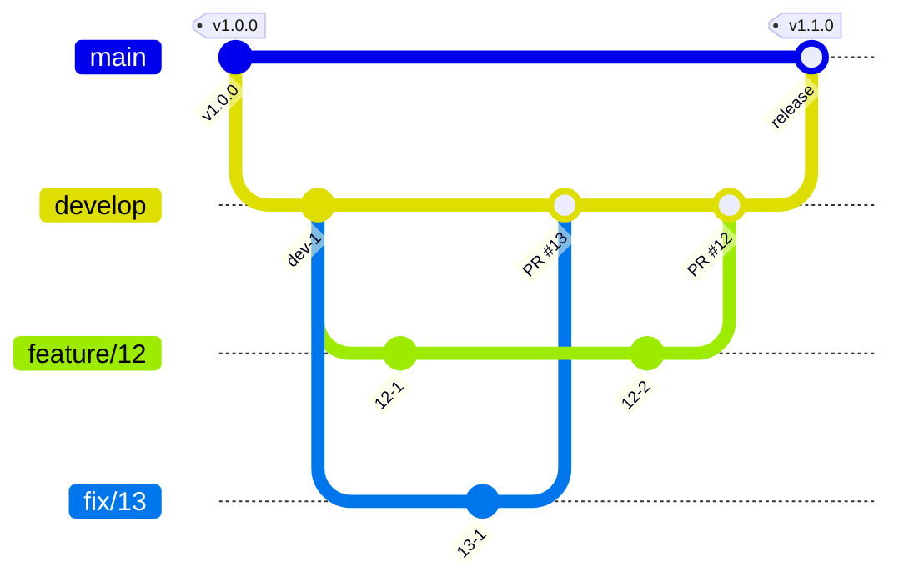

# 開発の準備

<!-- 次は既定。バージョンの管理に mise を使わないなら書き換える。必要なランタイムとツールの名前、最初に実行するコマンド -->

必要なものは mise である。ランタイムとツールのバージョンは `mise.toml` にある。文書のサイトを組む Zensical は、mise が入れる `uv` で動かす。

```sh
mise install
```

<!-- 次は apm で導入した場合。コーディングエージェントの標準の方法で導入したなら、その導入の手順に書き換える -->

スキルとフックは apm で配置し、Git で追跡しない。clone した後の最初のセッションで、セッションの開始のフックが配置する。手で配置するときは次を実行する。

```sh
apm install --frozen
```

`apm install` の後に配置先を `.gitignore` に足す post-install は、マシンごとに 1 度信頼させる。

```sh
apm lifecycle trust
```

## 手元で全部を動かす

画面、2 つの API、MySQL、Valkey、開発用の OIDC の IdP は、リポジトリのルートの `compose.yml` で一緒に起動する。Docker が要る。

```sh
docker compose up --build --wait
```

`--wait` は、全てのサービスのヘルスチェックが通るまで待つ。schedule-api は、起動の前にマイグレーションとシードを当てる。シードは、事業所の行が既にあれば当てない。

ポートは `127.0.0.1` にだけ公開する。

| サービス | 手元の URL | ポートを変える環境変数 |
| --- | --- | --- |
| web | `http://localhost:3000` | `WEB_PORT` |
| schedule-api | `http://localhost:8080` | `SCHEDULE_API_PORT` |
| receipt-api | `http://localhost:8090` | `RECEIPT_API_PORT` |
| idp | `http://localhost:9000/buddy` | `IDP_PORT` |
| mysql | `localhost:13306` | `MYSQL_PORT` |
| valkey | `localhost:6379` | `VALKEY_PORT` |

- IdP は navikt/mock-oauth2-server である。ログインの画面で入れた名前が `sub` になり、ほかのクレームは `compose/idp.json` の値になる。
  - 既定のクレームは、シードの職員の青木 陽菜（組織 `org-sample`）を指す。ほかの職員で入るときは、ログインの画面のクレームの欄に `{"email": "kenta.mori@example.com"}` のように書く。クレームの欄の値は、既定のクレームを上書きする。
  - 職員ごとに別の名前で入る。schedule-api は、初回のログインで `sub` を職員に結び付けるため、同じ名前でメールを替えても最初の職員として扱う。
- API が受けるトークンの `iss` は `http://idp:9000/buddy` である。IdP は `iss` をトークンの要求の Host から決めるため、トークンはコンテナの間の名前 `idp` で取る。
- `http://localhost:3000` を開くと IdP のログインの画面へ移る。名前に `dev-aoki` を入れると、青木 陽菜としてログインする。
- データを消して最初からにするときは、`docker compose down -v` で MySQL のボリュームを消す。

予定の API を手で呼ぶときは、認可コードのフローでトークンを取る。

```sh
CODE=$(curl -s -o /dev/null -w '%{redirect_url}' -X POST \
  'localhost:9000/buddy/authorize?client_id=web&response_type=code&redirect_uri=http://localhost:3000/cb&scope=openid&state=s' \
  -d username=dev-aoki | sed -E 's/.*code=([^&]+).*/\1/')
TOKEN=$(docker compose exec -T idp wget -qO- --post-data "grant_type=authorization_code&code=$CODE&redirect_uri=http://localhost:3000/cb&client_id=web&client_secret=web-dev" \
  http://idp:9000/buddy/token | jq -r .access_token)
curl -H "Authorization: Bearer $TOKEN" localhost:8080/v1/facilities/01M3TC5H00QV17BC0J9V3393ZP
```

## 文書を直すとき

PRD、Design Doc、ADR は `docs/` にあり、Zensical のサイトとして読む。
Zensical は `uv` で入れ、バージョンは `pyproject.toml` と `uv.lock` にある。

```sh
uv run zensical serve   # http://localhost:8000 で読みながら直す
uv run zensical build   # 出力の最後が "No issues found" になることを確かめる
```

- `zensical build` は、リンクの先のページと見出しのアンカーがないと "Warning" を出す。警告が残ったまま取り込まない。
- 画面仕様書かワイヤーフレーム（`docs/screens/wireframes/`）を直したら、`pnpm check:screens` で、表の構成番号と `data-ref` が食い違っていないことを確かめる。
- ページを足したら、`zensical.toml` の `nav` に足す。`nav` にないページはナビゲーションから開けない。
- 機能ごとの Design Doc は、コードの隣（`apps/<アプリ>/DesignDoc.md`）に置く。サイトには、`docs/design/apps/<アプリ>.md` のファイル単位のシンボリックリンクを置き、`nav` に足して載せる。
  - 機能ごとの Design Doc から `docs/` と `apps/` の文書へのリンクは、GitHub の `develop` の URL で書く。相対リンクは、GitHub とサイトで指す先が変わり、どちらかで切れるためである。

## API の定義を変えるとき

各 API の定義の正本は、`apps/schedule-api/openapi.yaml` と `apps/receipt-api/openapi.yaml` である。サーバーの Go のコードと画面の型は、そこから生成してコミットする。  
openapi.yaml を変えたら、同じコミットで生成物も生成し直す。

| 変えたもの | 生成のコマンド | 生成物 |
| --- | --- | --- |
| `apps/receipt-api/openapi.yaml` | `apps/receipt-api` で `go generate ./...` | `apps/receipt-api/internal/httpapi/openapi/` |
| `apps/schedule-api/openapi.yaml` | `apps/schedule-api` で `go generate ./...` | `apps/schedule-api/internal/presentation/http/openapi/` |
| `apps/schedule-api/db/` の SQL | `apps/schedule-api` で `sqlc generate` | `apps/schedule-api/internal/infrastructure/mysql/sqlcgen/` |
| どちらかの openapi.yaml | `pnpm --filter @buddy/web generate:api` | `apps/web/src/api/generated/` |

取り込む前に、生成物がそろっているかをリポジトリのルートで確かめる。全ての生成を流し直し、差分か追跡していない生成物があれば 1 で終わる。

```sh
pnpm check:generated
```

## コミットするとき

- commit-msg のフックが、メッセージの形式を commitlint で確かめる。形式は `commitlint.config.mjs` にある。フックは `pnpm install` の `prepare` が入れる。
- 変更の分け方とメッセージの書き方は、スキル write-commit に従う。

## ブランチとリリース

<!-- 次は既定の運用。運用が違えば本文と図を書き換える -->

ブランチは、`main`、`develop`、issue ごとの作業用のブランチにする。

- `main` はリリース済みの状態を指す。`develop` は次のリリースに向けて変更を集める。
- 作業用のブランチは `develop` から切る。名前は `feature/<issue 番号>` にし、不具合は `fix/<issue 番号>` にする。`develop` へは、pull request を通して取り込む。
- リリースは、`develop` を `main` へ pull request で取り込み、`main` のコミットにタグを付ける。バージョンはセマンティック バージョニングに従う。
- リリース後の緊急の修正は、`main` から `hotfix/<issue 番号>` を切り、`main` と `develop` の両方へ取り込む。
- 保護するブランチは `main`、`develop` である。直接はコミットせず、pull request を通して取り込む。直接コミットを許す場面があれば、この行の下に場面と理由を書く。
  - リポジトリを作った直後の、agent-harness の導入のコミットだけは `main` へ直接積んだ。`develop` はこのコミットから切った。

<!-- 次のバージョンを何から決めるか。コミットメッセージからなら release-please、変更ごとの記述からなら changesets -->



## issue と pull request

<!-- issue の種類とラベル、pull request との対応 -->

- 作業は issue から始める。pull request は 1 つの issue に対応させる。
- 題と本文の書き方は、スキル write-issue-pr に従う。
