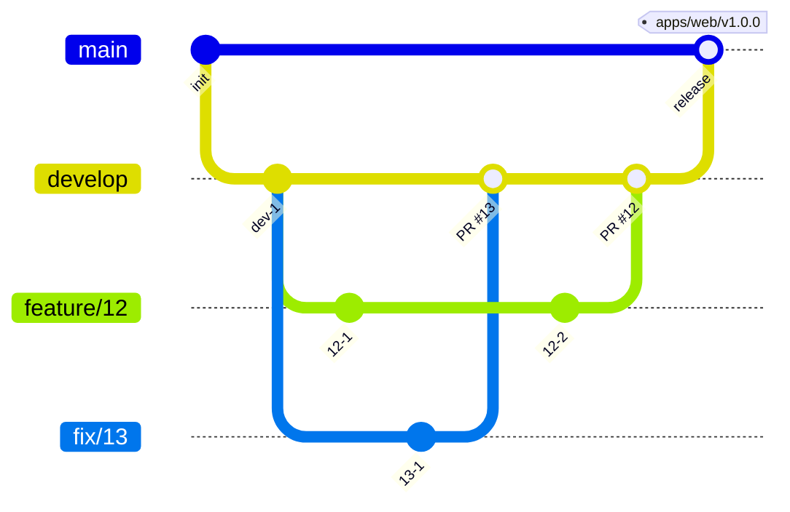

# 変更を取り込むまで

## 開発の準備

必要なものは mise と Docker である。ランタイムとツール（Node、pnpm、Go、sqlc、golang-migrate、golangci-lint、uv、apm）のバージョンは `mise.toml` にある。pnpm は `package.json` の `packageManager` と同じバージョンにする。文書のサイトを組む Zensical は、mise が入れる `uv` で動かす。

```sh
mise install
pnpm install
```

アプリとパッケージの README は、「準備、動かす、テストとチェック、コードの生成、文書」の順に見出しを置き、当てはまらない節は省く。

`pnpm install` の `prepare` が、lefthook の Git のフック（commit-msg の commitlint、pre-commit の textlint）を入れる。

Go のモジュールは `apps/schedule-api`、`apps/receipt-api` と、2 つの API が共有するコードの `packages/go` の 3 つである（[ADR-0007](docs/adr/0007-go-shared-module.md)）。2 つの API は `packages/go` を `go.mod` の `replace` で読む。エディタで 3 つを読むときは、ルートで `go work init ./apps/receipt-api ./apps/schedule-api ./packages/go` を流す。`go.work` は追跡しない。3 つのモジュールが共有する依存のバージョンが高い方にそろい、コンテナのイメージ（各 `go.mod` だけでビルドする）とずれるためである。テストと lint は、各アプリと `packages/go` のディレクトリで `GOWORK=off` を付けて流す。`packages/go` を変えたときは、2 つの API のテストも流す。`go.work` の下でビルドすると各アプリの `go.sum` に行が増えるので、コミットに含めない。

スキルとフックは apm で配置し、Git で追跡しない。clone した後の最初のセッションで、セッションの開始のフックが配置する。手で配置するときは次を実行する。

```sh
apm install --frozen
```

`apm install` の後に配置先を `.gitignore` に足す post-install は、マシンごとに 1 度信頼させる。

```sh
apm lifecycle trust
```

## 手元で全部を動かす

画面、2 つの API、MySQL、Valkey、開発用の OIDC の IdP は、リポジトリのルートの `compose.yml` で一緒に起動する。Docker が要る。

```sh
docker compose up --build --wait
```

`--wait` は、全てのサービスのヘルスチェックが通るまで待つ。schedule-api は、起動の前にマイグレーションとシードを当てる。シードは、事業所の行が既にあれば当てない。

ポートは `127.0.0.1` にだけ公開する。

| サービス | 手元の URL | ポートを変える環境変数 |
| --- | --- | --- |
| web | `http://localhost:3000` | `WEB_PORT` |
| schedule-api | `http://localhost:8080` | `SCHEDULE_API_PORT` |
| receipt-api | `http://localhost:8090` | `RECEIPT_API_PORT` |
| idp | `http://localhost:9000/buddy` | `IDP_PORT` |
| mysql | `localhost:13306` | `MYSQL_PORT` |
| valkey | `localhost:6379` | `VALKEY_PORT` |

- IdP は navikt/mock-oauth2-server である。ログインの画面で入れた名前が `sub` になり、ほかのクレームは `compose/idp.json` の値になる。
  - 既定のクレームは、シードの職員の青木 陽菜（組織 `org-sample`）を指す。ほかの職員で入るときは、ログインの画面のクレームの欄に `{"email": "kenta.mori@example.com"}` のように書く。クレームの欄の値は、既定のクレームを上書きする。
  - 職員ごとに別の名前で入る。schedule-api は、初回のログインで `sub` を職員に結び付けるため、同じ名前でメールを替えても最初の職員として扱う。
- API が受けるトークンの `iss` は `http://idp:9000/buddy` である。IdP は `iss` をトークンの要求の Host から決めるため、トークンはコンテナの間の名前 `idp` で取る。
- `http://localhost:3000` を開くと IdP のログインの画面へ移る。名前に `dev-aoki` を入れると、青木 陽菜としてログインする。
- データを消して最初からにするときは、`docker compose down -v` で MySQL のボリュームを消す。

予定の API を手で呼ぶときは、認可コードのフローでトークンを取る。

```sh
CODE=$(curl -s -o /dev/null -w '%{redirect_url}' -X POST \
  'localhost:9000/buddy/authorize?client_id=web&response_type=code&redirect_uri=http://localhost:3000/cb&scope=openid&state=s' \
  -d username=dev-aoki | sed -E 's/.*code=([^&]+).*/\1/')
TOKEN=$(docker compose exec -T idp wget -qO- --post-data "grant_type=authorization_code&code=$CODE&redirect_uri=http://localhost:3000/cb&client_id=web&client_secret=web-dev" \
  http://idp:9000/buddy/token | jq -r .access_token)
curl -H "Authorization: Bearer $TOKEN" localhost:8080/v1/facilities/01M3TC5H00QV17BC0J9V3393ZP
```

## E2E のテストを流す

E2E のテストは `packages/e2e` にあり、ルートの compose で立てた全体に向けて流す。初めて流すときは、Playwright のブラウザを入れる。

```sh
pnpm --filter @buddy/e2e exec playwright install chromium
docker compose up --build --wait
pnpm e2e
```

- 書き方は、スキル write-e2e-test に従う。書いたら `pnpm --filter @buddy/e2e check` で、整形、lint、E2E の書き方の規則、型を確かめる。
- 環境変数と、テストのデータの扱いは `context/testing.md` の E2E の節にある。
- 失敗したテストの trace は `packages/e2e/test-results/` に残る。`pnpm --filter @buddy/e2e exec playwright show-trace <trace.zip>` で開く。trace.zip は、`packages/e2e` からの相対パス（Playwright が出す `test-results/...`）で渡す。

## 公開した文書のサイトとカタログを確かめる

pull request を作ると、ワークフロー「文書のサイト」が、文書のサイトと Storybook のカタログ（`/storybook/`）のプレビューを出し、URL を pull request にコメントする。プレビューと本番は、Cloudflare Access で許可した人だけが開ける。

- 手元で成果物を作るときは、ルートで `pnpm site:build` を実行する。
- 公開の仕組みと Cloudflare の準備は、[apps/docs-site/README.md](apps/docs-site/README.md) にある。

## 文書を直すとき

PRD、Design Doc、ADR は `docs/` にあり、Zensical のサイトとして読む。
Zensical は `uv` で入れ、バージョンは `pyproject.toml` と `uv.lock` にある。

```sh
uv run zensical serve   # http://localhost:8000 で読みながら直す
uv run zensical build   # 出力の最後が "No issues found" になることを確かめる
```

- `zensical build` は、リンクの先のページと見出しのアンカーがないと "Warning" を出す。警告が残ったまま取り込まない。
- 画面仕様書かモックを直したら、`pnpm check:screens` を流す。[画面仕様書の規約](docs/screens/rules.md) の名前、構造、構成番号、`data-testid` の形と、E2E が使う testid がモックにあるかを確かめる。1 つの画面だけを見るときは `node scripts/check-screens.mjs docs/screens/<ディレクトリ>` を流す（E2E の testid の照合は流れない）。
- ページを足したら、`zensical.toml` の `nav` に足す。`nav` にないページはナビゲーションから開けない。
- 機能ごとの Design Doc は、コードの隣（`apps/<アプリ>/DesignDoc.md`）に置く。サイトには、`docs/design/apps/<アプリ>.md` のファイル単位のシンボリックリンクを置き、`nav` に足して載せる。
  - 機能ごとの Design Doc から `docs/` と `apps/` の文書へのリンクは、GitHub の `develop` の URL で書く。相対リンクは、GitHub とサイトで指す先が変わり、どちらかで切れるためである。

文章の規則は textlint で、経緯の混入とリンクは docs のスクリプトで確かめる。指摘された語は言い換え、`--fix` は使わない。プロジェクトの用語と見出しの語が指摘されたときは、言い換えずに、`.textlintrc.json` の `allows` に足すかをメンテナーと決める。

```sh
pnpm exec textlint "**/*.md"
node .claude/hooks/docs/hooks/check-history.mjs
node .claude/hooks/docs/hooks/check-links.mjs
```

- pre-commit のフックが、ステージした Markdown に textlint を流す。
- `.textlintignore` は、Git で追跡しないものと、`docs/design/` の下のシンボリックリンクを外す。シンボリックリンクの先の文書は、元の場所で確かめる。
- `docs/` のスクリプトは apm が `.claude/hooks/docs/` に配置する。無ければ `apm install --frozen` を流す。

`verified_commit` の後に実装が変わった文書は、`node .claude/hooks/docs/hooks/list-drift.mjs` で一覧する。実装と読み比べてから `verified_commit` を進める。

## API の定義を変えるとき

各 API の定義の正本は、`apps/schedule-api/openapi.yaml` と `apps/receipt-api/openapi.yaml` である。サーバーの Go のコードと画面の型は、そこから生成してコミットする。  
openapi.yaml を変えたら、同じコミットで生成物も生成し直す。

| 変えたもの | 生成のコマンド | 生成物 |
| --- | --- | --- |
| `apps/receipt-api/openapi.yaml` | `apps/receipt-api` で `go generate ./...` | `apps/receipt-api/internal/httpapi/openapi/` |
| `apps/schedule-api/openapi.yaml` | `apps/schedule-api` で `go generate ./...` | `apps/schedule-api/internal/httpapi/openapi/` |
| `apps/schedule-api/db/` の SQL | `apps/schedule-api` で `sqlc generate` | `apps/schedule-api/internal/mysql/sqlcgen/` |
| どちらかの openapi.yaml | `pnpm --filter @buddy/web generate:api` | `apps/web/src/api/generated/` |
| `packages/ui/src/tokens/semantic.css`、`@digital-go-jp/design-tokens` | `node scripts/build-mock-tokens.mjs` | `docs/screens/_common/tokens.css`（画面のモックが読む） |

取り込む前に、生成物がそろっているかをリポジトリのルートで確かめる。全ての生成を流し直し、差分か追跡していない生成物があれば 1 で終わる。

```sh
pnpm check:generated
```

## 取り込む前に CI で確かめること

pull request では、CI（`.github/workflows/ci.yml`）が、lint、型、単体のテスト、Go のテストと lint、生成物のそろい、E2E を流す。全部が通るまで取り込まない。確かめることの一覧と、変更ごとに手元で流すテストは `context/testing.md` の Required Tests にある。

E2E が CI だけで失敗したときは、ワークフローの実行の画面から artifact の `e2e-test-results` を落とし、中の trace を「E2E のテストを流す」の手順で開く。

## コミットするとき

- commit-msg のフックが、メッセージの形式を commitlint で確かめる。形式は `commitlint.config.mjs` にある。フックは `pnpm install` の `prepare` が入れる。
- 変更の分け方とメッセージの書き方は、スキル write-commit に従う。

## ブランチとリリース

ブランチは、`main`、`develop`、issue ごとの作業用のブランチにする。運用とリリースの方針を決めた理由は [ADR-0003](docs/adr/0003-branch-and-release.md) にある。

- `main` はリリース済みの状態を指す。`develop` は次のリリースに向けて変更を集める。
- 検証環境ができたら、`develop` の状態を検証環境に、`main` の状態を本番環境に反映する。今は検証環境が無く、手元の compose で確かめる。
- 作業用のブランチは `develop` から切る。名前は `feature/<issue 番号>` にし、不具合は `fix/<issue 番号>` にする。1 つの issue を複数の pull request に分けるときは、`feature/<issue 番号>-<短い名前>` にする。
- リリースは、検証した `develop` を `main` へ pull request で取り込み、`main` のコミットにアプリごとのタグを付ける。タグは `apps/<アプリ>/vX.Y.Z` の形で、バージョンはセマンティック バージョニングに従う。リリースの仕組みはまだ無く、タグは手で付ける。
- API の互換の規則（項目の追加は同じパス、削除と意味の変更は新しいパス、API を先にデプロイする）は ADR-0003 にある。
- リリース後の緊急の修正は、`main` から `hotfix/<issue 番号>` を切り、`main` と `develop` の両方へ取り込む。
- 保護するブランチは `main`、`develop` である。直接はコミットせず、pull request を通して取り込む。
  - リポジトリを作った直後の、agent-harness の導入のコミットだけは `main` へ直接積んだ。`develop` はこのコミットから切った。



## issue と pull request

- 作業は issue から始める。issue は、雛形（`.github/ISSUE_TEMPLATE/`）の要求、不具合、タスクから選ぶ。種類は `type:` のラベル、対象のアプリとパッケージは `pkg:` のラベルで示す。
- pull request は 1 つの issue に対応させる。大きい issue は、関心事ごとに複数の pull request に分け、本文で issue を `Refs #<番号>` で指す。
- 題と本文の書き方は、スキル write-issue-pr に従う。本文は `.github/pull_request_template.md` の節で書く。
- レビューの指摘に対応してから取り込む。直したコミットと、対応しない指摘の理由を pull request のコメントに残す。差分が変わったら、本文も差分に合わせて直す。
- `develop` への取り込みは merge commit にする（`gh pr merge --merge`）。
- 既定のブランチは `develop` である。1 つの pull request で issue の作業が終わるときは、本文に `Closes #<番号>` を書き、取り込みで issue を閉じる。複数の pull request に分けたときは、最後の pull request に `Closes` を書く。
