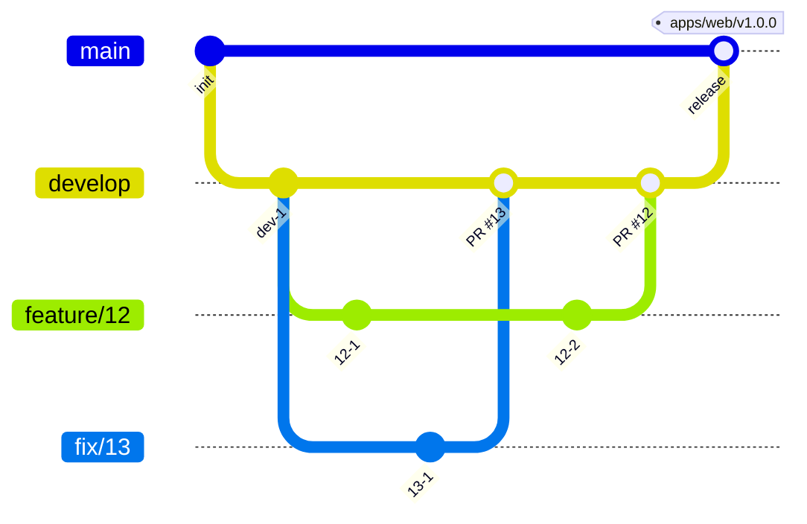

# Contributing

## Prerequisites

- mise
- Docker
- jq

## Setup

```sh
mise install
pnpm install
```

`pnpm install` が、lefthook の Git のフックを入れる。

mise が gh の attestation の確認で `error decoding response body` を出して失敗することがある。  
そのときは、エラーに出た zip を `gh attestation verify <zip> --repo cli/cli` で確認してから、確認を外して入れる。

```sh
MISE_AQUA_GITHUB_ATTESTATIONS=false mise install aqua:cli/cli
```

### Go のモジュール

- エディタで Go の 4 つのモジュールを読むときは、ルートで `go work init ./services/receipt ./services/schedule ./services/broker ./packages/go` を流す。
- `go.work` は追跡しない。
  - `go.work` の下では、4 つのモジュールが共有する依存のバージョンが高い方にそろい、コンテナのイメージ（各 `go.mod` だけでビルドする）とずれるためである。
- テストと lint は、各モジュールのディレクトリで `GOWORK=off` を付けて流す。
- `packages/go` を変えたときは、2 つの API とブローカーのテストも流す。
- `go.work` の下でビルドすると各 API の `go.sum` に行が増える。増えた行はコミットに含めない。

### スキルとフック

agent-harness のスキルとフックは apm で配置し、Git で追跡しない。  
文書の編集の後のフック（`.claude/hooks/docs/`）も apm が配置する。  
Claude Code か Codex を使うときは、clone した後の最初のセッションで、セッションの開始のフックが配置する。  
コーディングエージェントを使わないときは、手で配置する。

```sh
apm install --frozen
```

`apm install` の後に配置先を `.gitignore` に足す post-install は、マシンごとに 1 度信頼させる。

```sh
apm lifecycle trust
```

## Running Locally

画面、API、ID ブローカーと、それらが使うサービスを、ルートの `compose.yml` で一緒に起動する。

```sh
docker compose up --build --wait
```

ポートは `127.0.0.1` にだけ公開する。

| サービス | ローカルの URL | ポートを変える環境変数 |
| --- | --- | --- |
| web | `http://localhost:3000` | `WEB_PORT` |
| schedule | `http://localhost:8080` | `SCHEDULE_PORT` |
| schedule-calendar-export、schedule-calendar-sync（Google カレンダーの書き出しと同期の Worker） | 公開しない | なし |
| receipt | `http://localhost:8090` | `RECEIPT_PORT` |
| broker（ログインの画面） | `http://localhost:8100` | `BROKER_PORT` |
| broker（内部の API） | `http://localhost:8101` | `BROKER_INTERNAL_PORT` |
| hydra（public API と admin API） | `http://localhost:4444`、`http://localhost:4445` | `HYDRA_PUBLIC_PORT`、`HYDRA_ADMIN_PORT` |
| idp（上流の IdP のフェイク。事業所ごとに `/office-a`、`/office-b`、`/office-c`、`/office-d`） | `http://localhost:9000` | `IDP_PORT` |
| postgres | `localhost:15432` | `POSTGRES_PORT` |
| valkey | `localhost:6379` | `VALKEY_PORT` |
| calendarpit（Google Calendar API のフェイク） | `http://localhost:4173` | `CALENDARPIT_PORT` |
| gcalhold（予定の API と calendarpit の間の中継） | `http://localhost:8085` | `GCALHOLD_PORT` |

- `http://localhost:3000` を開き、ブローカーのログインの画面でメールに `hina.aoki@example.com` を入れる。
  - 上流の IdP のフェイクの画面で、クレームの欄に `{"email": "hina.aoki@example.com", "email_verified": true}` を書いて入ると、青木 陽菜（マネージャー）としてログインする。
  - クレームのメールが無いときと、ブローカーで入れたメールと違うときは、ログインの失敗の画面になる。
  - フェイクの画面の名前の欄の値は、初回のログインで職員に結び付く。以後は同じ値で入る。
    - 別の値で入るときは、`docker compose down -v` でデータを消す。
- シードの職員のメールは次のとおり。
  - 1 つ目の事業所（組織 `org-sample`）: `hina.aoki@example.com`（青木 陽菜、マネージャー）、`kenta.mori@example.com`（森 健太、チームリーダー）
    - ほかに `sakura.hayashi@example.com` と `misaki.sato@example.com` がいる
    - `yui.nakamura@example.com`（中村 結衣、事務）は訪問しない職員である
      - 予定のカレンダーの職員の列と、予定と担当の候補に出ない。
      - 照合の画面を開ける。
  - 2 つ目の事業所（組織 `org-sample-b`）: `nagisa.ueno@example.com`（上野 渚、マネージャー）
    - ほかに、休職の職員の `takumi.ono@example.com`（小野 拓海）がいる
      - ログインすると、ログインの失敗の画面になる。
  - 1 つ目と 2 つ目の事業所は、buddy を予定の正本にする（`buddy_primary`）。
  - 3 つ目の事業所（組織 `org-sample-c`）: `aoi.okada@example.com`（岡田 葵、マネージャー）
    - Google カレンダーを予定の正本にする（`google_primary`）。予定の API は、予定の作成、変更、キャンセルと取り込みを 409 で拒む。
    - 岡田に calendarpit のカレンダー `aoi.okada@example.com` を結び付けてある。同期の Worker は、このカレンダーの予定を参照のモデル（`calendar_event_projections`）に写す。
  - 4 つ目の事業所（組織 `org-sample-d`）: `ren.ishida@example.com`（石田 蓮、マネージャー）
    - 3 つ目と同じく `google_primary` で、石田に calendarpit のカレンダー `ren.ishida@example.com` を結び付けてある。
    - 予定の正本の切り替えを確認するのに使う。切り替えを完了すると `buddy_primary` に移り、戻せない。戻すときは `docker compose down -v` で作り直す。
  - 1 つ目と 2 つ目の事業所のカレンダーは、同期が読まない。Google カレンダーでの変更は buddy の予定に当たらない。
  - シードは、空の DB にだけ適用される。
    - シードを変えた後は、`docker compose down -v` で作り直す。
- 照合の画面で、予定の取り方に「Google カレンダー」を、対象の月に `2026-11` を選ぶと、calendarpit の森 健太のカレンダーの予定で照合できる。
- データを消して最初からにするときは、`docker compose down -v` でボリュームを消す。
- 別の worktree で同時に起動するときは、`docker compose -p <名前> up --build --wait` でプロジェクトの名前を変え、表の環境変数でポートをずらす。
  - E2E は、ずらしたポートに URL の環境変数を合わせて流す。
    - 画面と外部のサービスは `E2E_BASE_URL`、`E2E_CALENDARPIT_URL`、`E2E_GCALHOLD_URL`、`E2E_HYDRA_URL`
    - API とブローカーは `E2E_SCHEDULE_URL`、`E2E_BROKER_URL`、`E2E_BROKER_INTERNAL_URL`

### API を手で呼ぶ

`compose/dev-token.sh` で、引数のメールの職員の access token を取る。  
ポートを変えて起動したときは、同じ環境変数を渡す。

```sh
TOKEN=$(compose/dev-token.sh hina.aoki@example.com)
curl -H "Authorization: Bearer $TOKEN" localhost:8080/v1/facilities/01M3TC5H00QV17BC0J9V3393ZP
```

照合の API も、同じトークンで呼べる。  
`month` を送ると、calendarpit の森 健太のカレンダーのその月の予定と照合する。

```sh
curl -H "Authorization: Bearer $TOKEN" -F visits=@services/receipt/testdata/visits_utf8.csv -F month=2026-11 localhost:8090/v1/checks
```

ドキュメントサイトの API の仕様のページからも、ローカルの API を呼べる。  
公開したドキュメントサイトからは呼べない。

1. `docker compose up --build --wait schedule receipt` で API を立てる。
2. `uv run zensical serve` で、ドキュメントサイトを `http://localhost:8000` で開く。
   - `127.0.0.1` で開くと、CORS で失敗する。
3. 「API の仕様」のページで操作を選び、「Test Request」を押す。
4. `$TOKEN` の値を「Bearer Token」の欄に貼り、「Send」を押す。

## E2E Tests

初めて流すときは、Playwright のブラウザを入れる。

```sh
pnpm --filter @buddy/e2e exec playwright install chromium
docker compose up --build --wait
pnpm e2e
```

- 書いたら `pnpm --filter @buddy/e2e check` を流す。
- 環境変数と、テストのデータの扱いは [E2E のテスト](context/testing/e2e.md) にある。
- エビデンスの動画を撮る spec は、`pnpm e2e` では流れない。
  - 撮るコマンドは [エビデンス](context/testing/evidence.md) の Capture Environment にある。
- 失敗したテストの trace は `packages/e2e/test-results/` に残る。
  - `pnpm --filter @buddy/e2e exec playwright show-trace <trace.zip>` で開く。
  - trace.zip は、`packages/e2e` からの相対パス（Playwright が出す `test-results/...`）で渡す。

## Docs Site

pull request では、ドキュメントサイトのプレビューを出さない。  
変更が develop に入ると、本番のドキュメントサイトに出る。  
ADR-0004: [デザインシステムのトークンを DADS の基本、buddy の意味、Tailwind のテーマの 3 段にし、カタログをドキュメントサイトと同じ Worker で出す](docs/adr/0004-design-system.md)

- マージする前に公開した形で見るときは、ルートでサイトを組み立て、静的なファイルとして配信して開く。

  ```sh
  pnpm site:build
  uv run python -m http.server 8002 --bind 127.0.0.1 -d apps/docs-site/public   # http://127.0.0.1:8002 で開く
  ```

- ER 図だけを見るときは、`erd/` を作って配信する。

  ```sh
  pnpm build:erd
  uv run python -m http.server 8001 --bind 127.0.0.1 -d erd   # http://127.0.0.1:8001 で開く
  ```

  - テーブルを変えたときは、先に `pnpm generate:db-docs` を流す。

- デプロイの構成と Cloudflare のセットアップは、[apps/docs-site/README.md](apps/docs-site/README.md) にある。

## Editing Documents

```sh
uv run zensical serve   # http://localhost:8000 で読みながら直す
uv run zensical build   # 出力の最後が "No issues found" になることを確認する
```

- `zensical build` の "Warning" が残ったままマージしない。
  - "Warning" は、リンクの先のページか見出しのアンカーがないと出る。
- ページを足したら、`zensical.toml` の `nav` に足す。
- 機能ごとの Design Doc の配置先、サイトへの載せ方、リンクの書き方は、[コードと文書の規約](context/conventions.md#documents) にある。
- 画面仕様書かモックを直したときと、story の `title` か export の名前を変えたときは、`pnpm check:screens` を流す。
  - 1 つの画面だけを見るときは `node scripts/check-screens.mjs docs/screens/<ディレクトリ>` を流す。
    - ディレクトリを指定すると、E2E の testid の照合は流れない。
  - モックの `data-testid` を実装に合わせるときは、実装の testid を `rg -n 'data-testid' apps/web/src` で集める。

文書のチェックは次の 3 つ。  
CI の `docs` のジョブが、pull request と develop への push で、同じ 3 つを流す。

```sh
pnpm exec textlint "**/*.md"
node scripts/check-history.mjs
node scripts/check-links.mjs
```

- `scripts/check-history.mjs`、`scripts/check-links.mjs`、`scripts/doc-checks.mjs` は、agent-harness の docs のパッケージから写したものである。
  - apm が置く `.claude/hooks/docs/` は Git の外にあり、CI の機械に無いためである。
  - `apm.yml` の docs のパッケージを上げたときは、3 つのファイルを `.claude/hooks/docs/hooks/` の同じ名前のファイルと読み比べ、変わった処理を写す。
- textlint に指摘された語は言い換える。
- textlint の `--fix` は使わない。
- プロジェクトの用語と見出しの語が指摘されたときは、言い換えずに、`.textlintrc.json` の `allows` に足すかをメンテナーと決める。

`verified_commit` の後に実装が変わった文書は、`node .claude/hooks/docs/hooks/list-drift.mjs` で一覧する。  
実装と読み比べてから `verified_commit` を進める。

## Editing the Design System

使い方の規則は [packages/ui/DESIGN.md](packages/ui/DESIGN.md) にある。  
トークンを直すときは、スキル write-design-system に従う。  
意味のトークン（`packages/ui/src/tokens/semantic.css`）か DADS のバージョンを変えたら、次を流し、生成した `docs/screens/_common/tokens.css` を同じコミットに入れる。

```sh
pnpm check:contrast   # 意味のトークンの組が WCAG 2.2 のコントラスト比の基準に届くか
pnpm build:tokens     # 画面のモックとドキュメントサイトが読む tokens.css を作り直す
```

- 組を足すときと外すときは、`scripts/check-contrast.mjs` の冒頭の `TEXT_PAIRS` と `NON_TEXT_PAIRS` を直す。

ID ブローカーの画面（`apps/broker/src`）か、`packages/ui` のトークンとコンポーネントを変えたら、ID ブローカーの画面を生成し直す。  
生成した `services/broker/internal/login/pages/` は、同じコミットに入れる。

```sh
pnpm --filter @buddy/broker generate   # ID ブローカーの画面のテンプレートと CSS を作り直す
```

画面（`apps/web/src`）と `packages/ui/src` のコンポーネントのコードを変えたら、DESIGN.md の「画面を作るときの原則」に反する書き方がないかを確認する。  
pre-commit のフックと CI も同じチェックを流す。

```sh
pnpm check:design   # 色の値、DADS の変数の名前、14px より小さい文字、focus-ring 以外のフォーカスの表示、余白の任意値
```

- ロゴのように値が外で決まる行だけは、同じ行のコメントに `design-system-allow` と理由を書いて外す。
- 次の 3 つは、agent-harness のパッケージ design-system のテンプレートを写したものである。
  - `scripts/check-contrast.mjs`、`scripts/build-static-tokens.mjs`、`scripts/check-raw-values.mjs`
  - パッケージを上げたら、スキル setup-design-system の手順で差分を見て取り込む。

## Changing the API Definition

各 API の定義の正本は、`services/schedule/openapi.yaml` と `services/receipt/openapi.yaml` である。  
openapi.yaml を変えたら、`pnpm lint:openapi` を流し、同じコミットで生成物も生成し直す。  
定義の書き方の規約は、[コードと文書の規約](context/conventions.md#api-definitions) にある。  
項目の削除と意味の変更は、互換なしとして新しいパスで出す。  
ADR-0003: [モノレポを git flow でマージし、画面を apps/ に、API を services/ に置き、ディレクトリの名前でタグとサービスの名前をそろえる](docs/adr/0003-branch-and-release.md)

| 変えたもの | 生成のコマンド | 生成物 |
| --- | --- | --- |
| `services/receipt/openapi.yaml` | `services/receipt` で `go generate ./...` | `services/receipt/internal/httpapi/openapi/` |
| `services/schedule/openapi.yaml` | `services/schedule` で `go generate ./...` | `services/schedule/internal/httpapi/openapi/` |
| `services/schedule/db/` の SQL | `services/schedule` で `sqlc generate` | `services/schedule/internal/postgres/sqlcgen/` |
| どちらかの openapi.yaml | `pnpm --filter @buddy/web generate:api` | `apps/web/src/api/generated/` |
| `services/schedule/db/migrations/`、`services/schedule/.tbls.yml` | `pnpm generate:db-docs`（Docker が要る） | `docs/db/schedule/`（テーブル定義書と ER 図） |
| `packages/ui/src/tokens/semantic.css`、`@digital-go-jp/design-tokens` | `pnpm build:tokens` | `docs/screens/_common/tokens.css` |

テーブルを足したときは、`.tbls.yml` の `viewpoints` のどれかに入れる。  
viewpoint を足したときは、生成した文書を `zensical.toml` の nav の「DB の設計」にも足す。  
どちらかが抜けていると、`pnpm generate:db-docs` が 1 で終わる。

マージする前に、ルートで生成物がそろっているかを確認する。  
テーブル定義書は、CI の `db-docs` のジョブが確認する。

```sh
pnpm check:generated
```

## CI

pull request では、CI（[ci.yml](.github/workflows/ci.yml)）が通るまでマージしない。  
変更ごとにローカルで流すテストは、[テスト](context/testing.md#required-tests) の Required Tests にある。

- pull request の変更が文書だけのときは、`e2e` と `go` のジョブを飛ばす。
  - 文書だけの変更は、`docs/` の下のファイルと、リポジトリの中の `*.md` だけを変えた変更である。
  - 飛ばしたジョブは、`gh pr checks` で `skipping` と表示され、`--watch` の終了コードを 1 にしない。
  - `typescript`、`generated`、`db-docs`、`docs` のジョブは飛ばさない。
    - `docs/screens/` の画面仕様書とモックは、文書だけの変更でも `typescript` のジョブの `pnpm check:screens` が確認する。
    - `docs` のジョブは、[Editing Documents](#editing-documents) の文書のチェックの 3 つを流す。
- develop への push では、`e2e` のジョブを流さず、ほかのジョブを流す。
  - push の CI は、2 つの pull request を組み合わせたときにだけ起きる失敗を見つけるために流す。
    - `typescript`、`go`、`generated` は、型、テスト、生成物の食い違いを見つける。
    - `db-docs` は、マイグレーションを組み合わせたときのテーブル定義書のずれを見つける。
  - `e2e` は 7 分ほどかかる。組み合わせの失敗は、`typescript` と `generated` が先に見つける。
    - 組み合わせで画面の import が解決できなくなったときは、`e2e` も失敗した。ただし、同じ失敗を `typescript` も見つけていた。
  - develop の `e2e` は、`schedule` で毎日 12:00（JST）に流す。
  - 全てのジョブを手で流すときは、`gh workflow run ci.yml --ref develop` を流す。

- pull request と issue のタイトルと本文の形は、[issue-pr-body.yml](.github/workflows/issue-pr-body.yml) が確認する。
- E2E が CI だけで失敗したときは、ワークフローの実行の画面から artifact の `e2e-test-results` を落とし、中の trace を [E2E Tests](#e2e-tests) の手順で開く。
- ジョブを流すランナーの切り替えは、[基盤と運用](context/operations.md#ci-runners) にある。

## Commits

- commit-msg のフックが、commitlint でメッセージの形式を確認する。
- 変更の分け方とメッセージの書き方は、スキル write-commit に従う。

## Branches and Releases

ブランチは、`main`、`develop`、issue ごとの作業用のブランチにする。  
ADR-0003: [モノレポを git flow でマージし、画面を apps/ に、API を services/ に置き、ディレクトリの名前でタグとサービスの名前をそろえる](docs/adr/0003-branch-and-release.md)

- `main` はリリース済みの状態を指す。
- `develop` は、次のリリースに向けて変更を集める。
- `develop` の状態を検証環境に、`main` の状態を本番環境に反映する。
  - 環境ごとの用途は [基盤と運用](context/operations.md#environments) にある。
  - 検証環境で確認する前の変更と、外部の人が試す変更は、ローカルの compose で確認する。
  - 検証環境と本番環境は、外部の人は開けない。
- 作業用のブランチは `develop` から切る。
  - 名前は `feature/<issue 番号>` にし、不具合は `fix/<issue 番号>` にする。
  - 1 つの issue を複数の pull request に分けるときは、`feature/<issue 番号>-<短い名前>` にする。
- リリースは、検証した `develop` を `main` へ pull request でマージし、`main` のコミットにアプリごとのタグを手で付ける。
  - タグは `<ディレクトリ>/vX.Y.Z`（`apps/web/v1.0.0`、`services/schedule/v1.0.0` など）の形にする。
  - バージョンはセマンティック バージョニングに従う。
- リリース後の緊急の修正は、`main` から `hotfix/<issue 番号>` を切り、`main` と `develop` の両方へマージする。
- 保護するブランチは `main` と `develop` である。
  - 直接はコミットせず、pull request を通してマージする。



## Issues and Pull Requests

- 作業は issue から始める。
  - issue は、issue テンプレートの要求、不具合、タスクから選ぶ。
  - 対象のアプリとパッケージは `pkg:` のラベルで示す。
- タスクと不具合は、親の要求の sub-issue にする。
  - 保守のタスク（依存の更新、Dependabot と CI の設定、開発の環境、規約とテンプレートの直し）は、保守の要求 #220 の sub-issue にする。
  - 不具合は、不具合が起きた機能の要求の sub-issue にする。当てはまる要求が無ければ #220 にする。
    - 不具合の form には親の欄が無いので、起票した後に sub-issue にする。
- タイトルと本文の書き方は、スキル write-issue-pr に従う。
  - pull request の本文は `.github/pull_request_template.md` のセクションで書く。
- 起票の前の下書きは `.ai-out/issues/` か `.ai-out/prs/` に置き、`pnpm exec textlint --ignore-path /dev/null <下書きのパス>` で確認する。
  - check-history と check-links は、下書きには流さない。
- 本文とコメントに、コーディングエージェントが生成したことを示す行（Generated with Claude Code）と、セッションの URL を付けない。
- pull request は 1 つの issue に対応させる。
  - 大きい issue は、関心事ごとに複数の pull request に分ける。
  - 最後にマージする pull request の本文に `Closes #<番号>` を書き、ほかは `Refs #<番号>` を書く。
- 機能の追加と改修の pull request では、本文の「検証とエビデンス」に、観点ごとのエビデンスの動画を入れる。
  - 動作を確認しない変更では、「検証とエビデンス」のセクションを消す。
  - 対象と格納先は [エビデンス](context/testing/evidence.md) に、撮り方と本文への入れ方はスキル attach-evidence にある。
- レビューの指摘に対応してから、[Merging and Cleanup](#merging-and-cleanup) の手順でマージする。
  - Codex のボットは、pull request を開いたときにレビューする。
    - もう一度頼むときは、直したコミットを示す返信の末尾に `@codex review` と書く。
      - `@codex review` だけのコメントを作らない。
  - Codex が使用量の上限に達したときは、頼み直さずに、読み取りだけのサブエージェントでレビューする。
  - サブエージェントのレビューの結果は、1 つのコメントにまとめ、指摘ごとに重要度を付ける。
    - 重要度は、must（マージの前に直す誤り）、imo（直すとよい提案）、nits（表記の小さな直し）、ask（書き手への問い）の 4 つにする。

## Merging and Cleanup

作業用のブランチから `develop` への pull request は、次の順にマージする。  
各段の確認が済むまで、次の段に進まない。

1. レビューの指摘に、直したコミットか対応しない理由を返信する。
2. 本文を差分に合わせて直す。
   - 最後に足したコミットまでが、対応内容、確認したこと、検証とエビデンス（セクションがあるとき）に入っていることを確認する。
3. `gh pr checks <pull request 番号> --watch` で、全てのチェックが pass で終わるまで待つ。
4. `gh pr merge <pull request 番号> --merge` で、merge commit でマージする。
   - push の直後は、マージできるかの計算が終わらずに失敗することがある。数秒待って流し直す。
5. `gh pr view <pull request 番号> --json state` で、`MERGED` になったことを確認する。
   - マージと、リモートのブランチの削除（`git push origin --delete` など）を、`;` でつないで 1 行で流さない。マージが失敗したままリモートのブランチを消すと、pull request が閉じる。
6. `gh issue view <issue 番号> --json state` で、`Closes` の issue が閉じたことを確認する。
   - `Refs` だけの issue は、最後の pull request をマージするまで開いたままにする。
7. 作業用の worktree を `wt remove <ブランチ>` で消す。
   - ブランチが残ったときは、手順 5 で `MERGED` を確認していれば、`wt remove -D <ブランチ>` で消してよい。

`hotfix/<issue 番号>` の pull request は `main` へマージするので、`Closes` を書いても issue が閉じない。  
`Closes` は、`develop` へマージする側の pull request に書く。
