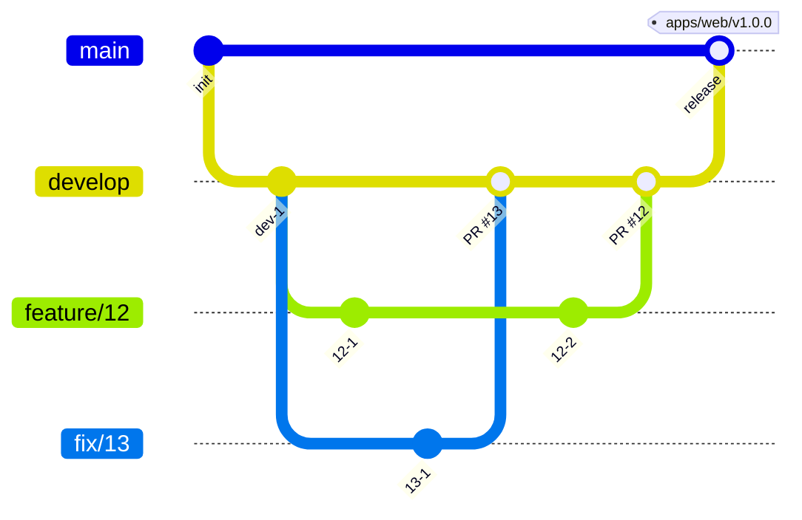

# 変更をマージするまで

## 開発環境のセットアップ

必要なものは mise、Docker、jq である。  
ランタイムとツール（Node、pnpm、Go、sqlc、golang-migrate、golangci-lint、uv、tbls、apm、gh）のバージョンは `mise.toml` にある。  
gh は、エビデンスの動画を pull request の本文と issue に入れる `--attach` のために、2.99 以降をそろえる。  
pnpm は `package.json` の `packageManager` と同じバージョンにする。  
jq は `mise.toml` に無く、API を手で呼ぶ手順でトークンを取り出すのに使う。  
文書のサイトをビルドする Zensical は、mise が入れる `uv` で実行する。  
ほかのツールとバージョンの所在は、[技術スタック](context/tech-stack.md) にある。

```sh
mise install
pnpm install
```

mise が gh の attestation を確かめるときに `error decoding response body` で失敗することがある。  
そのときは、mise のエラーに出た zip を `gh attestation verify <zip> --repo cli/cli` で確かめてから、確かめを外して入れる。

```sh
MISE_AQUA_GITHUB_ATTESTATIONS=false mise install aqua:cli/cli
```

`pnpm install` の `prepare` が、lefthook の Git のフック（commit-msg の commitlint、pre-commit の textlint と `pnpm lint:openapi`）を入れる。

Go のモジュールは `services/schedule`、`services/receipt` と、2 つの API が共有するコードの `packages/go` の 3 つである。  
2 つの API は `packages/go` を `go.mod` の `replace` で読む。  
ADR-0007: [2 つの Go の API が共有するコードを、別の module にまとめる](docs/adr/0007-go-shared-module.md)

- エディタで 3 つを読むときは、ルートで `go work init ./services/receipt ./services/schedule ./packages/go` を流す。
- `go.work` は追跡しない。
  - `go.work` の下では、3 つのモジュールが共有する依存のバージョンが高い方にそろい、コンテナのイメージ（各 `go.mod` だけでビルドする）とずれるためである。
- テストと lint は、各 API と `packages/go` のディレクトリで `GOWORK=off` を付けて流す。
- `packages/go` を変えたときは、2 つの API のテストも流す。
- `go.work` の下でビルドすると各 API の `go.sum` に行が増える。増えた行はコミットに含めない。

agent-harness のスキルとフックは apm で配置し、Git で追跡しない。  
buddy だけのスキルは `.claude/skills/` に置き、Git で追跡する。  
buddy だけのスキルは次の 5 つ。  
write-e2e-test、write-screen-spec、write-verification-spec、run-verification-scenarios、attach-evidence。  
codex が読むよう、`.agents/skills/` に同じ名前のシンボリックリンクを置く。  
Claude Code か Codex を使うときは、clone した後の最初のセッションで、セッションの開始のフックが apm のスキルとフックを配置する。  
文書のチェックのスクリプト（`.claude/hooks/docs/`）も apm が配置する。コーディングエージェントを使わないときは、手で次を実行する。

```sh
apm install --frozen
```

`apm install` の後に配置先を `.gitignore` に足す post-install は、マシンごとに 1 度信頼させる。

```sh
apm lifecycle trust
```

## ローカル環境で全体を起動する

画面、2 つの API、PostgreSQL、Valkey、開発用の OIDC の IdP、calendarpit、gcalhold は、リポジトリのルートの `compose.yml` で一緒に起動する。Docker が要る。

```sh
docker compose up --build --wait
```

`--wait` は、全てのサービスのヘルスチェックが通るまで待つ。schedule-api は、起動の前にマイグレーションとシードを適用する。シードは、事業所のレコードが既にあれば適用しない。

ポートは `127.0.0.1` にだけ公開する。

| サービス | ローカルの URL | ポートを変える環境変数 |
| --- | --- | --- |
| web | `http://localhost:3000` | `WEB_PORT` |
| schedule-api | `http://localhost:8080` | `SCHEDULE_API_PORT` |
| receipt-api | `http://localhost:8090` | `RECEIPT_API_PORT` |
| idp | `http://localhost:9000/buddy` | `IDP_PORT` |
| postgres | `localhost:15432` | `POSTGRES_PORT` |
| valkey | `localhost:6379` | `VALKEY_PORT` |
| calendarpit（Google Calendar API と OAuth をローカル環境で再現する。管理の画面で職員のカレンダーと予定を見て、直す） | `http://localhost:4173` | `CALENDARPIT_PORT` |
| gcalhold（予定の API と calendarpit の間の中継。E2E が Google の変更を予定の API に渡さないようにする） | `http://localhost:8085` | `GCALHOLD_PORT` |

- IdP は navikt/mock-oauth2-server である。ログインの画面で入れた名前が `sub` になり、ほかのクレームは `compose/idp.json` の値になる。
  - デフォルトのクレームは、シードの職員の青木 陽菜（組織 `org-sample`）を指す。ログインの画面のクレームの欄に書いた値は、`compose/idp.json` のクレームを上書きしない。
  - シードは森 健太の `sub` を `dev-mori` に結び付けてあるので、名前に `dev-mori` を入れると森 健太（チームリーダー）として入る。ほかの職員で入るときは、DB でその職員の `users.sub` に入れた名前で入る。
  - schedule-api は、初回のログインで `sub` を職員に結び付ける。一度結び付いた名前は、その職員として扱う。
  - シードは、事業所のレコードが無い空の DB にだけ適用される。シードを変えた後は、`docker compose down -v` で DB を作り直す。
- API が受けるトークンの `iss` は `http://idp:9000/buddy` である。IdP は `iss` をトークンのリクエストの Host から決めるため、トークンはコンテナの間の名前 `idp` で取る。
- `http://localhost:3000` を開くと IdP のログインの画面へ移る。名前に `dev-aoki` を入れると、青木 陽菜としてログインする。
- receipt-api は、calendarpit の森 健太のカレンダーを読む。読むカレンダーは `compose/receipt-calendars.json` にある。
  - 照合の画面で、予定の取り方に「Google カレンダー」を、対象の月に `2026-11` を選ぶと、`compose/calendarpit/fixture.json` の森のその月の予定で照合できる。
- データを消して最初からにするときは、`docker compose down -v` で PostgreSQL と calendarpit のボリュームを消す。
- 別の worktree で同時に起動するときは、`docker compose -p <名前> up --build --wait` でプロジェクトの名前を変え、上の表の環境変数でポートをずらす。コンテナ、ボリューム、予定の API のイメージがプロジェクトごとに分かれる。E2E は `E2E_BASE_URL`、`E2E_CALENDARPIT_URL`、`E2E_GCALHOLD_URL` を合わせて流す。

予定の API を手で呼ぶときは、認可コードのフローでトークンを取る。

```sh
CODE=$(curl -s -o /dev/null -w '%{redirect_url}' -X POST \
  'localhost:9000/buddy/authorize?client_id=web&response_type=code&redirect_uri=http://localhost:3000/cb&scope=openid&state=s' \
  -d username=dev-aoki | sed -E 's/.*code=([^&]+).*/\1/')
TOKEN=$(docker compose exec -T idp wget -qO- --post-data "grant_type=authorization_code&code=$CODE&redirect_uri=http://localhost:3000/cb&client_id=web&client_secret=web-dev" \
  http://idp:9000/buddy/token | jq -r .access_token)
curl -H "Authorization: Bearer $TOKEN" localhost:8080/v1/facilities/01M3TC5H00QV17BC0J9V3393ZP
```

照合の API も、同じトークンで呼べる。`month` を送ると、calendarpit の森のカレンダーのその月の予定と照合する。

```sh
curl -H "Authorization: Bearer $TOKEN" -F visits=@services/receipt/testdata/visits_utf8.csv -F month=2026-11 localhost:8090/v1/checks
```

文書のサイトの API の仕様のページからも、ローカルの API を呼べる。

1. `docker compose up --build --wait schedule-api receipt-api` で API を立てる。
2. `uv run zensical serve` で、文書のサイトを `http://localhost:8000` で開く。compose の 2 つの API は、このオリジンだけに CORS を許すので、`127.0.0.1` ではなく `localhost` で開く。
3. 「API の仕様」のページで操作を選び、「Test Request」を押す。
4. 上の手順で取った `$TOKEN` の値を「Bearer Token」の欄に貼り、「Send」を押す。

公開した文書のサイトからは呼べない。API がそのオリジンに CORS を許していないうえ、https のページからローカルの API へのリクエストをブラウザが止めることがあるためである。

## E2E のテストを流す

E2E のテストは `packages/e2e` にあり、ルートの compose で立てた全体に向けて流す。初めて流すときは、Playwright のブラウザを入れる。

```sh
pnpm --filter @buddy/e2e exec playwright install chromium
docker compose up --build --wait
pnpm e2e
```

- 書き方は、スキル write-e2e-test に従う。書いたら `pnpm --filter @buddy/e2e check` で、整形、lint、E2E の書き方の規則、型を確かめる。
- 環境変数と、テストのデータの扱いは `context/testing.md` の E2E の節にある。
- エビデンスの動画を撮る spec は、`pnpm e2e` では流れない。撮るコマンドは [エビデンス](context/testing/evidence.md) の「撮るコマンド」にある。
- 失敗したテストの trace は `packages/e2e/test-results/` に残る。`pnpm --filter @buddy/e2e exec playwright show-trace <trace.zip>` で開く。trace.zip は、`packages/e2e` からの相対パス（Playwright が出す `test-results/...`）で渡す。

## 公開した文書のサイトとカタログを確かめる

pull request を作ると、ワークフロー「文書のサイト」がプレビューを出し、URL を pull request にコメントする。プレビューには、文書のサイトと、Storybook のカタログ（`/storybook/`）と、ER 図（`/erd/`）がある。プレビューと本番は、Cloudflare Access で許可した人だけが開ける。

- ローカルで成果物を作るときは、ルートで `pnpm site:build` を実行する。
- ER 図だけをローカルで見るときは、ルートで `pnpm build:erd` を実行して `erd/` を作り、静的なファイルとして配信して開く。
  - ER 図は `docs/db/schedule-api/schema.json` から作るので、テーブルを変えたときは先に `pnpm generate:db-docs` を流す。

  ```sh
  pnpm build:erd
  uv run python -m http.server 8001 --bind 127.0.0.1 -d erd   # http://127.0.0.1:8001 で開く
  ```

- デプロイの構成と Cloudflare のセットアップは、[apps/docs-site/README.md](apps/docs-site/README.md) にある。

## 文書を直すとき

PRD、Design Doc、ADR は `docs/` にあり、Zensical のサイトとして読む。
Zensical は `uv` で入れ、バージョンは `pyproject.toml` と `uv.lock` にある。

```sh
uv run zensical serve   # http://localhost:8000 で読みながら直す
uv run zensical build   # 出力の最後が "No issues found" になることを確かめる
```

- `zensical build` は、リンクの先のページと見出しのアンカーがないと "Warning" を出す。警告が残ったままマージしない。
- 画面仕様書とモックの書き方は、スキル write-screen-spec に従う。
- 画面仕様書かモックを直したら、`pnpm check:screens` を流す。story の `title` か export の名前を変えたときも流す。
  - [画面仕様書の規約](docs/screens/rules.md) の名前、構造、構成番号、`data-testid` の形、E2E が使う testid がモックにあるか、カタログの欄の story があるかを確かめる。
  - CI も同じ点検を流す。
  - 1 つの画面だけを見るときは `node scripts/check-screens.mjs docs/screens/<ディレクトリ>` を流す。この形では、E2E の testid の照合は流れない。
- ページを足したら、`zensical.toml` の `nav` に足す。`nav` にないページはナビゲーションから開けない。
- 機能ごとの Design Doc の配置先、サイトへの載せ方、リンクの書き方は、[コードと文書の規約](context/conventions.md#documents) にある。

文章の規則は textlint で、経緯の混入とリンクは docs のスクリプトで確かめる。指摘された語は言い換え、`--fix` は使わない。プロジェクトの用語と見出しの語が指摘されたときは、言い換えずに、`.textlintrc.json` の `allows` に足すかをメンテナーと決める。

```sh
pnpm exec textlint "**/*.md"
node .claude/hooks/docs/hooks/check-history.mjs
node .claude/hooks/docs/hooks/check-links.mjs
```

- pre-commit のフックが、ステージした Markdown に textlint を流す。
- `.textlintignore` は、Git で追跡しないものと、`docs/design/` の下のシンボリックリンクを外す。シンボリックリンクの先の文書は、元の場所で確かめる。
- `docs/` のスクリプトは apm が `.claude/hooks/docs/` に配置する。無ければ `apm install --frozen` を流す。

`verified_commit` の後に実装が変わった文書は、`node .claude/hooks/docs/hooks/list-drift.mjs` で一覧する。実装と読み比べてから `verified_commit` を進める。

## API の定義を変えるとき

各 API の定義の正本は、`services/schedule/openapi.yaml` と `services/receipt/openapi.yaml` である。サーバーの Go のコードと画面の型は、そこから生成してコミットする。  
openapi.yaml を変えたら、同じコミットで生成物も生成し直す。

定義の書き方は Redocly CLI の `recommended-strict` の規則で確かめる。pre-commit のフックが、`openapi.yaml` か lint の設定をステージしたときに `pnpm lint:openapi` を流す。

null を許す項目は、`type` と `nullable: true` を同じ階層に置き、参照する型は `allOf` で包む。OpenAPI 3.0 は `type` の無い `nullable` を無視する。サーバーが使う kin-openapi は、外側の `nullable` を見て、`allOf` の中を確かめる前に null を通す。規則を外す箇所は `.redocly.lint-ignore.yaml` に理由と一緒に書き、規則ごと外すものは `redocly.yaml` に書く。

```sh
pnpm lint:openapi
```

| 変えたもの | 生成のコマンド | 生成物 |
| --- | --- | --- |
| `services/receipt/openapi.yaml` | `services/receipt` で `go generate ./...` | `services/receipt/internal/httpapi/openapi/` |
| `services/schedule/openapi.yaml` | `services/schedule` で `go generate ./...` | `services/schedule/internal/httpapi/openapi/` |
| `services/schedule/db/` の SQL | `services/schedule` で `sqlc generate` | `services/schedule/internal/postgres/sqlcgen/` |
| どちらかの openapi.yaml | `pnpm --filter @buddy/web generate:api` | `apps/web/src/api/generated/` |
| `services/schedule/db/migrations/`、`services/schedule/.tbls.yml` | `pnpm generate:db-docs`（Docker が要る） | `docs/db/schedule-api/`（テーブル定義書と ER 図） |
| `packages/ui/src/tokens/semantic.css`、`@digital-go-jp/design-tokens` | `node scripts/build-mock-tokens.mjs` | `docs/screens/_common/tokens.css`（画面のモックが読む） |

テーブルを足したときは、`.tbls.yml` の `viewpoints` のどれかに入れる。  
どの viewpoint にも入らないテーブルがあると、`pnpm generate:db-docs` が tbls lint で 1 で終わる。  
viewpoint を足したときは、生成した文書を `zensical.toml` の nav の「DB の設計」にも足す。  
nav に無い viewpoint の文書があっても、`pnpm generate:db-docs` が 1 で終わる。

マージする前に、生成物がそろっているかをリポジトリのルートで確かめる。テーブル定義書を除く全ての生成を流し直し、差分か追跡していない生成物があれば 1 で終わる。テーブル定義書は Docker が要るので外しており、CI の `db-docs` のジョブが同じように確かめる。

```sh
pnpm check:generated
```

## マージする前に CI で確かめること

pull request では、CI（[ci.yml](.github/workflows/ci.yml)）が次を流す。  
全部が通るまでマージしない。  
変更ごとにローカルで流すテストは `context/testing.md` の Required Tests にある。

- OpenAPI の lint（`pnpm lint:openapi`）と、画面仕様書の点検（`pnpm check:screens`）
- TypeScript と Go の lint、型のチェック、テスト
- 生成物のそろい（`pnpm check:generated`）と、テーブル定義書のそろい（`db-docs`）
- E2E

E2E が CI だけで失敗したときは、ワークフローの実行の画面から artifact の `e2e-test-results` を落とし、中の trace を「E2E のテストを流す」の手順で開く。

## コミットするとき

- commit-msg のフックが、メッセージの形式を commitlint で確かめる。形式は `commitlint.config.mjs` にある。フックは `pnpm install` の `prepare` が入れる。
- 変更の分け方とメッセージの書き方は、スキル write-commit に従う。

## ブランチとリリース

ブランチは、`main`、`develop`、issue ごとの作業用のブランチにする。運用とリリースの方針を決めた理由は [ADR-0003](docs/adr/0003-branch-and-release.md) にある。

- `main` はリリース済みの状態を指す。`develop` は次のリリースに向けて変更を集める。
- `develop` の状態を検証環境に、`main` の状態を本番環境に反映する。
  - 検証環境と本番環境は、メンテナーが非公開のインフラで運用する。
    - 外部の人は開けない。
  - 検証環境で確かめる前の変更と、外部の人が試す変更は、ローカルの compose で確かめる。
- 作業用のブランチは `develop` から切る。名前は `feature/<issue 番号>` にし、不具合は `fix/<issue 番号>` にする。1 つの issue を複数の pull request に分けるときは、`feature/<issue 番号>-<短い名前>` にする。
- リリースは、検証した `develop` を `main` へ pull request でマージし、`main` のコミットにアプリごとのタグを付ける。タグは `<ディレクトリ>/vX.Y.Z`（`apps/web/v1.0.0`、`services/schedule/v1.0.0` など）の形で、バージョンはセマンティック バージョニングに従う。タグは手で付ける。
- API の互換の規則（項目の追加は同じパス、削除と意味の変更は新しいパス、API を先にデプロイする）は ADR-0003 にある。
- リリース後の緊急の修正は、`main` から `hotfix/<issue 番号>` を切り、`main` と `develop` の両方へマージする。
- 保護するブランチは `main`、`develop` である。直接はコミットせず、pull request を通してマージする。



## issue と pull request

- 作業は issue から始める。issue は、issue テンプレート（`.github/ISSUE_TEMPLATE/`）の要求、不具合、タスクから選ぶ。種類は `type:` のラベル、対象のアプリとパッケージは `pkg:` のラベルで示す。
- pull request は 1 つの issue に対応させる。大きい issue は、関心事ごとに複数の pull request に分け、本文で issue を `Refs #<番号>` で指す。
- タイトルと本文の書き方は、スキル write-issue-pr に従う。本文は `.github/pull_request_template.md` の節で書く。
- 機能の追加と改修の pull request では、本文の「検証とエビデンス」に、観点ごとのエビデンスの動画を入れる。対象と格納先は [エビデンス](context/testing/evidence.md)、観点の設計、撮り方、本文への入れ方はスキル attach-evidence にある。
- レビューの指摘に対応してからマージする。直したコミットと、対応しない指摘の理由を pull request のコメントに残す。差分が変わったら、本文も差分に合わせて直す。
- `develop` へのマージは merge commit にする（`gh pr merge --merge`）。
- デフォルトのブランチは `develop` である。1 つの pull request で issue の作業が終わるときは、本文に `Closes #<番号>` を書き、マージで issue を閉じる。複数の pull request に分けたときは、最後の pull request に `Closes` を書く。
