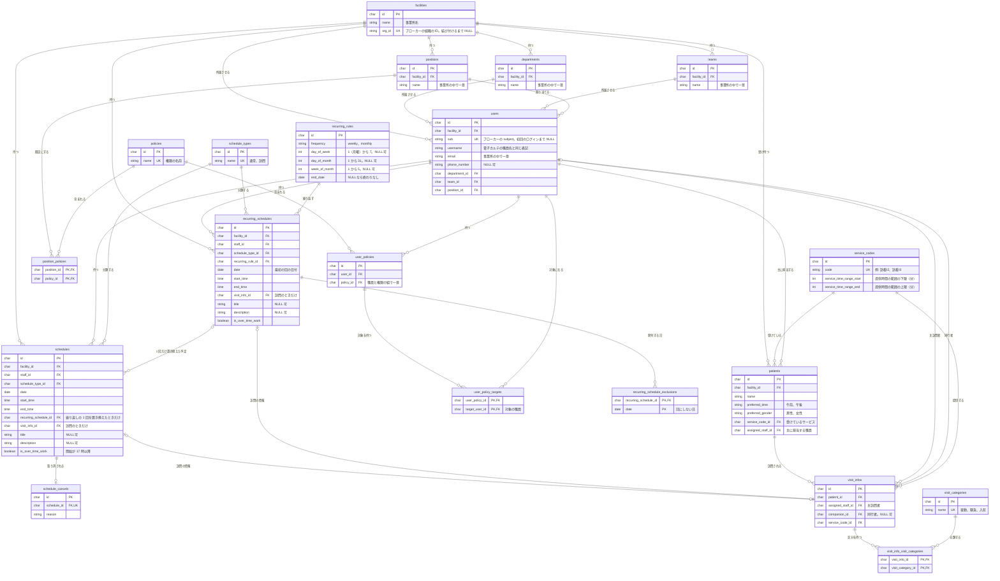
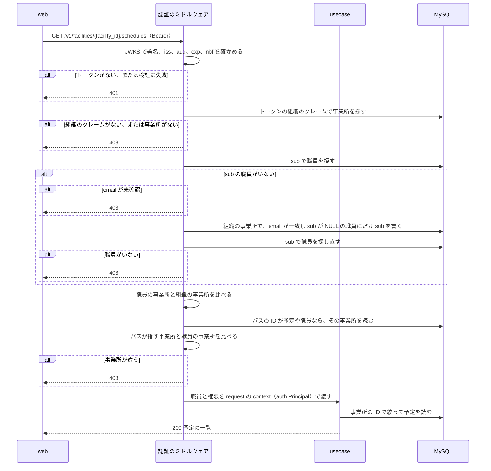

# 予定の管理

## Overview

schedule-api は、事業所ごとの予定、職員、利用者、権限を持ち、web に API で渡す。  
全体の中での責務と依存は [buddy Design Doc](https://github.com/Fukuemon/buddy/blob/develop/docs/design/DesignDoc.md) にある。

## Scope

持つもの

- 事業所、部署、チーム、役職と、職員、利用者
- 権限、役職の既定の権限、職員ごとの権限とその対象
- 単発の予定、繰り返しの予定と繰り返しの規則、予定のキャンセル
- 訪問の情報、サービスコード、訪問の区分
- access token の検証から事業所の確認までのミドルウェア

持たないもの

- 住所とエリア、訪問の順路、経営数値、月の稼働時間の集計の表
- ログインとパスワード。ブローカーが持つ
- 照合の規則。receipt-api が持つ

## Design

### コードの層

依存してよい向きは [コードベースの構造](https://github.com/Fukuemon/buddy/blob/develop/context/codebase.md) にある。各層は次のものを持つ。

| 層 | パッケージ | 持つもの |
| --- | --- | --- |
| domain | `internal/domain`、`internal/domain/<概念>` | 共通の誤りと `Transactor`、概念ごとのエンティティ、値の検証、リポジトリのインターフェイス |
| usecase | `internal/usecase` | 手順とトランザクションの範囲。トランザクションは `domain.Transactor` で受ける |
| infrastructure | `internal/infrastructure/mysql` | domain のリポジトリを、sqlc の生成コード（`sqlcgen`）で実装する |
| infrastructure | `internal/infrastructure/oidc` | access token を JWKS で検証する。`oidctest` は、テストと `cmd/devissuer` が使う偽物の発行者 |
| presentation | `internal/presentation/http/openapi` | `openapi.yaml` から生成した型と strict server のインターフェイス |
| presentation | `internal/presentation/http/handler` | 生成したインターフェイスを実装するハンドラと、gin のミドルウェア |
| cmd | `cmd/api`、`cmd/migrate`、`cmd/devissuer` | 起動、マイグレーションとシード、手元で試すための偽物の発行者（イメージに入れない） |

### 表の構成

次の図は、schedule-api の全ての表と、その間の関係を示す。全ての表の主キー `id` は ULID で、`CHAR(26)` に置く。結合の表は、2 つの外部キーの組を主キーにする。

- `departments`、`teams`、`positions` は事業所ごとに持つ。名前が同じ部署でも、事業所が違えば別の行にする。事業所の間で部署を共有すると、事業所が部署の名前を変えたときにほかの事業所に波及するためである。
- `users.username` は、電子カルテの職員名と同じ表記で登録する。照合が、予定の主訪問者と実績の主訪問者を名前で比べるためである。
- 訪問の区分は、`visit_info_visit_categories` で 1 件の訪問に複数を付けられる。
- 一覧の読み出しには、予定と訪問の情報と名前を結合したビュー（`schedule_details`、`recurring_schedule_details`、`visit_info_details`）を使う。
- `schedule_types`、`service_codes`、`visit_categories` の行は、マイグレーションで入れる。事業所ごとには持たない。サービスコードの提供時間の範囲は、照合の許容範囲と同じ値にする。
- `policies` の行は、API（`createPolicy`）で作る。

### 認証から事業所の確認までの流れ

次の図は、web が予定の一覧を求めたときに、schedule-api が職員を特定し、事業所を確かめるまでの流れを示す。

- `/v1` の全ての API は、`Authorization: Bearer` の access token を求める。`/healthz` と `/readyz` は認証を求めない。
- 署名のアルゴリズムは RS256 と ES256 だけを受け付ける。JWKS は、起動のときに discovery の文書から場所を読み、1 時間ごとに取り直す。知らない `kid` のトークンが来たときも取り直すが、間隔は 1 分以上あける。
- トークンが無いか検証に失敗したときは、`WWW-Authenticate: Bearer` を付けて 401 を返す。
- 組織の ID を持つクレームの名前は `OIDC_ORG_CLAIM` で決め、既定は `org_id` にする。ブローカーごとにクレームの名前が違うためである。
- sub を書く UPDATE は `sub IS NULL` を条件にする。同じ職員の初回のログインが同時に 2 つ来ても、書くのは 1 回だけになる。
- パスの ID のリソースが見つからないときは、ミドルウェアは通し、ハンドラが 404 を返す。
- 権限（`user_policies`）による判定は、まだ行わない。usecase は事業所の分離だけを前提にする。決めた方式は ADR-0002 にあり、実装は #45 で扱う。
  - ADR-0002: [権限を役職の既定と職員ごとの上書きで持つ（PBAC）](https://github.com/Fukuemon/buddy/blob/develop/docs/adr/0002-pbac.md)

### 繰り返しの予定

- 繰り返しの予定は、最初の回の日付（`recurring_schedules.date`）と規則（`recurring_rules`）で回を決める。回は保存しない。
- 繰り返しの規則は次の 3 つ。規則に値が無いときは、最初の回の日付から曜日か日を決める。
  - `weekly`: `day_of_week` の曜日ごと
  - `monthly` で `day_of_month` がある: 毎月のその日。その日がない月は回にしない
  - `monthly` で `week_of_month` と `day_of_week` がある: 毎月の第 n 週のその曜日
- 最初の回の日付より前と、`end_date` より後は回にしない。最初の回の日付は、規則の回に当たらなければならない。
- 繰り返しの 1 回だけを変えるときは、その日を `recurring_schedule_exclusions` に足し、`recurring_schedule_id` で元を指す単発の予定を作る。2 つは 1 つのトランザクションで行う。
- 予定の一覧の API は、単発の予定と繰り返しの予定を別々に返す。繰り返しの予定を期間の回に展開しない。`date_from` と `date_to` は単発の予定だけを絞る。

### 予定の変更

- 単発の予定の変更は、予定の枠を本文の内容に置き換える。部分の更新は持たない。画面のフォームは予定の全ての項目を送るためである。
- 訪問の情報は、予定ごとに 1 行を持つ。変更では本文の内容で新しい行を作り、どの予定も指さなくなった前の行を消す。
- 繰り返しの回を置き換えた予定は、変更しても `recurring_schedule_id` を保つ。
- キャンセルした予定は変更できず、409 を返す。
- 変更は、最初に予定の行に排他のロックを取る。同時の変更とキャンセルが、読んだ後の訪問の情報とキャンセルの有無を食い違わせないためである。同時の変更は、後に来た方の内容になる。

### キャンセル

- 予定をキャンセルすると、`schedule_cancels` に理由とともに 1 行を足す。予定の行は消さない。
- キャンセルした予定は、API の応答の `cancel` に理由を持つ。画面は、キャンセルした予定を予定の表示から除く。

## Interface

- 事業所に属する一覧と作成のパスは `/v1/facilities/{facility_id}/<資源>`、1 件を指すパスは `/v1/<資源>/{<資源>_id}` の形にする。主な資源は `schedules`、`schedules/recurring`、`users`、`patients`、`departments`、`teams`、`positions` である。
- 事業所に属さないマスタは `/v1/policies`、`/v1/schedule_types`、`/v1/visit_infos/service_codes`、`/v1/visit_infos/visit_categories` で読む。
- 一覧の並べ替えは、許可した列の名前だけを受け、それ以外は 400 を返す。
- `GET /v1/me` は、トークンの職員と権限を返す。画面は、ログインの後にこれを呼んで事業所を決める。
- 環境変数とマイグレーションのコマンドは [README](https://github.com/Fukuemon/buddy/blob/develop/apps/schedule-api/README.md) に、インフラとの約束は [buddy Design Doc の Interfaces](https://github.com/Fukuemon/buddy/blob/develop/docs/design/DesignDoc.md#interfaces) にある。
