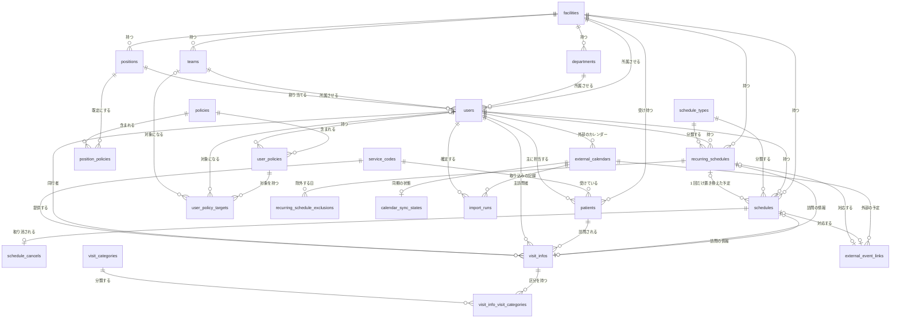
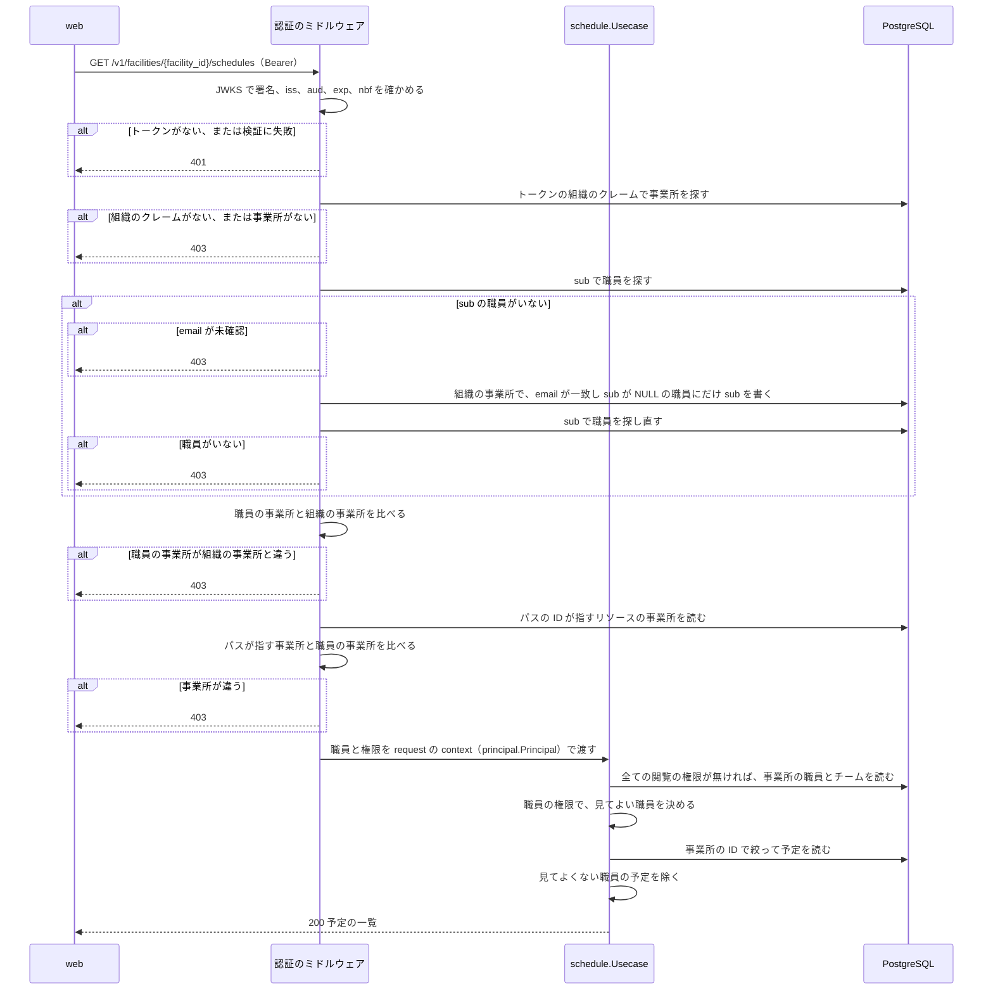
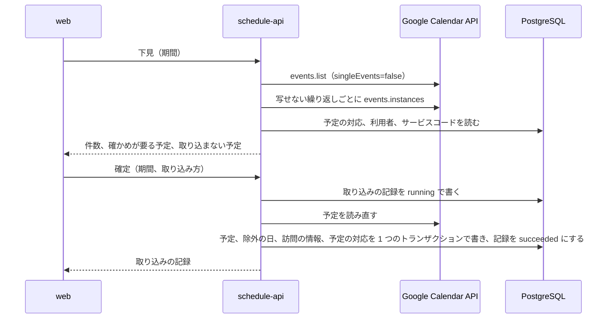
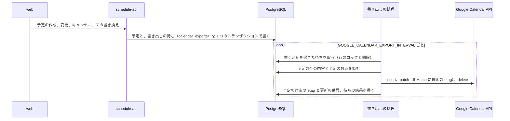

# 予定の管理

## Overview

schedule-api は、事業所ごとの予定、職員、利用者、権限を持ち、web に API で渡す。  
全体の中での責務と依存は [buddy Design Doc](https://github.com/Fukuemon/buddy/blob/develop/docs/design/DesignDoc.md) にある。

## Scope

持つもの

- 事業所、部署、チーム、役職と、職員、利用者
- 権限、役職の既定の権限、職員ごとの権限とその対象
- 単発の予定、繰り返しの予定と繰り返しの規則、予定のキャンセル
- 職員と Google カレンダーの結び付けと、Google カレンダーの予定の取り込み、buddy の予定の Google カレンダーへの書き出し
- 訪問の情報、サービスコード、訪問の区分
- access token の検証から事業所の確認までのミドルウェア

持たないもの

- 住所とエリア、訪問の順路、経営数値、月の稼働時間の集計の表
- ログインとパスワード。ブローカーが持つ
- 照合の規則。receipt-api が持つ

## Design

### コードの構成

規則と手順は機能ごとのパッケージに置き、DB と HTTP のアダプタは 1 つずつ置く。機能のパッケージの中は、手順（`Usecase`）、規則（状態を持たない関数かエンティティのメソッド）、集約の単位のリポジトリに分ける。決めた理由は ADR-0005 と ADR-0010 にあり、依存してよい向きは [コードベースの構造](https://github.com/Fukuemon/buddy/blob/develop/context/codebase.md) にある。

- ADR-0005: [schedule-api の規則と手順を機能ごとのパッケージにまとめる](https://github.com/Fukuemon/buddy/blob/develop/docs/adr/0005-schedule-api-packages.md)
- ADR-0010: [予定の API の機能のパッケージで、手順を usecase、規則を関数、リポジトリを集約の単位に分ける](https://github.com/Fukuemon/buddy/blob/develop/docs/adr/0010-schedule-api-usecase-boundaries.md)

| 種類 | パッケージ | 持つもの |
| --- | --- | --- |
| 共通 | `internal/apperr`、`internal/tx`、`internal/kernel`、`internal/civil` | 共通の誤りと検証の誤り、`Transactor`、文字の検証と並べ替えと `IDGenerator` と 1 件を読む `Finder`、日付と時刻の値 |
| 機能 | `internal/organization`、`internal/staff`、`internal/patient`、`internal/visit`、`internal/schedule` | エンティティ、規則の関数、自分の集約のリポジトリのインターフェイス、ほかの機能のデータを読む小さなインターフェイス、手順（`Usecase`）とトランザクションの範囲。予定の閲覧と編集の判定は `schedule` の `permission.go` に置く |
| 機能 | `internal/calendar` | 外部のカレンダーの予定（`Event`）と、予定を読む `EventSource`。予定を訪問、通常、取り込まないに分ける `Classify` と、RRULE を繰り返しの規則に写す `RuleFromRecurrence`。結び付けと取り込みと確かめが要る書き出しの手順（`Usecase`）、下見の読み替え（`plan.go`）、書き出しの待ちを積む `Outbox` と、待ちを書く `Exporter`、予定を外部の予定の内容にする `ScheduleBody` と `RecurrenceOf`。結び付けたカレンダーと取り込みの記録と予定の対応のリポジトリ、書き出しの待ちのリポジトリ。題名は `packages/go/gcaltitle` で読み書きする（ADR-0009） |
| 認可 | `internal/principal` | トークンの主張（`Identity`）、職員（`Principal`）、職員の管理の判定 |
| 認証 | `internal/access` | トークンから職員を特定する手順と、パスが指す資源の事業所を引く手順 |
| テスト | `internal/inmem` | 機能のパッケージのテストが共有する、メモリ上のリポジトリ |
| アダプタ | `internal/postgres` | 機能のパッケージのリポジトリを、pgx/v5 の接続のプールと sqlc の生成コード（`sqlcgen`）で実装する |
| アダプタ | `internal/ulid` | `IDGenerator` を ULID で実装し、ID の形を確かめる |
| アダプタ | `internal/gcal` | `calendar.EventSource`（`Reader`）と `calendar.EventWriter`（`Writer`）を Google Calendar API で実装する。繰り返しの予定を展開せずに、親の予定と例外の回を読み、回ごとにする繰り返しだけを events.instances で回に展開する。認証した `calendar.Service` は `cmd` が渡す。テストと compose の偽物の API は `internal/gcal/gcaltest` に置く |
| 設定 | `internal/config` | 環境変数から API とマイグレーションの設定を読む。DB の接続の値は自分の型で持ち、`cmd` がアダプタの設定に写す |
| 共有 | `packages/go/oidc`、`packages/go/healthcheck`、`packages/go/gcaltitle`（別の module） | access token の JWKS での検証、テストと `cmd/devissuer` が使う偽物の発行者（`oidctest`）、`api healthcheck`、Google カレンダーの予定の題名の解釈。receipt-api と共有する（ADR-0007） |
| アダプタ | `internal/httpapi/openapi` | `openapi.yaml` から生成した型と strict server のインターフェイス |
| アダプタ | `internal/httpapi` | 生成したインターフェイスを実装するハンドラと、gin のミドルウェア。要求は、埋め込んだ `openapi.yaml` の定義で確かめる |
| cmd | `cmd/api`、`cmd/migrate`、`cmd/devissuer`、`cmd/fakegcal` | 起動、マイグレーションとシード、手元で試すための偽物の発行者と Calendar API（本番のイメージに入れない） |

- `kernel` は、ADR-0010 の「`apperr` と同じ段の小さなパッケージ」に当たる。`kernel.Finder[T]` は ID で 1 件を読む 1 つのメソッドのインターフェイスで、機能のパッケージは、ほかの機能のエンティティをこの形で受ける。同じ形のインターフェイスを機能ごとに書かずに済ませるためである。
- `access` は機能のパッケージではないので、型の名前を `Service` のままにし、`Usecase` への改名と「1〜2 のメソッド」の規則の対象から外す。
- `access.Staff` は、`FindIDBySub`、`LinkSub`、`Get` の 3 つのメソッドを持つ。初回のログインで sub を職員に結び付け、職員と権限を読むために、3 つともが要る。

### 表の構成

次の図は、schedule-api の全ての表と、その間の関係を示す。カラム、制約、索引は、マイグレーションから生成した[表の文書](https://github.com/Fukuemon/buddy/blob/develop/docs/db/schedule-api/README.md)（文書のサイトでは「DB の設計」の「表の一覧」）にある。表の文書の Viewpoints は、事業所と組織、職員と権限、利用者、予定と訪問、繰り返しの予定、外部のカレンダーの取り込みの観点ごとに、表を絞った ER 図を持つ。  
DB は PostgreSQL 18 で、表は 1 本の初期のマイグレーションで作る（ADR-0011）。表とカラムの説明は、マイグレーションの `COMMENT ON` に書く。

- ADR-0011: [予定の API の DB を PostgreSQL にし、見直した表でマイグレーションを作り直す](https://github.com/Fukuemon/buddy/blob/develop/docs/adr/0011-schedule-api-postgresql.md)

- 主キーは、多くの表が ULID の `id`（`text COLLATE "C"`）である。主キーだけに ULID の形の CHECK を付ける。
- `position_policies` と `visit_info_visit_categories` は、2 つの外部キーの組を主キーにする。
- `recurring_schedule_exclusions` は、`recurring_schedule_id` と `date` の組を主キーにする。
- `user_policy_targets` は、`id` を主キーにする。対象の列（`target_user_id` と `target_team_id`）のどちらかが NULL になり、主キーに入れられないためである。

- 事業所の中の行を指す外部キーは、`(facility_id, id)` の組で指す。別の事業所の職員や利用者を指す行は、アプリの確認に加えて DB も拒む。
- 名前の列は既定の決定的な照合順序のままにし、完全に一致する値だけを同じとみなす。清音と濁音、全角と半角、大文字と小文字は別の名前である。メモリ上のリポジトリ（`inmem`）も同じ比べ方をする。
- 日時の監査の列は `timestamptz` にし、`updated_at` はトリガーで付ける。予定の日付と時刻は、事業所の現地の時刻として `date` と `time` で持つ。
- 区分値（`frequency`、`preferred_time` など）は `text` と CHECK で持つ。名前の付いた CHECK と一意の制約は `<表>_<意味>_{key,fkey,check}` の名前にする。
- `departments`、`teams`、`positions` は事業所ごとに持つ。名前が同じ部署でも、事業所が違えば別の行にする。事業所の間で部署を共有すると、事業所が部署の名前を変えたときにほかの事業所に波及するためである。
- `facilities.org_id` は、認証の基盤の組織の ID を持つ。NULL を許し、値があれば一意にする。認証のミドルウェアは、トークンの組織のクレームでこの列を探す。
- `users.sub` は、認証の基盤の利用者の識別子を持つ。初回のログインまでは NULL で、値があれば全ての事業所を通じて一意にする。
- `users.email` は、事業所の中で一意にする（`facility_id` と `email` の組）。初回のログインは事業所とメールで職員を探すので、当たる職員は 1 人に限られる。予定の API は、メールを小文字にそろえてから保存し、比べる。そろえ忘れた書き込みは CHECK が拒む。`users.username` は表示名で、一意にしない。
- 訪問の区分は、`visit_info_visit_categories` で 1 件の訪問に複数を付けられる。
- 予定の種類の規則（通常はタイトルが必須、訪問は訪問の情報が必須）は、`schedule_types.code`（`normal`、`visit`）で読む。`name` は表示と一覧の絞り込みに使う。
- 1 つの訪問の情報は、1 つの予定か 1 つの繰り返しの予定だけが指す（`visit_info_id` の一意の制約）。
- `is_over_time_work` は、開始の時刻から DB が生成する列である。書き込みには含めない。
- 外部キーの列には、引く向きに使うものに index を置く。行を消さない固定のマスタ（権限、サービスコード、訪問の区分、予定の種類）を指す列には置かない。
- 監査の日時は UTC で読み、応答はマイクロ秒までの RFC 3339 の形で返す。
- `external_calendars`、`calendar_sync_states`、`external_event_links`、`import_runs` は、Google カレンダーの取り込み（ADR-0009 の段階 1）で使う。外部の予定の題名と本文は、利用者の名前を含むので保存しない。カレンダーを外すときは行を消さずに `external_calendars.disabled_at` を入れ、外部の予定との対応を残す。結び付け直して同じ期間を取り込んでも、予定が重ならないためである。外していないカレンダーは、職員ごとに 1 つにする（部分の一意の index）。
- 一覧の読み出しには、予定と訪問の情報と名前を結合したビュー（`schedule_details`、`recurring_schedule_details`、`visit_info_details`）を使う。
- `schedule_types`、`service_codes`、`visit_categories` の行は、マイグレーションで入れる。事業所ごとには持たない。サービスコードの提供時間の範囲は、照合の許容範囲と同じ値にする。
- `policies` の 8 行は、マイグレーションで入れる。事業所ごとには持たず、API では作らない。認可は `code` で権限を読むので、行が環境ごとに違うと判定がずれるためである。
- `user_policy_targets` は、`target_user_id` と `target_team_id` のどちらか 1 つだけを持つ。DB の CHECK 制約で確かめる。

### 権限の行

`policies` は、PRD の 8 つの権限（予定の 7 つと職員の管理）を次の `code` で持つ。`needs_target` が true の権限は、対象の職員かチームを `user_policy_targets` に持つ。

| `code` | 権限 | `needs_target` |
| --- | --- | --- |
| `schedule.self.edit` | 自分の予定の編集 | false |
| `schedule.user.read` | 指定した職員の予定の閲覧 | true |
| `schedule.user.edit` | 指定した職員の予定の編集 | true |
| `schedule.team.read` | 指定したチームの職員の予定の閲覧 | true |
| `schedule.team.edit` | 指定したチームの職員の予定の編集 | true |
| `schedule.all.read` | 事業所の全ての予定の閲覧 | false |
| `schedule.all.edit` | 事業所の全ての予定の編集 | false |
| `staff.manage` | 職員の管理 | false |

役職の既定を写す規則、役職を変えたときに写し直す規則、`staff.manage` の扱いは [権限](https://github.com/Fukuemon/buddy/blob/develop/context/domain/permission.md) にある。  
職員の権限（`schedule.user.*`）は、写すときに対象を決められないので、役職の既定にできない。

- ADR-0002: [権限を役職の既定と職員ごとの上書きで持つ（PBAC）](https://github.com/Fukuemon/buddy/blob/develop/docs/adr/0002-pbac.md)

職員の役職は `PUT /v1/users/{user_id}/position` で変える。  
職員ごとに権限を足す（`POST /v1/users/{user_id}/policies`）ときは、`needs_target` が true の権限に、code に合わせて職員かチームの対象を 1 つ以上付ける。対象は同じ事業所のものに限る。外す（`DELETE /v1/users/{user_id}/policies/{user_policy_id}`）と、対象も消える。

職員と利用者の登録、役職の作成、役職を変える操作、権限を足し外す操作は、`staff.manage` を持つ職員だけに許す。

- ADR-0006: [職員と利用者の登録と、職員の権限と役職を変える操作を、職員の管理の権限で許す](https://github.com/Fukuemon/buddy/blob/develop/docs/adr/0006-staff-manage-policy.md)

### 認証から事業所の確認までの流れ

次の図は、web が予定の一覧を求めたときに、schedule-api が職員を特定し、事業所を確かめ、権限で予定を絞るまでの流れを示す。

- `/v1` の全ての API は、`Authorization: Bearer` の access token を求める。`/healthz` と `/readyz` は認証を求めない。
- 署名のアルゴリズムは RS256 と ES256 だけを受け付ける。JWKS は、起動のときに discovery の文書から場所を読み、1 時間ごとに取り直す。知らない `kid` のトークンが来たときも取り直すが、間隔は 1 分以上あける。
- トークンが無いときは `WWW-Authenticate: Bearer` を、検証に失敗したときは `WWW-Authenticate: Bearer error="invalid_token"` を付けて、401 を返す。
- 組織の ID を持つクレームの名前は `OIDC_ORG_CLAIM` で決め、既定は `org_id` にする。ブローカーごとにクレームの名前が違うためである。
- sub を書く UPDATE は `sub IS NULL` を条件にする。同じ職員の初回のログインが同時に 2 つ来ても、書くのは 1 回だけになる。
- ミドルウェアは、パスの引数ごとに、指すリソースの事業所を職員の事業所と比べる。
  - `facility_id` は、値をそのまま職員の事業所と比べる。
  - `department_id`、`team_id`、`position_id`、`user_id`、`schedule_id`、`recurring_schedule_id` は、リソースを読んでその事業所と比べる。
  - `policy_id` は、事業所に属さないので確かめない。`user_policy_id` は、同じパスの `user_id` で事業所を確かめ、`staff.Usecase` が職員の権限かを確かめる。
  - この一覧に無い引数を持つパスは、事業所を確かめられないので 500 を返す。
- パスの ID が ULID でないときと、リソースが見つからないときは、ミドルウェアは通す。ULID でない ID は次のミドルウェアが 400 を返し、見つからないリソースはハンドラが 404 を返す。
- `/v1` の要求は、次の順に確かめる。先に失敗した段の応答を返すので、トークンの 401 と事業所の 403 は、パスの ID と定義の 400 より先に返る。
  1. Origin を許すか（403）。`CORS_ALLOW_ORIGINS` を設定したときだけ当てる。規則は [Interface](#interface) の CORS にある
  2. クエリを読めるか（400）。`/v1` 以外のパスにも当てる
  3. トークン（401）と、職員と組織の事業所（403）
  4. パスが指す事業所（403）
  5. パスの ID が ULID か（400）
  6. 要求が `openapi.yaml` の定義に合うか（400）

### 予定の認可

予定の操作は、`schedule.Usecase` が、ミドルウェアが context に入れた職員（`principal.Principal`）の `user_policies` で判定する。判定の規則は `schedule` の `permission.go` の関数にある。役職は見ない。編集の権限は、同じ範囲の閲覧を含む。

1. 自分の予定は、権限によらず見てよい。自分の予定の編集には `schedule.self.edit` が要る。
2. `schedule.all.read` があれば、事業所の全ての職員の予定を見てよい。`schedule.all.edit` があれば、編集もしてよい。
3. `schedule.user.*` は、対象の職員の予定に及ぶ。
4. `schedule.team.*` は、対象のチームに属する職員の予定に及ぶ。

- 一覧は、見てよくない職員の予定を除いて返す。1 件を指す操作（取得、変更、キャンセル、回の置き換え）は 403 を返す。
- 作成と変更は、予定の職員の予定を編集する権限を求める。変更と回の置き換えは、元の予定の職員と、新しい予定の職員の両方の編集の権限を求める。
- 権限の判定は、事業所の分離の後に行う。事業所が違えば、ミドルウェアが先に 403 を返す。
- 職員と利用者の登録、役職の作成、職員の権限と役職を変える操作は `staff.manage` で判定する（[権限の行](#権限の行)）。それ以外の職員、利用者、訪問の情報、組織の API は、権限で判定せず、事業所の分離だけを確かめる。

### 繰り返しの予定

- 繰り返しの予定は、最初の回の日付（`recurring_schedules.date`）と、同じ行の規則の列（`frequency` から `end_date`）で回を決める。回は保存しない。頻度ごとの列の組み合わせは CHECK で確かめる。
- 繰り返しの規則は次の 3 つ。規則に値が無いときは、最初の回の日付から曜日か日を決める。
  - `weekly`: `day_of_week` の曜日ごと
  - `monthly` で `day_of_month` がある: 毎月のその日。その日がない月は回にしない
  - `monthly` で `week_of_month` と `day_of_week` がある: 毎月の n 回目のその曜日。n は日から `(日 - 1) / 7 + 1` で決め、1 から 5 を受ける。5 回目のない月は回にしない
- 最初の回の日付より前と、`end_date` より後は回にしない。最初の回の日付は、規則の回に当たらなければならない。
- 繰り返しの 1 回だけを変えるときは、その日を `recurring_schedule_exclusions` に足し、`recurring_schedule_id` と元の回の日付（`original_date`）で元を指す単発の予定を作る。2 つは 1 つのトランザクションで行う。2 つの列は組で持ち、同じ回は 1 度だけ置き換えられる（一意の制約）。
- 予定の一覧の API は、単発の予定と繰り返しの予定を別々に返す。繰り返しの予定を期間の回に展開しない。`date_from` と `date_to` は単発の予定だけを絞る。

### 予定の変更

- 単発の予定の変更は、予定の枠を本文の内容に置き換える。部分の更新は持たない。画面のフォームは予定の全ての項目を送るためである。
- 訪問の情報は、予定ごとに 1 行を持つ。変更では本文の内容で新しい行を作り、どの予定も指さなくなった前の行を消す。
- 繰り返しの回を置き換えた予定は、変更しても `recurring_schedule_id` を保つ。
- キャンセルした予定は変更できず、409 を返す。
- 変更は、最初に予定の行に排他のロックを取る。同時の変更とキャンセルが、読んだ後の訪問の情報とキャンセルの有無を食い違わせないためである。同時の変更は、後に来た方の内容になる。

### キャンセル

- 予定をキャンセルすると、`schedule_cancels` に理由とともに 1 行を足す。予定の行は消さない。
- キャンセルした予定は、API の応答の `cancel` に理由を持つ。画面は、キャンセルした予定を予定の表示から除く。

### Google カレンダーの取り込み

職員の管理の権限を持つ職員が、職員に Google カレンダーを結び付け、期間を選んで下見し、確定して予定に取り込む（ADR-0009 の段階 1）。読み替えの規則と画面の動きは、画面仕様書の [予定の取り込み](https://github.com/Fukuemon/buddy/blob/develop/docs/screens/schedule-import_予定の取り込み/index.md) と [カレンダーの連携](https://github.com/Fukuemon/buddy/blob/develop/docs/screens/schedule-link_カレンダーの連携/index.md) にある。

- ADR-0009: [Google カレンダーとの連携を、buddy を正にする段階の同期にする](https://github.com/Fukuemon/buddy/blob/develop/docs/adr/0009-google-calendar-sync.md)

- 下見の結果は保存しない。確定は Google の予定を読み直し、下見と同じ規則で読み替える。確かめが要る予定の集合か版（まとめた予定の ID と etag から作る）が、送られた取り込み方と違えば、何も書かずに 409 を返す。
- 同じカレンダーの取り込みは、1 つずつ行う。確定の始めにカレンダーの行に排他のロックを取り、10 分以内に始めた `running` の記録があれば 409 を返す。止まった取り込みが次の取り込みを止め続けないよう、10 分より前の `running` は数えない。
- 取り込んだ Google の予定は、`external_event_links` の対応を持つ。対応のある予定は取り込み済みに数え、もう一度は書かない。
- 繰り返しは、親の予定の RRULE を buddy の規則に写せれば、規則ごと取り込む。期間の外の回も繰り返しの予定に含まれる。Google が返した取り消した回は除外の日に、期間の中の変えた回は除外の日と、元の回の日付を持つ単発の予定にする。前の取り込みで取り込んだ繰り返しにも、後の期間の取り消しと変更を当てる。
- 前の取り込みで回か例外の回だけを取り込んだ繰り返しは、規則に写せる形でも回ごとにする。規則ごと作ると、前に取り込んだ回と重なるためである。
- Google は変えた回を今の日時で期間に絞るので、期間の前後 31 日を広げて例外の回を読み直し、元の日付が期間の中の回も読み替える。期間の中の回を期間の外へ動かしても、元の日に回が残らない。31 日より遠くへ動かした回は読めず、元の日に回が残る。Calendar API は元の日時で予定を絞れず、上限なしに探すと回ごとに API を呼ぶことになるためである。
- 写せない繰り返しは、events.instances で期間の中の回を読み、回ごとに単発の予定にする。回の対応は、回の ID で持つ。
- 題名のサービス内容と利用者名は、照合の API と同じ規則で表記をそろえ、サービスコードと事業所の利用者を引く。利用者を 1 人に決められない予定は、下見で取り込み方を選ばせる。取り込んだ訪問の予定の主訪問者は、カレンダーを結び付けた職員である。
- 予定の題名、利用者名、カレンダーの ID は、取り込まない予定の一覧、誤りの文、ログに出さない。確かめが要る予定だけは、題名から読んだ利用者名とサービス内容を返す。
- 空き時間だけの共有（`freeBusyReader`）のカレンダーは、読めないとみなす（422 `calendar_unreadable`）。Google は空き時間だけの共有に、繰り返しの親と予定の題名を返さないためである。
- カレンダーを外しても、行と予定の対応は消さない。同じ職員に結び付け直すと、外した行を使い直す。

### Google カレンダーへの書き出し

buddy で作り、変え、キャンセルした予定を、予定の職員が結び付けた Google カレンダーに書く（ADR-0009 の段階 2）。Google カレンダーで直された予定は buddy に当てず、確かめが要る予定に出す。

- 書き出しは、`GOOGLE_CALENDAR_EXPORT_ENABLED` が `true` のときだけ動く。既定は `false` で、そのときは待ちを積まず、書き出しの処理も動かさない。サービスアカウントが「予定の変更」の共有だけで書けるかを確かめるまで（ADR-0012 の承認の条件）、本番では有効にしない。
- 待ちを積む: 予定の操作（`schedule.Usecase`）は、予定を書くのと同じトランザクションで `Outbox` に積む。積むのは、予定の職員に外していないカレンダーがあるときと、予定の対応のカレンダーを外していないとき（職員を替えて、前のカレンダーの予定を消すとき）だけである。取り込みで書いた予定は積まない。
- 待ちは予定ごとに終わっていないものを 1 つだけ持ち、積み直すと `revision` が増える。書くときは、積んだ時点ではなく書く時点の予定の内容を書く。書いている間に積み直されたら、結果によらず待ちを pending に戻して数え直し、もう一度書く。
- 書き出しの処理は、API と同じプロセスのゴルーチンで動く。待ちは `FOR UPDATE SKIP LOCKED` と期限（`locked_until`、2 分）で 5 件ずつ取り、1 件を 20 秒で打ち切るので、期限のうちに書き終える。結果は、取ったときの回数（`attempts`）と比べて書き、期限が切れた後にほかのレプリカが取り直した待ちを変えない。外部の API はトランザクションの外で呼ぶ。
- 止める合図で書けなかった待ちは、書こうとした回数に数えずに返す。
- 予定の更新の番号（`version`）は、単発の予定の変更とキャンセル、繰り返しの予定の回の除外のたびに 1 つ増える。書いた後に、予定の対応（`external_event_links`）に Google の etag と更新の番号（`synced_version`）を書く。段階 3 で、どちらの側が変わったかを比べるのに使う。
- 書く先は、予定の職員（`staff_id`）が結び付けたカレンダーである。訪問の予定では、画面が主訪問者を予定の職員と同じにする。
- 書く先
  - 予定の対応があり、職員のカレンダーが対応のカレンダーと同じなら、Google の予定を部分更新する。取り込んだ予定もこの形で更新する。
  - キャンセルした予定と、職員を替えた予定は、対応の Google の予定を消し、対応も消す。職員を替えた予定は、新しい職員のカレンダーに作る。
  - 対応のカレンダーを外していれば、そのカレンダーには書かない。職員に今のカレンダーがあれば、対応を消してそのカレンダーに作る。外したカレンダーの予定は残る。対応が無く、職員にカレンダーがあれば作る。
  - 作る予定の ID は、buddy の予定の ULID を base32hex にした値にする。作った後に対応を書けずに書き直しても、Google の予定は 2 つにならない。同じ ID の予定があれば（409）、buddy の内容で更新する。
- 内容
  - 題名は、訪問の予定なら `【サービス内容】利用者名`（`packages/go/gcaltitle.Format`）、通常の予定ならタイトルである。照合の API が同じ題名を読む。
  - 日時は、タイムゾーン `Asia/Tokyo` とオフセットの無い日時で書く。`extendedProperties.private` に buddy の予定の ID だけを置く。
  - 説明は、buddy の予定に説明があるときだけ書く。取り込んだ予定の Google の説明を消さないためである。buddy で説明を消しても、Google の説明は残る。
  - 参加者は書かず、通知を送らない（`sendUpdates=none`）。
- 繰り返し: buddy の繰り返しの規則は、全て RRULE に写せる（`RecurrenceOf`、取り込みの `RuleFromRecurrence` の逆）。規則に無い曜日と日は最初の回の日付から決め、終了日はその日の 23:59:59（Asia/Tokyo）を UTC にした `UNTIL` にする。除外の日は `EXDATE;TZID=Asia/Tokyo` にする。
  - 回の置き換えは、Google の例外の回にせず、親の予定の `EXDATE` と、別の単発の予定にする。buddy が持つ形（除外の日と、元の回を指す単発の予定）と同じである。
  - 取り込んだ Google の例外の回が置き換えた日は、`EXDATE` にしない。`EXDATE` にすると、Google の例外の回が消えるためである。
- 衝突と誤り
  - 更新と削除には、予定の対応の etag を `If-Match` に付ける。412 は Google カレンダーで予定が変わったとみなし、書かずに待ちを `conflict`（`precondition_failed`）にする。Google で消された予定（410）と、Google が予定かカレンダーを見つけられないとき（404）も `conflict`（`not_found`）にする。
  - `conflict` の待ちは、buddy で予定を変えても書かない。職員の管理の権限を持つ職員が、確かめが要る予定の一覧から「buddy の内容で書き直す」を選ぶと、`If-Match` を付けずに書き直す。消された予定（410）は作り直す。
  - 404 では予定の対応を消さない。Google は、予定が消されたときと、カレンダーの共有が外れたときの両方で 404 を返すので、対応を消すと、共有を戻した後に予定が 2 つになるためである。キャンセルの削除が 404 でも、対応を消さずに `conflict` にする。
  - 429、5xx、通信の誤り、403 の上限の誤りは、30 秒から倍にしながら書き直し、5 回で `failed`（`unavailable`）にする。403 は書き直さずに `failed`（`forbidden`）に、400 は `failed`（`rejected`）にする。`failed` の待ちは、buddy で予定を変えると数え直して書く。
  - 待ちの誤りは決まった値（`error_code`）だけを持ち、確かめが要る予定の一覧とログに、予定の題名、利用者名、カレンダーの ID を出さない。
- カレンダーを結び付ける前に作った予定は書き出さない。結び付けた後にその予定を変えると書く。

## Interface

- 事業所に属する一覧と作成のパスは `/v1/facilities/{facility_id}/<資源>`、1 件を指すパスは `/v1/<資源>/{<資源>_id}` の形にする。主な資源は `schedules`、`schedules/recurring`、`users`、`patients`、`departments`、`teams`、`positions`、`external_calendars`、`calendar_exports` である。資源ごとにどのパスを持つかは `openapi.yaml` にある。
- 事業所に属さないマスタは `/v1/policies`、`/v1/schedule_types`、`/v1/visit_infos/service_codes`、`/v1/visit_infos/visit_categories` で読む。
- 一覧の並べ替えは、許可した列の名前だけを受け、それ以外は 400 を返す。
- `GET /v1/me` は、トークンの職員と権限を返す。画面は、ログインの後にこれを呼んで事業所を決める。
- エラーは `{"code","message"}` の JSON で返す。`message` は人が読む説明で、文言は変わることがあるので、利用者は `code` で分岐する。
  - 400 の `invalid_input`: クエリを読めない、パスの ID が ULID でない、要求が `openapi.yaml` の定義に合わない、本文の値が規則に合わない、本文が指す参照が見つからないか別の事業所のもの
  - 401 の `unauthenticated`: トークンが無いか、検証に失敗した
  - 403 の `forbidden`: 職員を特定できない、事業所が違う、権限で許されない
  - 404 の `not_found`: パスで指したリソースが無い
  - 409 の `conflict`: 一意の値が重なる、キャンセル済みの予定を変えるかキャンセルする、繰り返しの回をすでに置き換えた
  - 409 の `calendar_taken`、`calendar_already_linked`、`staff_has_calendar`: カレンダーを結び付けられない原因
  - 409 の `import_running`、`import_preview_changed`: 取り込みを確定できない原因
  - 409 の `export_not_in_review`: 書き直そうとした書き出しが、確かめが要る状態でない
  - 422 の `calendar_unreadable`: Google カレンダーが無いか、サービスアカウントに共有されていない
  - 500 の `internal`: サーバーの誤り
  - 502 の `calendar_unavailable`: Google に届かないか、Google が誤りを返した
  - 503 の `calendar_not_configured`: サービスアカウントが設定されていない
- CORS は、`CORS_ALLOW_ORIGINS` に並べた Origin だけに許す。空なら CORS のヘッダーを返さない。
  - 許す Origin の事前の要求には、トークンを求めずに 204 を返す。許すメソッドは GET、POST、PUT、DELETE、OPTIONS、ヘッダーは `Content-Type` と `Authorization` にする。
  - 許さない Origin の要求は、本文を持たない 403 で止める。Origin が要求の Host と同じ要求は、CORS の要求として扱わずに通す。
- 環境変数とマイグレーションのコマンドは [README](https://github.com/Fukuemon/buddy/blob/develop/apps/schedule-api/README.md) に、インフラとの約束は [buddy Design Doc のインフラとの約束](https://github.com/Fukuemon/buddy/blob/develop/docs/design/DesignDoc.md#インフラとの約束) にある。
