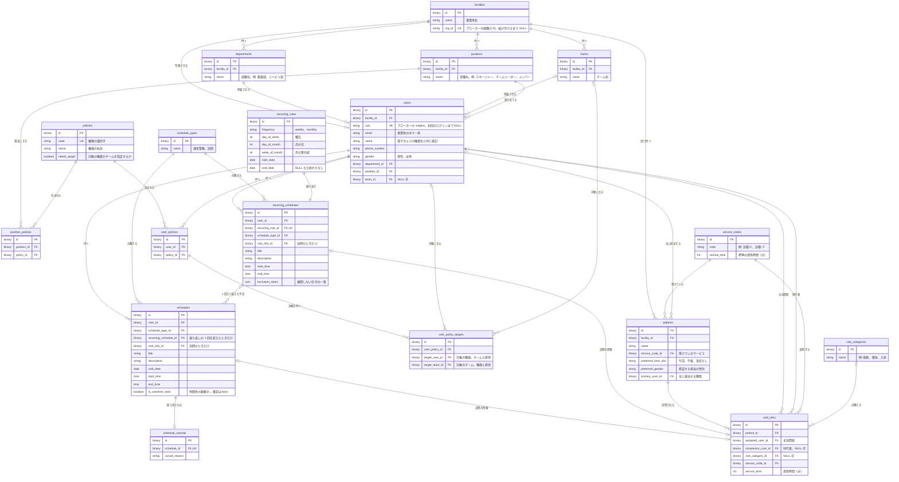
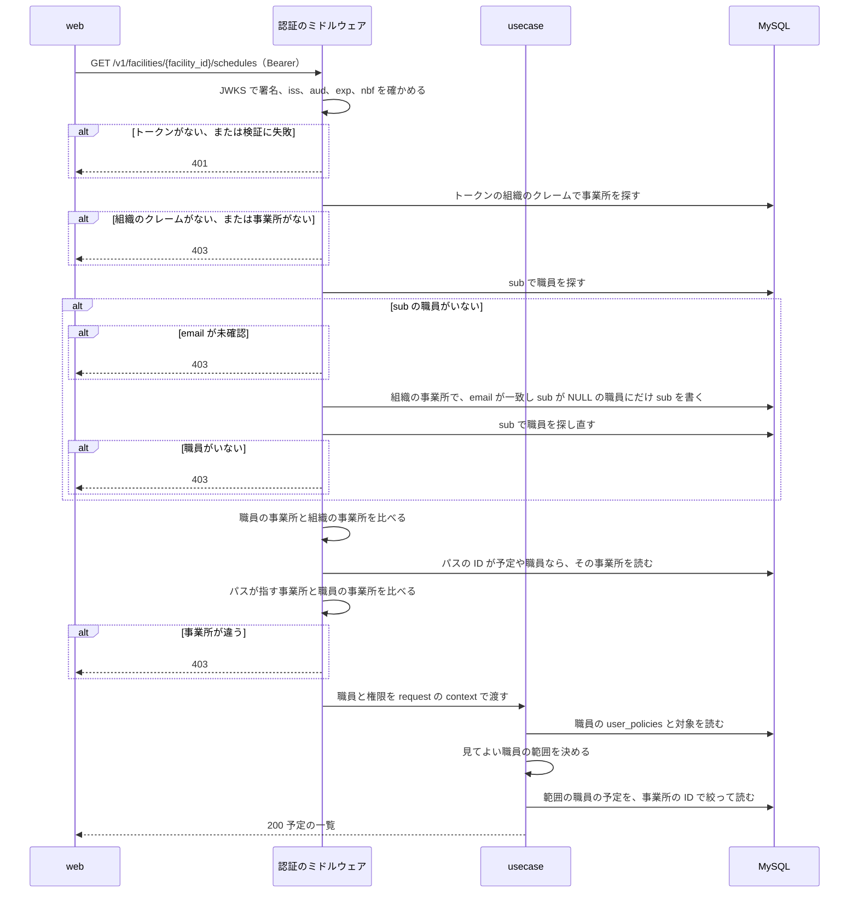

# 予定の管理

## Overview

schedule-api は、事業所ごとの予定、職員、利用者、権限を持ち、web に API で渡す。  
全体の中での責務と依存は [buddy Design Doc](https://github.com/Fukuemon/buddy/blob/develop/docs/design/DesignDoc.md) にある。

## Scope

持つもの

- 事業所、部署、チーム、役職と、職員、利用者
- ポリシー、役職の既定のポリシー、職員ごとのポリシーとその対象
- 単発の予定、繰り返しの予定と繰り返しの規則、予定のキャンセル
- 訪問の情報、サービスコード、訪問のカテゴリ
- access token の検証から認可までのミドルウェア

持たないもの

- 住所とエリア、訪問の順路、経営数値、月の稼働時間の集計の表
- ログインとパスワード。ブローカーが持つ
- 照合の規則。receipt-api が持つ

## Design

### 表の構成

次の図は、schedule-api の全ての表と、その間の関係を示す。全ての表の主キー `id` は UUID で、`BINARY(16)` に置く。

- `departments`、`teams`、`positions` は事業所ごとに持つ。名前が同じ部署でも、事業所が違えば別の行にする。事業所の間で部署を共有すると、事業所が部署の名前を変えたときにほかの事業所に波及するためである。
- `users.name` は、電子カルテの職員名と同じ表記で登録する。
- `user_policy_targets` は、`target_user_id` と `target_team_id` のどちらか 1 つだけを持つ。
- 訪問のカテゴリは、訪問 1 件に 1 つだけ付ける。
- `policies` の 7 行と `schedule_types` の 2 行は、マイグレーションで入れる。事業所ごとには持たない。

### 権限の行

`policies` は、PRD の 7 つの権限を次の `code` で持つ。

| `code` | 権限 | `needs_target` |
| --- | --- | --- |
| `schedule.self.edit` | 自分の予定の編集 | false |
| `schedule.user.read` | 指定した職員の予定の閲覧 | true |
| `schedule.user.edit` | 指定した職員の予定の編集 | true |
| `schedule.team.read` | 指定したチームの職員の予定の閲覧 | true |
| `schedule.team.edit` | 指定したチームの職員の予定の編集 | true |
| `schedule.all.read` | 事業所の全ての予定の閲覧 | false |
| `schedule.all.edit` | 事業所の全ての予定の編集 | false |

役職の既定を職員に写す規則は、ADR-0002 にある。

- ADR-0002: [権限を役職の既定と職員ごとの上書きで持つ（PBAC）](https://github.com/Fukuemon/buddy/blob/develop/docs/adr/0002-pbac.md)

### 認証から認可までの流れ

次の図は、web が予定の一覧を求めたときに、schedule-api が職員を特定し、事業所と権限を確かめるまでの流れを示す。

- 組織の ID を持つクレームの名前は `OIDC_ORG_CLAIM` で決め、既定は `org_id` にする。ブローカーごとにクレームの名前が違うためである。
- sub を書く UPDATE は `sub IS NULL` を条件にする。同じ職員の初回のログインが同時に 2 つ来ても、書くのは 1 回だけになる。
- パスの ID のリソースが見つからないときは、ミドルウェアは通し、ハンドラが 404 を返す。

予定を見てよいかは、次の順で決める。編集の権限は、同じ範囲の閲覧を含む。

1. 対象が自分なら、見てよい。編集は `schedule.self.edit` があればよい。
2. `schedule.all.read` か `schedule.all.edit` があれば、事業所の全ての職員を見てよい。
3. `schedule.user.*` の対象に、対象の職員があれば見てよい。
4. `schedule.team.*` の対象に、対象の職員のチームがあれば見てよい。

どれにも当たらなければ、一覧からは除き、1 件を指す操作には 403 を返す。

### 繰り返しの予定の展開

- schedule-api は、予定の一覧を求められた期間について、`recurring_schedules` を日付ごとの予定に展開して返す。展開した予定は保存しない。
- 繰り返しの規則は次の 3 つ。
  - `weekly`: `day_of_week` の曜日ごと
  - `monthly` で `day_of_month` がある: 毎月のその日。その日がない月は展開しない
  - `monthly` で `week_of_month` と `day_of_week` がある: 毎月の第 n 週のその曜日
- `start_date` より前、`end_date` より後、`exclusion_dates` にある日は展開しない。
- 繰り返しの 1 回だけを変えるときは、その日を `exclusion_dates` に足し、`recurring_schedule_id` で元を指す単発の予定を作る。
- 展開を schedule-api に置くのは、予定を読む全ての画面が同じ規則で予定を読むためである。

### 予定の変更

- 単発の予定の変更は、予定の枠を本文の内容に置き換える。部分の更新は持たない。画面のフォームは予定の全ての項目を送るためである。
- 訪問の情報は、予定ごとに 1 行を持つ。変更では本文の内容で新しい行を作り、どの予定も指さなくなった前の行を消す。
- 繰り返しの回を置き換えた予定は、変更しても `recurring_schedule_id` を保つ。
- キャンセルした予定は変更できず、409 を返す。
- 変更は、最初に予定の行に排他のロックを取る。同時の変更とキャンセルが、読んだ後の訪問の情報とキャンセルの有無を食い違わせないためである。同時の変更は、後に来た方の内容になる。

### キャンセル

- 予定をキャンセルすると、`schedule_cancels` に理由とともに 1 行を足す。予定の行は消さない。
- キャンセルした予定は、カレンダーにキャンセルの印つきで出す。

## Interface

- API のパスは `/v1/facilities/{facility_id}/...` の形にする。主な資源は `schedules`、`recurring-schedules`、`users`、`patients`、`users/{user_id}/policies`。
- 一覧の並べ替えは、許可した列の名前だけを受け、それ以外は 400 を返す。
- `GET /v1/me` は、トークンの職員と権限を返す。画面は、ログインの後にこれを呼んで事業所を決める。
- 環境変数、ヘルスチェック、マイグレーションのコマンドは [buddy Design Doc の Interfaces](https://github.com/Fukuemon/buddy/blob/develop/docs/design/DesignDoc.md#interfaces) にある。
