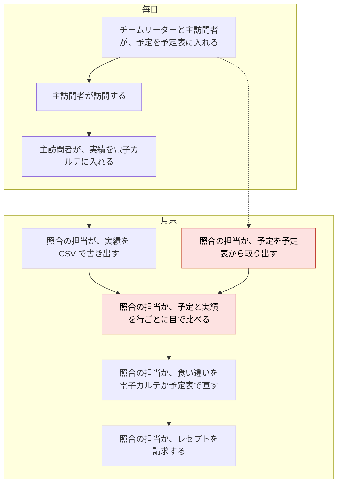
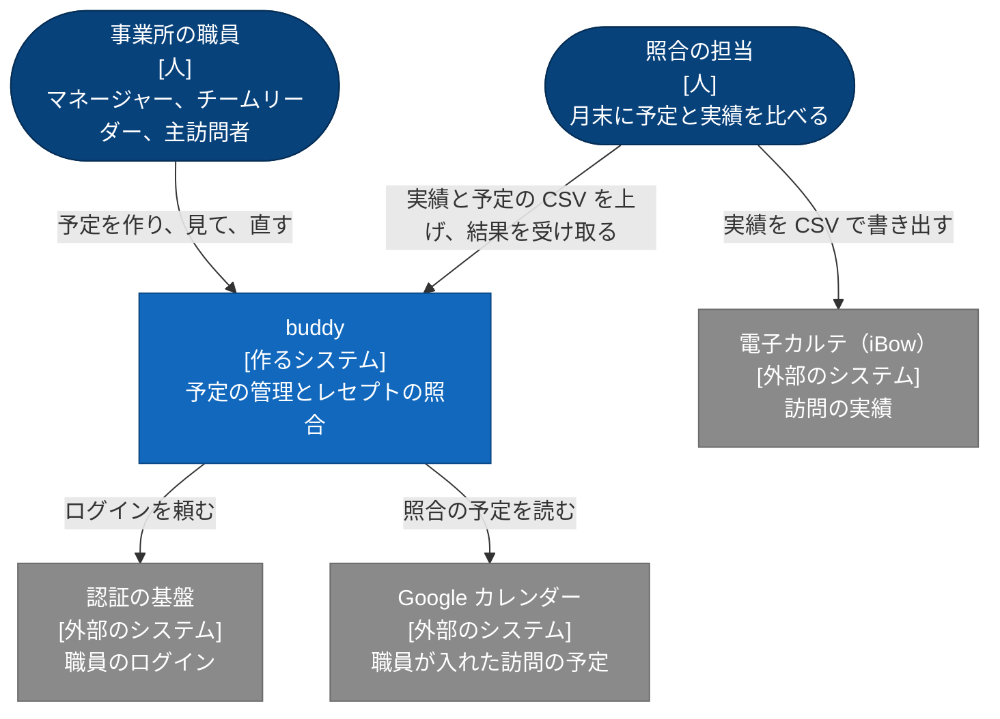

# buddy PRD

## Overview / Problem Statement

buddy は、訪問看護の事業所の職員が、訪問の予定を組み、月末に予定と実績を照合するためのアプリである。

照合に要る情報は、2 つの場所に分かれている。  
訪問の予定は職員ごとの予定表にあり、訪問の実績は電子カルテ（iBow）にある。  
2 つをつなぐものがないため、照合の担当は月末に予定を予定表から取り出す。  
照合の担当は、取り出した予定を実績の CSV と並べ、行ごとに目で比べている。

buddy は、職員が予定を入れている Google カレンダーから、対象の月の予定を直接取る。  
照合の担当は、実績の CSV を上げるだけで、食い違いの一覧を受け取れる。

## Background

### 事業所は、毎日の訪問の実績を元に、月末にレセプトを請求する

訪問看護の事業所では、職員が利用者の家を訪問し、提供したサービスと時間を記録する。  
事業所は月ごとに、その記録を元にレセプトを請求する。  
請求の区分は、サービスの種類と提供時間で決まるため、記録の時刻やサービスを誤ると、請求も誤る。

職員は、次の 3 つの役職のどれかを持つ。

- マネージャー: 事業所の職員と利用者を登録し、事業所の全ての予定を見る。
- チームリーダー: チームの職員の予定を見比べ、訪問を割り振る。
- メンバー: 自分の予定を入れ、訪問する。

役職とは別に、職員は業務の中で次の役割を担う。

- 主訪問者: 利用者を訪問し、実績を電子カルテに入れる。役職を問わない。
- 照合の担当: 月末に予定と実績を比べ、食い違いを直してから請求する。役職を問わない。

次の図は、今の業務の流れを、毎日の業務と月末の業務に分けて示す。  
赤い枠の段は、buddy を使うと照合の担当がしなくてよくなる作業である。  
点線は、月末に取り出す予定が、毎日入れた予定であることを示す。

### 予定は職員ごとの予定表に分かれている

チームリーダーは、訪問を割り振るときに、職員ごとに予定表を開いて見比べる。

### これまでのアプリには、事業所の業務で使うには次の問題があった

これまでの照合のアプリの問題は、次のとおり。

- 利用者名を含む予定を、ログインした職員だけに限って渡す仕組みが無かった。
- 取る月はアプリを動かした日で決まり、照合の担当は対象の月を選べなかった。
- アプリを入れた 1 台のパソコンでしか照合できなかった。

これまでの予定の管理のアプリは、予定を返す前に、要求した職員と事業所を確かめていなかった。  
複数の事業所で使うと、ほかの事業所の予定が見える。

## Goals

- チームリーダーは、チームの職員の予定を 1 つのカレンダーで見て、訪問を割り振れる。
- 職員は、自分の事業所の予定だけを、権限の範囲で見て直せる。
- 照合の担当は、月末に予定を取り出さずに、実績の CSV と対象の月だけで食い違いを受け取れる。
- 照合の担当は、ブラウザがあれば、どのパソコンからでも照合できる。

## Lower-Priority Goals

- 予定を複数の予定表に分けて持つ（例: 職員の予定と、事業所の会議の予定）。

## Non-Goals

- 経営数値（予定と実績の差の集計、キャンセル率、業務の割合）の管理。
- 勤怠と、職員の月の稼働時間の集計。
- 訪問の順路と移動時間、利用者の住所とエリアの管理。
- iOS のアプリ。
- 電子カルテへの実績の書き戻しと、レセプトの請求そのもの。
- 照合の結果の保存。結果は利用者の名前を含むため、照合の担当が CSV で受け取って手元で扱う。

## User Stories

### 事業所と職員: 職員が最初のログインから自分の事業所の予定を使い始める

困りごと: マネージャーは、新しく入った職員と利用者を登録する。職員がログインできるまでに、別の画面でアカウントを作る手順が要ると、登録が漏れる。

How Might We: マネージャーが職員をメールアドレスで登録しておけば、職員が最初のログインでそのまま使い始められるようにできないか。

- マネージャーとして、新しい職員をメールアドレスと役職で登録し、職員が最初のログインで自分の予定を開けるようにしたい。（未提供、段階は未決）
- マネージャーとして、利用者を、受けているサービスと希望する訪問の時間帯と担当の職員で登録したい。（未提供、段階は未決）
- マネージャーとして、特定の職員に、ほかの職員の予定を見る権限を足したい。（未提供、段階は未決）

### 予定: チームの予定を重ねて見て、空いている時間に訪問を割り振る

困りごと: チームリーダーは、チームの職員の予定を見比べて訪問を割り振る。職員ごとに予定表を開くと、空いている時間に気づかない。

How Might We: チームの職員の予定を 1 つのカレンダーに重ねて、空いている時間を見つけられるようにできないか。

- チームリーダーとして、チームの職員の予定を 1 つのカレンダーで見て、空いている時間に訪問の予定を作りたい。（M1）
- 主訪問者として、毎週や毎月の決まった訪問を 1 回の操作で入れ、休みの日だけを外したい。（未提供、段階は未決）
- 主訪問者として、利用者の都合で取りやめた訪問をキャンセルにし、理由を残したい。（未提供、段階は未決）

### 照合: 月末に、予定と食い違う実績を一覧で見つける

困りごと: 照合の担当は、予定と実績を行ごとに目で比べ、サービスの種類ごとの提供時間の許容範囲を覚えておく必要がある。件数が多い月は、食い違いに気づかないまま請求する。

How Might We: 実績の CSV を上げるだけで、予定と食い違う行と、許容範囲を外れた行が分かるようにできないか。

- 照合の担当として、予定の CSV と実績の CSV を上げて、予定との食い違いを一覧で見たい。（M2）
- 照合の担当として、対象の月を選び、実績の CSV だけを上げて、予定との食い違いを一覧で見たい。（M3）
- 照合の担当として、照合の結果を CSV で受け取り、電子カルテを直す作業の手元に置きたい。（M2）

## Proposed Solution / Feature Description

### System Context

次の図は、buddy を使う人と、buddy が頼る外部のシステムを示す。

### 事業所と職員

- 職員は、事業所の認証の基盤でログインする。buddy はパスワードを持たない。
- 職員は、職員の管理の権限を持つ職員が事前にメールアドレスで登録した場合だけ使える。最初のログインで、ログインのアカウントと登録した職員が結び付く。
- 職員は、自分の事業所のデータだけを扱える。ほかの事業所のデータを求めると、buddy は拒否する。
- 職員は、名前、メールアドレス、電話番号、部署、役職、チームを持つ。部署、役職、チームは事業所ごとに持つ。
  - 部署の例は看護部とリハビリ部、役職はマネージャー、チームリーダー、メンバーの 3 つ。
- 利用者は、名前、受けているサービス、希望する訪問の時間帯（午前、午後）、希望する担当の性別、主に担当する職員を持つ。

#### 役職ごとの権限

職員が扱える予定の範囲は、次の 7 つの権限で決まる。  
自分の予定を見ることは、権限によらず全ての職員ができる。

1. 自分の予定の編集
2. 指定した職員の予定の閲覧
3. 指定した職員の予定の編集
4. 指定したチームの職員の予定の閲覧
5. 指定したチームの職員の予定の編集
6. 事業所の全ての予定の閲覧
7. 事業所の全ての予定の編集

職員と利用者の登録、役職の作成、職員の権限と役職を変える操作は、職員の管理の権限を持つ職員だけができる。

職員を登録したときと役職を変えたときは、役職の既定の権限が職員に付く。  
職員の管理の権限を持つ職員は、その後に職員ごとに権限を足し、外せる。  
役職の既定は、次の表のとおり（仮決定）。

| 権限 | マネージャー | チームリーダー | メンバー |
| --- | --- | --- | --- |
| 自分の予定の編集 | あり | あり | あり |
| 指定した職員の予定の閲覧 | なし | なし | なし |
| 指定した職員の予定の編集 | なし | なし | なし |
| 指定したチームの職員の予定の閲覧 | なし | あり | なし |
| 指定したチームの職員の予定の編集 | なし | あり | なし |
| 事業所の全ての予定の閲覧 | あり | なし | なし |
| 事業所の全ての予定の編集 | あり | なし | なし |
| 職員の管理 | あり | なし | なし |

登録と役職の変更で付く、指定したチームの権限は、職員の所属のチームを指す。  
権限の付き方と判定の規則は、[権限](https://github.com/Fukuemon/buddy/blob/develop/context/domain/permission.md) にある。

### 予定

- 予定は、種類（通常、訪問）、日付、開始時間、終了時間、タイトル、説明を持つ。
- 訪問の予定は、利用者、主訪問者、同行者、サービスコード、訪問の区分（夜勤、緊急、入院）を持つ。
  - サービスコードは提供時間の範囲を持つ。
  - 訪問の区分は複数を付けられる。
- 繰り返しの予定は、毎週の曜日、毎月の日付、毎月の第何週の曜日のどれかで繰り返す。開始日と終了日を持ち、除外する日を指定できる（未提供）。
- 予定はキャンセルでき、キャンセルの理由を残す（未提供）。
- 開始が 17 時以降の予定には、時間外の勤務の印が付く（未提供）。
- カレンダーは、表示する職員をチームと職員で絞れる。初めて開いたときは、見る権限がある職員の全部を表示する（仮決定）。

### 照合

- 照合の担当は、電子カルテから書き出した実績の CSV を上げ、予定の CSV を上げるか対象の月を選ぶ。
- 対象の月を選んだときは、buddy がその月の 1 日から月末までの訪問の予定を、職員の Google カレンダーから取る。
- buddy は、訪問日、利用者名、主訪問者が同じ予定と実績を対にし、結果を次の 4 つの区分に分ける。
  - 不整合: 対になったが、開始時間、サービス内容、提供時間、終了時間、加算のどれかが規則に合わない
  - 予定のみ: 予定はあるが、対になる実績がない
  - 実績のみ: 実績はあるが、対になる予定がない
  - 整合: 対になり、全ての規則に合う
- 結果は、不整合、予定のみ、実績のみ、整合の順に並べ、画面に表示し、CSV で受け取れる。
- 照合の担当は、結果の各行で、規則に合わない値と、許容範囲の中で予定と違う値を見分けられる。
  - 結果の表の列、印の付け方、値がないときの表示は、画面仕様書の [照合の結果](screens/receipt-result_照合の結果/index.md) にある。

### 画面の一覧

| 画面 | 開ける職員 |
| --- | --- |
| ログイン（認証の基盤の画面へ移り、buddy は画面を持たない） | 全ての職員 |
| ログインの失敗（ログインできないか、事業所に登録されていないときに出す） | 全ての職員 |
| カレンダー（予定の作成、詳細、編集、キャンセルのモーダルを含む。キャンセルのモーダルは未提供） | 全ての職員。表示する予定は権限で決まる |
| 利用者の一覧（未提供） | 全ての職員 |
| 利用者の登録と編集（未提供） | 職員の管理の権限を持つ職員（既定はマネージャー） |
| 職員の一覧と詳細（未提供） | 全ての職員 |
| 職員の登録と編集（権限の変更を含む。未提供） | 職員の管理の権限を持つ職員（既定はマネージャー） |
| プロフィール（未提供） | 全ての職員 |
| 照合（対象の月の選択、CSV のアップロード） | 全ての職員 |
| 照合の結果 | 全ての職員 |

### Milestones

- M1: ログインと予定の管理を提供する。チームリーダーがチームの予定を 1 つのカレンダーで見て訪問を割り振れ、ほかの事業所と権限の外の予定が見えないことを確かめる。
  - 確かめる指標は、Success Metrics の予定の割り振りと、事業所の分離と権限。
- M2: 照合を、予定の CSV と実績の CSV で提供する。照合の規則が、意図して変えた点を除き、これまでの照合のアプリと同じ区分を出すかを確かめる。
  - 確かめる指標は、Success Metrics の照合の区分と、照合の規則の一致。
- M3: 照合の予定を Google カレンダーから取る。予定の CSV を用意せずに、実績の CSV と対象の月だけで照合できるかを確かめる。
  - 確かめる指標は、Success Metrics の対象の月での照合。

### Success Metrics

- 予定の割り振り: チームリーダーがログインし、チームの職員の予定を 1 つのカレンダーで見て、訪問の予定を作れる。
  - 確かめ方: 手元の環境で、チームリーダーで入るブラウザの操作の自動テストで確かめる。
- 事業所の分離と権限: 職員は、ほかの事業所の予定と、権限の外の職員の予定を見られず、直せない。
  - 確かめ方: API のテストで確かめる。
- 照合の区分: 架空の予定と実績の CSV を上げると、結果が不整合、予定のみ、実績のみ、整合の 4 つに分かれる。
  - 確かめ方: ブラウザの操作の自動テストで確かめる。
- 照合の規則の一致: 同じ予定と実績の CSV で、buddy とこれまでの照合のアプリの区分が、意図して変えた点を除いて一致する。
  - 確かめ方: 2 つの結果を行ごとに比べる。意図して変えた点は、[レセプトの照合の Design Doc の Verification](https://github.com/Fukuemon/buddy/blob/develop/apps/receipt-api/DesignDoc.md#verification) にある。
- 対象の月での照合: 対象の月と実績の CSV だけで、その月の予定と実績が対になり、4 つの区分に分かれる。
  - 確かめ方: Google カレンダーの代わりの偽物を使う API のテストで確かめる。

## Open Questions / Risks

### Open Questions

- 「未提供」と書いた要求を、どの段階で提供するか。対象は、繰り返しの予定の入力と除外する日、予定のキャンセルとその理由、時間外の勤務の印、キャンセルのモーダル、職員と利用者の登録、権限の変更、利用者と職員とプロフィールの画面である。開発者が、M3 の次の段階を Milestones に足すときに決める。
- 役職の既定の権限（職員の管理の権限をマネージャーに付けることを含む）は仮決定である。開発者が、事業所の責任者に確かめて、職員の登録と編集の画面を作るまでに決める。
- 職員の性別を持つか。利用者の希望する担当の性別と比べるには要る。開発者が、事業所の責任者に確かめて、職員の登録と編集の画面を作るまでに決める。
- 同じ人を 2 つの事業所の職員に登録すると、後にログインした事業所ではログインできない。複数の事業所で働く職員がいるかを、開発者が事業所の責任者に確かめて、2 つ目の事業所で使い始めるまでに決める。
- カレンダーを初めて開いたときに表示する職員を、見る権限がある職員に限るか。今のカレンダーは、事業所の全ての職員を絞り込みに並べ、全員を表示する。開発者が、カレンダーの絞り込みを次に直すまでに決める。
- 繰り返しの予定を、回ごとにカレンダーに出すか。開発者が、画面から繰り返しの予定を作れるようにするときに決める。
- 加算が「通常」のときだけを規則に合うとするか。この規則では、加算が空の実績も不整合になる。開発者が、事業所の照合の担当に確かめて、事業所で照合を使い始めるまでに決める。
- I２、I３、I４ の、訪看、予防看、予訪看、予防訪看の 12 種類のサービス内容の予定は、終了時間と提供時間を 1 分減らしてから比べている。理由を、開発者が事業所で照合を使い始めるまでに確かめる。
- 照合の許容範囲の表は、予防訪看の I５・２超を `予防訪看I５２超` の形だけで持ち、`予防訪看I５・２超` を持たない。`予防訪看I５・２超` の予定と実績は、許容範囲が無いので不整合になる。写した元の表の抜けかを、開発者が事業所の照合の担当に確かめて、事業所で照合を使い始めるまでに決める。
- 電子カルテが書き出す CSV の訪問日の形を、手元の資料で確かめていない。buddy は `2026/10/1` と `2026-10-01` の形だけを読む。開発者が、事業所で照合を使い始めるまでに確かめる。
- 照合の対象を、期間と職員で絞るか。絞らないと、予定を入れていない職員の実績は全て実績のみに入る。開発者が、事業所で照合を使い始めるまでに決める。
- 照合の予定を、Google カレンダーの代わりに buddy の予定から取るか。開発者が、職員が予定を buddy で入れるようになる段階を決めるときに選ぶ。

### Risks

- 予定と実績で主訪問者の表記が違うと、対にならず、全ての行が予定のみと実績のみに分かれる。
  - 備え: 職員のカレンダーの表示名を、電子カルテの職員名と同じ表記にする。照合の画面に、予定のみと実績のみの件数を出す。
- 実績の CSV は利用者の名前を含む。
  - 備え: buddy は上げた CSV と照合の結果を保存しない。
