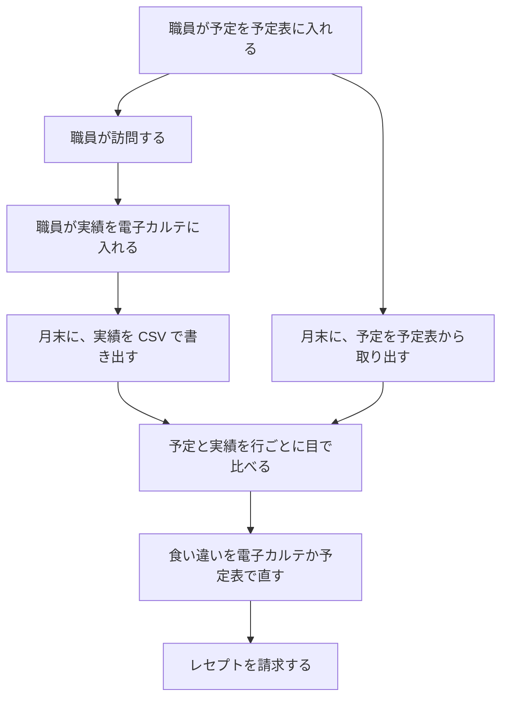
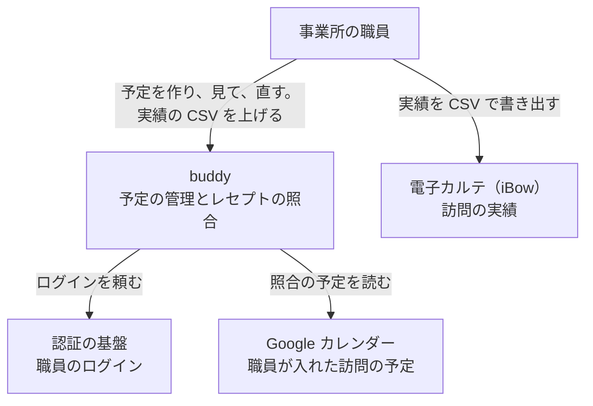

# buddy PRD

## Overview / Problem Statement

buddy は、訪問看護の事業所の職員が使う 2 つのアプリを 1 つにまとめる。  
1 つは職員の予定を管理するアプリで、もう 1 つは訪問の予定と実績を比べてレセプトの誤りを見つけるアプリである。  
職員は 1 回のログインで、同じ画面から両方を使う。

レセプトの照合に要る情報は、2 つの場所に分かれている。  
訪問の予定は職員の予定表にあり、訪問の実績は電子カルテ（iBow）にある。  
2 つの間をつなぐものがないため、職員は月末に予定を予定表から取り出し、実績の CSV と並べて、行ごとに目で比べている。

buddy の照合は、職員が予定を入れている Google カレンダーから、対象の月の予定を直接取る。  
職員は予定を取り出す手間がなくなり、照合の画面で実績の CSV を上げるだけで、食い違いの一覧を受け取れる。

## Background

### 照合の予定を取る仕組みが、誰にでも利用者名を返す

これまでの照合のアプリは、職員の Google カレンダーの予定を、CSV にして返すスクリプトから取っていた。  
スクリプトは匿名で呼べる設定で公開され、利用者名を含む予定を返す。  
取る期間は実行した日の 2 か月前の月に固定され、対象の月を選べない。  
カレンダーの職員名は電子カルテの職員名と表記が違い（例: 役職を名前の前に付ける）、職員名の対応表を手で保守していた。

### 照合が手元の 1 台でしか動かない

照合の規則は、手元のパソコンで動くアプリの中にしかない。  
照合する職員は、そのアプリが入ったパソコンの前でしか作業できない。

### 予定の管理に、事業所と職員の区別がない

予定の管理の API は、ログインを確かめずに応答する。  
複数の事業所で使うと、ほかの事業所の予定が見えてしまう。

今の照合の作業の流れは、次のとおり。

## Goals

- 事業所の職員は、1 回のログインで、自分の事業所の予定の管理とレセプトの照合を同じ画面から使える。
- 職員は、役職と個別に与えられた権限の範囲で、ほかの職員の予定を見て、直せる。
- 照合する職員は、実績の CSV を上げるだけで、予定との食い違いを 4 つの区分で受け取れる。

## Lower-Priority Goals

- 予定を複数の予定表に分けて持つ（例: 職員の予定と、事業所の会議の予定）。

## Non-Goals

- 経営数値（予定と実績の差の集計、キャンセル率、業務の割合）の管理。
- 勤怠と、職員の月の稼働時間の集計。
- 訪問の順路と移動時間、利用者の住所とエリアの管理。
- iOS のアプリ。
- 電子カルテへの実績の書き戻しと、レセプトの請求そのもの。
- 照合の結果の保存。結果は利用者の名前を含むため、職員が CSV で受け取って手元で扱う。

## User Stories

### 予定を組む

困りごと: チームリーダーは、チームの職員の予定を見比べて訪問を割り振る。職員ごとに予定表を開くと、空いている時間に気づかない。

How Might We: チームの職員の予定を 1 つのカレンダーに重ねて、空いている時間を見つけられるようにできないか。

- チームリーダーとして、チームの職員の予定を 1 つのカレンダーで見て、空いている時間に訪問の予定を作りたい。（M1）
- 職員として、毎週や毎月の決まった訪問を 1 回の操作で入れ、休みの日だけを外したい。（M1）
- 職員として、利用者の都合で取りやめた訪問をキャンセルにし、理由を残したい。（M1）

### 職員と利用者を登録する

困りごと: 管理者は、新しく入った職員と利用者を登録する。職員がログインできるまでに、別の画面でアカウントを作る手順が要ると、登録が漏れる。

How Might We: 管理者が職員をメールアドレスで登録しておけば、職員が最初のログインでそのまま使い始められるようにできないか。

- 管理者として、新しい職員をメールアドレスと役職で登録し、職員が最初のログインで自分の予定を開けるようにしたい。（M1）
- 管理者として、利用者を、受けているサービスと希望する訪問の時間帯と担当の職員で登録したい。（M1）
- 管理者として、特定の職員に、ほかの職員の予定を見る権限を足したい。（M1）

### 月末に照合する

困りごと: 照合する職員は、予定と実績を行ごとに目で比べ、サービスの種類ごとの提供時間の許容範囲を覚えておく必要がある。件数が多い月は、食い違いに気づかないまま請求する。

How Might We: 実績の CSV を上げるだけで、予定と食い違う行と、許容範囲を外れた行が分かるようにできないか。

- 照合する職員として、対象の月を選び、実績の CSV を上げて、予定との食い違いを一覧で見たい。（M2、M3）
- 照合する職員として、照合の結果を CSV で受け取り、電子カルテを直す作業の手元に置きたい。（M2）

## Proposed Solution / Feature Description

### Landscape

buddy は、事業所の職員から予定と実績の CSV を受け、ログインを外部の認証の基盤に任せる。

### ログインと事業所

- 職員は、事業所の認証の基盤でログインする。buddy はパスワードを持たない。
- 職員は、管理者が事前にメールアドレスで登録した場合だけ使える。最初のログインで、ログインのアカウントと登録した職員が結び付く。
- 職員は、自分の事業所のデータだけを扱える。ほかの事業所のデータを求めると、buddy は拒否する。

### 予定の管理

- 予定は、種類（通常、訪問）、日付、開始時間、終了時間、タイトル、説明を持つ。
- 訪問の予定は、利用者、主訪問者、同行者、サービスコード、訪問の区分（夜勤、緊急、入院）を持つ。サービスコードは提供時間の範囲を持つ。訪問の区分は複数を付けられる。
- 繰り返しの予定は、毎週の曜日、毎月の日付、毎月の第何週の曜日のどれかで繰り返す。開始日と終了日を持ち、除外する日を指定できる。
- 予定はキャンセルでき、キャンセルの理由を残す。
- 開始が 17 時以降の予定には、時間外の勤務の印が付く。
- カレンダーは、全体、自分、チームのチェックボックスで、表示する職員を切り替える。初めて開いたときは、見る権限がある職員の全部を表示する。

### 利用者と職員の管理

- 利用者は、名前、受けているサービス、希望する訪問の時間帯（午前、午後）、希望する担当の性別、主に担当する職員を持つ。
- 職員は、名前、メールアドレス、電話番号、部署、役職、チームを持つ。部署、役職、チームは事業所ごとに持つ。
  - 部署の例は看護部とリハビリ部、役職はマネージャー、チームリーダー、メンバーの 3 つ。

### 役職ごとの権限

職員が扱える予定の範囲は、次の 7 つの権限で決まる。  
自分の予定を見ることは、権限によらず全ての職員ができる。

1. 自分の予定の編集
2. 指定した職員の予定の閲覧
3. 指定した職員の予定の編集
4. 指定したチームの職員の予定の閲覧
5. 指定したチームの職員の予定の編集
6. 事業所の全ての予定の閲覧
7. 事業所の全ての予定の編集

職員と利用者の登録と、職員の権限と役職を変える操作は、職員の管理の権限を持つ職員だけができる。

職員を登録したときと役職を変えたときは、役職の既定の権限が職員に付く。  
職員の管理の権限を持つ職員は、その後に職員ごとに権限を足し、外せる。  
役職の既定は、次の表のとおり（仮決定）。指定したチームの権限は、職員の所属のチームを指す。

| 権限 | マネージャー | チームリーダー | メンバー |
| --- | --- | --- | --- |
| 自分の予定の編集 | あり | あり | あり |
| 指定した職員の予定の閲覧 | なし | なし | なし |
| 指定した職員の予定の編集 | なし | なし | なし |
| 指定したチームの職員の予定の閲覧 | なし | あり | なし |
| 指定したチームの職員の予定の編集 | なし | あり | なし |
| 事業所の全ての予定の閲覧 | あり | なし | なし |
| 事業所の全ての予定の編集 | あり | なし | なし |
| 職員の管理 | あり | なし | なし |

### レセプトの照合

- 照合する職員は、電子カルテから書き出した実績の CSV を上げ、予定の CSV を上げるか対象の月を選ぶ。
- 対象の月を選んだときは、buddy がその月の 1 日から月末までの訪問の予定を、職員の Google カレンダーから取る。
- buddy は、訪問日、利用者名、主訪問者が同じ予定と実績を対にし、結果を次の 4 つの区分に分ける。
  - 不整合: 対になったが、開始時間、サービス内容、提供時間、終了時間、加算のどれかが規則に合わない
  - 予定のみ: 予定はあるが、対になる実績がない
  - 実績のみ: 実績はあるが、対になる予定がない
  - 整合: 対になり、全ての規則に合う
- 結果は、不整合、予定のみ、実績のみ、整合の順に並べ、画面に表示し、CSV で受け取れる。
- 規則に合わない値には印と、そのサービスの許容範囲を付ける。値が一致しないが許容範囲に入る値には、注意の印を付ける。

結果の表の列は、次のとおり。値がない欄は「データなし」と表示する。ただし、実績に加算が無いときは、加算の欄を空欄にする。

- 訪問日、利用者名、主訪問者（予定と実績で一致させる）
- サービス内容、開始時間、終了時間、提供時間の予定の値
- サービス内容、開始時間、終了時間、提供時間の実績の値
- 加算（実績の CSV にあるもの）

### 画面の一覧

| 画面 | 開ける職員 |
| --- | --- |
| ログイン | 全ての職員 |
| カレンダー（予定の作成、詳細、編集、キャンセルのモーダルを含む） | 全ての職員。表示する予定は権限で決まる |
| 利用者の一覧 | 全ての職員 |
| 利用者の登録と編集 | 職員の管理の権限を持つ職員（既定はマネージャー） |
| 職員の一覧と詳細 | マネージャー |
| 職員の登録と編集（権限の変更を含む） | 職員の管理の権限を持つ職員（既定はマネージャー） |
| プロフィール | 全ての職員 |
| 照合（対象の月の選択、CSV のアップロード） | 全ての職員 |
| 照合の結果 | 全ての職員 |

### Milestones

- M1: ログインと予定の管理を提供する。職員が自分の事業所の予定を作り、ほかの事業所の予定が見えないことを確かめる。
  - 確かめる指標は、Success Metrics の予定の作成と、事業所の分離。
- M2: 照合を、予定の CSV と実績の CSV で提供する。照合の規則が、これまでの照合のアプリと同じ結果を出すことを確かめる。
  - 確かめる指標は、Success Metrics の照合の区分。
- M3: 照合の予定を Google カレンダーから取る。予定の CSV を用意せずに、実績の CSV と対象の月だけで照合できることを確かめる。
  - 確かめる指標は、Success Metrics の照合の区分。

### Success Metrics

- 予定の作成: 職員がログインし、予定を作れる。手元の環境で、ブラウザの操作の自動テストで確かめる。
- 事業所の分離: ほかの事業所の予定を API で求めると、buddy が拒否する。API のテストで確かめる。
- 照合の区分: 架空の予定と実績の CSV を上げると、結果が不整合、予定のみ、実績のみ、整合の 4 つに分かれる。ブラウザの操作の自動テストで確かめる。

## Open Questions / Risks

### Open Questions

- 役職の既定の権限（職員の管理の権限をマネージャーに付けることを含む）は仮決定である。開発者が、事業所の管理者に確かめて M1 の完了までに決める。
- 加算の判定は、加算が「通常」のときだけ規則に合うとしている。加算が空の実績も不整合になる。開発者が、事業所の照合の担当者に確かめて M2 の完了までに決める。
- 訪看 I２ から I４ の予定は、終了時間と提供時間を 1 分減らしてから比べている。理由は未確認で、元の規則のままにしている。開発者が M3 の完了までに確かめる。
- 照合の予定を、Google カレンダーの代わりに予定の管理から取るか。職員が画面で予定を入れるようになってから、開発者が選ぶ。
- 職員の性別を持つか。利用者の希望する担当の性別と比べるには要る。開発者が、事業所の管理者に確かめて M1 の完了までに決める。
- 繰り返しの予定を、回ごとにカレンダーに出すか。今は、繰り返しの予定を画面から作れず、カレンダーにも出さない。開発者が、画面から繰り返しの予定を作れるようにするときに決める。
- 同じ人を 2 つの事業所の職員に登録すると、後にログインした事業所ではログインできない。複数の事業所で働く職員がいるかを、開発者が事業所の管理者に確かめて M1 の完了までに決める。
- 照合の対象を職員で絞るか。今は絞らないので、予定のない職員の実績は全て実績のみに入る。開発者が M3 の完了までに決める。

### Risks

- 予定と実績で主訪問者の表記が違うと、対にならず、全ての行が予定のみと実績のみに分かれる。
  - 備え: 職員のカレンダーの表示名を、電子カルテの職員名と同じ表記にする。照合の画面に、予定のみと実績のみの件数を出す。
- 実績の CSV は利用者の名前を含む。
  - 備え: buddy は上げた CSV と照合の結果を保存しない。
