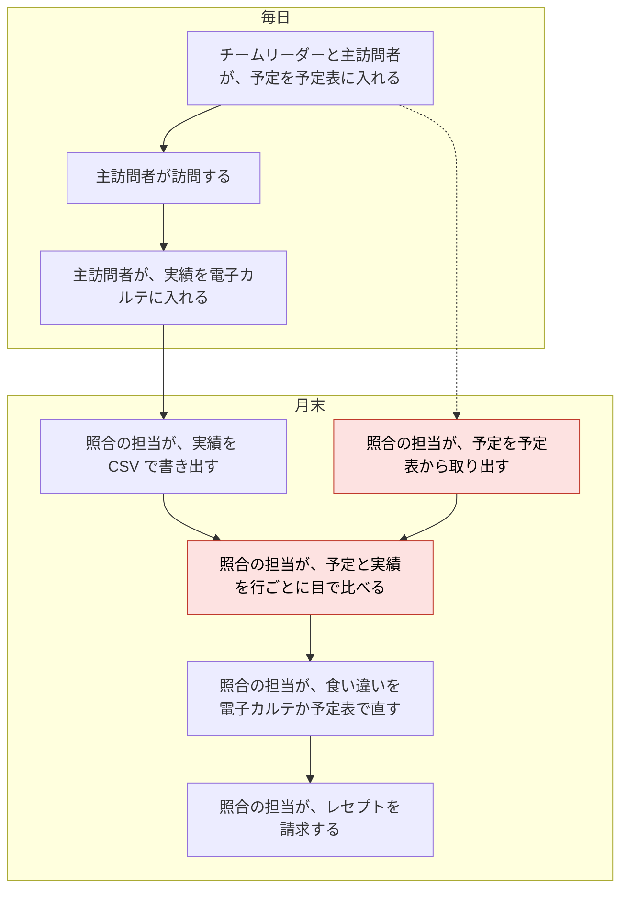
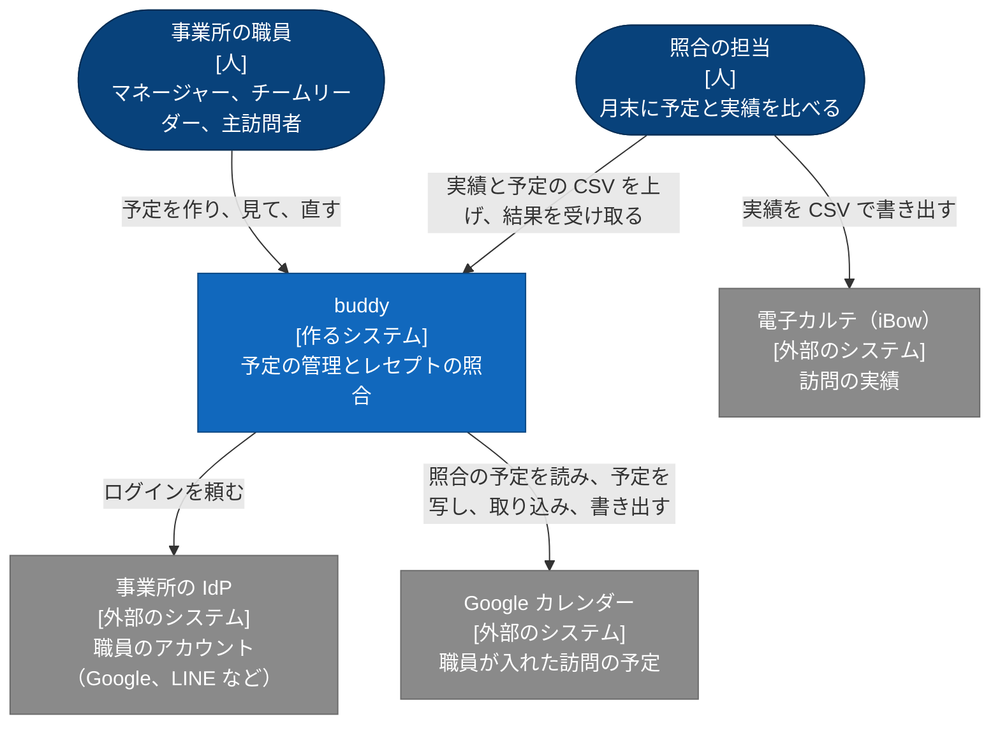

# buddy PRD

## Overview / Problem Statement

buddy は、訪問看護の事業所の職員が、訪問の予定を組み、月末に予定と実績を照合するためのアプリである。

照合に要る情報は、2 つの場所に分かれている。  
訪問の予定は職員ごとの予定表にあり、訪問の実績は電子カルテ（iBow）にある。  
2 つをつなぐものがないため、照合の担当は月末に予定を予定表から取り出す。  
照合の担当は、取り出した予定を実績の CSV と並べ、行ごとに目で比べている。

buddy は、職員が予定を入れている Google カレンダーから、対象の月の予定を直接取る。  
照合の担当は、実績の CSV を上げるだけで、食い違いの一覧を受け取れる。

職員は、予定を Google カレンダーで入れ、見ている。  
予定の管理を buddy へ一度に移すと、職員は予定を入れ直す必要がある。  
移った後も、Google カレンダーを見る職員が残る。  
移る前は、buddy は Google カレンダーの予定を写して見せ、職員は Google カレンダーで予定を直す。  
事業所が buddy へ移るときは、Google カレンダーの予定を buddy に取り込み、予定の管理を buddy に移す。  
移った後は、buddy の予定を Google カレンダーに書き出す。

## Background

### 事業所は、毎日の訪問の実績を元に、月末にレセプトを請求する

訪問看護の事業所では、職員が利用者の家を訪問し、提供したサービスと時間を記録する。  
事業所は月ごとに、その記録を元にレセプトを請求する。  
請求の区分は、サービスの種類と提供時間で決まる。  
記録の時刻やサービスを誤ると、請求も誤る。

職員は、次の 4 つの役職のどれかを持つ。

- マネージャー: 事業所の職員と利用者を登録し、事業所の全ての予定を見る。
- チームリーダー: チームの職員の予定を見比べ、訪問を割り振る。
- メンバー: 自分の予定を入れ、訪問する。
- 事務: 月末に予定と実績を照合し、請求する。
  - 事務の職員は訪問しない。

役職とは別に、職員は業務の中で次の役割を担う。

- 主訪問者: 利用者を訪問し、実績を電子カルテに入れる。
  - 主訪問者は役職を問わない。
- 照合の担当: 月末に予定と実績を比べ、食い違いを直してから請求する。
  - 照合の権限を持つ職員が担い、主に事務の職員である。

次の図は、今の業務の流れを、毎日の業務と月末の業務に分けて示す。  
赤い枠の段は、buddy を使うと照合の担当がしなくてよくなる作業である。  
点線は、月末に取り出す予定が、毎日入れた予定であることを示す。

### 予定は職員ごとの予定表に分かれている

チームリーダーは、訪問を割り振るときに、職員ごとに予定表を開いて見比べる。

### これまでのアプリには、事業所の業務で使うには次の問題があった

これまでの照合のアプリの問題は、次のとおり。

- 利用者名を含む予定を、ログインした職員だけに限って渡す仕組みが無かった。
- 取る月はアプリを実行した日で決まり、照合の担当は対象の月を選べなかった。
- アプリを入れた 1 台のパソコンでしか照合できなかった。

これまでの予定の管理のアプリは、予定を返す前に、リクエストした職員と事業所を確認していなかった。  
複数の事業所で使うと、ほかの事業所の予定が見える。

## Goals

- チームリーダーは、チームの職員の予定を 1 つのカレンダーで見て、訪問を割り振れる。
- 職員は、自分の事業所の予定だけを、権限の範囲で見て直せる。
- 照合の担当は、月末に予定を取り出さずに、実績の CSV と対象の月だけで食い違いを受け取れる。
- 照合の担当は、ブラウザがあれば、どのパソコンからでも照合できる。
- 職員は、Google カレンダーに入れてきた予定を buddy へ移せる。
  - 移る前は Google カレンダーで予定を直したまま buddy で予定を見られ、移った後は Google カレンダーで buddy の予定を見られる。

## Lower-Priority Goals

- 予定を複数の予定表に分けて持つ（例: 職員の予定と、事業所の会議の予定）。

## Non-Goals

- 経営数値（予定と実績の差の集計、キャンセル率、業務の割合）の管理。
- 勤怠と、職員の月の稼働時間の集計。
- 訪問の順路と移動時間、利用者の住所とエリアの管理。
- iOS のアプリ。
- 電子カルテへの実績の書き戻しと、レセプトの請求そのもの。
- 照合の結果の保存。
  - 結果は利用者の名前を含むため、照合の担当が CSV で受け取って手元で扱う。

## User Stories

### 事業所と職員: 職員が最初のログインから自分の事業所の予定を使い始める

困りごと: マネージャーは、新しく入った職員と利用者を登録する。  
職員がログインできるまでに、別の画面でアカウントを作る手順が要ると、登録が漏れる。

How Might We: マネージャーが職員をメールアドレスで登録しておけば、職員が最初のログインでそのまま使い始められるようにできないか。

- マネージャーとして、新しい職員をメールアドレスと役職で登録し、職員が最初のログインで自分の予定を開けるようにしたい。
- マネージャーとして、利用者を、受けているサービスと希望する訪問の時間帯と担当の職員で登録したい。
- マネージャーとして、特定の職員に、ほかの職員の予定を見る権限を足したい。
- マネージャーとして、照合をする事務の職員を事務の役職と訪問しない職員で登録し、その職員が照合できて、カレンダーの職員の列と訪問の担当の候補に出ないようにしたい。
- マネージャーとして、育休や病気で休む職員を休職にし、戻ったら復職にしたい。
  - 休職の間、その職員は buddy を使えず、訪問の割り振りの候補にも出ない。
- マネージャーとして、辞めた職員を退職にし、その職員が buddy を使えないようにしたい。
  - 退職の前に、その職員のこれからの予定と担当の利用者を別の職員に割り振り直し、誰も行かない訪問を残したくない。
- マネージャーとして、誤ったアカウントでログインした職員の結び付けを外し、その職員が正しいアカウントで入り直せるようにしたい。
  - 職員を退職させずに直したい。

### 予定: チームの予定を重ねて見て、空いている時間に訪問を割り振る

困りごと: チームリーダーは、チームの職員の予定を見比べて訪問を割り振る。  
職員ごとに予定表を開くと、空いている時間に気づかない。

How Might We: チームの職員の予定を 1 つのカレンダーに重ねて、空いている時間を見つけられるようにできないか。

- チームリーダーとして、チームの職員の予定を 1 つのカレンダーで見て、空いている時間に訪問の予定を作りたい。（M1）
- 主訪問者として、毎週や毎月の決まった訪問を 1 回の操作で入れ、休みの日だけを外したい。（段階は未決）
- 主訪問者として、利用者の都合で取りやめた訪問をキャンセルにし、理由を残したい。（段階は未決）
- 職員として、誤って入れた予定を、キャンセルの記録と混ぜずに消したい。（段階は未決）

### 移行と併用: Google カレンダーを使いながら buddy へ移る

困りごと: 職員は、訪問の予定を職員ごとの Google カレンダーに入れている。  
予定を buddy へ一度に入れ直すのは手間が大きく、移った後も Google カレンダーで予定を見る職員が残る。

How Might We: 予定を直す場所を事業所ごとに 1 つに保ったまま、Google カレンダーの予定をそのまま buddy へ移せないか。

- マネージャーとして、職員の Google カレンダーの予定を、期間を選んで buddy に取り込みたい。（M4）
  - 取り込む前に、取り込む予定と取り込めない予定を見たい。
- 主訪問者として、buddy で作り、直し、キャンセルした予定を、自分の Google カレンダーでも見たい。（M5）
- 主訪問者として、buddy へ移る前は、Google カレンダーで直した予定を buddy のカレンダーでも見たい。（M6）
- マネージャーとして、職員の予定を全て取り込んだことを確認してから、事業所の予定の管理を buddy に移したい。（M6）

### 照合: 月末に、予定と食い違う実績を一覧で見つける

困りごと: 照合の担当は、予定と実績を行ごとに目で比べ、サービスの種類ごとの提供時間の許容範囲を覚えておく必要がある。  
件数が多い月は、食い違いに気づかないまま請求する。

How Might We: 実績の CSV を上げるだけで、予定と食い違う行と、許容範囲を外れた行が分かるようにできないか。

- 照合の担当として、予定の CSV と実績の CSV を上げて、予定との食い違いを一覧で見たい。（M2）
- 照合の担当として、対象の月を選び、実績の CSV だけを上げて、予定との食い違いを一覧で見たい。（M3）
- 照合の担当として、照合の結果を CSV で受け取り、電子カルテを直す作業の手元に置きたい。（M2）

## Proposed Solution / Feature Description

### System Context

次の図は、buddy を使う人と、buddy が使う外部のシステムを示す。

### 事業所と職員

- 職員は、事業所の IdP のアカウントでログインする。
  - buddy はパスワードを持たない。
- 職員は、職員の管理の権限を持つ職員が事前にメールアドレスで登録した場合だけ使える。
  - 最初のログインで、ログインのアカウントと登録した職員が結び付く。
- 職員の管理の権限を持つ職員は、職員に結び付いたログインのアカウントを、退職させずに外せる。
  - 外した職員はログアウトし、次のログインで、登録したメールアドレスのアカウントで結び付け直す。
  - 誰がいつ外したかが記録に残る。
  - ADR-0050: [職員に結び付いた上流のアカウントを、職員の管理の権限を持つ職員が職員の詳細の画面から外し、外したらログインのセッションを取り消す](https://github.com/Fukuemon/buddy/blob/develop/docs/adr/0050-unlink-upstream-account.md)
- 職員の管理の権限を持つ職員は、職員を休職か退職にできる。
  - 休職と退職の職員はログインできない。ログインしている間に休職か退職にされた職員も、数分のうちに使えなくなる。
  - 休職は、復職で元に戻せる。戻る予定の日をメモとして持てるが、その日に自動では戻らない。
  - 退職は戻せない。
    - 退職した職員の名前と所属は、過去の予定と照合の結果のために残り、電話番号は消える。
    - 同じ人を再び雇うときは、新しい職員として登録する。
  - 休職か退職にするときに、その日以降の予定と担当の利用者が一覧で出る。退職は、その一覧が空になるまでできない。
  - 休職と退職の職員は、カレンダーの職員の列と、予定と利用者の担当の候補に出ない。
  - 職員は、自分を休職と退職にできない。事業所で職員の管理の権限を持つ最後の有効な職員も、休職と退職にできない。
- 職員は、自分の事業所のデータだけを扱える。
  - ほかの事業所のデータを求めると、buddy は拒否する。
- 職員は、名前、メールアドレス、電話番号、部署、役職、チームを持つ。
  - 部署、役職、チームは事業所ごとに持つ。
  - 部署の例は看護部とリハビリ部、役職はマネージャー、チームリーダー、メンバー、事務の 4 つ。
- 職員は、訪問するかを持つ。
  - 登録したときは「訪問する」で、職員の管理の権限を持つ職員が変えられる。
  - 訪問しない職員は、カレンダーの職員の列と、予定の職員、主訪問者、同行者、利用者の担当の候補に出ない。訪問しない職員は、自分の予定を持てない。
  - その日以降の予定、繰り返しの予定、担当の利用者が残る職員は、訪問しない職員にできない。残る予定と担当の利用者が一覧で出る。
  - 訪問しない職員にしても、過去の予定は残る。
- 利用者は、名前、受けているサービス、希望する訪問の時間帯（午前、午後）、希望する担当の性別、主に担当する職員を持つ。
- 職員の管理の権限を持つ職員は、サービスを終えた利用者を利用の終了にできる。
  - 利用の終了は、利用の再開で元に戻せる。
    - 再開するときは、担当の職員を選び直す。休職と退職の職員は選べない。
  - その日以降の予定と繰り返しの予定が残る利用者は、利用の終了にできない。残る予定が一覧で出る。
  - 利用の終了の利用者は、利用者の一覧のふだんの表示に出ず、状態の絞り込みで利用の終了にした日とともに出る。
    - 予定の利用者の候補には出ない。
  - 利用の終了の利用者の名前と受けているサービスは、過去の予定と照合の結果のために残る。
  - 職員を退職にするときの担当の利用者の一覧に、利用の終了の利用者は出ない。

#### 役職ごとの権限

職員が扱える予定の範囲は、次の 7 つの権限で決まる。  
自分の予定を見ることは、権限によらず全ての職員ができる。

1. 自分の予定の編集
2. 指定した職員の予定の閲覧
3. 指定した職員の予定の編集
4. 指定したチームの職員の予定の閲覧
5. 指定したチームの職員の予定の編集
6. 事業所の全ての予定の閲覧
7. 事業所の全ての予定の編集

職員と利用者の登録、役職の作成、職員の権限と役職を変える操作は、職員の管理の権限を持つ職員だけができる。  
照合と照合の結果は、照合の権限を持つ職員だけが扱える。

職員を登録したときと役職を変えたときは、役職のデフォルトの権限が職員に付く。  
職員の管理の権限を持つ職員は、その後に職員ごとに権限を足し、外せる。  
照合の権限も、事務の職員のほかに足せる。  
役職のデフォルトの権限は、次の表のとおり（仮決定）。

| 権限 | マネージャー | チームリーダー | メンバー | 事務 |
| --- | --- | --- | --- | --- |
| 自分の予定の編集 | あり | あり | あり | なし |
| 指定した職員の予定の閲覧 | なし | なし | なし | なし |
| 指定した職員の予定の編集 | なし | なし | なし | なし |
| 指定したチームの職員の予定の閲覧 | なし | あり | なし | なし |
| 指定したチームの職員の予定の編集 | なし | あり | なし | なし |
| 事業所の全ての予定の閲覧 | あり | なし | なし | あり |
| 事業所の全ての予定の編集 | あり | なし | なし | あり |
| 職員の管理 | あり | なし | なし | なし |
| 照合 | あり | なし | なし | あり |

事務の職員は、照合の食い違いを予定表で直すので、事業所の全ての予定を見て直せる。  
照合の権限と事務の役職は ADR-0041 に、訪問しない職員の扱いは ADR-0006 にある。

- ADR-0041: [権限を役職のデフォルトと職員ごとの上書きで持ち、役職を変えても職員ごとに足した権限を残し、職員の管理と照合も権限で許す](https://github.com/Fukuemon/buddy/blob/develop/docs/adr/0041-pbac-grants.md)
- ADR-0006: [訪問するかを職員に持ち、訪問しない職員を予定と担当から外す](https://github.com/Fukuemon/buddy/blob/develop/docs/adr/0006-non-visiting-staff.md)

登録と役職の変更で付く、指定したチームの権限は、職員の所属のチームを指す。  
権限の付き方と判定の規則は、[権限](https://github.com/Fukuemon/buddy/blob/develop/context/domain/permission.md) にある。

### 予定

- 予定は、種類（通常、訪問）、日付、開始時間、終了時間、タイトル、説明を持つ。
- 訪問の予定は、利用者、主訪問者、同行者、サービスコード、訪問の区分（夜勤、緊急、入院）を持つ。
  - サービスコードは提供時間の範囲を持つ。
  - 訪問の区分は複数を付けられる。
- 繰り返しの予定は、毎週の曜日（複数の曜日と、隔週などの週の間隔を選べる）、毎月の日付、毎月の第何週の曜日のどれかで繰り返す。
  - 繰り返しの予定は、開始日と終了日を持ち、除外する日を指定できる。
- 予定はキャンセルでき、キャンセルの理由を残す。
- 予定を buddy で管理している事業所では、誤って入れた予定を、キャンセルと別の操作で削除できる。
  - 削除できるのは、開始の日が今日以降の、キャンセルしていない単発の予定と、日が今日以降の繰り返しの予定の 1 つの回である。
  - 削除した予定は、カレンダーにも照合にも出ず、戻せない。誰がいつ消したかは、画面に出さない監査の記録に残す。
  - 扱いの設計は、ADR-0040 にある。
    - ADR-0040: [誤って入れた予定を、キャンセルと別の削除で消し、開始の日が今日以降の有効な予定に限り、監査の記録だけを残す](https://github.com/Fukuemon/buddy/blob/develop/docs/adr/0040-schedule-deletion.md)
- 開始が 17 時以降の予定には、時間外の勤務の印が付く。
- 予定は、翌日に終わる 24 時間未満の予定も扱う。
  - 事業所には、夜勤の訪問のように日をまたぐ訪問がある。
  - 日をまたぐ予定は、開始の日の予定として持ち、開始の日の一覧に出る。カレンダーは、0 時から 24 時を出し、日をまたぐ予定を開始の日と翌日の両方に描く。
  - 扱いの設計は、ADR-0033 にある。
    - ADR-0033: [日をまたぐ予定を、開始の日の予定に「終了が翌日か」の印を付けて持ち、取り込み、カレンダー、照合で扱う](https://github.com/Fukuemon/buddy/blob/develop/docs/adr/0033-overnight-schedule.md)
  - 終了が翌日の予定の規則は、[予定の不変条件](https://github.com/Fukuemon/buddy/blob/develop/context/domain/schedule.md#invariants) にある。
- カレンダーは、表示する職員をチームと職員で絞れる。
  - 初めて開いたときに表示する職員は未決である。

### Google カレンダーとの連携

- カレンダーの結び付け、取り込み、移行、確認が必要な予定を解く操作は、職員の管理の権限を持つ職員（デフォルトはマネージャー）ができる。
  - このセクションでは、この職員をマネージャーと書く。
- 事業所ごとに、予定の管理先を Google カレンダーか buddy の 1 つに決める。
  - 予定を Google カレンダーで管理している事業所（`google_primary`）では、職員は Google カレンダーと buddy のどちらでも予定を作成、変更、キャンセルできる。buddy で直した予定は、buddy が Google カレンダーに書く。
    - キャンセルの理由は、Google カレンダーに書く場所が無いので残らない。
    - Google カレンダーと buddy の両方で同じ予定を変えたときは、先に書かれた変更を残す。
      - 後から buddy で保存した職員には、予定が Google カレンダーで変わったことと最新の予定を示し、入力を残す。職員は、最新の予定を見て入力し直す。
      - ADR-0029: [buddy からの書き込み（`google_primary`）](https://github.com/Fukuemon/buddy/blob/develop/docs/adr/0029-google-calendar-sync.md#buddy-からの書き込みgoogle_primary)
    - 予定の管理を buddy に移している間は、buddy で予定を直せない。
  - 予定を buddy で管理している事業所（`buddy_primary`）では、職員は buddy で予定を直し、buddy が Google カレンダーに書き出す。Google カレンダーで直した予定は、buddy に反映しない。
  - 新しい事業所は、予定を Google カレンダーで管理して始める。
  - 予定の管理は、Google カレンダーから buddy への向きにだけ移す。
  - ADR-0029: [Google カレンダーとの連携を、事業所ごとの予定の管理先で分ける](https://github.com/Fukuemon/buddy/blob/develop/docs/adr/0029-google-calendar-sync.md)
- 職員の Google のアカウントは、事業所の Google Workspace のものである。
  - カレンダーを共有する手順は、Workspace のアカウントだけを前提にする。
- マネージャーは、職員ごとに、その職員の Google カレンダーを buddy に結び付ける。
  - 結び付ける前に、buddy がそのカレンダーを読めるかを確認できる。
- 取り込み（M4）
  - マネージャーは、予定を buddy で管理している事業所で、期間を選んで、結び付けたカレンダーの予定を buddy に取り込む。取り込む前に、取り込む件数、繰り返しの件数、確認が必要な件数、取り込まない件数を見て、確定する。
  - タイトルが `【サービス内容】利用者名` の予定は訪問の予定に、ほかの予定は通常の予定になる。主訪問者は、カレンダーを結び付けた職員になる。
  - 毎週の曜日（複数の曜日と週の間隔を含む）、毎日（間隔が 1 日のもの）、毎月の日付、毎月の第何週の曜日で繰り返す予定は、繰り返しの予定のまま移る。ほかの繰り返しは、回ごとの予定になる。
  - M4 では、取り込んだ繰り返しの予定を、カレンダーに回ごとに出す。
  - 利用者を 1 人に決められない予定は、取り込む前に、マネージャーが利用者を選ぶか、通常の予定にするか、取り込まないかを選ぶ。
  - 終日の予定、2 日以上にわたる予定、24 時間以上の予定、時刻を読めない予定、長さの無い予定、タイトルを読めない予定、サービス内容を引けない予定は取り込まず、件数と日時を示す。
  - 翌日に終わる 24 時間未満の予定は、終了が翌日の予定として取り込む。
  - 同じ期間を取り込み直しても、予定は重ならない。
- 書き出し（M5）
  - 予定を buddy で管理している事業所では、buddy で作り、直し、キャンセルした予定は、主訪問者の Google カレンダーにも出る。同行者の Google カレンダーには書き出さない。
  - Google カレンダーは、buddy が使えないときに予定を見るための控えになる。
  - 書き出す予定が Google カレンダーで直されていたか消されていたときと、書き出せなかったときは、Google カレンダーに書かず、確認が必要な予定として示す。マネージャーは、buddy の内容で書き直す。
- Google カレンダーの予定の写し（M6）
  - 予定を Google カレンダーで管理している事業所では、buddy は、結び付けたカレンダーの予定を数分のうちに写し、カレンダーの画面に出す。Google カレンダーで新しく作った予定も写す。
  - 照合は、写した予定を読まず、予定の管理先がどちらの事業所でも Google カレンダーを直接読む。
  - 写した予定は、buddy の予定と同じ権限の範囲で見られる。
  - タイトルから利用者かサービス内容を引けない予定は、訪問の情報を空にして出す。
  - カレンダーの同期が失敗しているか古いときは、カレンダーの画面に、予定が最新でないことを示す。
- 移行（M6）
  - マネージャーは、予定を Google カレンダーで管理している事業所で、移行を始める。職員ごとに予定を取り込み、全てを取り込んだことを確認してから、予定の管理を buddy に移す。
  - 移行の間は、職員は、カレンダーの画面で写した予定を見続ける。移行の間は Google カレンダーで予定を直さないよう、マネージャーが職員に頼む。
  - 取り込みの期間は、移行の月の初日から先の全てにする。繰り返しの予定は、終わりの無いものも、規則のまま移す。
  - 取り込んでいない予定、buddy の繰り返しの規則に写せない予定、取り込んだ後に Google カレンダーで直された予定が残る間は、移行を完了しない。残った予定を一覧で示す。
  - 移行をやめると、移行で取り込んだ予定を消し、予定の管理先は Google カレンダーのままにする。
- 認証の方式は、ADR-0030 にある。
  - ADR-0030: [職員のカレンダーを、事業所ごとのサービスアカウントへの共有で読み書きする](https://github.com/Fukuemon/buddy/blob/develop/docs/adr/0030-google-calendar-service-accounts.md)

### 照合

- 照合は、照合の権限を持つ職員（デフォルトはマネージャーと事務）だけができる。
  - このセクションでは、この職員を照合の担当と書く。
- 照合の担当は、電子カルテから書き出した実績の CSV を上げ、予定の CSV を上げるか対象の月を選ぶ。
- 対象の月を選んだときは、buddy がその月の 1 日から月末までの訪問の予定を、職員の Google カレンダーから取る。
- buddy は、訪問日、利用者名、主訪問者が同じ予定と実績を対にし、結果を次の 4 つの区分に分ける。
  - 不整合: 対になったが、開始時間、サービス内容、提供時間、終了時間、加算のどれかが規則に合わない
  - 予定のみ: 予定はあるが、対になる実績がない
  - 実績のみ: 実績はあるが、対になる予定がない
  - 整合: 対になり、全ての規則に合う
- 加算は、実績の早朝、夜間、深夜の加算が、予定の開始時間の時間帯に合えば規則に合うとする。
  - 緊急時の訪問の加算を含む実績は、不整合にし、照合の担当が見直す。
  - サービス内容に早朝、夜間、深夜の加算の印（「・夜」「・深」）が付いた実績は、印の付かないサービス内容と同じ許容範囲で比べる。
  - 加算の時間帯と緊急時の訪問の条件は、[訪問看護の報酬](https://github.com/Fukuemon/buddy/blob/develop/context/domain/visiting-nursing-fee.md) にある。
- 結果は、不整合、予定のみ、実績のみ、整合の順に並べ、画面に表示し、CSV で受け取れる。
- 照合の担当は、結果の各行で、規則に合わない値と、許容範囲の中で予定と違う値を見分けられる。
  - 結果の表の列、印の付け方、値がないときの表示は、画面仕様書の [照合の結果](screens/receipt-result_照合の結果/index.md) にある。

### 画面の一覧

画面ごとの表示と操作は、[画面仕様書](screens/index.md) にある。

| 画面 | 開ける職員 |
| --- | --- |
| [ログイン](screens/account-login_ログイン/index.md) | 全ての職員。ログインしていなくても開ける |
| [ログインの失敗](screens/account-error_ログインの失敗/index.md) | 全ての職員。ログインしていなくても開ける |
| [自分の情報](screens/account-profile_自分の情報/index.md) | 全ての職員 |
| [予定のカレンダー](screens/schedule-calendar_予定のカレンダー/index.md) | 全ての職員。表示する職員と予定は、予定を見る権限の範囲で決まる |
| [予定の作成](screens/schedule-new_予定の作成/index.md) | 誰かの予定を編集できる職員。主訪問者と予定者に選べる職員は、予定の権限で決まる |
| [予定の詳細](screens/schedule-detail_予定の詳細/index.md) | 予定を見る権限を持つ職員。自分の予定は全ての職員が見られる |
| [予定の編集](screens/schedule-edit_予定の編集/index.md) | 予定の職員の予定を編集できる職員 |
| [カレンダーの連携](screens/schedule-link_カレンダーの連携/index.md) | 職員の管理の権限を持つ職員（デフォルトはマネージャー） |
| [予定の取り込み](screens/schedule-import_予定の取り込み/index.md) | 職員の管理の権限を持つ職員（デフォルトはマネージャー） |
| [確認が必要な予定](screens/schedule-review_確認が必要な予定/index.md) | 職員の管理の権限を持つ職員（デフォルトはマネージャー） |
| [予定の管理を buddy に移す](screens/schedule-cutover_予定の管理をbuddyに移す/index.md) | 職員の管理の権限を持つ職員（デフォルトはマネージャー） |
| [利用者の一覧](screens/patient-list_利用者の一覧/index.md) | 職員の管理の権限を持つ職員（デフォルトはマネージャー） |
| [利用者の登録](screens/patient-new_利用者の登録/index.md) | 職員の管理の権限を持つ職員（デフォルトはマネージャー） |
| [利用者の詳細](screens/patient-detail_利用者の詳細/index.md) | 職員の管理の権限を持つ職員（デフォルトはマネージャー） |
| [職員の一覧](screens/staff-list_職員の一覧/index.md) | 職員の管理の権限を持つ職員（デフォルトはマネージャー） |
| [職員の登録](screens/staff-new_職員の登録/index.md) | 職員の管理の権限を持つ職員（デフォルトはマネージャー） |
| [職員の詳細](screens/staff-detail_職員の詳細/index.md) | 職員の管理の権限を持つ職員（デフォルトはマネージャー） |
| [部署とチーム](screens/organization-list_部署とチーム/index.md) | 職員の管理の権限を持つ職員（デフォルトはマネージャー） |
| [照合](screens/receipt-upload_照合/index.md) | 照合の権限を持つ職員（デフォルトはマネージャーと事務） |
| [照合の結果](screens/receipt-result_照合の結果/index.md) | 照合の権限を持つ職員（デフォルトはマネージャーと事務） |

### Milestones

- M1（提供済み）: ログインと予定の管理を提供する。
  - チームリーダーがチームの予定を 1 つのカレンダーで見て訪問を割り振れ、ほかの事業所と権限の外の予定が見えないことを確認する。
  - 確認する指標は、Success Metrics の予定の割り振りと、事業所の分離と権限。
- M2（提供済み）: 照合を、予定の CSV と実績の CSV で提供する。
  - 照合の規則が、意図して変えた点を除き、これまでの照合のアプリと同じ区分を出すかを確認する。
  - 確認する指標は、Success Metrics の照合の区分と、照合の規則の一致。
- M3（提供済み）: 照合の予定を Google カレンダーから取る。
  - 予定の CSV を用意せずに、実績の CSV と対象の月だけで照合できるかを確認する。
  - 確認する指標は、Success Metrics の対象の月での照合。
- M4（提供済み）: Google カレンダーの予定を buddy に取り込む。
  - 職員の予定を入れ直さずに、buddy で予定を使い始められるかを確認する。
  - 確認する指標は、Success Metrics の予定の取り込み。
- M5（作ったが、本番では有効にしていない）: buddy の予定を Google カレンダーに書き出す。
  - Google カレンダーを見る職員に、buddy の予定が届くかを確認する。
  - 本番では、Open Questions の書き込みの確認の後に有効にする。
  - 確認する指標は、Success Metrics の予定の書き出し。
- M6（作ったが、本番では有効にしていない）: 予定を Google カレンダーで管理している事業所で、Google カレンダーの予定を buddy に写し、事業所ごとに予定の管理を buddy に移す。
  - 職員が Google カレンダーで予定を直したまま buddy で予定を見られ、予定を取りこぼさずに管理を buddy に移せるかを確認する。
  - 確認する指標は、Success Metrics の予定の写しと、移行。
- 結び付けを外す操作（作る前）: 職員に結び付いたログインのアカウントを外す操作を提供する。
  - マネージャーが結び付けを外した職員が、退職させずに、正しいアカウントで入り直せるかを確認する。
  - 確認する指標は、Success Metrics の結び付けの付け直し。

### Success Metrics

- 予定の割り振り: チームリーダーがログインし、チームの職員の予定を 1 つのカレンダーで見て、訪問の予定を作れる。
  - 確認の方法: ローカル環境で、チームリーダーで入るブラウザの操作の自動テストで確認する。
- 事業所の分離と権限: 職員は、ほかの事業所の予定と、権限の外の職員の予定を見られず、直せない。
  - 確認の方法: API のテストで確認する。
- 照合の区分: ダミーの予定と実績の CSV を上げると、結果が不整合、予定のみ、実績のみ、整合の 4 つに分かれる。
  - 確認の方法: ブラウザの操作の自動テストで確認する。
- 照合の規則の一致: 同じ予定と実績の CSV で、buddy とこれまでの照合のアプリの区分が、意図して変えた点を除いて一致する。
  - 確認の方法: 2 つの結果を行ごとに比べる。意図して変えた点は、[レセプトの照合の Design Doc の Verification](https://github.com/Fukuemon/buddy/blob/develop/services/receipt/DesignDoc.md#verification) にある。
- 対象の月での照合: 対象の月と実績の CSV だけで、その月の予定と実績が対になり、4 つの区分に分かれる。
  - 確認の方法: Google カレンダーの代わりのフェイクを使う API のテストで確認する。
- 予定の取り込み: 期間を選んで取り込むと、`【サービス内容】利用者名` の予定が訪問の予定になり、同じ期間を取り込み直しても予定が重ならない。
  - 確認の方法: Google カレンダーの代わりのフェイクを使う API のテストと、検証のカレンダー 1 つからの取り込みで確認する。
- 予定の書き出し: buddy で作り、直し、キャンセルした予定が、主訪問者の Google カレンダーに出る。
  - 確認の方法: 検証のカレンダー 1 つで確認する。
- 予定の写し: 予定を Google カレンダーで管理している事業所で、Google カレンダーで作り、直した予定が、数分のうちに buddy のカレンダーの画面に出る。
  - 確認の方法: Google カレンダーの代わりのフェイクを使う API のテストと、検証のカレンダー 1 つで確認する。
- 移行: 職員の予定を全て取り込むと移行を完了でき、取り込んでいない予定か取り込んだ後に直された予定が残ると完了できない。
  - 確認の方法: Google カレンダーの代わりのフェイクを使う API のテストで確認する。
- 結び付けの付け直し: マネージャーが結び付けを外した職員は、ログアウトし、登録したメールアドレスのアカウントで結び付け直せる。外したことが記録に残る。
  - 確認の方法: API のテストと、ブラウザの操作の自動テストで確認する。

## Open Questions / Risks

### Open Questions

未決事項は、[#384 のチェックリスト](https://github.com/Fukuemon/buddy/issues/384#issuecomment-6546013063) の項目と 1 対 1 で対応する。  
決まった項目は、ここから外して要件に書く。

- 役職のデフォルトの権限（職員の管理の権限をマネージャーに付けることを含む）を、今の仮決定のままにしてよいか。
  - 職員の管理の画面は、仮決定のまま作る。
  - 開発者が、事業所の責任者に確認して、事業所で使い始めるまでに決める。
- 役職を作る画面を作るか。
  - 今は、予定の API に役職を作る操作があるが、web には役職を作る画面が無い。
  - 開発者が、事業所で役職を増やす必要があるかを事業所の責任者に確認して、事業所で職員の管理を使い始めるまでに決める。
- 日をまたぐ訪問の時間帯と、電子カルテの実績で日をまたぐ訪問の訪問日をどう数えるか。
  - 今の照合は、仮に、予定と実績の訪問日を開始の日として比べる。
    - ADR-0033: [日をまたぐ予定を、開始の日の予定に「終了が翌日か」の印を付けて持ち、取り込み、カレンダー、照合で扱う](https://github.com/Fukuemon/buddy/blob/develop/docs/adr/0033-overnight-schedule.md)
  - 開発者が、事業所の責任者に確認して、事業所で照合を使い始めるまでに決める。
- 未提供の要求を、どの段階で提供するか。
  - 繰り返しの予定の作成は、画面は未提供で、API は提供済み。
  - 繰り返しの予定の除外する日の指定は、API も画面も未提供。
  - 時間外の勤務の印は、画面は未提供で、API は印を返す。
  - 自分の情報は、画面は未提供で、ログインした職員を読む API は提供済み。画面は #532 で作る。
  - 職員と利用者の管理の画面（登録、権限の変更、休職、復職、退職を含む）は、2026-10-31 に、今の段階で作ると決めた。
  - 開発者が、事業所で予定の取り込みを使い始めるまでに決める。
- I2、I3、I4 の予定の終了時間と提供時間を 1 分減らしてから比べる運用が、今も同じか。
  - 電子カルテの実績は I2 を 29 分、I3 を 59 分で記録しており、切りのよい長さで入れた予定とそろえるためと推測する。
  - 開発者が、I4 も 89 分で記録するかを含めて、事業所の照合の担当に確認して、事業所で照合を使い始めるまでに決める。
- 照合の対象を、期間と職員で絞るか。
  - 問いは、照合の画面で職員とカレンダーを選ぶかを含む。絞らないと、予定を入れていない職員の実績は全て実績のみに入る。
  - 今は絞らず、カレンダーはサーバーの設定で決まる。
  - 開発者が、事業所で照合を使い始めるまでに決める。
- 照合の予定を、Google カレンダーと buddy の予定のどちらから取るか。
  - 今の照合は、Google カレンダーから取る。
  - 開発者が、事業所で照合を使い始めるまでに選ぶ。
- buddy が Google カレンダーに書き出す予定のタイトルに、利用者名を載せてよいか。
  - 今は職員が利用者名をタイトルに入れている。
  - 今の書き出しは、訪問の予定のタイトルを `【サービス内容】利用者名` にする。照合が同じタイトルを読むためである。
  - 開発者が、事業所の責任者に確認して、本番で書き出しを有効にするまでに決める。
- 職員がサービスアカウントに「予定の変更」の権限で共有したカレンダーに、ドメイン全体の委任なしで buddy が書けるか。
  - 書けるかは確認していない。
  - 開発者が、本番で書き出しを有効にするまでに、検証のカレンダー 1 つで確認する。
- カレンダーを初めて開いたときに表示する職員を、見る権限がある職員に限るか。
  - チームの外の職員の名前を見せてよいかが論点になる。
  - 今のカレンダーは、事業所の全ての職員を絞り込みに並べ、全員を表示する。
  - 開発者が、カレンダーの絞り込みを次に直すまでに決める。
- 2 つ目の事業所でも働く職員がいるか。
  - 今は、同じ人を 2 つ目の事業所の職員に登録できない。メールは全ての事業所で一意である。
  - 開発者が、事業所の責任者に確認して、2 つ目の事業所で使い始めるまでに決める。
- 職員の性別を持つか。
  - 職員の性別は、利用者の希望する担当の性別と比べるには要る。
  - 今は持たず、職員の管理の画面にも性別の項目を置かない。
  - 開発者が、担当の候補を性別で絞る機能を作るときに決め直す。
- 職員の管理の権限が無い職員が、同僚の連絡先を見る画面が要るか。
  - 同僚の連絡先を見る画面は、今は無い。
  - 開発者が、事業所の責任者に確認して、自分の情報の画面を提供する段階を決めるときに一緒に決める。
- 1 回の取り込みで、複数の職員の予定をまとめて取り込むか。
  - 今は 1 回に 1 人の職員を取り込む。
  - 開発者が、事業所の要望を聞いて、予定の取り込みを次に直すまでに決める。

### Risks

- 予定と実績で主訪問者の表記が違うと、対にならず、全ての行が予定のみと実績のみに分かれる。
  - 備え: 職員のカレンダーの表示名を、電子カルテの職員名と同じ表記にする。照合の画面に、予定のみと実績のみの件数を出す。
- 実績の CSV は利用者の名前を含む。
  - 備え: buddy は上げた CSV と照合の結果を保存しない。
