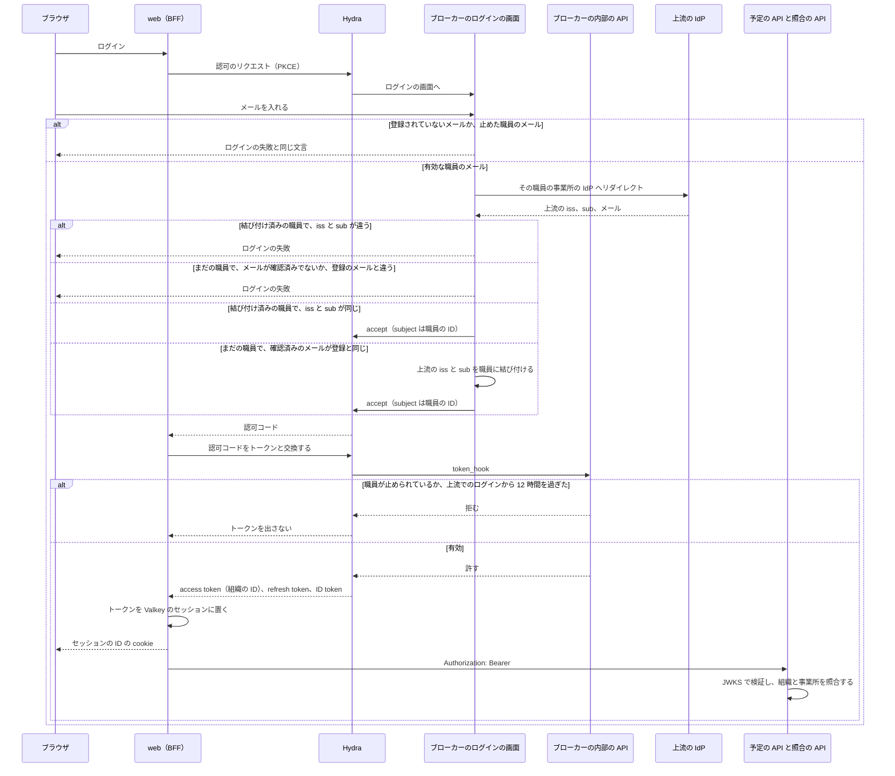

# ADR-0001: 認証を OIDC のブローカーと BFF のサーバー側のセッションにし、職員の身元をブローカーが、権限と業務のデータを予定の API が持つ

## Status

承認

## Context

buddy は、web と、予定の API と照合の API の 2 つの API を持つ。職員は web に 1 度ログインし、web は 1 つの access token で両方の API を呼ぶ。

- 職員のアカウントは、事業所の外部の IdP にある。IdP は事業所ごとに違ってよい。事業所の Google Workspace のものとは限らず、個人の Google や LINE のこともある。
- 1 つの buddy を複数の事業所が使う。職員は自分の事業所のデータだけを扱う。
- 職員は、管理者が事前にメールアドレスで登録した場合だけ使える。buddy はパスワードを持たない。
- web のブラウザ側のコードは、利用者の名前を扱う画面を持つ。スクリプトの注入が起きたときに、トークンが盗まれる範囲を小さくしたい。
- インフラは別のリポジトリが持ち、buddy はデプロイ先のクラウドを知らない。
- OIDC のブローカーは、Ory Hydra と自作の login and consent app で作る。
  - ADR-0010: [OIDC のブローカーを、Ory Hydra と、自作の login and consent app で作る](0010-id-broker-hydra.md)
- 照合の API は、職員の登録を確認せず、トークンの組織だけで、その事業所のカレンダーを読む。利用者のテーブルも読まず、予定と実績の利用者名を比べる。
- 職員の登録、役職の変更、権限を足し外す操作は、職員の管理の権限（`staff.manage`）を持つ職員だけに許す。
  - ADR-0002: [権限を役職のデフォルトと職員ごとの上書きで持ち、職員の管理と照合も権限で許す](0002-pbac.md)
- 職員のアカウントの種類は、PRD の Open Questions に未決として残っている。
- ブローカーは、職員のメールを全ての事業所で一意に持ち、上流のアカウント（`iss` と `sub`）を 1 人の職員にだけ結び付ける。

## Decision

### ログインとセッション

外部の IdP の前に OIDC のブローカーを置き、buddy の全てのアプリはブローカーだけを相手にする。  
IdP の違いと事業所の対応はブローカーが吸収し、buddy は 1 つの Issuer のトークンだけを検証すればよい。

- web は BFF として、ブローカーと認可コードフロー（PKCE つき）でやり取りする。
  - トークンはサーバー側のセッションに置き、セッションは Valkey に持つ。
  - ブラウザには、HttpOnly、Secure、SameSite=Lax の cookie でセッションの ID だけを渡す。トークンはブラウザに渡さない。
  - web は API を呼ぶときに、セッションの access token を `Authorization: Bearer` に付ける。期限が近ければ refresh token で更新する。
- API は、access token の JWT をブローカーの JWKS で検証し、署名、`iss`、`aud`、`exp` を確認する。API はセッションを持たない。
- 事業所は、ブローカーの組織に対応する。API は、トークンの組織と、リクエストが指す事業所が違えば 403 を返す。

職員のログインは、次の順に進む。

### 職員の身元はブローカー、権限と業務のデータは予定の API が持つ

職員が誰で、どの事業所に属し、ログインしてよいかはブローカーが持ち、職員が buddy で何をしてよいかは予定の API が持つ。ブローカーは権限を持たない。

| 持つもの | ブローカー | 予定の API |
| --- | --- | --- |
| 事業所 | 組織の ID、上流の IdP の設定 | 名前、部署、チーム、役職などの業務のデータ |
| 職員 | 職員の ID、メール、所属の事業所、有効か停止か、上流のアカウント（`iss` と `sub`） | 名前、役職、チーム、職員の権限（`user_policies`） |
| 操作 | 事前登録、初回の結び付け、停止、セッションの取り消し | 権限の判定 |

- ブローカーは、ログインの accept の `subject` に職員の ID を、access token に組織の ID を入れる。事前登録していない職員と、止めた職員には、トークンを出さない。
  - 理由: トークンの組織が「その事業所の有効な職員である」ことを意味するので、照合の API のように職員を探さない API も、トークンの組織だけを信じてよくなる。予定の API に判定を残すと、API が増えるたびに、予定の API への問い合わせか同じ判定の写しが要る。
- 予定の API は、職員の業務のデータを、ブローカーの職員の ID（`users.sub`）で引く。`users.sub` は、初回のログインではなく、登録のときに入れる。
- 職員の登録と停止は、予定の API が職員の管理の権限を確認してから、ブローカーの内部の API を呼ぶ。内部の API は、Hydra の client credentials のトークン（`aud` は `broker`）で守る。
  - 理由: 誰が登録し止めてよいかは権限の判定で、ブローカーに権限を持たせない。
- 職員の事業所は、ブローカーのメールの入力の画面で入れたメールを、登録した職員のメールと照合して決め、その事業所の上流の IdP へリダイレクトする。
  - 理由: メールのドメインでは、個人の Google や LINE のアカウントの事業所を決められない。事業所の一覧を画面に出すと、ログインの前に事業所の名前が見える。
  - 登録されていないメールには、事業所を示さず、ログインの失敗と同じ文言を返す。メールの有無を確認する試行は、回数で制限する。
- 初回のログインでは、上流の IdP のメールが確認済みで、登録した職員のメールと同じで、その職員に上流のアカウントがまだ無いときだけ、上流の `iss` と `sub` を職員に結び付ける。以後は `iss` と `sub` で職員を探す。1 人の職員は 1 つの事業所にだけ属する。
- ブローカーは、Hydra の `oauth2.token_hook` で、トークンを発行するたびに職員が有効かを確認する。
- 上流の IdP で止めたアカウントは、上流でのログインから 12 時間で切れる。Hydra のログインのセッションを 12 時間で切らし、上流でのログインから 12 時間を過ぎた refresh を `oauth2.token_hook` で拒む。次の上流のログインで、上流の IdP が拒む。
  - 理由: 上流の IdP の停止の通知（SCIM、Back-Channel Logout）は IdP ごとに違い、LINE や個人の Google には無い。12 時間は web のセッションの長さと同じである。
- 職員のログアウトでは、web は自分のセッションを消した後に、ブラウザを Hydra の RP-Initiated Logout へリダイレクトし、Hydra のログインのセッションも消す。上流の IdP のセッションは消さない。
  - 理由: 共用の端末で、次の人がログインの画面を通らずに入るのを防ぐ。上流のセッションを消すと、職員の個人の Google からもログアウトさせてしまう。

## Considered Options

### 認証の仕組み

| 選択肢 | 強み | 弱み |
| --- | --- | --- |
| **採用:** OIDC のブローカーと、BFF のサーバー側のセッション | IdP を替えても buddy は変わらない。トークンがブラウザに出ない | ブローカーと Valkey を動かす必要がある |
| Cognito を直接使い、API Gateway と Lambda のオーソライザーで検証する | AWS の管理のサービスに任せられる | buddy が AWS に固定され、デプロイ先を知らない前提に反する。ローカル環境で起動できない |
| SPA がトークンを受け、ブラウザの storage か JavaScript の変数に置く | サーバー側のセッションが要らない | スクリプトの注入でトークンが盗まれる。refresh token をブラウザに置く必要がある |
| buddy が職員のパスワードを持ち、自前でログインさせる | 外部の仕組みに依存しない | パスワードの保管、再設定、多要素認証を buddy が作り続ける必要がある |

### 職員の身元の配置先

| 選択肢 | 強み | 弱み |
| --- | --- | --- |
| **採用:** 身元はブローカー、権限と業務のデータは予定の API | トークンの組織が有効な職員を意味する。ブローカーは権限を持たない | 職員の登録と停止が、予定の API とブローカーの 2 か所への書き込みになる |
| 予定の API に身元を持ち、ブローカーがログインのたびに問い合わせる | 職員のデータが 1 か所にある | ログインが業務の API に依存し、予定の API が止まるとログインできない |
| 予定の API が初回のログインで結び付け、ブローカーは振り分けだけを持つ | 変更が最も少ない | 事前登録していない職員にもトークンが出て、照合の API はそれを拒めない |
| 振り分け: 事業所ごとのログインの URL | メールの登録の有無が分からない | 職員が事業所の URL を使い分け、web が事業所ごとのログインの URL を持つ |
| 取り消し: 期限だけに任せる | 作るものが無い | buddy で止めても最大 12 時間使える |
| ログアウト: web のセッションだけを消す | 作るものが無い | Hydra がログインのセッションを保つ間、次のログインが上流の確認を通らない |

## Consequences

### Positive

- 事業所ごとに IdP が違っても、buddy の API はブローカーの 1 つの JWKS だけを読めばよい。
- ブラウザのコードからトークンが読めないので、スクリプトの注入で盗まれるのはセッションの cookie を使った操作の範囲に限られる。
- API は状態を持たないので、台数を増やしても設定を変えなくてよい。
- 照合の API は、職員を探さずに、トークンの組織だけで事業所を決めてよい。
- buddy で止めた職員は、web の BFF が次に access token を取り直すとき（最大 5 分）に使えなくなる。予定の API は、止めたことを自分でも知るので、その場で 403 を返せる。

### Negative

- ローカル環境と E2E のテストで、ブローカーと IdP の代わりを立てる必要がある。
- Valkey が止まると、全ての職員がログインし直す必要がある。
- cookie でセッションを運ぶので、web は状態を変えるリクエストに CSRF の対策を持つ必要がある。
- web の BFF は、RP-Initiated Logout に渡す ID token をセッションに置く。
- 職員の登録と停止で、予定の API とブローカーの片方だけが書けたときの戻し方を決める必要がある。
- メールを入れる画面は、そのメールが登録されているかを試す手段になる。回数の制限で抑えるが、なくせない。
- 同じ人を 2 つの事業所の職員にするには、「1 人の職員は 1 つの事業所」を置き換える必要がある。
