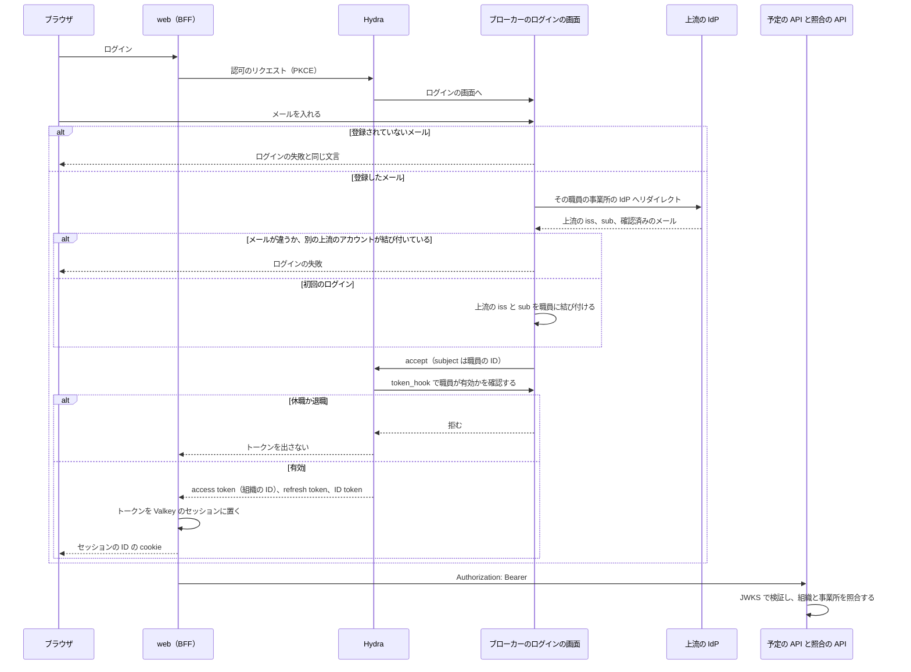
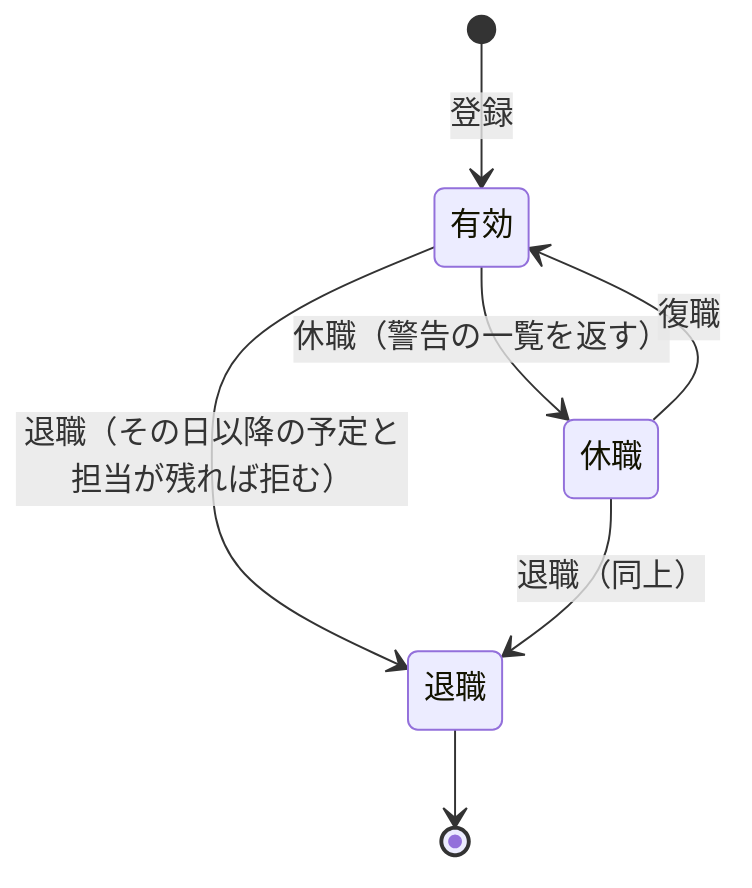
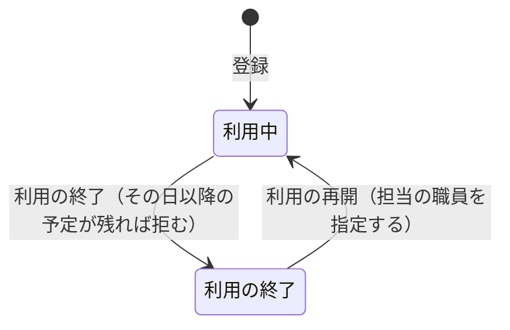

# ADR-0001: 認証を OIDC のブローカーと BFF のサーバー側のセッションにし、職員の身元と停止をブローカーが、権限と業務のデータを予定の API が持つ

## Status

承認

## Context

buddy は、web と、予定の API と照合の API の 2 つの API を持つ。職員は web に 1 度ログインし、web は 1 つの access token で両方の API を呼ぶ。

- 職員のアカウントは、事業所の外部の IdP にある。IdP は事業所ごとに違ってよい。事業所の Google Workspace のものとは限らず、個人の Google や LINE のこともある。
- 1 つの buddy を複数の事業所が使う。職員は自分の事業所のデータだけを扱う。
- 職員は、管理者が事前にメールアドレスで登録した場合だけ使える。buddy はパスワードを持たない。
- web のブラウザ側のコードは、利用者の名前を扱う画面を持つ。スクリプトの注入が起きたときに、トークンが盗まれる範囲を小さくしたい。
- インフラは別のリポジトリが持ち、buddy はデプロイ先のクラウドを知らない。
- OIDC のブローカーは、Ory Hydra と自作の login and consent app で作る。
  - ADR-0014: [OIDC のブローカーを、Ory Hydra と、自作の login and consent app で作る](0014-id-broker-hydra.md)
- 照合の API は、職員の登録を確認せず、トークンの組織だけで、その事業所のカレンダーを読む。利用者のテーブルも読まず、予定と実績の利用者名を比べる。
- 職員の登録、役職の変更、権限を足し外す操作は、職員の管理の権限（`staff.manage`）を持つ職員だけに許す。
  - ADR-0006: [職員と利用者の登録と、職員の権限と役職を変える操作を、職員の管理の権限で許す](0006-staff-manage-policy.md)
- 事業所には、育休や病気の休職のように戻る職員と、退職して戻らない職員がいる。入院の後に訪問を再開する利用者もいる。
- 過去の予定と照合の結果は、主訪問者の名前で読む。予定と訪問の情報は利用者の ID で利用者を参照し、予定の一覧と Google カレンダーへの書き出しは、そのときの利用者の名前を読む。
- 利用者は、連絡先を持たない。名前、受けているサービス、希望する訪問の時間帯、希望する担当の性別、担当の職員だけを持つ。

## Decision

### ログインとセッション

外部の IdP の前に OIDC のブローカーを置き、buddy の全てのアプリはブローカーだけを相手にする。  
IdP の違いと事業所の対応はブローカーが吸収し、buddy は 1 つの Issuer のトークンだけを検証すればよい。

- web は BFF として、ブローカーと認可コードフロー（PKCE つき）でやり取りする。
  - トークンはサーバー側のセッションに置き、セッションは Valkey に持つ。
  - ブラウザには、HttpOnly、Secure、SameSite=Lax の cookie でセッションの ID だけを渡す。トークンはブラウザに渡さない。
  - web は API を呼ぶときに、セッションの access token を `Authorization: Bearer` に付ける。期限が近ければ refresh token で更新する。
- API は、access token の JWT をブローカーの JWKS で検証し、署名、`iss`、`aud`、`exp` を確認する。API はセッションを持たない。
- 事業所は、ブローカーの組織に対応する。API は、トークンの組織と、リクエストが指す事業所が違えば 403 を返す。

職員のログインは、次の順に進む。

### 職員の身元はブローカー、権限と業務のデータは予定の API が持つ

職員が誰で、どの事業所に属し、ログインしてよいかはブローカーが持ち、職員が buddy で何をしてよいかは予定の API が持つ。ブローカーは権限を持たない。

| 持つもの | ブローカー | 予定の API |
| --- | --- | --- |
| 事業所 | 組織の ID、上流の IdP の設定 | 名前、部署、チーム、役職などの業務のデータ |
| 職員 | 職員の ID、メール、所属の事業所、有効か止めたか、上流のアカウント（`iss` と `sub`） | 名前、役職、チーム、職員の権限（`user_policies`） |
| 操作 | 事前登録、初回の結び付け、停止、セッションの取り消し | 権限の判定 |

- ブローカーは、ログインの accept の `subject` に職員の ID を、access token に組織の ID を入れる。事前登録していない職員と、止めた職員には、トークンを出さない。
  - 理由: トークンの組織が「その事業所の有効な職員である」ことを意味するので、照合の API のように職員を探さない API も、トークンの組織だけを信じてよくなる。予定の API に判定を残すと、API が増えるたびに、予定の API への問い合わせか同じ判定の写しが要る。
- 予定の API は、職員の業務のデータを、ブローカーの職員の ID（`users.sub`）で引く。`users.sub` は、初回のログインではなく、登録のときに入れる。
- 職員の登録と停止は、予定の API が職員の管理の権限を確認してから、ブローカーの内部の API を呼ぶ。内部の API は、Hydra の client credentials のトークン（`aud` は `broker`）で守る。
  - 理由: 誰が登録し止めてよいかは権限の判定で、ブローカーに権限を持たせない。
- 職員の事業所は、ブローカーのメールの入力の画面で入れたメールを、登録した職員のメールと照合して決め、その事業所の上流の IdP へリダイレクトする。
  - 理由: メールのドメインでは、個人の Google や LINE のアカウントの事業所を決められない。事業所の一覧を画面に出すと、ログインの前に事業所の名前が見える。
  - 登録されていないメールには、事業所を示さず、ログインの失敗と同じ文言を返す。メールの有無を確認する試行は、回数で制限する。
- 初回のログインでは、上流の IdP のメールが確認済みで、登録した職員のメールと同じで、その職員に上流のアカウントがまだ無いときだけ、上流の `iss` と `sub` を職員に結び付ける。以後は `iss` と `sub` で職員を探す。1 人の職員は 1 つの事業所にだけ属する。
- ブローカーは、職員のメールを全ての事業所で一意に持ち、上流のアカウントを 1 人の職員にだけ結び付ける。
- ブローカーは、Hydra の `oauth2.token_hook` で、トークンを発行するたびに職員が有効かを確認する。
- 上流の IdP で止めたアカウントは、上流でのログインから 12 時間で切れる。Hydra のログインのセッションを 12 時間で切らし、上流でのログインから 12 時間を過ぎた refresh を `oauth2.token_hook` で拒む。次の上流のログインで、上流の IdP が拒む。
  - 理由: 上流の IdP の停止の通知（SCIM、Back-Channel Logout）は IdP ごとに違い、LINE や個人の Google には無い。12 時間は web のセッションの長さと同じである。
- 職員のログアウトでは、web は自分のセッションを消した後に、ブラウザを Hydra の RP-Initiated Logout へリダイレクトし、Hydra のログインのセッションも消す。上流の IdP のセッションは消さない。
  - 理由: 共用の端末で、次の人がログインの画面を通らずに入るのを防ぐ。上流のセッションを消すと、職員の個人の Google からもログアウトさせてしまう。

### 職員の停止は、戻せる休職と、戻せない退職に分ける

職員の状態は、次のとおり移る。

| 状態 | ログイン | 戻す操作 | 職員の一覧 | 予定のカレンダーと予定の候補 |
| --- | --- | --- | --- | --- |
| 有効 | できる | なし | 出る | 出る |
| 休職 | できない | 復職で有効に戻す | 休職の印を付けて出る | 出ない |
| 退職 | できない | なし | 退職の印を付けて出る | 出ない |

- 休職は、職員の管理の権限を持つ職員が手で始め、手で戻す。戻る予定の日をメモとして持てるが、その日に自動では戻さない。
  - 理由: 育休や休職は延びることがあり、日付で切り替えると延びるたびに直す必要がある。日付で切り替える定期の処理も要らない。
- 休職でも退職でも、ブローカーは Hydra の admin API で、その職員のログインのセッション、同意、refresh token を取り消す。復職では、ブローカーの職員を有効に戻し、上流のアカウントの結び付けはそのまま使う。
- 退職では、予定の API は職員の名前、所属、役職を残し、電話番号を消す。ブローカーは職員の身元（メールと上流のアカウント）を消す。
  - 理由: 過去の予定と照合の結果で、誰が訪問したかを読めるようにする。退職した人の連絡先とログインの手段は残さない。
  - 同じ人を再び雇うときは、新しい職員として登録する。ブローカーの身元を消すので、同じメールと同じ上流のアカウントで登録し直せる。
- 休職か退職にするときに、その日以降の予定、繰り返しの予定、担当の利用者を一覧で示す。
  - 退職は、一覧が空になるまで拒む。管理者は、別の職員に割り振り直してから退職にする。担当の利用者は、利用中の利用者だけを数え、利用の終了の利用者は数えない。
  - 休職は拒まず、一覧を警告として返す。休職が短ければ、割り振り直さずに戻ることがあるためである。
- 予定の API は、休職と退職の職員への新しい割り振り（予定の作成、職員の変更、利用者の担当の変更）を拒む。既にその職員に割り振った予定は、職員を変えずに保存できる。
- 職員は自分を休職と退職にできない。事業所で職員の管理の権限を持つ最後の有効な職員も、休職と退職にできない。
  - 理由: 戻す操作をする職員がいなくなると、DB を直すほかに戻せない（ADR-0006 の Negative）。

### 利用者は、戻せる利用の終了にでき、予定の候補と職員の退職の確認から外す

利用者の状態は、次のとおり移る。

| 状態 | 戻す操作 | 利用者の一覧 | 予定の利用者の候補 | 職員の退職の確認の担当の利用者 |
| --- | --- | --- | --- | --- |
| 利用中 | なし | 出る | 出る | 数える |
| 利用の終了 | 利用の再開で利用中に戻す | 利用の終了の印を付けて出る | 出ない | 数えない |

- 利用の終了と利用の再開は、職員の管理の権限を持つ職員だけができる。利用者の登録と同じ権限にそろえる。
- 利用の終了は戻せる。入院の後に訪問を再開する利用者を、同じ利用者のまま扱い、過去の予定とつなぐ。
- その日以降の予定と繰り返しの予定が残る利用者は、利用の終了にできない。職員の退職と同じく、残る予定を一覧で返して拒む。
  - 理由: 誰も行かない訪問を残さないためである。管理者は、残る予定をキャンセルするか、繰り返しを終えてから、利用の終了にする。
- 利用の再開では、担当の職員を必ず指定する。休職か退職の職員を指すと 400 で拒む。画面は、今の担当が有効な職員なら、それを初期値にする。
  - 理由: 職員の退職の確認が利用の終了の利用者を数えないので、利用の終了の間に担当の職員が退職することがある。再開の操作で担当を決め直せば、退職した職員に担当が戻らない。
- 予定の API は、利用の終了の利用者への新しい予定（予定の作成と、予定の利用者の変更）を拒む。既にその利用者に作った予定は、利用者を変えずに保存できるが、日付をその日以降にする変更は拒む。
  - 理由: 過去の訪問の記録は直せるようにし、利用の終了の利用者にその日以降の予定が生まれないようにする。
- 職員の退職の確認は、担当の利用者のうち、利用の終了の利用者を数えない。
  - 理由: サービスを終えた利用者を、退職の前に割り振り直す作業を無くす。利用の終了の利用者には、その日以降の予定が無い。
- 利用の終了でも、利用者のレコードを消さず、名前、受けているサービス、担当の職員を残す。消す連絡先は無い。
  - 理由: 過去の予定、Google カレンダーへの書き出し、照合の結果で、どの利用者の訪問かを読めるようにする。
- 照合は変えない。照合の API は利用者のテーブルを読まないので、利用の終了の利用者の過去の月も照合できる。

## Considered Options

### 認証の仕組み

| 選択肢 | 強み | 弱み |
| --- | --- | --- |
| **採用:** OIDC のブローカーと、BFF のサーバー側のセッション | IdP を替えても buddy は変わらない。トークンがブラウザに出ない | ブローカーと Valkey を動かす必要がある |
| Cognito を直接使い、API Gateway と Lambda のオーソライザーで検証する | AWS の管理のサービスに任せられる | buddy が AWS に固定され、デプロイ先を知らない前提に反する。ローカル環境で起動できない |
| SPA がトークンを受け、ブラウザの storage か JavaScript の変数に置く | サーバー側のセッションが要らない | スクリプトの注入でトークンが盗まれる。refresh token をブラウザに置く必要がある |
| buddy が職員のパスワードを持ち、自前でログインさせる | 外部の仕組みに依存しない | パスワードの保管、再設定、多要素認証を buddy が作り続ける必要がある |

### 職員の身元の配置先

| 選択肢 | 強み | 弱み |
| --- | --- | --- |
| **採用:** 身元はブローカー、権限と業務のデータは予定の API | トークンの組織が有効な職員を意味する。ブローカーは権限を持たない | 職員の登録と停止が、予定の API とブローカーの 2 か所への書き込みになる |
| 予定の API に身元を持ち、ブローカーがログインのたびに問い合わせる | 職員のデータが 1 か所にある | ログインが業務の API に依存し、予定の API が止まるとログインできない |
| 予定の API が初回のログインで結び付け、ブローカーは振り分けだけを持つ | ブローカーが持つものが少ない | 事前登録していない職員にもトークンが出て、照合の API はそれを拒めない |
| 振り分け: 事業所ごとのログインの URL | メールの登録の有無が分からない | 職員が事業所の URL を使い分け、web が事業所ごとのログインの URL を持つ |
| 取り消し: 期限だけに任せる | 作るものが無い | buddy で止めても最大 12 時間使える |
| ログアウト: web のセッションだけを消す | 作るものが無い | Hydra がログインのセッションを保つ間、次のログインが上流の確認を通らない |

### 職員の停止

| 選択肢 | 強み | 弱み |
| --- | --- | --- |
| **採用:** 休職と退職の 2 種類 | 業務の言葉と合い、戻す操作を休職だけに限れる | 状態と API が 1 つ増える |
| 停止の 1 種類に、有効に戻す操作だけを足す | 状態が少ない | 休職と退職を見分けられず、退職した職員も戻せる |
| 休職、退職、削除の 3 種類 | 個人情報を残さない | 過去の予定と照合の主訪問者が誰かを読めなくなる |
| 退職で名前も匿名にする | 個人情報が残らない | 過去の予定と照合の結果で、誰が訪問したかを読めない |
| 休職を開始日と終了日で自動で切り替える | 戻し忘れが無い | 日付で切り替える定期の処理が要り、延長のたびに直す |
| 休職と退職で、その日以降の予定を自動でキャンセルする | 管理者の操作が要らない | 訪問が消え、別の職員に割り振り直す作業が漏れる |

### 利用者の利用の終了

| 選択肢 | 強み | 弱み |
| --- | --- | --- |
| **採用:** 戻せる利用の終了 | 入院の後の再開を同じ利用者で扱え、過去の予定と名前が残る | 状態と API が増え、再開で担当を決め直す |
| 戻せない利用の終了 | 状態の遷移が 1 方向で単純 | 再開する利用者を別の利用者として登録し直し、過去の予定とつながらない |
| 利用者の削除 | 状態が増えない | 過去の予定と照合の結果で、どの利用者の訪問かを読めない |
| 利用の終了で、その日以降の予定を自動でキャンセルする | 管理者の操作が要らない | 終了の日を誤ると訪問が消え、気付きにくい |
| 終了の利用者も退職の確認で数える | 退職の確認の規則が 1 つで済む | サービスを終えた利用者を、退職の前に割り振り直す作業が残る |
| 終了の日を指定し、その日に自動で切り替える | 終了の日の操作を忘れない | 日付で切り替える定期の処理が要り、入院が延びるたびに直す |
| 再開で、担当が休職か退職なら拒み、先に担当を変えさせる | 再開の入力が増えない | 操作が 2 回に分かれ、再開の前に担当を変える理由が画面から分かりにくい |

## Consequences

### Positive

- 事業所ごとに IdP が違っても、buddy の API はブローカーの 1 つの JWKS だけを読めばよい。
- ブラウザのコードからトークンが読めないので、スクリプトの注入で盗まれるのはセッションの cookie を使った操作の範囲に限られる。
- API は状態を持たないので、台数を増やしても設定を変えなくてよい。
- 照合の API は、職員を探さずに、トークンの組織だけで事業所を決めてよい。
- buddy で止めた職員は、web の BFF が次に access token を取り直すとき（最大 5 分）に使えなくなる。予定の API は、止めたことを自分でも知るので、その場で 403 を返せる。
- 休職から戻る職員は、上流のアカウントの結び付けを保ったまま、同じ職員としてログインできる。
- 退職の前に、誰も行かない訪問が残らない。サービスを終えた利用者を割り振り直さずに、担当の職員を退職にできる。
- 予定の利用者の候補に、サービスを終えた利用者が出ない。再開した利用者の予定を、利用の終了の前の予定と同じ利用者として読める。

### Negative

- ローカル環境と E2E のテストで、ブローカーと IdP の代わりを立てる必要がある。
- Valkey が止まると、全ての職員がログインし直す必要がある。
- cookie でセッションを運ぶので、web は状態を変えるリクエストに CSRF の対策を持つ必要がある。
- web の BFF は、RP-Initiated Logout に渡す ID token をセッションに置く。
- 職員の登録と停止で、予定の API とブローカーの片方だけが書けたときの戻し方を決める必要がある。
- メールを入れる画面は、そのメールが登録されているかを試す手段になる。回数の制限で抑えるが、なくせない。
- 同じ人を 2 つの事業所の職員にするには、「1 人の職員は 1 つの事業所」を置き換える必要がある。
- 退職にするには、管理者が先に予定と担当を割り振り直す必要がある。割り振り直す画面が無い間は、予定の編集で 1 件ずつ直す。
- 休職のまま戻し忘れると、その職員はログインできない。職員の一覧の休職の印と、戻る予定の日のメモで気付く必要がある。
- 再び雇った職員は新しい職員になるので、退職の前と後の予定は別の職員として読む。
- 利用の終了にするには、管理者が先にその日以降の予定をキャンセルし、繰り返しを終える必要がある。
- 利用の終了の利用者の担当に、退職した職員が残る。利用者の一覧は、退職の印の付いた職員の名前を出す。
- 利用の終了の利用者の名前は残り続ける。名前を消す操作は足していない。

## 統合した ADR

- ADR-0001: 認証を OIDC のブローカーと BFF のサーバー側のセッションにする（[統合の前](https://github.com/Fukuemon/buddy/blob/b8a7a2a33a10a6d6694d056c3597fb3786ca1924/docs/adr/0001-auth.md)）
- ADR-0015: 職員の身元をブローカーが持ち、権限と業務のデータは予定の API が持つ（[統合の前](https://github.com/Fukuemon/buddy/blob/b8a7a2a33a10a6d6694d056c3597fb3786ca1924/docs/adr/0015-identity-boundary.md)）
- ADR-0016: 職員の停止を、戻せる休職と、戻せない退職に分ける（[統合の前](https://github.com/Fukuemon/buddy/blob/b8a7a2a33a10a6d6694d056c3597fb3786ca1924/docs/adr/0016-staff-leave-and-retirement.md)）
- ADR-0017: 利用者を、戻せる利用の終了にでき、終了の利用者を予定の候補と職員の退職の確認から外す（[統合の前](https://github.com/Fukuemon/buddy/blob/b8a7a2a33a10a6d6694d056c3597fb3786ca1924/docs/adr/0017-patient-service-end.md)）
