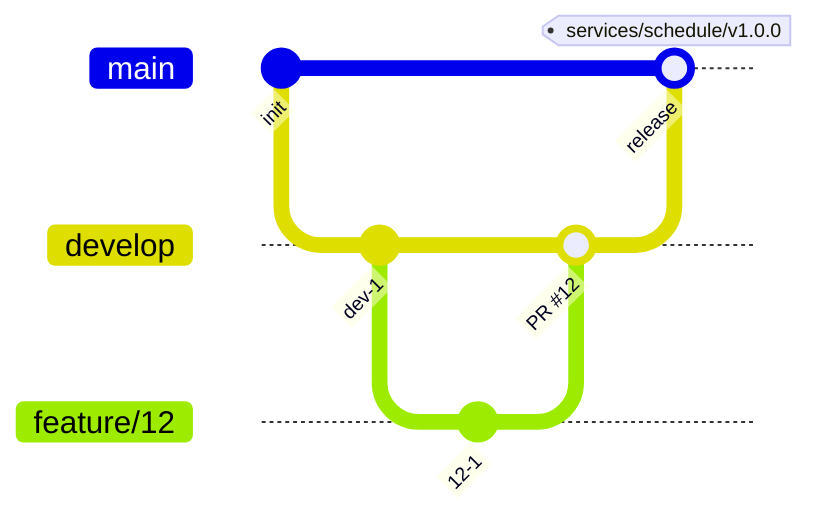

# ADR-0003: モノレポを git flow でマージし、画面を apps/ に、API を services/ に置き、ディレクトリの名前でタグとサービスの名前をそろえる

## Status

承認

## Context

buddy は、web、予定の API、照合の API のアプリと、共有のパッケージを 1 つのリポジトリに持つ。ブランチの運用、リリースの方針、ディレクトリの配置、アプリの名前を決める必要がある。

- web は、各 API の `openapi.yaml` から生成した型で API を呼ぶ。API の定義、サーバーの生成物、画面の型は、同じ変更でそろえる必要がある。
- アプリは別のイメージでデプロイし、デプロイの順序と時期がアプリごとに違うことがある。
- インフラは別のリポジトリが持つ。buddy はデプロイ先を知らず、デプロイの要件はイメージ、環境変数、ヘルスチェック、マイグレーションである。
- web にも予定と照合の機能があるので、API のディレクトリを `apps/schedule` のように機能の名前だけにすると、API か画面かが名前から分からない。
- アプリの名前は、compose のサービス、コンテナ、イメージ、環境変数、トークンの `aud` と IdP の開発用の設定、テーブル定義書の出力先、ドキュメントサイトの API の仕様のページ、GitHub のラベルが使う。
- web は、トークンを取るときに audience を指定しない。`aud` を決めるのは IdP の設定で、確認するのは各 API の `OIDC_AUDIENCE` である。

## Decision

### ブランチとリリース

モノレポのまま、git flow でマージする。`develop` は開発と検証の状態、`main` はリリース済みの状態にする。

ブランチとリリースは、次の流れにする。

- 作業は issue ごとに `develop` から切ったブランチで行い、pull request で `develop` にマージする。
- `develop` の状態を検証環境に、`main` の状態を本番環境に反映する。
- リリースは、検証した `develop` の状態を `main` にマージする。リリースの仕組みはまだ作らず、タグを手で付ける。
- バージョンはアプリごとに持ち、タグは `<ディレクトリ>/vX.Y.Z` の形にする（`apps/web/v1.0.0`、`services/schedule/v1.0.0`）。Go のモジュールのタグの形に合わせ、ディレクトリとタグを 1 対 1 に対応させる。
- CHANGELOG のファイルは作らない。変更の記録は pull request とコミットが持つ。
- pull request ごとのリリースへの移行と、次のバージョンを決めるツールは、E2E と検証環境がそろった時点で決める。
  - ツールを入れるときの第一の候補は、release-please の manifest のモードである。コミットメッセージ（Conventional Commits で書き、commitlint が確認している）から、アプリごとに次のバージョンを決められる。
  - changesets は、変更ごとに記述のファイルを足す運用が要るので、第二の候補にする。
  - `<ディレクトリ>/vX.Y.Z` のタグの形にできるかは、入れるときに設定で確認する。

API と画面のバージョンは別々に進むので、API の互換を次の規則で保つ。

- レスポンスの項目と、省略できる引数の追加は、互換ありとして同じパスで出す。
- 項目の削除、型と意味の変更は、互換なしとして新しいパス（`/v2`）で出す。古いパスは、画面が移るまで残す。
- デプロイは API を先に、画面を後にする。画面は、デプロイ済みの API が持つ項目だけを使う。

モノレポにしたのは、`openapi.yaml`、サーバーの生成物、画面の型を 1 つの pull request で変えられるためである。`pnpm check:generated` が、生成物のずれを 1 つのリポジトリの中で見つける。ポリレポにすると、API の定義と画面の型を別々の pull request で変えることになり、2 つのずれを見つける仕組みが別に要る。

### ディレクトリの配置

画面と BFF、ドキュメントサイトは `apps/` に、Go の API は `services/` に、共有のコードは `packages/` に置く。API のディレクトリは、接尾辞を付けず機能の名前にする（`services/schedule`、`services/receipt`）。

- 理由: トップのディレクトリで画面と API が分かれるので、同じ機能の名前を使っても区別できる。Go の module のパスも `github.com/Fukuemon/buddy/services/schedule` と短くなる。
- ID ブローカーのログインの画面のソースの配置先は、ADR-0014 で決めた。
  - ADR-0014: [ID ブローカーのログインの画面のソースを apps/broker に置き、@buddy/ui から生成したテンプレートを ID ブローカーが埋め込んで配信する](0014-broker-login-pages-source.md)

### API の名前

2 つの API を名前で指す全ての箇所を、ディレクトリの名前の `schedule` と `receipt` にそろえる。

- compose のサービスは `schedule`、`schedule-migrate`、`schedule-seed`、`receipt` にし、イメージは `<プロジェクト>-schedule` にする。
- トークンの `aud` は `schedule` と `receipt` にする。
  - 理由: 2 つの API は、ブローカーの 1 つの Issuer のトークンだけを受けるので、`aud` の値は buddy の API の間で区別できればよい。サービスの名前と同じにすると、API の `OIDC_AUDIENCE` と IdP の設定を名前から書ける。
  - ADR-0001: [認証を OIDC のブローカーと BFF のサーバー側のセッションにし、職員の身元と停止をブローカーが、権限と業務のデータを予定の API が持つ](0001-auth.md)
- 環境変数は、ほかのサービスの `WEB_PORT`、`IDP_PORT`、`E2E_GCALHOLD_URL` と同じく、サービスの名前を接頭辞にする（`SCHEDULE_PORT`、`SCHEDULE_URL`、`E2E_SCHEDULE_URL` など）。
- テーブル定義書の出力先は `docs/db/schedule/`、API の仕様のページは `docs/api/schedule.html` と `docs/api/receipt.html` にする。
- GitHub のラベルは `pkg:schedule` と `pkg:receipt` にする。
- 文書の地の文では、2 つの API を「予定の API」「照合の API」と書く。名前そのものを指すときだけ、`schedule` と `receipt` をコードスパンで書く。
  - 理由: web にも予定と照合の画面があるので、地の文の `schedule` は API か画面かが分からない。

## Considered Options

### ブランチとバージョン

| 選択肢 | 強み | 弱み |
| --- | --- | --- |
| **採用:** モノレポで git flow、アプリごとのバージョン | API と画面の型を 1 つの変更でそろえられる。アプリごとにリリースの時期を選べる | タグとバージョンがアプリの数だけ増える |
| モノレポで、リポジトリ全体に 1 つのバージョン | タグが 1 つで分かりやすい | 変えていないアプリのバージョンも上がり、どのイメージを出し直すかが分からない |
| アプリごとのリポジトリ（ポリレポ） | アプリごとに権限と CI を分けられる | API の定義と画面の型を別々の pull request で変え、ずれを見つける仕組みが要る |
| trunk-based（`main` だけ） | ブランチが少ない | 検証環境と本番環境を分ける前に、リリースの単位を決める必要がある |

### ディレクトリと名前

| 選択肢 | 強み | 弱み |
| --- | --- | --- |
| **採用:** API を `services/<機能>` に置き、サービスの名前、`aud`、環境変数、文書とラベルの名前を全てディレクトリの名前にそろえる | 機能の名前だけで API を指せ、画面と区別できる。ディレクトリとサービスの名前を読み替えずに済む | パス、module、CI のジョブ名、タグの形と、compose、IdP、web、E2E、ドキュメントサイトの設定を一度に変える |
| `apps/schedule-api` と `apps/receipt-api` のまま残す | 今の名前を変えずに済む | 名前に役割の接尾辞が付き続け、画面と API が同じ階層に並ぶ |
| `apps/schedule` と `apps/receipt` に置く | トップのディレクトリの数が変わらない | web の予定と照合の機能と、名前から区別できない |
| ディレクトリは `services/<機能>` にし、サービスの名前は `schedule-api` と `receipt-api` のまま残す | 今の名前を変えずに済む | ディレクトリとサービスの名前の読み替えが残る |
| `aud` だけを `buddy-schedule` のように buddy の接頭辞を付けた名前にする | ほかのプロダクトと同じ IdP の組織を使っても `aud` が重ならない | `aud` だけがサービスの名前と違い、読み替えが残る。buddy の Issuer は buddy の組織だけを扱う |
| 環境変数は `SCHEDULE_API_URL` のように `_API_` を残す | web の設定の中で、API の URL であることが名前から分かる | 環境変数だけがサービスの名前と違い、ほかのサービスの環境変数の付け方ともずれる |

## Consequences

### Positive

- API の定義を変える pull request が、サーバーと画面の両方の生成物を含み、レビューで一緒に読める。
- アプリごとのタグから、デプロイしたイメージがどのコミットかを辿れる。
- 新しい API は `services/` に、新しい画面のアプリは `apps/` に置けばよく、配置先を迷わない。
- compose、トークン、文書、ラベルのどこでも、ディレクトリと同じ名前で API を指せる。

### Negative

- リリースの仕組みが無い間は、タグを手で付ける。
- 互換なしの変更では、古いパスと新しいパスを並べて持つ期間がある。
- 非公開のインフラは、2 つの API を `schedule` と `receipt` の名前で設定する必要がある。

## 統合した ADR

- ADR-0003: git flow でマージし、アプリごとのバージョンでリリースする（[統合の前](https://github.com/Fukuemon/buddy/blob/0c5d348b6c562f7032c46ef7a5faaca6725a6a68/docs/adr/0003-branch-and-release.md)）
- ADR-0010: 2 つの API を services/ に置き、画面と API をトップのディレクトリで分ける（[統合の前](https://github.com/Fukuemon/buddy/blob/0c5d348b6c562f7032c46ef7a5faaca6725a6a68/docs/adr/0010-services-directory.md)）
- ADR-0011: 2 つの API のサービスの名前とトークンの aud を、ディレクトリの名前にそろえる（[統合の前](https://github.com/Fukuemon/buddy/blob/0c5d348b6c562f7032c46ef7a5faaca6725a6a68/docs/adr/0011-service-names.md)）
