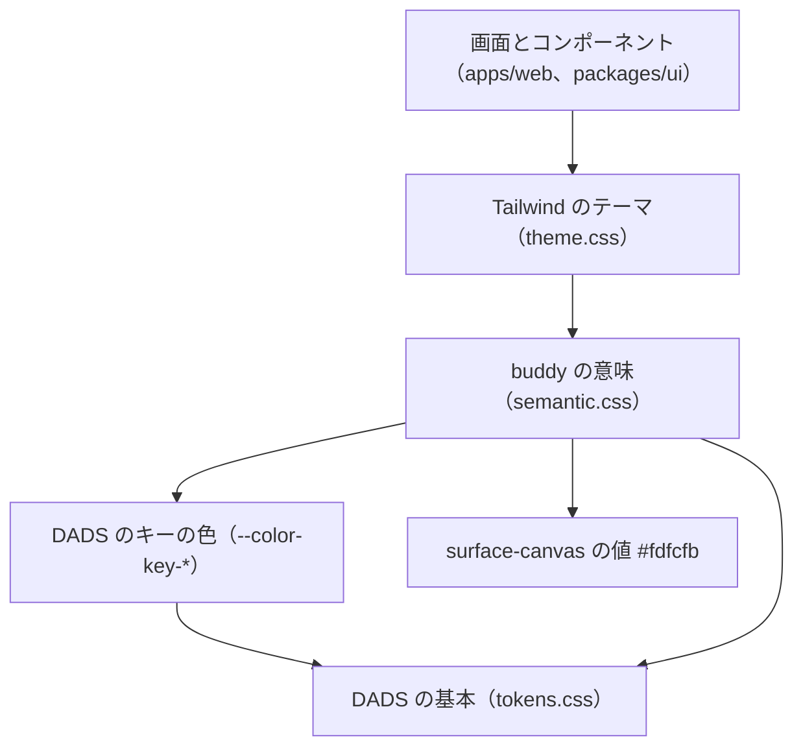
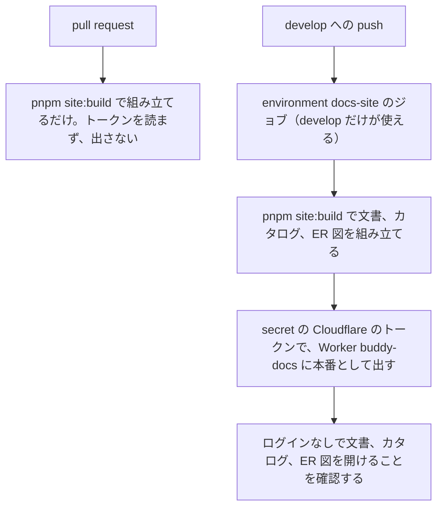

# ADR-0004: デザインシステムのトークンを DADS の基本、buddy の意味、Tailwind のテーマの 3 段にし、カタログをドキュメントサイトと同じ Worker で誰でも開けるように出す

## Status

承認

## Context

画面の見た目をそろえる基準と、アクセシビリティの基準を決める必要がある。

- receipt-front からコピーしたもとの画面のテーマには、白の上で 4.5:1 に届かない文字の色と、文字でないものの基準の 3:1 に届かない入力欄の枠があった。フォーカスの表示はコンポーネントごとに違い、色相を人数で等分した職員の色は、色相によって白の文字が読めなかった。

- デジタル庁デザインシステム（DADS）は、トークンを npm の `@digital-go-jp/design-tokens` で配っている。2.1.0 は MIT で、`dist/tokens.css` に CSS の変数として色、文字、角丸、影を持つ。余白とフォーカスのトークンは持たない。
  - 出典: [@digital-go-jp/design-tokens](https://www.npmjs.com/package/@digital-go-jp/design-tokens)
- DADS の Tailwind の plugin `@digital-go-jp/tailwind-theme-plugin` 1.0.1 は、v4 の `@theme` を持つ。原色の全ての段を `--color-blue-900` のような名前で Tailwind のテーマに入れる。
  - 出典: [@digital-go-jp/tailwind-theme-plugin](https://www.npmjs.com/package/@digital-go-jp/tailwind-theme-plugin)
- DADS は、キーの色をサービスごとに選ぶ前提で `--color-key-*` を置き、何も選ばなければ blue の階調を当てている。
  - 出典: [DADS のカラー](https://design.digital.go.jp/dads/foundations/color/)
- buddy のもともとのデザイン案は、くすんだ青（`#4d89c0`）を主の色にし、画面の背景をわずかに温かい白（`#fdfcfb`）にしている。
  - この青は、白の文字を載せると 4.5:1 に届かない。DADS の light-blue-800 は色相がほぼ同じで、白の文字で 4.5:1 以上になる。
  - DADS の基本のトークンには、温かい白の値が無い。白の次に明るい灰色の solid-gray-50 は、白との差が `#fdfcfb` より大きい。
- ドキュメントサイト（Worker `buddy-docs`）は、文書、Storybook のカタログ、表の ER 図を 1 つの URL で出す。サイトに並べるものは、どれもリポジトリの文書とコードから組み立てる。
- 同じリポジトリの pull request には GitHub が secret を渡すので、書き込みの権限を持つ人は、ワークフローを書き換えてリポジトリの単位の secret を読める。
- パッケージ design-system は、意味のトークンの組のコントラスト比を計算するスクリプト `check-contrast.mjs` を配る。

## Decision

### トークンは DADS の基本、buddy の意味、Tailwind のテーマの 3 段にする

コンポーネントと画面は意味のトークンだけを使い、DADS の段の名前を直に書かない。  
DADS の値を替えても、意味のトークンの参照先を 1 か所直せば画面が追従する。

| 段 | 配置先 | 名前の例 | 書くもの |
| --- | --- | --- | --- |
| DADS の基本 | `@digital-go-jp/design-tokens` の `dist/tokens.css` | `--color-primitive-blue-800`、`--font-size-16`、`--border-radius-8`、`--elevation-3` | 色の階調、文字の大きさと行高、角丸、影の値 |
| buddy の意味 | `packages/ui/src/tokens/semantic.css` | `--buddy-color-primary`、`--buddy-color-border-field` | 用途ごとの名前と、DADS の基本への参照。値は `surface-canvas` のほかは書かない |
| Tailwind のテーマ | `packages/ui/src/tokens/theme.css` | `bg-primary`、`text-caption`、`rounded-8`、`desktop:` | `@theme inline` で意味のトークンをユーティリティにする。Tailwind のデフォルトの色、文字の大きさ、角丸、影、ブレークポイントは消す |

トークンは、次の向きにだけ参照する。

- 値は CSS の変数で持ち、JSON から生成しない。DADS が生成済みの CSS を配っており、buddy が足すのは参照だけなので、生成の手順を持つ理由がない。
- DADS の `@digital-go-jp/design-tokens` は依存にし、バージョンを `2.1.0` に固定する。値をコピーすると、DADS の修正を手で追い、MIT の表示を自分で持つ必要がある。バージョンを上げるときは、`tokens.css` の差分と、意味のトークンのコントラストを確認する。
- `@digital-go-jp/tailwind-theme-plugin` は使わない。原色の段がそのまま Tailwind のユーティリティになり、画面が意味のトークンを経ずに `bg-blue-800` と書ける。
- DADS が持たないトークンは、次のように扱う。
  - 余白は、Tailwind のデフォルトの 4px の段を使い、トークンを足さない。DADS は余白を 8px を基準に組む例を示し、トークンにするかは任意としている。
    - 出典: [DADS の余白](https://design.digital.go.jp/dads/foundations/spacing/)
  - フォーカスは、DADS の実装例の値で `focus-ring` のユーティリティを `theme.css` に置く。
  - 文字は、DADS のテキストスタイルのうち 6 つを、`text-caption` のような用途の名前で `theme.css` に置く。
- 意味のトークンの一覧と使い分けは [packages/ui の DESIGN.md](../design/packages/ui.md#トークン) にある。

キーの色と画面の背景は、もともとのデザイン案の印象に寄せる。

- `semantic.css` で、DADS の `--color-key-50` から `--color-key-1200` を、同じ段の light-blue に当て直す。`primary` と `primary-surface` は、key の 800 と 50 を参照する。キーの色を参照するほかの箇所（ドキュメントサイトのアクセントの色）も、同じ色相にそろう。
- 画面の背景の `surface-canvas` だけ、DADS に無い `#fdfcfb` を直に書き、`body` の背景にする。カード、表、入力欄、ダイアログ、ヘッダーは `surface`（白）にする。
  - 白との差は小さく、文字と線のコントラストは白の上とほぼ変わらない。canvas の上の文字と線の組は、`pnpm check:contrast` で確認する。
  - 値を直に持つトークンは `surface-canvas` だけにする。

### 画面の見た目は、意味のトークンで次のとおりにする

色、文字の大きさ、角丸、影、ブレークポイントの使い道ごとの意味のトークンは、[今の画面のテーマとトークンの対応表](https://github.com/Fukuemon/buddy/blob/develop/packages/ui/src/tokens/current-theme-map.md) に決めた。

- 主のボタン、ロゴ、選ばれている選択肢は、主の色（key の 800、light-blue）にする。
- 入力欄、副のボタン、選択肢の枠は、solid-gray-600 `#666666` にする。
- フォーカスの表示は、DADS の黄と黒の 2 重の枠にする。
- 角丸は、ボタン、入力欄、幅の広い画面のダイアログで 8px にする。
- 14px 未満の文字は使わない。日の格子の予定は、高さ 20px の枠に文字が収まらなくなることがある。
- 書体は Noto Sans JP にする。
- 職員の色は、白の文字で 4.5:1 以上の 10 色の繰り返しにする。11 人目から色が重なる。

照合の結果の区分と印は、新しい色のトークンを作らず、状態の色に当てる。対応は DESIGN.md に書く。  
照合のドメインの名前を packages/ui に持ち込まないためである。

### packages/ui には、ドメインを持たない Base と Case のコンポーネントを置く

コンポーネントは BCD Design で分類し、名前はドメイン、場面、基本の語の順に並べる。  
packages/ui には Base と Case だけを置き、Domain のコンポーネントは apps/web の `features/<機能>/components` に置く。

- 出典: [BCD Design によるコンポーネントの分類](https://qiita.com/misuken/items/19f9f603ab165e228fe1)

| コンポーネント | 分類 | 配置先 |
| --- | --- | --- |
| `Button`、`Modal`、`SegmentedControl`、`Table`、`Loading`、`DatePicker`、`TimePicker`、`NumberPicker`、`TextareaField` | Base | `packages/ui/src/base/<名前>/` |
| `FieldFrame` | Base。コンポーネントの中だけで使い、export しない | `packages/ui/src/base/FieldFrame/` |
| `SearchBox` | Case（Search が場面） | `packages/ui/src/case/SearchBox/` |
| `SiteHeader` | Domain（buddy の画面の帯） | `apps/web/src/components/layout/` |
| Schedule で始まるコンポーネント、職員と利用者の選択の一覧 | Domain | `apps/web/src/features/schedule/components/` |

- 表示の単位と予定の種類の、値を 1 つ選ぶ操作は、切り替える領域（tabpanel）を持たないので、ラジオボタンの役割を持つ `SegmentedControl` にする。DADS のタブは同じ主題の内容を観点で切り替えるコンポーネントなので、タブのコンポーネントは、切り替える領域を持つ画面ができるまで作らない。
  - 出典: [DADS のタブ](https://design.digital.go.jp/dads/components/tab/)
- 入力のコンポーネントは、React Hook Form の `control` と `name` を受ける。packages/ui は `react-hook-form` を peer dependency にする。

### アクセシビリティは WCAG 2.2 の AA を基準にし、自動で確認する

DADS が参照する WCAG 2.2 の AA を基準にし、DADS の指針の値を使う。

- 出典: [DADS のアクセシビリティ](https://design.digital.go.jp/dads/guidance/accessibility/)

| 項目 | 基準 | 確認の方法 |
| --- | --- | --- |
| 文字のコントラスト | 4.5:1 以上。面の上の状態の色の文字も含む | Storybook の a11y のアドオン（axe）を全ての story で実行し、違反をテストの失敗にする |
| 文字でないもののコントラスト | 入力欄と押せる枠の境界、フォーカスの表示が 3:1 以上 | 意味のトークンの組のコントラストを、ルートの `pnpm check:contrast`（`scripts/check-contrast.mjs`）で計算し、CI で流す。axe は枠の色を確認しないため |
| フォーカスの見え方 | 全ての操作できる要素で `focus-ring` を `:focus-visible` に出す | story の play 関数で Tab キーを押し、フォーカスの位置を確認する |
| ターゲットの大きさ | ボタンは 44×44 CSS px 以上。S のボタンとアイコンのボタンは、見た目の外に押せる領域を広げる | コンポーネントの Vitest のテストで、押せる領域の大きさを確認する |
| キーボードの操作 | コンポーネントごとの操作を DESIGN.md のコンポーネントのセクションに書き、その通りに動く | story の play 関数と Vitest で、キーを押した結果を確認する |

- 出典: [DADS の色](https://design.digital.go.jp/dads/foundations/color/)
- 出典: [DADS のボタンのアクセシビリティ](https://design.digital.go.jp/dads/components/button/accessibility/)
- コントラストの計算は、パッケージ design-system のスクリプトを使い、計算の直しが agent-harness から届くようにする。組は `scripts/check-contrast.mjs` の冒頭に置く。
- story をテストとして実行するのは、Storybook の Vitest のアドオンにする。`pnpm --filter @buddy/ui test` が、コンポーネントの単体テストと story のテストの両方を実行する。

### DADS の指針から外れる 3 点は、理由を DESIGN.md に書いて残す

- 予定の作成と編集は、URL を持つモーダルのダイアログに入力のコンポーネントを置く。DADS はモーダルのダイアログをフォームに使わないとしているが、カレンダーの上で予定を作り、閉じてカレンダーに戻る操作を画面仕様が決めている。
  - 出典: [DADS のモーダルダイアログ](https://design.digital.go.jp/dads/components/modal-dialog/)
- 日付と時刻は、ブラウザの `input type="date"` と `type="time"` を使う。DADS は年、月、日を分けた 3 つの入力欄を勧めるが、buddy の日付は近い日を選ぶことが多く、ブラウザのカレンダーから選べる方が手数が少ない。
  - 出典: [DADS の日付ピッカー](https://design.digital.go.jp/dads/components/date-picker/)
- ダイアログの中身を読み込む間も、回転する `Loading` を出す。DADS は回転する表示を画面全体の待ちに限るが、ダイアログは開いている間ほかを操作できないので、画面全体の待ちと同じに扱う。
  - 出典: [DADS のプログレスインジケーター](https://design.digital.go.jp/dads/components/progress-indicator/)

### 文書は、使う側の DESIGN.md と、保守の判断の ADR に分ける

`packages/ui/DESIGN.md` は、画面を作る人とコーディングエージェントが読む。原則、トークンの使い分け、コンポーネントの選び方、Storybook の title の規則を書く。  
トークンの値とコンポーネントの振る舞いはコードを参照先にし、DESIGN.md には値を書き写さない。  
packages/ui の構成を変える判断は ADR に書く。

mitame-ai/design-system（Tezawari）の DESIGN.md と DESIGN.local.md の分け方は採らない。  
mitame-ai/design-system は、パッケージとして配る DESIGN.md と、配らない保守の資料を分けている。packages/ui は外に配らず、保守の判断はこのリポジトリの規則で ADR に書くため、2 つ目の文書を持つ理由がない。  
mitame-ai/design-system の DESIGN.md から、知りたいことごとに参照するファイルを示す表だけを採る。

### Storybook は、apps/web の Storybook を 1 つのカタログにする

カタログは apps/web の Storybook で組み、packages/ui の MDX と story も読み込む。  
apps/web は packages/ui に依存するので、依存の向きを変えずに 1 つのサイドバーと検索で全てを読める。

- packages/ui は自分の Storybook も持つ。コンポーネントを単独で開発し、`pnpm --filter @buddy/ui build-storybook` と story のテストを packages/ui の中で完結させるためである。
- a11y のアドオンの設定と decorator は packages/ui の `.storybook/preview` に置き、apps/web の preview はそれを読み込む。2 つの Storybook で確認する基準が分かれないようにするためである。
- カタログのページは、はじめに、トークン、コンポーネント、パターン、画面の 5 つに分ける。DADS のサイトと SmartHR Design System のように、原則とトークンとコンポーネントの使い方を読めるサイトにする。
  - 出典: [SmartHR Design System](https://smarthr.design/)
- title は、ファイルの配置先から機械的に決める。規則は DESIGN.md にある。
- カタログに載せるのは、コンポーネントとダミーデータだけにする。サイトは誰でも開けるので、実際のデータを載せない。

### ドキュメントサイトは、develop に入ったときだけ、誰でも開けるように出す

カタログは、ドキュメントサイトと 1 つの Cloudflare Worker の静的なファイルとして出す（`/storybook/`）。デプロイの構成は `apps/docs-site/README.md` にある。

develop に入った変更は、次の流れで本番に出る。

- pull request ごとのプレビューは出さない。Cloudflare のトークンを、pull request のコードから読めないようにするためである。
- Cloudflare のトークンは、GitHub の environment `docs-site` の secret に置き、environment にデプロイできるブランチを develop だけにする。
  - ワークフローの条件だけで develop に絞ると、条件を外したワークフローを別のブランチへ push してトークンを読める。environment のブランチの制限は、ワークフローを書き換えても外せない。
  - トークンは、Worker の中身を書き換えられるためである。
  - トークンの範囲はこの Worker に絞り、漏れたときに書き換えられるものを、このサイトの中身と設定に限る。
- ワークフローは、パッケージ docs-site のテンプレートを元にする。
- ドキュメントサイトは Cloudflare Access で守らず、誰でも開けるようにする。リポジトリを public にしたので、サイトの中身はすでに誰でも読めるためである。
  - 本番に出した後の確認は、リダイレクトをたどらずに取った応答に、文書、カタログ、ER 図のそれぞれの中身にだけある文字列があるかで行う。Access を掛け直したときや、公開した中身が欠けたときに失敗する。

## Considered Options

### トークンの値の配置先

| 選択肢 | 強み | 弱み |
| --- | --- | --- |
| **採用:** `@digital-go-jp/design-tokens` を依存にし、意味のトークンを CSS の変数で参照する | DADS の修正をバージョンの更新で取り込める。MIT の表示はパッケージが持つ | DADS が名前を変えると、意味のトークンの参照を直す必要がある |
| `@digital-go-jp/tailwind-theme-plugin` の v4 の `@theme` を読み込む | Tailwind のテーマを書かずに済む | 原色の全ての段がユーティリティになり、意味のトークンを経ない書き方を止められない。1.0.1 が対応する Figma のバージョンは 2.14.0 までで、tokens の 2.1.0 の 2.18.1 より古い |
| DADS の値を `semantic.css` にコピーする | 依存が増えない | DADS の修正を手で追う。MIT の表示を自分で持つ |
| トークンを JSON に書き、Style Dictionary で CSS を生成する | CSS 以外の形式にも出せる | CSS 以外で使う場所がない。生成の手順と、生成物のずれの確認が増える |

### キーの色と背景

| 選択肢 | 強み | 弱み |
| --- | --- | --- |
| **採用:** キーの色を light-blue に当て直し、canvas だけ値を持つ | もともとのデザイン案の色相と背景に近い。キーの色を参照する箇所がそろって変わる | 意味のトークンに値を持つ例外が 1 つできる |
| `primary` だけ light-blue の原色を参照し、キーの色は blue のまま | 変更が `primary` の 2 行で済む | キーの色を参照するドキュメントサイトのアクセントが blue のまま残り、ホバーで色相が変わる |
| もともとのデザイン案の `#4d89c0` をそのまま使う | もともとのデザイン案と同じ色になる | 白の文字で 4.5:1 に届かず、ボタンの文字に使えない |
| 背景を白か solid-gray-50 にする | DADS の値だけで済む | 白はもともとのデザイン案の背景と違う。solid-gray-50 は灰色が強く、カードとの差が大きすぎる |

### コントラストの確認

| 選択肢 | 強み | 弱み |
| --- | --- | --- |
| **採用:** パッケージのスクリプト（`pnpm check:contrast`） | 計算の直しがパッケージから届く。条件つきのブロックと解けない値を報告する | パッケージを上げたときに、写したスクリプトとの差分を取り込む手間がある |
| Vitest のテスト（`contrast.test.ts`） | packages/ui のテストと一緒に流れる | 計算を buddy で保守する |

### カタログの組み方

| 選択肢 | 強み | 弱み |
| --- | --- | --- |
| **採用:** apps/web の Storybook に packages/ui の MDX と story も読ませる | 1 回のビルドで 1 つのサイトになる。原則から画面までを 1 つのサイドバーと検索でたどれる | packages/ui の story を 2 つの Storybook でビルドする |
| Storybook の refs で、apps/web から packages/ui の Storybook を合成する | 2 つの Storybook を独立にビルドできる | 2 つのビルドと公開先を揃える必要がある。refs の URL は開発の時と公開先とで違う。相対の URL で動くかは未確認 |
| 2 つの Storybook を別々に公開し、一覧のページから 2 つへリンクする | 公開の仕組みが単純になる | 原則とトークンとコンポーネントのサイトと、画面のサイトが分かれ、行き来できない |
| packages/ui の Storybook に apps/web の story も読ませる | packages/ui の中でカタログが完結する | packages/ui が apps/web の import のエイリアスと plugin に依存し、依存の向きが逆になる |

### カタログとドキュメントサイトの公開

| 選択肢 | 強み | 弱み |
| --- | --- | --- |
| **採用:** ドキュメントサイトと 1 つの Worker にまとめ、Access で守らず、develop に入ったときだけ出す | 誰でもログインなしで読める。Access の設定と保護の確認を保たなくてよい。トークンを develop の実行だけが読める | サイトの URL が検索に載りうる。文書の見た目は、マージする前にローカルの `pnpm site:build` か `zensical serve` で確認する |
| ドキュメントサイトとカタログを、別々の Worker に出す | 変えた方だけを出せる | Worker の作成、URL、設定が 2 つずつになる。文書からカタログへ相対のリンクで行き来できない |
| Access を残す | 開ける人を絞れる | 中身はリポジトリで誰でも読めるので、絞っても隠せるものがない。読む人にログインを求め続ける |
| pull request ごとのプレビューを残し、トークンをリポジトリの単位の secret に置く | マージする前に、公開した形で確認できる | 書き込みの権限を持つ人が、ワークフローを書き換えてトークンを読める |
| サイトをやめ、リポジトリの Markdown だけを読ませる | Cloudflare のアカウントとトークンが要らない | カタログと ER 図は組み立てた成果物で、リポジトリでは読めない。文書の検索と目次がなくなる |

### 文書の分け方

| 選択肢 | 強み | 弱み |
| --- | --- | --- |
| **採用:** 使う側の DESIGN.md と、保守の判断の ADR | 使う側は 1 つの文書を読めばよい。判断の経緯は ADR の規則で残る | DESIGN.md に経緯を書かない規則を、書く人が守る必要がある |
| mitame-ai/design-system と同じく DESIGN.md と DESIGN.local.md に分ける | 保守の資料を自由に書ける | 配らないパッケージでは分ける境界がない。ADR と保守の資料に同じ判断が並ぶ |

### 入力のコンポーネントとフォームのライブラリ

| 選択肢 | 強み | 弱み |
| --- | --- | --- |
| **採用:** `control` と `name` を受け、`react-hook-form` を peer dependency にする | 呼び出す側を直さずに移せる | packages/ui がフォームのライブラリに依存する |
| `value` と `onChange` だけを受けるコンポーネントにし、React Hook Form との結び付けは apps/web に置く | packages/ui がフォームのライブラリに依存しない | 全ての呼び出す側と結び付けのコンポーネントを書き直す |

## Consequences

### Positive

- 画面の全ての文字が白の面で 4.5:1 以上、入力欄の枠とフォーカスの表示が 3:1 以上になる。主の色も、白の文字で 4.5:1 以上を保つ。
- 画面は Tailwind のユーティリティで意味のトークンしか書けなくなり、色の値を直に書くと見つけられる。
- 主のボタン、リンク、選択、ドキュメントサイトのアクセントが、もともとのデザイン案と同じ色相にそろう。
- 原則、トークン、コンポーネント、画面を 1 つのカタログで読める。誰でもログインなしで、文書、カタログ、ER 図を読める。
- Cloudflare のトークンを読めるのは、develop の実行だけになる。
- コントラストの計算と、トークンの CSS の生成と、サイトの組み立てを、同じパッケージの手順で更新できる。

### Negative

- DADS のバージョンを上げるたびに、`tokens.css` の名前と値の差分を確認する必要がある。`surface-canvas` は DADS の値に追従しないので、canvas の上のコントラストも確認する。
- 背景を指定しない要素は canvas の色になる。白にする要素には `bg-surface` を付ける。
- pull request の段階で、公開した形のサイトを確認できない。
- コントラストのチェックは `pnpm --filter @buddy/ui test` では流れない。トークンを変えたら `pnpm check:contrast` を流す。
- サイトの URL が検索に載りうる。リポジトリを private に戻すときは、Worker に Access を掛け直し、ワークフローの確認を保護の確認に戻す。
- story のデータを作る人が、ダミーデータに限る規則を守る必要がある。

## 統合した ADR

- ADR-0004: デザインシステムのトークンとコンポーネントの配置先（[統合の前](https://github.com/Fukuemon/buddy/blob/24bb45dd420e8bbbf41d4ae71205171b39943e66/docs/adr/0004-design-system.md)）
- ADR-0014: キーの色を light-blue にし、画面の背景だけ DADS に無い値を持つ（[統合の前](https://github.com/Fukuemon/buddy/blob/24bb45dd420e8bbbf41d4ae71205171b39943e66/docs/adr/0014-key-color-and-canvas.md)）
- ADR-0018: ドキュメントサイトのプレビューをやめ、トークンの組のコントラストを pnpm check:contrast で確認する（[統合の前](https://github.com/Fukuemon/buddy/blob/24bb45dd420e8bbbf41d4ae71205171b39943e66/docs/adr/0018-docs-site-publish-and-contrast-check.md)）
- ADR-0019: ドキュメントサイトを Cloudflare Access で守らず、誰でも開けるようにする（[統合の前](https://github.com/Fukuemon/buddy/blob/24bb45dd420e8bbbf41d4ae71205171b39943e66/docs/adr/0019-docs-site-without-access.md)）
