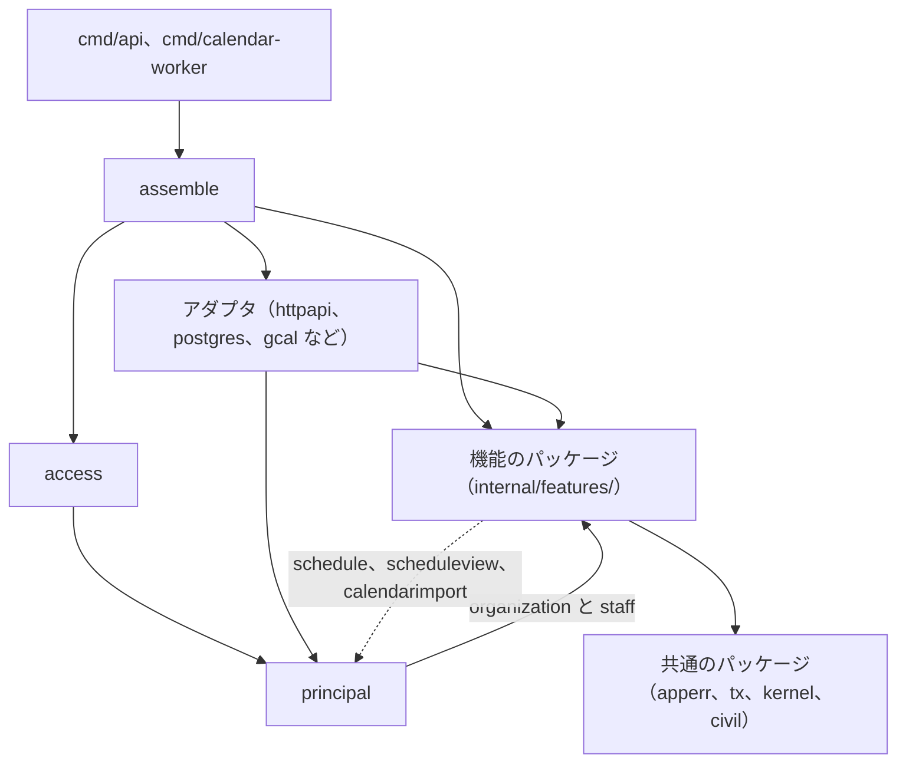
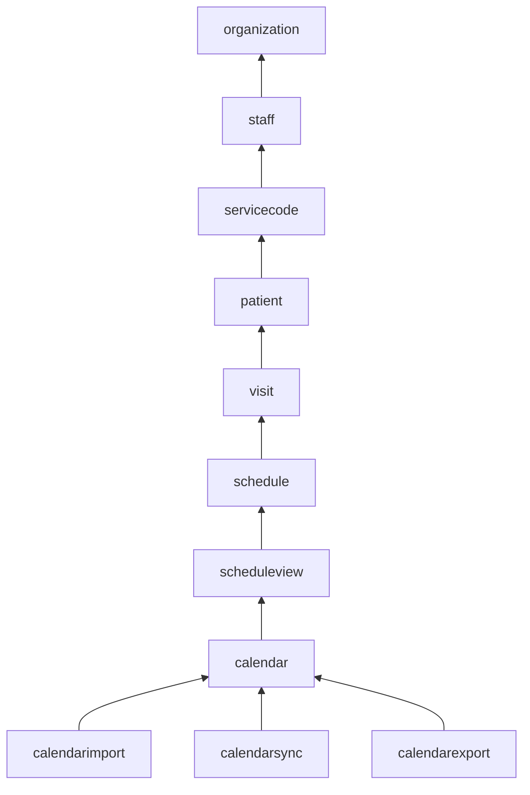

# ADR-0005: 予定の API を機能ごとのパッケージに分け、Go の API の操作を使う依存だけを持つ型にし、ファイルの名前の末尾の語で役割を表す

## Status

承認

## Context

Go の API は 3 つある。予定の API（`services/schedule`）、照合の API（`services/receipt`）、ID ブローカー（`services/broker`）である。

- 予定の API は、組織と人、訪問と予定、外部のカレンダーの、複数の機能を持つ。
- 照合の API は、照合という 1 つの機能を段（読み込み、正規化、対の作成、判定）に分け、usecase にあたる `check.Run` の 1 つの関数を HTTP のハンドラから呼ぶ。
- ID ブローカーは、職員のアカウントの 1 つの機能を、ログインの画面（`login`）と内部の API（`internalapi`）で扱う。ハンドラが手順を持つ。

決定に関わる制約と事実は、次のとおり。

- DB の操作は sqlc、HTTP は oapi-codegen の strict server が、それぞれ 1 つのパッケージに生成する。
  - 予定の API と照合の API の `httpapi` は、生成した `StrictServerInterface` を 1 つの型で実装するので、ハンドラを操作ごとの型に分けられない。
- Go の module の配置の指針は、サーバーのコードを `internal/` に置くことだけを勧め、層や `pkg/` を求めず、`internal/` の下の分け方を決めていない。
  - 出典: Organizing a Go module の [Server project](https://go.dev/doc/modules/layout#server-project)
- Go は、インターフェースを、値を実装する側ではなく使う側に置くことを勧める。
  - 出典: [Go Code Review Comments の Interfaces](https://go.dev/wiki/CodeReviewComments#interfaces)
- Go は、同じパッケージの型のメソッドを、パッケージの中のどのファイルにも置ける。
  - 出典: The Go Programming Language Specification の [Method declarations](https://go.dev/ref/spec#Method_declarations)
- Google Go Style は、1 つの領域とその複数の責務を 1 つのパッケージに持つ形を例に挙げ、ファイルは、どのファイルに何があるかが分かる程度に分けるとする。Go の blog は、`types` や `interfaces` のように、種類でパッケージをまとめることを誤りとする。
  - 出典: [Google Go Style Best Practices の Package size](https://google.github.io/styleguide/go/best-practices#package-size)、[Package names](https://go.dev/blog/package-names)
- 外部のカレンダーは、結び付け、手動の取り込み、同期の変更の取得、取った変更を当てる規則、書き出しの 5 つの理由で変わる。Google カレンダーの書き出しと同期を Worker に分ける変更（#593）と、Google カレンダーを予定の正本にする変更（#594）は、同期と書き出しだけを変える。
- 外部のカレンダーの機能の間には、次の共有がある。
  - 同期の適用の規則は、書き出しの待ちを読んで、待ちを保留か解決にする。
  - 同期と取り込みは、外部の予定と buddy の予定を読み替える規則を共有する。

## Decision

### パッケージの分け方

予定の API の規則と手順を、機能ごとのパッケージに置く。DB と HTTP のアダプタ（`postgres`、`httpapi`）は、生成物が 1 つのパッケージなので、機能に分けずに 1 つずつ置く。

- 機能のパッケージは `internal/features/<機能>/` に置く。ディレクトリの一覧から機能を読み取れ、依存の規則を `features/` の下と外のパスのパターンで書ける。
  - 機能の一覧は `context/codebase.md` にある。サービスコードの `servicecode` は ADR-0020 で、予定の読み取りのモデルの `scheduleview` は ADR-0009 で決めた。
    - ADR-0009: [Google カレンダーとの連携を事業所ごとの正本のモードで分け、職員のカレンダーを事業所ごとのサービスアカウントへの共有で読み書きする](0009-google-calendar-sync.md)
    - ADR-0020: [サービスの規則を packages/go/servicecode に置き、予定の API のサービスコードを visit から servicecode の機能に分ける](0020-service-code-rules.md)
- `internal/` の直下には、機能でないパッケージを置く。
  - アダプタ（`httpapi`、`postgres`、`gcal` など）
  - 共通のパッケージ（`apperr`、`tx`、`kernel`、`civil`）。共通のエラーと検証のエラーは `apperr`、`Transactor` は `tx` に置く。ID の発行と並べ替えは、使う機能のパッケージか、`apperr` と同じ段の小さなパッケージ（`kernel`）に置く。
  - 認証と、パスが指すリソースの事業所の確認は、全ての機能を読むので `access` に置く。
  - リクエストを送った職員と権限の一覧は `principal` に置く。`principal` はリポジトリと操作を持たず、`access` と `httpapi` が認証の後に作るリクエストの文脈なので、`features/` に置かない。
    - `principal` は `organization` と `staff` に依存する。予定に固有の判定は `principal` に置かず、`schedule` に置く。
  - 設定は `config` に置く。`config` は DB の接続の値を自分の型で持ち、DB のアダプタを import しない。組み立ての場所がアダプタに渡す。
  - 全ての依存を組み立てる場所は `assemble` に置き、`cmd/api` と `cmd/calendar-worker` が共有する。
  - 機能のパッケージのテストが使うメモリ上のリポジトリは、`inmem` に置いて共有する。本番のコードからは import しない。
- 新しい API は、機能が 2 つ以上あるときだけ `internal/features/<機能>/` を作る。照合の API と ID ブローカーは、1 つの機能なので `features/` を作らない。

依存の向きは、アダプタと組み立ての場所から機能のパッケージ、機能のパッケージから共通のパッケージの 1 方向にする。



- `principal` は `organization` と `staff` に依存し、`schedule`、`scheduleview`、`calendarimport`、`access`、`httpapi`、`assemble` から使う。点線は、`principal` を使ってよい 3 つの機能のパッケージから `principal` への向きである。

機能のパッケージの間は、決めた順の前の機能だけを import する。



- 矢印は、import してよい向きの、隣り合う機能の間だけを描いた。順の前のどの機能も import してよい。
- `calendarimport`、`calendarsync`、`calendarexport` は、互いに import しない。
- 依存の向きは、golangci-lint の depguard で確認する。規則は `context/codebase.md` の Dependency Rules にある。
  - 出典: depguard の [Config](https://github.com/OpenPeeDeeP/depguard#config)

### 外部のカレンダーの 4 つの機能

外部のカレンダーを、次の 4 つの機能のパッケージに分ける。3 つの機能（`calendarimport`、`calendarsync`、`calendarexport`）は `calendar` までの機能を import し、互いには import しない。

| パッケージ | 責務 | 置くもの |
| --- | --- | --- |
| `calendar` | 結び付けたカレンダー、予定の対応、外部の予定と buddy の予定を読み替える規則、書き出しの待ちの記録 | `ExternalCalendar`、`EventLink`、`ImportRun`、Google の口（`EventSource`、`EventWriter`、`Accounts`）、`classify.go`、`recurrence.go`、`eventbody.go`、`Export` と `Target`、結び付けの操作（`ServiceAccount`、`List`、`Check`、`Link`、`Unlink`） |
| `calendarimport` | 期間を決めた手動の取り込み | `Preview`、`Import`、`plan.go` |
| `calendarsync` | 同期の変更の取得と、取った変更を当てる規則 | `Syncer`（取得）、`Applier`（当てる規則） |
| `calendarexport` | buddy の予定の変更の書き出し | `Outbox`、`Exporter`、`ListExportIssues`、`RetryExport` |

- 取り込みと同期の両方が使う読み替えの規則（`Classify`、`RuleFromRecurrence`、`serviceKey`、`originalDate`、`createdVersion`）は、`calendar` に置いて公開する。外部の予定と buddy の予定を互いに読み替える規則は、3 つの機能の共通の規則であるためである。
- 書き出しの待ちの記録（`Export`、`Target`、`ExportStatus`、`ExportErrorCode`）は `calendar` に置く。同期は、書いている途中の待ちを見て、外部の変更を当てるか保留にするかを決めるので、待ちの記録は書き出しと同期が共有する状態である。
- 書き出しの待ちの一覧と書き直しは、buddy の内容を書く側なので `calendarexport` に置く。
- 外部の変更と buddy の予定を比べて当てる `ReconcileApplier` と、確認が必要な待ちを外部の内容で解決する `AcceptExport` は、どのモードでも使わないので消す。この判断は ADR-0009 にある。
  - ADR-0009: [Google カレンダーとの連携を事業所ごとの正本のモードで分け、職員のカレンダーを事業所ごとのサービスアカウントへの共有で読み書きする](0009-google-calendar-sync.md)

同期は、取得と、当てる規則の 2 つの型に分ける。

- `Syncer` は、同期の状態の Claim と Finish、`EventSource` の変更の読み取り、syncToken の失効（410）の読み直しを持つ。正本のモードを知らない。
- `Applier` は、1 つの外部の予定を 1 つのトランザクションで当てるインターフェースにする。Google カレンダーを正本にする事業所の参照のモデルを書く型は `ProjectionApplier` である。
- `Syncer` は、1 つの予定を当てるトランザクションの中で事業所の正本のモードを読み、モードごとの `Applier` を選ぶ。モードごとの `Applier` は組み立ての場所が渡し、`Syncer` はモードの値と `Applier` の対応だけを持つ。
  - モードごとの同期の向きは ADR-0009 にある。
    - ADR-0009: [Google カレンダーとの連携を事業所ごとの正本のモードで分け、職員のカレンダーを事業所ごとのサービスアカウントへの共有で読み書きする](0009-google-calendar-sync.md)

`calendarexport` は、事業所の正本のモードが buddy を正本にするときだけ書く。

- `Outbox` は、予定を書くトランザクションの中で事業所のモードを読み、buddy を正本にしないモードなら待ちを積まない。
- `Exporter` は、取った待ちの事業所のモードが buddy を正本にしないモードなら、外部のカレンダーに書かずに待ちを保留にする。
- プロセスの全体にかかる設定のフラグ（`GOOGLE_CALENDAR_EXPORT_ENABLED`）は残す。フラグとモードの両方が許すときだけ書き、フラグを誤って有効にしても、正本と逆の向きに書かない。

予定の対応と書き出しの待ちを書くメソッドは、使う側のパッケージの `calendar_port.go` に、使うものだけを並べる。

| パッケージ | 予定の対応 | 書き出しの待ち |
| --- | --- | --- |
| `calendarimport` | `CreateLink` | なし |
| `calendarsync` | `CreateLink`、`UpdateLink` | `Open`、`Hold`、`Resolve`、`Retry` |
| `calendarexport` | `CreateLink`、`UpdateLink`、`DeleteLink` | `Enqueue`、`Claim`、`Finish`、`Get`、`ListIssues`、`Retry` |

- `calendar` の `Repository` は、結び付けたカレンダーの読み書きだけを持つ。取り込みの記録（`CreateRun`、`FinishRun`、`RunningSince`）は `calendarimport` の、`LinkByEvent` は `calendarsync` のインターフェースに置く。
- postgres の実装は 1 つのまま、それぞれのインターフェースを満たす。

### 機能のパッケージの中

機能のパッケージの中を、手順（操作の型）、規則、リポジトリに分ける。

- 規則は、名前に `Service` を付けず、状態を持たない関数かエンティティのメソッドにする。
  - 予定の閲覧と編集の判定と、見てよい職員の絞り込みは、`schedule` の 1 つのファイルに集める。
  - 役職のデフォルトの権限をコピーする規則は、`staff` の公開の関数にする。
- リポジトリは、自分の集約のものだけを、そのパッケージに置く。単発の予定（キャンセルを含む）、繰り返しの予定（規則と除外の日を含む）、マスタで分け、テーブルごとには分けない。
  - レコードをロックして読む操作は `GetForUpdate` の 1 つにし、名前でロックを示す。`GetForUpdate` が返す型は ADR-0009 にある。
- ほかの機能のデータは、使う側で定義したインターフェースで受ける。ほかの機能のリポジトリのインターフェースと、リポジトリの束は受けない。
  - 読むだけなら、`kernel.Finder` か 1〜2 のメソッドにする。例えば `schedule` は、職員の ID、事業所、チームだけを返すインターフェースで職員を受ける。
  - ほかの機能の集約を 1 つのトランザクションで書くかロックするなら、使うメソッドだけを並べた 1 つのインターフェースにする。
    - 例は、`calendar` の `ScheduleStore` と `RecurringStore`、`schedule` の `StaffRefs`。
    - 1 つのトランザクションの中で使うメソッドを分けると、同じ実装を指す項目が増えるだけで、使う側から読める依存は減らないためである。
- トランザクションは操作が始める。外部の API はトランザクションの中で呼ばない。Google カレンダーへの書き出しは、予定の変更と同じトランザクションで書き出しの待ちを記録し、別の処理が送る。

### 操作の型

機能のパッケージの操作を、使う依存だけをフィールドに持つ操作ごとの型にする。全ての依存を知るのは、組み立ての場所（`internal/assemble`）だけにする。

```go
// Leave は、職員を休職にする操作である。
type Leave struct {
	staff       Repository
	assignments AssignmentReader
	tx          tx.Transactor
	guard       organization.Guard
	// ...
}

// NewLeave は Leave を作る。
func NewLeave(staff Repository, assignments AssignmentReader, tx tx.Transactor, guard organization.Guard /* ... */) Leave

// Do は、職員 id を休職にする。
func (o Leave) Do(ctx context.Context, id string, in LeaveInput) (StatusChange, error)
```

- 型の名前は、operationId の動詞から決まる操作の名前にし、操作のファイル（`leave.go`）に置く。
  - 型の名前が、同じパッケージの集約や読み取りのモデルの型と重なるときは、集約や読み取りのモデルの型を名詞に改める。
- コンストラクタは `New<操作>` にし、使う依存を引数で受け、値を返す。nil のときにデフォルトを入れる依存（`Now` など）は、その依存を受けるコンストラクタでデフォルトを入れる。
- 実行のメソッドの名前は `Do` にする。型の名前が動詞を持つので、メソッドの名前は動詞を重ねない。`Handle` はファイルの名前の役割の語の `handler` と紛れ、`Run` は照合の API の `check.Run` が使う。
- 複数の操作が使う補助は、使う依存を引数で受けるパッケージの関数にし、`<まとまり>_app.go` に置く。
  - 例は `func locked(ctx context.Context, staff Repository, id string) (Detail, error)`。
  - 既に自分の依存をフィールドに持つ補助の型（`calendarsync` の適用の規則）は、型のまま残し、使う操作の型と常駐の処理がフィールドに持つ。
- 操作の型の doc コメントには、操作の契約を書く。

操作の型を束ねる型は、機能のパッケージに置かない。束は、使う側の `httpapi` が持つ。

- `httpapi` の `<機能>App`（`StaffApp` など）は、操作と同じ名前とシグネチャの関数のフィールドを持つ struct にする。`<機能>App` の束は `Apps` と名付ける。
- 組み立ての場所は、操作の型の `Do` をメソッド値で渡す（`Leave: staff.NewLeave(...).Do`）。`assemble` の関数は、操作ごとではなく `httpapi` の `<機能>App` ごとに 1 つ置く（`staffApp(repos) httpapi.StaffApp`）。
  - Worker は、使う型だけを作る。ID ブローカーの依存を持つ機能（`staff`）を作らない。
- ハンドラは `s.u.Staff.Leave(ctx, id, in)` のように呼び、呼び先のパッケージを知らない。
- `httpapi` のテストは、フェイクのメソッド値を struct に入れて渡す。

常駐の処理と、操作の型以外で操作を持つ型（`calendarexport` の `Exporter`、`Outbox`、`calendarsync` の `Syncer`、`visit` の `Writer`）は、1 つの型が 1 つの役割を持つ型にする。

- これらの型は、同じ集約のリポジトリと規則を使うので、同じ機能のパッケージに置く。
- 常駐と 1 回の繰り返しの配置先は ADR-0021 にある。
  - ADR-0021: [Google カレンダーの書き出しと同期を、予定の API と同じイメージの Worker のコマンドで役割ごとに動かし、繰り返しを Worker のコマンドに集める](0021-calendar-worker.md)

照合の API と ID ブローカーには、次のとおり当てる。

- 照合の API の操作（`check.Run`）は、予定のデータソースを引数で受けるパッケージの関数のままにする。`httpapi` の `server` は、生成した `StrictServerInterface` を実装するアダプタのままにする。
- ID ブローカーの `login` と `internalapi` は、手順の型を足さず、ハンドラを操作として扱う。
  - パスごとのハンドラを、使う依存だけをフィールドに持つ、パッケージの外に出さない型にし、`http.Handler` を実装させる。実行のメソッドは `ServeHTTP` にする。
  - 型の名前は、ハンドラのメソッドの名前（`submitEmail`、`register`）にし、ハンドラのファイル（`login_handler.go`、`staff_handler.go`）に置く。
  - 複数のハンドラが使う補助（`login` の `accept`、`fail`、`setCookie`、`internalapi` の `revoke`、`writeError`）は、使う依存を引数で受ける関数にする。
  - 組み立ての場所は、パッケージの名前のファイルの `NewHandler` にし、`Config` を受けてハンドラの型を作る。

### ファイルの名前

3 つの API で、パッケージはフラットに保ち、サブパッケージを足さない。ファイルの名前の末尾に付ける役割の語で、そのファイルが持つものの役割を表す。

| 役割 | ファイルの名前 |
| --- | --- |
| 操作（書き込みと読み取り） | `<動詞>_<対象>.go`。役割の語を付けず、`context/conventions.md` の動詞で書き込みか読み取りかを表す |
| 集約、エンティティ、値オブジェクト、読み取りのモデル | `<集約>.go` |
| リポジトリのインターフェース | `<集約>_repository.go` |
| 集約をまたぐ規則（ドメインサービス） | `<規則>_service.go` |
| 複数の操作の共通の補助 | `<まとまり>_app.go` |
| ほかの機能と外部のシステムのインターフェース | `<相手>_port.go` |
| HTTP のハンドラ | `<機能>_handler.go` |

- 例は、`staff_repository.go`、`assignable_service.go`、`status_change_app.go`、`identity_port.go`、`staff_handler.go`。
- 操作のファイルの名前は、操作の名前を snake_case にしたものにする。対象がパッケージの集約のときは、操作の名前と同じく対象を省く（`staff` の `Retire` は `retire.go`）。
  - 操作の数と大きさによらず、全ての機能で、公開の操作を操作の名前のファイルに置く。
  - 1 つの操作だけが使う補助の関数は、その操作のファイルに置く。
- 集約の型は、集約の名前のファイルに置く。機能の名前と同じ集約が無い `calendar` は、結び付けたカレンダーの型を `calendar.go` に置き、操作の `Link` を `link.go` に置く。`organization` は `facility.go`、`department.go`、`team.go`、`position.go`、`policy.go` に、`visit` は `info.go` と `master.go` に分ける。
- パッケージのドキュメントコメントと、複数の集約が使う定数は、機能の名前のファイル（`organization.go`、`visit.go`）に置く。
- 常駐の処理と、操作の型以外で操作を持つ型は、型の名前のファイル（`exporter.go`、`syncer.go`、`writer.go`）に置く。
- 役割の語は、ファイルの名前の末尾に付ける。Go で多い付け方で、テストのファイルが `staff_repository_test.go` のように対象のファイルと並ぶためである。
  - 出典: [Three Dots Labs: Basic CQRS in Go](https://threedots.tech/post/basic-cqrs-in-go/)（例の Wild Workouts の `trainings_firestore_repository.go`）
- 役割の語（`repository`、`service`、`app`、`port`、`handler`）は、GOOS と GOARCH の値に当たらないので、暗黙のビルドの条件にならない。Go は、ファイルの名前の末尾が GOOS か GOARCH の値（`linux`、`amd64` など）に合うときだけ、ビルドの条件にする。
  - 出典: [Build constraints](https://pkg.go.dev/cmd/go#hdr-Build_constraints)
- CQRS は、書き込みと読み取りを動詞で区別するところまでにする。読み取りの DB と、その同期は足さない。
  - 出典: [Fowler: CQRS](https://martinfowler.com/bliki/CQRS.html)
- ドメインイベントは足さない。Google カレンダーへの書き出し（予定の変更と同じトランザクションで積む書き出しの待ち）が、ドメインイベントにする将来の候補になる。

テストのファイルは、次のとおり置く。

- 確認する対象のファイルの名前に `_test` を付ける。操作のテストは操作ごとのファイルに、型のテストは型の名前のファイル（`exporter_test.go`、`syncer_test.go`）に置く。
- 複数の操作を 1 つの観点でまとめて確認するテストは、観点の名前のファイル（`accounts_test.go`、`authorization_test.go`）に置く。観点に名前が付かないものだけを `app_test.go` に置く。

照合の API と ID ブローカーには、表の規則を次のとおり当てる。

- 役割が 1 つのパッケージは、役割の語を付けず、パッケージの名前のファイルの 1 つにする（照合の API の `record`、`normalize`、`match`、`judge`、ID ブローカーの `hydra`）。役割の語は、1 つのパッケージに複数の役割があるときに、役割を分けるために付ける。
- アダプタのパッケージ（`httpapi`、`login`、`internalapi`、`postgres`）は、`Config` と `NewHandler` の組み立てを、パッケージの名前のファイル（`httpapi.go` など）に置く。ハンドラは `<機能>_handler.go`、使う側で定義したインターフェースは `<相手>_port.go` に置く。
- 照合の API の `check` は、ファイルを 3 つに分ける。
  - 段をつなぐ操作（`Run`）は `run.go` に置く。
  - 結果の型（`Report`、`Summary`）は `report.go` に置く。
  - 予定のデータソースのインターフェースと CSV の実装は `schedules_port.go` に置く。

## Considered Options

| 選択肢 | 強み | 弱み |
| --- | --- | --- |
| **採用:** 機能のパッケージを `internal/features/` にフラットに置き、操作を操作ごとの型にし、ファイルの名前の末尾の語で役割を表す | 1 つの機能の規則と手順が 1 か所にある。操作の依存をフィールドから読める。ファイルの名前から役割を探せる。依存の向きを lint で確認できる | ファイルと小さなインターフェースの数が増える。組み立ての場所が長くなる |
| 層（domain、usecase、infrastructure、presentation）でパッケージを分ける | パッケージの名前が層を示す | 1 つの機能の変更が 4 つのパッケージにまたがり、usecase が大きくなり続ける |
| DB と HTTP のアダプタも機能ごとに分ける | 1 つの機能が 1 つのディレクトリに収まる | sqlc の生成物が機能ごとに重なる。strict server のインターフェースを組み立て直す |
| 機能のパッケージを `domain`、`app`、`port` のようなサブパッケージに分ける | ディレクトリで役割が分かる | 種類でパッケージをまとめる形になる。パッケージの数が増え、1 つの機能の変更が複数のパッケージにまたがる |
| 機能のパッケージに、操作を束ねる型（`App`）を置き、操作をそのメソッドにする | 機能の操作の一覧を 1 つの型から読める | どの操作からも全ての依存に触れ、操作のシグネチャから依存を読めない。1 つの操作のテストにも全ての依存を用意する |
| 操作ごとの型にし、依存を `<操作>Deps` の struct で受ける | 依存の多い操作でも引数が並ばない | 操作ごとに型が 2 つになる。フィールドの入れ忘れがコンパイルで分からない |
| 操作ごとの型にし、機能のパッケージに束（Wild Workouts の `Application`）を置く | 機能の操作の一覧を 1 つの型から読める | 束が操作の具体の型を持つと、`httpapi` のテストがフェイクを渡せない |
| `principal` を `features/principal/` に置く | 職員を表す型と同じ階層に置ける | 機能の一覧に、リポジトリと操作を持たないパッケージが並ぶ |
| 役割の語をファイルの名前の先頭に付ける（`repository_staff.go`） | ファイルの一覧が役割ごとに並ぶ | Go で少ない付け方で、同じ対象の集約とリポジトリが離れて並ぶ |
| ほかの機能を書くインターフェース（`ScheduleStore`、`RecurringStore`）も 1〜2 のメソッドに分ける | 読むだけのときと同じ規則で済む | 使う型の項目が 3〜4 つずつ増え、同じ `schedule.Repository` を何度も渡す |
| `calendar` を 1 つのパッケージのまま、ファイルの名前の先頭で分ける | import のパスが変わらない | 非公開の型の共有が残り、同期と書き出しの変更が取り込みと結び付けのパッケージに広がる |
| `calendar` の下にサブパッケージ（`calendar/sync` など）を置く | ディレクトリで束ねて読める | パッケージをフラットに保つ規則に反する。depguard の規則のパターンが増える |

## Consequences

### Positive

- 機能の規則と手順を、1 つのパッケージで読める。機能の一覧を `internal/features/` で読み取れる。
- 読み手は、操作の型のフィールドとコンストラクタの引数から、操作が使う依存を読める。1 つの操作のテストは、その操作が使う依存だけを用意する。
- ファイルの一覧から、集約、リポジトリ、ほかの機能のインターフェース、操作を、名前だけで探せる。3 つの API で、HTTP のハンドラと、使う側で定義したインターフェースの配置先がそろう。
- 外部のカレンダーの 3 つの機能は互いを import しないので、同期と書き出しの変更が取り込みと結び付けに広がらない。
- DB を替えるときは、アダプタを足して組み立ての場所で選ぶだけで、機能のパッケージと設定は変わらない。

### Negative

- 職員を参照するための型と、使う側の小さなインターフェースが、使う機能ごとに増える。
- 依存の多い操作は、コンストラクタの引数が 9 個ほど並ぶ。関数のフィールドを入れ忘れると、呼び出しで panic する。
- 機能の操作の一覧は、パッケージの操作のファイルの一覧と、`httpapi` の `<機能>App` から読む。
- `calendar` は読み替えの規則を持ち、公開の型と関数が増える。1 つの postgres の実装が、4 つのパッケージのインターフェースを満たす。
- 次のものは lint で確認できず、レビューで確認する。
  - 役割の語が役割と合っているか
  - ほかの機能を書くインターフェースが、1 つのトランザクションの中で使うメソッドだけか

## 統合した ADR

- ADR-0005: 予定の API の規則と手順を機能ごとのパッケージにまとめる（[統合の前](https://github.com/Fukuemon/buddy/blob/ef1f289c1edf1257fa20c25b9c2ed4756c790010/docs/adr/0005-schedule-api-packages.md)）
- ADR-0010: 予定の API の機能のパッケージで、手順を usecase、規則を関数、リポジトリを集約の単位に分ける（[統合の前](https://github.com/Fukuemon/buddy/blob/ef1f289c1edf1257fa20c25b9c2ed4756c790010/docs/adr/0010-schedule-api-usecase-boundaries.md)）
- ADR-0026: 予定の API の機能のパッケージを internal/features/ に置き、usecase のメソッドを操作ごとのファイルに分ける（[統合の前](https://github.com/Fukuemon/buddy/blob/ef1f289c1edf1257fa20c25b9c2ed4756c790010/docs/adr/0026-schedule-api-features-directory.md)）
- ADR-0029: 予定の API の機能のパッケージの中で、操作でないファイルとテストの配置先と、ほかの機能を書くインターフェースの大きさを決める（[統合の前](https://github.com/Fukuemon/buddy/blob/ef1f289c1edf1257fa20c25b9c2ed4756c790010/docs/adr/0029-schedule-api-feature-package-layout.md)）
- ADR-0030: Go の 3 つの API で、パッケージをフラットに保ち、ファイルの名前の末尾の語で役割を表す（[統合の前](https://github.com/Fukuemon/buddy/blob/ef1f289c1edf1257fa20c25b9c2ed4756c790010/docs/adr/0030-go-file-names-by-role.md)）
- ADR-0031: Go の API の操作を、使う依存だけを持つ操作ごとの型にし、機能のパッケージの App をやめる（[統合の前](https://github.com/Fukuemon/buddy/blob/ef1f289c1edf1257fa20c25b9c2ed4756c790010/docs/adr/0031-go-operation-types.md)）
- ADR-0032: 予定の API の calendar を、結び付け、取り込み、同期、書き出しの 4 つの機能に分ける（[統合の前](https://github.com/Fukuemon/buddy/blob/ef1f289c1edf1257fa20c25b9c2ed4756c790010/docs/adr/0032-schedule-api-calendar-split.md)）
