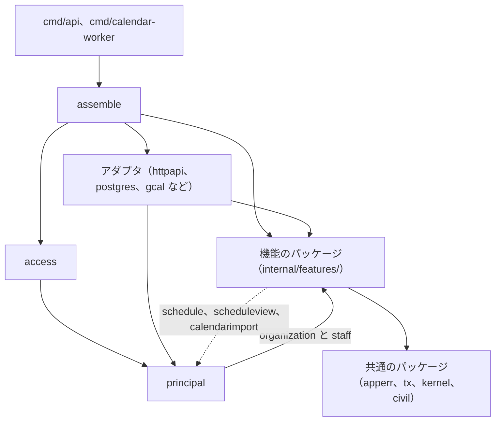
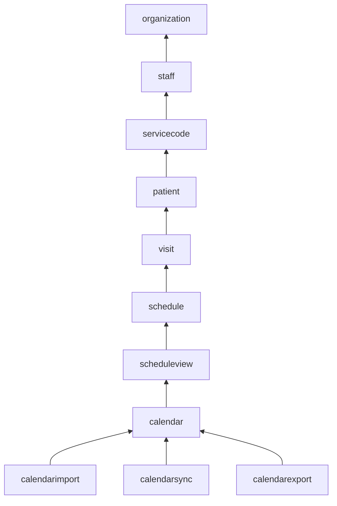

# ADR-0005: 予定の API を機能ごとのパッケージに分ける

## Status

承認

## Context

Go の API は 3 つある。予定の API（`services/schedule`）、照合の API（`services/receipt`）、ID ブローカー（`services/broker`）である。

- 予定の API は、組織と人、訪問と予定、外部のカレンダーの、複数の機能を持つ。
- 照合の API は、照合という 1 つの機能を段（読み込み、正規化、対の作成、判定）に分け、usecase にあたる `check.Run` の 1 つの関数を HTTP のハンドラから呼ぶ。
- ID ブローカーは、職員のアカウントの 1 つの機能を、ログインの画面（`login`）と内部の API（`internalapi`）で扱う。ハンドラが手順を持つ。

決定に関わる制約と事実は、次のとおり。

- DB の操作は sqlc、HTTP は oapi-codegen の strict server が、それぞれ 1 つのパッケージに生成する。
  - 予定の API と照合の API の `httpapi` は、生成した `StrictServerInterface` を 1 つの型で実装するので、ハンドラを操作ごとの型に分けられない。
- Go の module の配置の指針は、サーバーのコードを `internal/` に置くことだけを勧め、層や `pkg/` を求めず、`internal/` の下の分け方を決めていない。
  - 出典: Organizing a Go module の [Server project](https://go.dev/doc/modules/layout#server-project)
- Go は、インターフェースを、値を実装する側ではなく使う側に置くことを勧める。
  - 出典: [Go Code Review Comments の Interfaces](https://go.dev/wiki/CodeReviewComments#interfaces)
- Google Go Style は、1 つの領域とその複数の責務を 1 つのパッケージに持つ形を例に挙げ、ファイルは、どのファイルに何があるかが分かる程度に分けるとする。Go の blog は、`types` や `interfaces` のように、種類でパッケージをまとめることを誤りとする。
  - 出典: [Google Go Style Best Practices の Package size](https://google.github.io/styleguide/go/best-practices#package-size)、[Package names](https://go.dev/blog/package-names)
- 外部のカレンダーは、結び付け、手動の取り込み、同期の変更の取得、取った変更を当てる規則、書き出しの 5 つの理由で変わる。Google カレンダーの書き出しと同期を Worker に分ける変更（#593）と、Google カレンダーを予定の正本にする変更（#594）は、同期と書き出しだけを変える。
- 外部のカレンダーの機能の間には、次の共有がある。
  - 同期の適用の規則は、書き出しの待ちを読んで、待ちを保留か解決にする。
  - 同期と取り込みは、外部の予定と buddy の予定を読み替える規則を共有する。

## Decision

### パッケージの分け方

予定の API の規則と手順を、機能ごとのパッケージに置く。DB と HTTP のアダプタ（`postgres`、`httpapi`）は、生成物が 1 つのパッケージなので、機能に分けずに 1 つずつ置く。

- 機能のパッケージは `internal/features/<機能>/` に置く。ディレクトリの一覧から機能を読み取れ、依存の規則を `features/` の下と外のパスのパターンで書ける。
  - 機能の一覧は `context/codebase.md` にある。サービスコードの `servicecode` は ADR-0016 で、予定の読み取りのモデルの `scheduleview` は ADR-0030 で決めた。
    - ADR-0030: [予定の書き込みのモデルを schedule に、読み取りのモデルを scheduleview に置く](0030-schedule-write-read-models.md)
    - ADR-0016: [サービスの規則を packages/go/servicecode に置き、予定の API のサービスコードを visit から servicecode の機能に分ける](0016-service-code-rules.md)
- `internal/` の直下には、機能でないパッケージを置く。
  - アダプタ（`httpapi`、`postgres`、`gcal` など）
  - 共通のパッケージ（`apperr`、`tx`、`kernel`、`civil`）。共通のエラーと検証のエラーは `apperr`、`Transactor` は `tx` に置く。ID の発行と並べ替えは、使う機能のパッケージか、`apperr` と同じ段の小さなパッケージ（`kernel`）に置く。
  - 認証と、パスが指すリソースの事業所の確認は、全ての機能を読むので `access` に置く。
  - リクエストを送った職員と権限の一覧は `principal` に置く。`principal` はリポジトリと操作を持たず、`access` と `httpapi` が認証の後に作るリクエストの文脈なので、`features/` に置かない。
    - `principal` は `organization` と `staff` に依存する。予定に固有の判定は `principal` に置かず、`schedule` に置く。
  - 設定は `config` に置く。`config` は DB の接続の値を自分の型で持ち、DB のアダプタを import しない。組み立ての場所がアダプタに渡す。
  - 全ての依存を組み立てる場所は `assemble` に置き、`cmd/api` と `cmd/calendar-worker` が共有する。
  - 機能のパッケージのテストが使うメモリ上のリポジトリは、`inmem` に置いて共有する。本番のコードからは import しない。
- 新しい API は、機能が 2 つ以上あるときだけ `internal/features/<機能>/` を作る。照合の API と ID ブローカーは、1 つの機能なので `features/` を作らない。

依存の向きは、アダプタと組み立ての場所から機能のパッケージ、機能のパッケージから共通のパッケージの 1 方向にする。

- `principal` は `organization` と `staff` に依存し、`schedule`、`scheduleview`、`calendarimport`、`access`、`httpapi`、`assemble` から使う。点線は、`principal` を使ってよい 3 つの機能のパッケージから `principal` への向きである。

機能のパッケージの間は、決めた順の前の機能だけを import する。

- 矢印は、import してよい向きの、隣り合う機能の間だけを描いた。順の前のどの機能も import してよい。
- `calendarimport`、`calendarsync`、`calendarexport` は、互いに import しない。
- 依存の向きは、golangci-lint の depguard で確認する。規則は `context/codebase.md` の Dependency Rules にある。
  - 出典: depguard の [Config](https://github.com/OpenPeeDeeP/depguard#config)

### 外部のカレンダーの 4 つの機能

外部のカレンダーを、次の 4 つの機能のパッケージに分ける。3 つの機能（`calendarimport`、`calendarsync`、`calendarexport`）は `calendar` までの機能を import し、互いには import しない。

| パッケージ | 責務 | 置くもの |
| --- | --- | --- |
| `calendar` | 結び付けたカレンダー、予定の対応、外部の予定と buddy の予定を読み替える規則、書き出しの待ちの記録 | `ExternalCalendar`、`EventLink`、`ImportRun`、Google の口（`EventSource`、`EventWriter`、`Accounts`）、`classify.go`、`recurrence.go`、`eventbody.go`、`Export` と `Target`、結び付けの操作（`ServiceAccount`、`List`、`Check`、`Link`、`Unlink`） |
| `calendarimport` | 期間を決めた手動の取り込み | `Preview`、`Import`、`plan.go` |
| `calendarsync` | 同期の変更の取得と、取った変更を当てる規則 | `Syncer`（取得）、`Applier`（当てる規則） |
| `calendarexport` | buddy の予定の変更の書き出し | `Outbox`、`Exporter`、`ListExportIssues`、`RetryExport` |

- 取り込みと同期の両方が使う読み替えの規則（`Classify`、`RuleFromRecurrence`、`serviceKey`、`originalDate`、`createdVersion`）は、`calendar` に置いて公開する。外部の予定と buddy の予定を互いに読み替える規則は、3 つの機能の共通の規則であるためである。
- 書き出しの待ちの記録（`Export`、`Target`、`ExportStatus`、`ExportErrorCode`）は `calendar` に置く。同期は、書いている途中の待ちを見て、外部の変更を当てるか保留にするかを決めるので、待ちの記録は書き出しと同期が共有する状態である。
- 書き出しの待ちの一覧と書き直しは、buddy の内容を書く側なので `calendarexport` に置く。
- 外部の変更と buddy の予定を比べて当てる `ReconcileApplier` と、確認が必要な待ちを外部の内容で解決する `AcceptExport` は、どのモードでも使わないので消す。この判断は ADR-0008 にある。
  - ADR-0008: [Google カレンダーとの連携を、事業所ごとの正本のモードで分ける](0008-google-calendar-sync.md)

同期は、取得と、当てる規則の 2 つの型に分ける。

- `Syncer` は、同期の状態の Claim と Finish、`EventSource` の変更の読み取り、syncToken の失効（410）の読み直しを持つ。正本のモードを知らない。
- `Applier` は、1 つの外部の予定を 1 つのトランザクションで当てるインターフェースにする。Google カレンダーを正本にする事業所の参照のモデルを書く型は `ProjectionApplier` である。
- `Syncer` は、1 つの予定を当てるトランザクションの中で事業所の正本のモードを読み、モードごとの `Applier` を選ぶ。モードごとの `Applier` は組み立ての場所が渡し、`Syncer` はモードの値と `Applier` の対応だけを持つ。
  - モードごとの同期の向きは ADR-0008 にある。
    - ADR-0008: [Google カレンダーとの連携を、事業所ごとの正本のモードで分ける](0008-google-calendar-sync.md)

`calendarexport` は、事業所の正本のモードが buddy を正本にするときだけ書く。

- `Outbox` は、予定を書くトランザクションの中で事業所のモードを読み、buddy を正本にしないモードなら待ちを積まない。
- `Exporter` は、取った待ちの事業所のモードが buddy を正本にしないモードなら、外部のカレンダーに書かずに待ちを保留にする。
- プロセスの全体にかかる設定のフラグ（`GOOGLE_CALENDAR_EXPORT_ENABLED`）は残す。フラグとモードの両方が許すときだけ書き、フラグを誤って有効にしても、正本と逆の向きに書かない。

予定の対応と書き出しの待ちを書くメソッドは、使う側のパッケージの `calendar_port.go` に、使うものだけを並べる。

| パッケージ | 予定の対応 | 書き出しの待ち |
| --- | --- | --- |
| `calendarimport` | `CreateLink` | なし |
| `calendarsync` | `CreateLink`、`UpdateLink` | `Open`、`Hold`、`Resolve`、`Retry` |
| `calendarexport` | `CreateLink`、`UpdateLink`、`DeleteLink` | `Enqueue`、`Claim`、`Finish`、`Get`、`ListIssues`、`Retry` |

- `calendar` の `Repository` は、結び付けたカレンダーの読み書きだけを持つ。取り込みの記録（`CreateRun`、`FinishRun`、`RunningSince`）は `calendarimport` の、`LinkByEvent` は `calendarsync` のインターフェースに置く。
- postgres の実装は 1 つのまま、それぞれのインターフェースを満たす。

### 機能のパッケージの中

機能のパッケージの中を、手順（操作の型）、規則、リポジトリに分ける。

- 規則は、名前に `Service` を付けず、状態を持たない関数かエンティティのメソッドにする。
  - 予定の閲覧と編集の判定と、見てよい職員の絞り込みは、`schedule` の 1 つのファイルに集める。
  - 役職のデフォルトの権限をコピーする規則は、`staff` の公開の関数にする。
- リポジトリは、自分の集約のものだけを、そのパッケージに置く。単発の予定（キャンセルを含む）、繰り返しの予定（規則と除外の日を含む）、マスタで分け、テーブルごとには分けない。
  - レコードをロックして読む操作は `GetForUpdate` の 1 つにし、名前でロックを示す。`GetForUpdate` が返す型は ADR-0030 にある。
- ほかの機能のデータは、使う側で定義したインターフェースで受ける。ほかの機能のリポジトリのインターフェースと、リポジトリの束は受けない。
  - 読むだけなら、`kernel.Finder` か 1〜2 のメソッドにする。例えば `schedule` は、職員の ID、事業所、チームだけを返すインターフェースで職員を受ける。
  - ほかの機能の集約を 1 つのトランザクションで書くかロックするなら、使うメソッドだけを並べた 1 つのインターフェースにする。
    - 例は、`calendar` の `ScheduleStore` と `RecurringStore`、`schedule` の `StaffRefs`。
    - 1 つのトランザクションの中で使うメソッドを分けると、同じ実装を指す項目が増えるだけで、使う側から読める依存は減らないためである。
- トランザクションは操作が始める。外部の API はトランザクションの中で呼ばない。Google カレンダーへの書き出しは、予定の変更と同じトランザクションで書き出しの待ちを記録し、別の処理が送る。

## Considered Options

| 選択肢 | 強み | 弱み |
| --- | --- | --- |
| **採用:** 機能のパッケージを `internal/features/` にフラットに置く | 1 つの機能の規則と手順が 1 か所にある。依存の向きを lint で確認できる | 小さなインターフェースの数が増える |
| 層（domain、usecase、infrastructure、presentation）でパッケージを分ける | パッケージの名前が層を示す | 1 つの機能の変更が 4 つのパッケージにまたがり、usecase が大きくなり続ける |
| DB と HTTP のアダプタも機能ごとに分ける | 1 つの機能が 1 つのディレクトリに収まる | sqlc の生成物が機能ごとに重なる。strict server のインターフェースを組み立て直す |
| 機能のパッケージを `domain`、`app`、`port` のようなサブパッケージに分ける | ディレクトリで役割が分かる | 種類でパッケージをまとめる形になる。パッケージの数が増え、1 つの機能の変更が複数のパッケージにまたがる |
| `principal` を `features/principal/` に置く | 職員を表す型と同じ階層に置ける | 機能の一覧に、リポジトリと操作を持たないパッケージが並ぶ |
| ほかの機能を書くインターフェース（`ScheduleStore`、`RecurringStore`）も 1〜2 のメソッドに分ける | 読むだけのときと同じ規則で済む | 使う型の項目が 3〜4 つずつ増え、同じ `schedule.Repository` を何度も渡す |
| `calendar` を 1 つのパッケージのまま、ファイルの名前の先頭で分ける | import のパスが変わらない | 非公開の型の共有が残り、同期と書き出しの変更が取り込みと結び付けのパッケージに広がる |
| `calendar` の下にサブパッケージ（`calendar/sync` など）を置く | ディレクトリで束ねて読める | パッケージをフラットに保つ規則に反する。depguard の規則のパターンが増える |

## Consequences

### Positive

- 機能の規則と手順を、1 つのパッケージで読める。機能の一覧を `internal/features/` で読み取れる。
- 外部のカレンダーの 3 つの機能は互いを import しないので、同期と書き出しの変更が取り込みと結び付けに広がらない。
- DB を替えるときは、アダプタを足して組み立ての場所で選ぶだけで、機能のパッケージと設定は変わらない。

### Negative

- 職員を参照するための型と、使う側の小さなインターフェースが、使う機能ごとに増える。
- `calendar` は読み替えの規則を持ち、公開の型と関数が増える。1 つの postgres の実装が、4 つのパッケージのインターフェースを満たす。
- 次のものは lint で確認できず、レビューで確認する。
  - ほかの機能を書くインターフェースが、1 つのトランザクションの中で使うメソッドだけか
