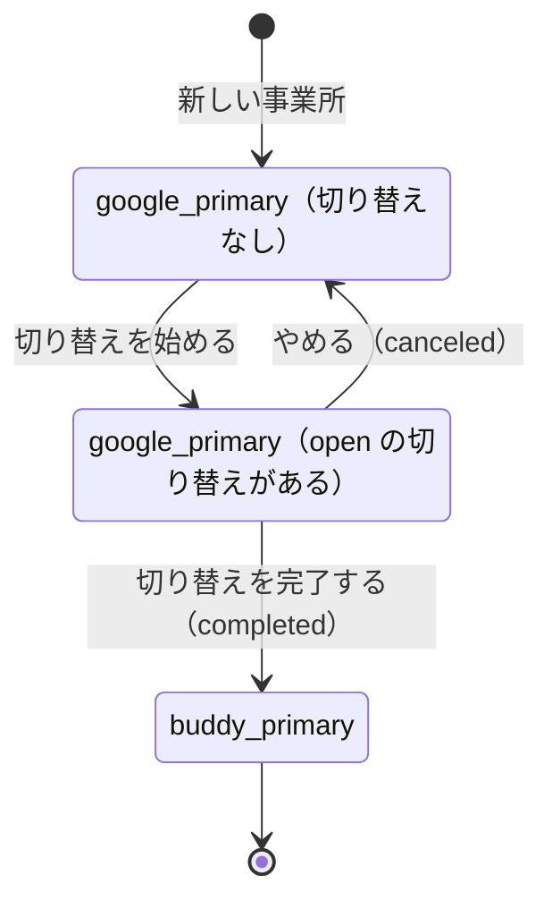
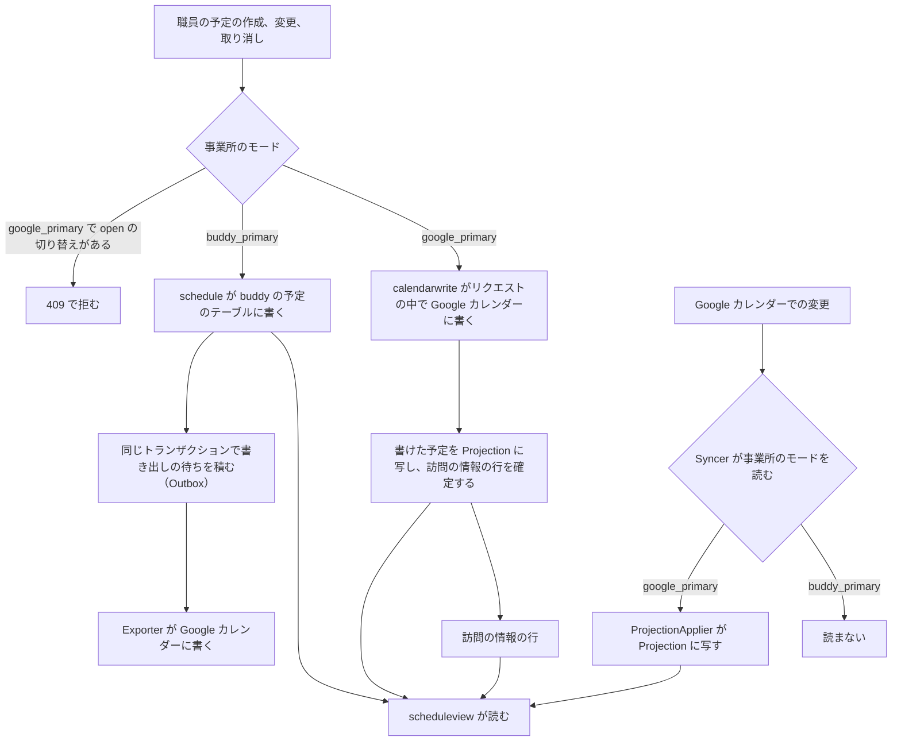

# ADR-0009: Google カレンダーとの連携を事業所ごとの正本のモードで分け、職員のカレンダーを事業所ごとのサービスアカウントへの共有で読み書きする

## Status

承認

## Context

職員は、訪問の予定を職員ごとの Google カレンダーで管理している。照合の API は、そのカレンダーをサービスアカウントで読む。  
buddy を初めから予定の正本にし、Google カレンダーと双方を編集できるようにすると、二重の管理、衝突の解決、同期の失敗のときの運用が複雑になる。  
職員が Google カレンダーで予定を管理したまま buddy の画面と照合を使い、定着した事業所から buddy へ正本を切り替えられるようにする。Google カレンダーを正本にする事業所でも、職員は buddy の画面で予定を作成し、変更し、取り消す。

- PRD: [Google カレンダーとの連携](../PRD.md#google-カレンダーとの連携)

訪問の予定と Google カレンダーについて、決定に関わる事実は次のとおり。

- 訪問の予定は、利用者、主訪問者、同行者、サービスコード、訪問の区分を持ち、予定の API が権限で読み書きを判定する。Google カレンダーの予定は、これらを構造として持てない。職員、利用者、訪問の情報、権限は buddy の DB にある。
- 照合の API は、どのモードでも、予定の CSV か Google カレンダーを直接読み、タイトル `【サービス内容】利用者名` で利用者とサービスを決める。
  - 出典: [照合の API の Design Doc](https://github.com/Fukuemon/buddy/blob/develop/services/receipt/DesignDoc.md)
- buddy はデプロイ先を知らない。Google からの通知を受ける公開のエンドポイントを、buddy の側だけでは用意できない。
- Google Calendar API は、変わった予定だけを `syncToken` で取れる。`syncToken` が切れると 410 を返し、全件を取り直す必要がある。
  - 出典: [Synchronize resources efficiently](https://developers.google.com/workspace/calendar/api/guides/sync)
- 予定の更新と削除に `If-Match` で etag を付けると、Google の側で予定が変わっていたときに 412 を返す。
  - 出典: [Version resources](https://developers.google.com/workspace/calendar/api/guides/version-resources)
- 通知のチャネルには期限があり、自動では延びない。通知のエンドポイントは、公開の HTTPS の URL でなければならない。
  - 出典: [Push notifications](https://developers.google.com/workspace/calendar/api/guides/push)
- buddy は公開する前で、運用している事業所の予定は無い。

予定の API の構成について、決定に関わる事実は次のとおり。

- 同期は、変更の取得（`calendarsync` の `Syncer`）と、取った変更を当てる規則（`Applier`）に分かれる。`Syncer` は、1 つの予定を当てるトランザクションの中で事業所の正本のモードを読み、モードごとの `Applier` を選ぶ。
  - ADR-0005: [予定の API を機能ごとのパッケージに分け、Go の API の操作を使う依存だけを持つ型にし、ファイルの名前の末尾の語で役割を表す](0005-schedule-api-packages.md)
- Google カレンダーに書く口（`calendar.EventWriter`）は、作成、部分更新、削除を持つ。412 のとき `ErrEventChanged` を、消された予定への 412 のとき `ErrEventGone` を、404 のとき `ErrEventNotFound` を返す。
- 書き出しは、カレンダーの共有が外れたときの 404 と予定が無いときの 404 を見分けられないとみなし、404 で予定の対応を消さない。
- `calendar.EventIDOf` は、buddy の予定の ULID から Google の予定の ID を作る。同じ ID の作成は 409（`ErrEventExists`）になるので、書き直しても予定は 2 つにならない。
- 予定の書き込みの前の確認と、表示のための読み出しで、読むものが違う。表示は種類、職員、訪問の情報の名前を結合し、Google カレンダーを正本にする事業所では、buddy の予定のテーブルでない写しから同じ形を返す。
- 事業所の行のロックは `organization` にあり、職員の状態の変更と予定と担当の割り振りが同じロックを使う。

サービスアカウントについて、決定に関わる事実は次のとおり。

- サービスアカウントが 1 つだと、ほかの事業所の職員がサービスアカウントに共有したカレンダーも、ID を入れれば読めて結び付けられる。読めるかどうかで、カレンダーがどの事業所のものかを判定できない。
- 照合の API は、設定のファイルのカレンダーごとに事業所の組織の ID（`org_id`）を持ち、リクエストのトークンの組織のカレンダーだけを読む。照合の API は事業所のテーブルを持たない。
- 予定の API は、結び付けの操作でカレンダーの ID をリクエストから受ける。結び付けたカレンダーのレコードは、事業所（`facility_id`）を持つ。書き出しと増分の取得は、リクエストを受けずに動く。事業所と組織は 1 対 1 に対応する（`facilities.org_id`）。
- サービスアカウントの権限を借用するには、`iam.serviceAccounts.getAccessToken` の権限が要る。この権限は、サービスアカウントのトークン作成者のロール（`roles/iam.serviceAccountTokenCreator`）に含まれる。ロールは、1 つのサービスアカウントに付けられる。
  - 出典: [Service account impersonation](https://docs.cloud.google.com/iam/docs/service-account-impersonation)
  - 出典: [Manage access to service accounts](https://docs.cloud.google.com/iam/docs/manage-access-service-accounts)
- 権限借用の短い期間の token を作るには、プロジェクトで IAM Service Account Credentials API を有効にする。
  - 出典: [Create a short-lived access token](https://docs.cloud.google.com/iam/docs/create-short-lived-credentials-direct)
- Go のライブラリは、Application Default Credentials の認証から、権限を借用した token を作れる。元の認証が利用者のアカウントのときは、権限を借用する先のアカウントにも `serviceusage.services.use` を持つロールが要る。
  - 出典: [impersonate パッケージ](https://pkg.go.dev/google.golang.org/api/impersonate)
- 1 つのプロジェクトに作れるサービスアカウントの数は、プロジェクトごとに違い、増やすことを申し込める。
  - 出典: [IAM の割り当てと上限](https://docs.cloud.google.com/iam/quotas)

## Decision

### 同期の単位と認証

- 同期の単位は、職員ごとのカレンダーにする。今の運用と、照合の API の読み方（カレンダー 1 つが職員 1 人）を変えずに済む。
- 職員のカレンダーの共有で接続する。取り込みは閲覧、書き出しは予定の変更の権限で共有する。同意の画面、Google の審査、利用者ごとのトークンの保管が要らない。ドメイン全体の委任は使わない。
- 運営側の 1 つの GCP のプロジェクトに、事業所ごとのサービスアカウントを作る。buddy はサービスアカウントのキーを持たず、Application Default Credentials で認証した主体から、事業所のサービスアカウントの権限を借用して Google Calendar API を呼ぶ。
  - 職員は、自分の事業所のサービスアカウントにカレンダーを共有する。ほかの事業所のアカウントには共有されていないので、ほかの事業所の職員が ID を入れても読めない。
  - 事業所は、リクエストを受ける操作ではリクエストの職員かトークンの組織から、リクエストを受けない書き出しと増分の取得では結び付けたカレンダーのレコードの事業所（`external_calendars.facility_id`）から決める。リクエストの本文からは受けない。
  - 組織の ID とサービスアカウントのメールアドレスの対応は、運営側が設定のファイルで渡す。予定の API と照合の API は、同じ形の設定を読む。予定の API は、事業所の組織の ID で対応を引く。アカウントを作るのも、ロールを付けるのも運営側で、buddy の画面からは変えないためである。
  - Application Default Credentials で認証する主体に、トークン作成者のロールを、事業所のサービスアカウントごとに付ける。プロジェクトの全体には付けない。主体は、Workload Identity Federation でプールの主体が直接に呼ぶならその主体、中間のサービスアカウントを経るならそのアカウントである。プロジェクトでは IAM Service Account Credentials API を有効にする。
  - buddy のリポジトリと動いている環境に、サービスアカウントのキーを置かない。デプロイした環境は Workload Identity Federation で認証する。
  - 開発者は、検証の事業所のサービスアカウントの権限を借用した Application Default Credentials を作る。キーのファイルと `GOOGLE_APPLICATION_CREDENTIALS` は使わない。
    - コマンドは `gcloud auth application-default login --impersonate-service-account` である。
    - 開発者のアカウントには、検証の事業所のアカウントのトークン作成者のロールだけを付け、本番の事業所のアカウントには付けない。本番の事業所のアカウントの権限を借用できると、ローカルから利用者名の入った職員のカレンダーを読めるためである。
    - Application Default Credentials のアカウントが事業所のアカウントと同じときは、buddy は重ねて権限を借用しない。
- 予定の対応: buddy の予定と Google の予定の ID の対応を、予定の API の DB に持つ。タイトルは `【サービス内容】利用者名` の形を保ち、照合の API が読み続けられるようにする。

### 正本のモード

事業所の正本のモードを、`google_primary` と `buddy_primary` の 2 つにし、`organization` の `Facility` の状態にする。  
モードは、どちらが予定の正本かだけを表す。切り替えの途中は、モードではなく切り替えの記録で表す。

| モード | 予定の正本 | buddy からの書き込み | 同期 | 書き出し | 画面が読むもの |
| --- | --- | --- | --- | --- | --- |
| `google_primary` | 日付と時刻、タイトル、取り消しは Google カレンダー。訪問の情報は buddy の DB | 同期の呼び出しで Google カレンダーに書く。`open` の切り替えの間は拒む | Google の変更を Projection に写す | しない | Projection と訪問の情報の行 |
| `buddy_primary` | buddy | buddy の予定のテーブルに書く | しない | buddy から Google へ一方向 | buddy の予定 |

モードと切り替えは、次のとおり移る。

- 遷移は、`google_primary` から `buddy_primary` の 1 つだけにする。切り替え（`Cutover`）を完了したときにだけ起きる。遷移の規則は `organization` に置く。
- 新しい事業所のデフォルトのモードは `google_primary` にする。マイグレーションは、今ある事業所を `buddy_primary` にし、今の動作を変えない。ローカル環境と E2E のシードの事業所は `buddy_primary` にし、`google_primary` の確認のための事業所を別に足す。
- `buddy_primary` では、Google カレンダーへの書き出しを常に行う。Google カレンダーは、buddy が使えないときの参照用の控えになる。
- 正本のモードは事業所ごとに持つ。正本を切り替える単位を事業所にするためである。
- 事業所を `buddy_primary` に切り替える運用を続ける。

モードごとの書き込み、同期、書き出しは、この ADR が決めた次の流れにする。

### 予定の書き込みのモデルと読み取りのモデル

予定の書き込みのモデルを `schedule` に、画面と照合が読む読み取りのモデルを `scheduleview` に置く。

- `schedule` は、buddy の予定のテーブルの予定を書く。予定の作成、変更、キャンセル、繰り返しの予定と回の置き換えの操作を持つ。
  - `GetForUpdate` は、名前を結合しない書き込みのモデル（`Schedule` と更新の番号）を返す。
  - 予定の閲覧と編集の判定と、見てよい職員の絞り込みは、`schedule` の 1 つのファイルに置き、公開する。
  - 予定の種類のマスタ（`ListTypes`）は、予定を書くときの参照なので `schedule` に置く。
- `scheduleview` は、予定の 1 件と一覧を読む操作（`Get`、`GetRecurring`、`List`）と、名前を結合した表示の型（`Detail`、`RecurringDetail`、`Listing`）を持つ。
  - 事業所のモードで、buddy の予定のテーブルか Projection を読み、同じ型を返す。画面と照合は、どちらから読んだかを知らない。
  - 閲覧の判定と絞り込みは、`schedule` の公開の関数を呼ぶ。規則を 2 か所に書かない。
- 機能の順は、`schedule`、`scheduleview`、`calendar` の順にする。`scheduleview` は `schedule` まで import してよい。`calendarsync` は Projection を書くために `scheduleview` を import してよい。

buddy の予定のテーブルに書けるかは、次の規則で決める。

- 予定を書く操作は、トランザクションの最初に、事業所の行を共有のロックで読み、`schedule` の規則の関数（`RequireWritable`）でモードを確認する。
  - `buddy_primary` のときだけ書ける。`google_primary` で書けるのは、`open` の切り替えがある事業所の切り替えの取り込みだけである。
  - 手動の取り込み（`calendarimport`）も、buddy の予定のテーブルを書く前に同じ規則を呼ぶ。
  - 規則は 1 つの関数で、テストに DB とフェイクが要らない。
- モードの切り替えは、同じ事業所の行を排他のロックで取る。切り替えの途中の書き込みは、切り替えの後に入り、切り替えの前のモードで書かれない。

### 取り込みと書き出し（`buddy_primary`）

- 取り込み: マネージャーが期間を選び、プレビューしてから確定する。
- 書き出し: 予定の変更と同じトランザクションで書き出しの待ちを記録し、別の処理（`Exporter`）が Google に送る。更新には最後に同期した etag を `If-Match` で付ける。
  - 412 は確認が必要な予定にし、マネージャーは buddy の内容で書き直す（`RetryExport`）。
- 繰り返し: buddy の繰り返しの規則（毎週の曜日、毎月の日付、毎月の第何週の曜日）に写せる RRULE だけを繰り返しのまま持ち、ほかの形は回ごとの予定に展開する。1 回だけ変えた回は、buddy の回の置き換えに写す。
- `buddy_primary` では、`Syncer` はその事業所のカレンダーを読まない。Google カレンダーでの変更は buddy に取り込まない。

### 同期と Projection（`google_primary`）

- 同期は、`syncToken` による増分の取得を、2〜5 分ごとのポーリングで行う。
- `Syncer` は `ProjectionApplier` で Google カレンダーの変更を Projection に写す。予定の対応の有無によらず、新しく作った予定も写す。
- Projection は、Google カレンダーを正本にする事業所の予定の写しで、`scheduleview` だけが読む。書くのは、同期（`ProjectionApplier`）と、予定の API の書き込みの 2 つである。
- テーブルは `calendar_event_projections` にし、Google カレンダーの 1 つの予定を 1 行にする。結び付けたカレンダーの ID と Google の予定の ID の組で一意にする。
- 保存する項目は次のとおり。
  - Google の予定の ID、繰り返しの予定の親の ID と元の開始の時刻（例外の回）、状態（確定か取り消し）
  - タイトル、開始と終了（日時か、終日の日付）、繰り返しの規則（RRULE）
  - etag、Google での更新の時刻、写した時刻
- 保存しない項目は、説明、場所、参加者、作成者と主催者のメール、添付である。タイトルは、利用者名を含むが、表示と照合に要るので保存する。
- 繰り返しの予定は、展開せずに親と例外の回を保存し、`scheduleview` が読む期間の中で展開する。展開には、取り込みと同じ読み替えの規則（`calendar.RuleFromRecurrence`）を使う。展開できない繰り返しの規則の予定は、確認が必要な予定として 1 件で返し、一覧から落とさない。
- 保持する期間は、前々月の初日から 3 か月後の月末までにする。期間より前に終わった予定の行は、同期が消す。照合で前月の予定を読むためである。
- 2 つが書く順は決まらないので、Google の更新の時刻（`updated`）の新しい方を残す。
  - 同期も予定の API も、行を書くのは、読んだ予定の `updated` が行の `updated` より新しいときだけにする。
  - 同期は、Google で取り消した単発の予定と親の予定の行を消さず、取り消しの状態と `updated` を持つ行に残す。消すと、予定の API が古い応答で予定を戻すためである。取り消しの状態の行は、`scheduleview` が一覧に出さない。保持する期間より前に終わった行と同じく、期間で消す。
  - `syncToken` が切れたとき（410）は、そのカレンダーの予定を全件読み直し、読み直しに無かった Projection の行を消す。これで、取り消しの取りこぼしを直す。

職員、事業所、閲覧の判定は、次のとおりにする。

- Projection の行は、結び付けたカレンダー（`external_calendars`）を通して、職員と事業所に結び付く。行には、写した時点の職員と事業所の ID を持たせ、事業所で絞る読み出しに使う。
- `scheduleview` は、Projection の予定にも、buddy の予定と同じ閲覧の判定（`schedule.Readable`）と事業所の分離を当てる。カレンダーの職員を、予定の職員とみなす。
- Projection の予定の訪問の情報は、buddy の DB に訪問の情報の行がある予定ではその行を使う。行が無い予定は、読み出しのときにタイトルを読み替えて引く（`calendar.Classify`）。引けない予定は、訪問の情報を空にし、理由（利用者が見つからない、サービスコードが見つからない）を付けて返す。

同期の状況の返し方と失敗のときは、次のとおりにする。

- `scheduleview` は、Projection を読む一覧に、カレンダーごとの同期の最終の成功時刻と、最後の失敗の理由を一緒に返す。画面は、最終の成功が古いか失敗しているときに、予定が最新でないことを示す。古いとみなす時間は画面で決める。
- Google カレンダーの API の障害、クォータの超過、読めないカレンダーは、カレンダーごとにリースと再試行の回数で読み直し、失敗の理由を同期の状態に残す。1 つの予定の不正で、ほかの予定とカレンダーの同期を止めない。
- 予定のタイトルと利用者名は、ログに書かない。ログには事業所、カレンダー、Google の予定の ID だけを書く。

### buddy からの書き込み（`google_primary`）

`google_primary` の事業所でも、予定の API は予定の作成、変更、取り消しを受ける。  
予定の API は、受けた変更をリクエストの中で Google カレンダーに書き、書けたときだけ成功を返す。

- 同期の呼び出しで Google カレンダーに書き、Outbox と `Exporter` を使わない。
  - Google が受けるまで、変更は正本に入っていない。後から書く形では、書けなかった変更を buddy のどこかに持ち、職員がいないときに衝突を解く手順が要る。
- Google に書く操作は、機能のパッケージ `calendarwrite` に置く。`calendar`、`scheduleview`、`visit`、`schedule` の閲覧と編集の判定を使う。Google に書くときは、`calendar.EventWriter`、`EventIDOf`、予定の本文を作る規則（`eventbody.go`）を使う。
  - `httpapi` は、予定の作成、変更、取り消しの API のまま、事業所のモードで `schedule` か `calendarwrite` を呼ぶ。API のパスは変えず、作成のリクエストに予定の ID を足す。
- 予定の閲覧と編集の判定は、`buddy_primary` と同じ `schedule` の規則を当て、カレンダーの職員を予定の職員とみなす。
  - 主訪問者に、外していないカレンダーが無いときは、409（`calendar_not_linked`）で拒む。

1 つの書き込みは、次の順に行う。

1. 1 つ目のトランザクションで、事業所の行を共有のロックで読み、`google_primary` で `open` の切り替えが無いことを確認する。訪問の情報の行に、書く内容を「書いている途中」の保留の版として書き、書く期限を持たせる。
   - 書く期限は、手順 1 の時刻に、Google を呼ぶ時間の上限と余裕を足した時刻である。
2. トランザクションの外で、Google に書く。予定の本文の `extendedProperties.private` に、buddy の予定の ID と保留の版を置く。
3. 書けたら、2 つ目のトランザクションで、Google が返した予定を Projection に写し、保留の版を確定する。画面は、同期を待たずに書いた予定を読める。
   - Projection の行が Google の更新の時刻で同じか新しいときは写さない。同期が、書いた後の Google での変更をすでに写していることがあるためである。
4. Google が書き込みを拒んだことが確かなときは、保留の版を消し、訪問の情報の行を書く前の内容に戻す。
5. 結果が分からないときは、保留の版を「結果が分からない」にして残し、503 を返す。

Google の応答で、拒んだことが確かな場合と、結果が分からない場合を分ける。

- 拒んだことが確かな場合は、Google が 4xx を返したときである。412、404、410、403、400、429 が当たる。
- 結果が分からない場合は、Google が 5xx を返したとき、通信のエラー、時間切れである。Google が書いた後に応答だけが失われたことがある。`EventWriter` は、この場合を `ErrOutcomeUnknown` で返す。

保留の版は、その書き込みがもう Google に届かないと分かるまで消さない。

- 同期がその予定を読み、`extendedProperties.private` の版が保留の版と同じなら確定する。手順 3 のトランザクションが失敗したときも、この規則で確定する。
- 同期の増分で読んだ版が保留の版と違っても、保留の版を消さない。
  - 同期は、予定ごとのトランザクションを開く前に変更をまとめて読むので、読んだ予定が手順 2 の前のものであることがある。消した後に Google が書き込みを受けると、DB にしかない訪問の情報を戻せない。
- 保留の版を消すのは、手順 4 のほかは、書く期限を過ぎた保留の版を同期が `events.get` で読み戻したときだけにする。読み戻しは、書く期限の後に Google を読むので、その書き込みがまだ届く途中であることはない。
  - 予定が無いか、版が違えば保留の版を消す。版が同じなら確定する。
  - 書く期限を過ぎた「書いている途中」の保留の版は、予定の API が手順 3 から 5 のどれにも進まずに止まったものとみなし、「結果が分からない」と同じく読み戻す。
  - 同期の増分は、作成が失敗して予定が無いときに何も返さないので、読み戻しで解く。
- 保留の版がある予定への buddy からの書き込みは、409（`google_write_pending`）で拒む。保留の版を重ねると、どの版を Google が受けたかを比べられないためである。
- buddy で入力した訪問の情報は、Google が受けた版なら失われない。

作る予定の ID は、画面が作成のリクエストに付ける buddy の予定の ID（ULID）から `calendar.EventIDOf` で作る。  
Google に書けたのに応答を受けられず、職員が同じ入力を送り直しても、同じ ID になるので予定は 2 つにならない。

- 作成が 409（`ErrEventExists`）のときは、Google の予定を読み、次の順で扱う。読んだ etag で上書きしない。上書きすると、最初の作成の後に Google で変えた内容を、職員に知らせずに失うためである。
  - `extendedProperties.private` の buddy の予定の ID が違えば、409 を返す。
  - ID が同じで、版が保留の版と同じで、予定の内容（タイトル、日時、繰り返しの規則、説明）が送り直した内容と同じなら、作成は済んでいたとみなして成功を返し、読んだ予定を Projection に写して保留の版を確定する。
  - ID が同じで、版か内容が違えば、最初の作成の後に Google で変わったとみなし、409（`google_event_changed`）を返して、読んだ予定を Projection に写す。

`EventWriter` のエラーごとの扱いは次のとおり。

| `EventWriter` のエラー | 予定の API の応答 | 画面の表示 |
| --- | --- | --- |
| 無し | 書いた予定 | 書いた予定 |
| `ErrEventChanged` | 409（`google_event_changed`）。Google の今の予定を Projection に写す | Google カレンダーで変更されたことと最新の予定を示し、入力を残す |
| `ErrEventGone` | 409（`google_event_not_found`）。Projection の行を消す | Google カレンダーで消されたことを示す |
| `ErrEventNotFound` | 409（`google_event_not_found`）。Projection の行を消さない | Google カレンダーで予定が見つからないことを示す |
| `ErrUnavailable` | 503（`google_unavailable`）。保留の版を消す | 書けなかったことを示し、入力を残す |
| `ErrOutcomeUnknown` | 503（`google_write_unknown`）。保留の版を残す | 書けたかを確認できなかったことを示し、時間をおいて予定を開き直すよう案内する |
| `ErrUnwritable` | 409（`google_calendar_unwritable`） | カレンダーの共有の権限が足りないことを示す |
| `ErrEventRejected` | 409（`google_event_rejected`） | Google カレンダーが予定を受け付けなかったことを示し、入力を残す |

- Google カレンダーが使えない間は、`google_primary` の事業所の予定を buddy から書けない。利用者がこの扱いを選んだ。

訪問の情報は、buddy の DB に持つ。

- 訪問の情報（利用者、主訪問者、同行者、サービスコード、訪問の区分）の行の主キーは buddy の予定の ID にし、結び付けたカレンダーと Google の予定の ID の組を一意のカラムにする。
  - 利用者と職員の参照、事業所の分離、同行者の不変条件を、buddy の予定の訪問の情報と同じ規則で DB と予定の API が守れる。
- buddy から書くときは、Google のタイトルを書き出しと同じ `【サービス内容】利用者名` にする。
- Google でタイトルを変え、タイトルの利用者かサービス内容が buddy の訪問の情報と違うときは、訪問の情報を消さずに、確認が必要な予定として理由を付けて返す。職員が buddy で直すと、両方がそろう。
- 主訪問者を替えると、予定を新しい職員のカレンダーに移し、訪問の情報の行のカレンダーと Google の予定の ID を書き換える。主キーは変わらない。
- 訪問の情報の行は、Projection の行と同じ期間だけ残し、Google で取り消した予定の行は消す。

両方で同じ予定を変えたときは、先に書かれた変更を残す。

- 画面は、読んだ予定の etag を書き込みに付ける。予定の API は、その etag を `If-Match` に付けて Google に書く。
- Google で先に変わっていれば、Google は 412 を返し、予定の API は buddy の変更を書かずに 409 を返す。buddy の変更は職員の画面に入力のまま残る。職員に知らせずに片方の変更を失うことはなく、職員がその場で最新を見て入力し直す。
- Projection が古くても、比べるのは Google の etag なので、変更は失われない。409 が増えるだけである。
- この規則は、利用者が選んだ。

Google で作った予定は、タイトルを読み替えて画面に出す。

- 職員は、その予定を buddy で開いて変更でき、訪問の情報を足して保存できる。保存すると、訪問の情報の行ができる。利用者がこの扱いを選んだ。
- 同期は、Google で作った予定に訪問の情報の行を自動で作らない。タイトルの読み替えは推定で、同行者と訪問の区分を持たないためである。

繰り返しの予定は、Google の繰り返しの形に合わせる。

- buddy で作る繰り返しの予定は、書き出しと同じ RRULE と `EXDATE` の繰り返しの予定として Google に書く。
- 1 回だけの変更と取り消しは、Google の例外の回として書く。`buddy_primary` の書き出しの、親の `EXDATE` と別の単発の予定にする形は使わない。
- 訪問の情報は親の予定の行に持ち、例外の回で変えたときだけ回の行を足す。

### 切り替え（`Cutover`）

切り替えは、モードではなく、期間のある作業の記録にする。

- 配置先は `calendarimport` にする。最後のモードの変更だけを `organization` に頼む。
- 状態は `open` から、`completed` か `canceled` に移る。
- 持つものは、事業所、始めた職員と時刻、取り込みの期間、終えた時刻である。
  - 取り込みの期間は、切り替えの月の初日から先の全てにする。終わりを持たない。
  - 取り込みの期間は、Projection を保持する期間とは別のものである。Projection は画面と照合が読む写しで、切り替えは buddy に正本を移す作業なので、Projection が持たない先の予定も移す。
- 1 つの事業所に、`open` の切り替えは 1 つまでにする。DB の一意の索引で守る。
- 取り込みの記録（`ImportRun`）に切り替えの ID を持たせる。
- 切り替えの操作は、事業所で職員の管理の権限（`staff.manage`）を持つ職員が、予定の API で行う。
  - ADR-0006: [職員と利用者の登録と、職員の権限と役職を変える操作を、職員の管理の権限で許す](0006-staff-manage-policy.md)

切り替えの手順は次のとおり。

1. 始める。事業所が `google_primary` で、結び付けた全てのカレンダーの最後の同期が成功していることを条件にする。
2. 取り込む。マネージャーが、取り込みの画面（`calendarimport` のプレビューと確定）で、カレンダーごとに取り込む。
   - 画面と照合は Projection を読み続けるので、取り込みの途中の状態は職員に見えない。
   - 取り込みは、Projection ではなく、Google カレンダーを直接読む。Projection が持たない先の予定も取り込むためである。
   - 取り込みの確認が必要な予定（訪問の情報に読み替えられない予定など）は、マネージャーが取り込むか取り込まないかを決める。
   - 訪問の情報の行がある予定は、タイトルの読み替えより訪問の情報の行を使う。buddy で入力した訪問の情報を失わないためである。
   - 繰り返しの予定は、回に展開せず、規則のまま取り込む。終わりの無い繰り返しの予定も、規則のまま移す。
   - buddy の繰り返しの規則に写せない繰り返しの予定は、確認が必要な予定として返す。マネージャーが Google カレンダーで規則を変えるか、取り込まないと決めるまで、切り替えを完了させない。
   - `open` の切り替えの間に取り込み直すと、Google の etag が予定の対応の etag と違う予定を、Google の内容で buddy の写しに上書きする。予定の対応がある予定を飛ばす通常の取り込みと違い、切り替えの取り込みにだけこの規則を足す。切り替えの間は buddy からの書き込みが止まっているので、上書きしても職員の変更は失われない。
3. 完了する。カレンダーごとに、次の 3 つを確認する。
   - 最後の取り込みの後に、同期が成功している。これで最後の差分の取得を兼ねる。
   - 切り替えの月の初日より後に終わる Google の予定が、全て、予定の対応を持つか、取り込みで取り込まないと決めた予定である。buddy の規則に写せない繰り返しの予定が残っていない。
   - 取り込んだ後に Google の予定が変わっていない。予定の対応の etag と Google の etag が同じである。
   - Projection が持たない先の予定も確認するため、Google カレンダーを切り替えの月の初日から全件読み直して比べる。Google を読むのはトランザクションの前にし、事業所の行を排他のロックで取ったトランザクションの中で、読んだ予定と予定の対応を比べる。
   - 満たせば、モードを `buddy_primary` にし、事業所の Projection の行を消し、切り替えを `completed` にする。同期をやめ、書き出しを始める。
   - 満たさなければ、満たさない予定の一覧を返し、切り替えを `open` のままにする。
4. やめる。この切り替えの取り込みで作った buddy の予定と予定の対応を消し、切り替えを `canceled` にする。モードは `google_primary` のままにする。

切り替えと buddy からの書き込みは、次の順序で並べる。

- `open` の切り替えがある事業所では、buddy からの書き込みを 409 で拒む。切り替えの取り込みが、取り込んだ後の Google の変更を上書きする規則が、buddy の書き込みで崩れないためである。
- 切り替えを始める操作と完了する操作は、事業所の行を排他のロックで取った後に、事業所に保留の版があれば 409（`google_write_pending`）で拒む。
  - 予定の API の書き込みは、手順 1 で事業所の行を共有のロックで読み、`open` の切り替えが無いことを確認してから保留の版を書く。始める操作が排他のロックを取った後は、新しい書き込みは `open` の切り替えを見て拒まれ、それより前の書き込みは保留の版を残している。
  - 完了の確認の etag の比べ方は、まだ Google に書いていない書き込みを見つけられない。保留の版で、処理中の書き込みを数える。
- マネージャーは、保留の版が確定するか消えるまで待ってから、切り替えを始めるか完了する。結果が分からない書き込みの保留の版は、同期の読み戻しで解ける。

切り替えは、業務時間外の 1 回の作業で終える。

- その日のうちに完了できなければ、切り替えを「やめる」で終え、事業所を `google_primary` のままにする。別の日に、始めからやり直す。運用の手順に「その日のうちに終わらなければやめる」と書く。
- 切り替えの間は Google カレンダーを編集しないよう職員に頼むことを、運用の手順に書く。Google での編集は、手順 3 の etag の確認で見つけ、取り込み直しで buddy の写しに上書きする。
- `open` の切り替えを、自動の期限で止めない。作業中の取り込みが消え、Worker に期限の処理が要るためである。放置は、運用と画面の表示で防ぐ。
  - 予定の画面は、`open` の切り替えがある事業所で、「切り替え中」と、始めた職員と始めた時刻を出し、buddy から予定を変えられないことを示す。
- 利用者がこの運用を選んだ。

### 残すコードと消すコード

- `ProjectionApplier` と Projection は残し、予定の API の書き込みからも Projection を書く。
- `calendarexport` の Outbox と `Exporter` は、`buddy_primary` の書き出しに残す。
- `ReconcileApplier`（外部の変更と buddy の予定を比べて当てる規則）と `AcceptExport`（確認が必要な待ちを Google の内容で解決する操作）は、どのモードでも使わないので消す。
  - どちらも buddy の予定のテーブルを正本にする前提で、`google_primary` の書き込みは buddy の予定のテーブルを書かない。`buddy_primary` は同期をせず、`AcceptExport` は `buddy_primary` で拒み、`google_primary` では確認が必要な待ちができない。
  - 消すものは次のとおり。
    - OpenAPI の `createCalendarExportAcceptance` と `httpapi` の口
    - web の呼び出しとモック
    - 確認が必要な予定の画面仕様書の「Google の内容に合わせる」
    - Design Doc の当てる規則の記述

### 今は作らないもの

次の 2 つは、今の構造を変えずに足せる。足し方だけを決める。

- 完全に切り替える（Google カレンダーへの書き出しをやめる）。
  - `buddy_primary` の事業所に、設定「Google カレンダーを控えとして保つ」（オンとオフ）を足す。書き出しだけがこの設定を読む。
- buddy から Google カレンダーに正本を戻す。
  - 切り替えの記録に向き（`to_buddy`、`to_google`）を足す。
  - `calendarexport` に一斉の書き出しを足す。予定の対応がある予定を書き直し、無い予定を作り、buddy に無い予定を消す。控えのオンとオフにかかわらず戻せる。
  - `buddy_primary` の間に Google カレンダーで編集した予定は書き直されるので、戻す前に確認する手順が要る。

### 照合

照合の API は、どのモードでも、予定の CSV か Google カレンダーを直接読む。

- `google_primary` では、Google カレンダーが正本なので、直接読む予定が正本と一致する。
- `buddy_primary` では、書き出しで Google カレンダーを buddy にそろえる。書き出しが遅れると照合の予定も遅れる。
- 照合はタイトルの利用者とサービス内容だけを使い、構造の訪問の情報（同行者と訪問の区分）は使わない。利用者がこの扱いを選んだ。
  - 照合の API が予定の API から予定を読む形と、照合で過去の月を読み直すために訪問の情報の行を残す期間を延ばすかは、別の要求で決める。

## Verification

- 2026-10-22 に、検証の事業所のアカウントが持つカレンダーで、実際の Google Calendar API を呼んで確認した。予定の API は、検証の事業所のアカウントに権限を借用した Application Default Credentials で動き、取り込み、書き出し（予定の作成、変更、削除）、増分の取得ができた。
  - 出典: [#180 の実際の API での確認](https://github.com/Fukuemon/buddy/issues/180#issuecomment-6333280999)
- アカウントが持つカレンダーへの書き込みなので、職員の共有での書き込みの確認にはならない。承認の条件の 1 つ目は、未確認のままである。
- 検証の事業所のアカウントに `serviceusage.services.use` を持つロールがあったかは見ておらず、ロールを外して確認してもいない。承認の条件の 2 つ目の要否は、未確認のままである。

## 承認の条件

- サービスアカウントが、ドメイン全体の委任なしに、予定の変更の共有だけで予定を書けるかは、まだ確認していない。書き出しを本番で有効にする前に、職員のアカウントが検証の事業所のアカウントに共有したカレンダー 1 つで確認する。書けなければ、書き出しの認証を新しい ADR で決め直す。
- ローカルでの権限借用で、検証の事業所のアカウントに `serviceusage.services.use` を持つロールが要るかは、まだ確認していない。同じ検証で確認する。
- 事業所ごとに分け、権限借用で切り替える判断は、これらの確認を待たずに承認とする。

## Considered Options

### 正本と同期の形

| 選択肢 | 強み | 弱み |
| --- | --- | --- |
| **採用:** 事業所ごとの 2 つのモードにし、Google を正本にする間は Projection に写し、期間のある切り替えの記録で取り込んで確認してから buddy に切り替える | 正本が常に 1 つで、モードは正本だけを表す。切り替えをやめても、モードを変えずに Projection のまま残る。取り込みの画面と規則を切り替えに使える | Projection のテーブルと、それを読む `scheduleview` の処理が増える。切り替えの取り込みはマネージャーの手作業である |
| buddy を初めから正本にし、取り込み、書き出し、双方向の同期で併用する | 正本が初めから buddy の 1 つになる | Google で編集を続けると、衝突と繰り返しの例外を全て解く必要がある。マネージャーが確認が必要な予定を解き続ける |
| Google を正本にする間も、Google の予定を buddy の予定のテーブルに自動で取り込み、書き込みだけを止める | 読み出しが 1 つのテーブルで済む | 訪問の情報に読み替えられない予定を書き込みのモデルに入れられず、不変条件を外す分岐が要る |
| 切り替えの途中を表す 3 つ目のモード（`migrating`）を持つ | モードを見れば切り替えの途中か分かる | モードが正本と作業の状態の 2 つを表し、同期、書き出し、書き込み、読み取りの分かれ方が 3 通りになる。やめるときにモードを戻す遷移が要る |
| 画面と照合が Google カレンダーを毎回直接読み、Projection を持たない | テーブルが要らない | 画面の表示のたびに Google の API を呼び、クォータと遅さが画面に出る。Google の障害のときに何も表示できない |
| `buddy_primary` でも、双方向の同期で Google の変更を buddy に当てる | 双方を編集できる | 切り替えた後に Google の変更を自動で取り込まない求めに反し、正本が 2 つになる |
| 切り替えの単位を職員のカレンダーにする | 一部の職員から先に移せる | 1 つの事業所に正本が 2 つでき、同じ利用者の予定が 2 つの正本に分かれる。照合と画面の読み元が職員ごとに変わる |
| 通知（push）から同期を始める | 反映が速く、呼び出しが少ない | 公開の HTTPS のエンドポイントと、期限の前のチャネルの張り直しが要る。通知が届かなくても同期できる仕組みも要る |
| 繰り返しを全て回に展開する | 読み替えが単純になる | 毎週の訪問の繰り返しが buddy に残らない |

### `google_primary` の書き込み

| 選択肢 | 正本が 1 つか | 訪問の情報 | 衝突 | 書き込みの失敗 | 運用の手間 |
| --- | --- | --- | --- | --- | --- |
| **採用:** 同期の呼び出しで Google に書き、訪問の情報を buddy の DB に Google の予定の ID で持つ | 予定は Google、訪問の情報は buddy で、項目ごとに 1 つ | 構造のまま持てる | 412 を職員に返し、その場で入力し直す | 職員がその場で見る。Google が使えない間は書けない | 確認が必要な待ちの一覧を見る手間が無い |
| Outbox で後から Google に書き、buddy の予定のテーブルを経由する | buddy の予定のテーブルと Google の 2 つ | 構造のまま持てる | 後から見つけ、マネージャーが選ぶ | 職員が書いた後に失敗し、確認が必要な予定に出る | マネージャーが確認が必要な予定を解き続ける。Google で作った予定は取り込みを待つ |
| 同期の呼び出しで Google に書き、訪問の情報を Google の予定の `extendedProperties` に持つ | 全てを Google に持つ | 利用者と職員の ID を Google に置き、DB の参照と事業所の分離を守れない | 採用と同じ | 採用と同じ | Google で予定を写したときに ID が古いまま残る |
| 同期の呼び出しで Google に書き、訪問の情報をタイトルだけで表す | 全てを Google に持つ | 同行者と訪問の区分を持てない | 採用と同じ | 採用と同じ | buddy で入力した訪問の情報が失われる |
| Google を正本にする事業所をやめ、全ての事業所を `buddy_primary` にする | buddy の 1 つ | 構造のまま持てる | 書き出しの 412 をマネージャーが解く | 書き出しの失敗が後から出る | 職員が Google カレンダーで予定を入れる今の運用を変える |

### `open` の切り替えの放置の防ぎ方

| 選択肢 | 強み | 弱み |
| --- | --- | --- |
| **採用:** 業務時間外の 1 回の作業で終え、終わらなければやめる。放置は運用と「切り替え中」の表示で防ぐ | 作業中の取り込みを残したまま、マネージャーがやめるかを決められる。Worker に処理を足さない | 放置すると、職員が buddy から予定を変えられないままになる |
| 決めた時間を過ぎた `open` の切り替えを、自動でやめる | 放置しても、buddy からの書き込みが自動で戻る | 作業中の取り込みが消える。Worker に期限の処理が要る |

### 書き込みのモデルと読み取りのモデル

| 選択肢 | 強み | 弱み |
| --- | --- | --- |
| **採用:** `schedule` を書き込みのモデル、`scheduleview` を読み取りのモデルの機能にし、正本のモードを事業所の状態にして、予定を書く操作が共有のロックの中で確認する | 読み取りのモデルを分けるのは、Projection が要る予定だけになる。画面と照合は読み元を知らない。モードの切り替えと書き込みが同じ行のロックで並ぶ | 予定を書く操作に、同じ 1 行の確認を足す。`httpapi` は、書いた後の予定を `scheduleview` から読む |
| `schedule` の中で、リポジトリを書くインターフェースと読むインターフェースの 2 つに分け、Projection も `schedule` に置く | パッケージが増えない | `schedule` が Projection の規則まで持ち、変わる理由が増える |
| Google カレンダーを正本にする事業所の予定も buddy の予定のテーブルに書き、正本を表すカラムで区別する | テーブルと読む処理が 1 つのまま | 書き込みのモデルの不変条件（職員の割り振り、訪問の情報の参照）を Projection の予定が満たせず、確認を外す分岐が書き込みのモデルに入る |
| HTTP のミドルウェアで、予定を書くパスを事業所のモードで拒む | 機能のパッケージが変わらない | 取り込みと同期からの書き込みを止められない。パスの一覧とモードの規則を `httpapi` が持つ |
| DB のトリガーか制約で、Google カレンダーを正本にする事業所の予定の行への書き込みを拒む | どこから書いても止まる | 規則が SQL にあり、エラーを業務の文にできない。テストに DB が要る |

- 出典: [Fowler: CQRS](https://martinfowler.com/bliki/CQRS.html)

### 認証

| 選択肢 | 強み | 弱み |
| --- | --- | --- |
| **採用:** 事業所ごとのサービスアカウントに、権限借用で切り替え、職員のカレンダーの共有で接続する | 事業所の間でカレンダーを読めない。キーを保管しない。事業所を足すときに、buddy のコードを変えない。同意の画面と Google の審査が要らない | 事業所を足すたびに、運営側がアカウントを作り、ロールを付け、設定に足す。職員ごとに共有の操作が要る |
| 1 つのサービスアカウントのまま、ほかの事業所が結び付けたカレンダーを拒む | 運営側の操作が増えない | 最初に結び付けた事業所を確認できない。ほかの事業所の職員が先に結び付ければ読める |
| 1 つのサービスアカウントのまま、カレンダーのオーナーのメールアドレスと職員のメールアドレスを比べる | 運営側の操作が増えない | 共有のアカウントが持つカレンダーと、2 つ目のカレンダーを結び付けられない |
| 事業所ごとのサービスアカウントのキーを、buddy が持つ | 権限借用に要るロールを付けなくてよい | 事業所の数だけキーを保管し、入れ替える必要がある |
| 事業所ごとに GCP のプロジェクトを分ける | 事業所の間を、プロジェクトの境界で分けられる | 事業所を足すたびにプロジェクトと課金と API の有効化が要る |
| ドメイン全体の委任 | 職員の操作なしに全員のカレンダーを読み書きできる | 事業所の全員の全ての予定に届き、範囲が広すぎる |
| 職員ごとの OAuth | 職員が自分で連携と解除をできる | 更新のトークンを暗号化して保管し、失効を検知する必要がある。Google の審査が要ることがある |

## Consequences

### Positive

- 職員は Google カレンダーで予定を管理したまま、buddy の画面で予定を見て、作成し、変更し、取り消せる。Google で新しく作った予定も、手動の取り込みを待たずに見える。
- 正本は事業所ごとに常に 1 つで、項目ごとの正本も 1 つである。
- 切り替えをやめても、モードは `google_primary` のままで、職員の予定は Projection のまま残る。
- `google_primary` の衝突と書き込みの失敗は、書いた職員の画面に出る。マネージャーが後から解く待ちが増えない。
- 予定の閲覧と編集の判定は、どのモードの書き込みにも同じく当たる。予定を書けるかの規則が 1 つの関数にあり、API と取り込みのどこから書いても同じ規則で拒む。
- 書き込みの前の確認が、表示のための名前の結合を読まない。
- 照合の API は、どのモードでも Google カレンダーを読み続けられる。
- ほかの事業所の職員が共有したカレンダーは、公開していなければ、ID を入れても読めず、結び付けられない。シークレットに、サービスアカウントのキーが無い。事業所ごとに、カレンダーの共有の範囲と、権限借用に要るロールを外せる。

### Negative

- 職員かマネージャーが、カレンダーを事業所のサービスアカウントに共有する操作が要る。
- 事業所を足すときに、運営側がサービスアカウントを作り、認証する主体にトークン作成者のロールを付け、buddy の設定に対応を足す。事業所の数が、プロジェクトのサービスアカウントの上限に近づいたら、上限を増やすことを申し込む。
- 認証する主体は、全ての事業所のサービスアカウントの権限を借用できる。buddy が事業所を間違えると、ほかの事業所のカレンダーに届く。事業所は、リクエストの職員、トークンの組織、結び付けたカレンダーのレコードからだけ決める。
- 予定の API と照合の API の両方に、事業所ごとに Calendar API のクライアントを作る仕組みが要る。
- buddy の規則に写せない繰り返しは、`buddy_primary` の取り込みでは回ごとの予定に見える。
- Google カレンダーが使えない間は、`google_primary` の事業所の予定を buddy から書けない。
- 予定の項目の正本が、日時とタイトルは Google、訪問の情報は buddy に分かれる。タイトルと訪問の情報が食い違った予定を、確認が必要な予定として出す処理が要る。
- 予定を書く操作が、モードによって、buddy の予定のテーブルに書く操作と、Google カレンダーに書く操作に分かれる。
- 結果が分からない書き込みの保留の版が解けるまで、その予定への buddy からの書き込みと、切り替えの開始と完了を待たせる。
- 切り替えは、マネージャーが全てのカレンダーを取り込む手作業が要る。放置すると、職員が buddy から予定を変えられないままになる。
- `httpapi` は、予定を書いた後の応答を `scheduleview` の 1 件の読み出しで作る。書き込みと読み出しは別のトランザクションになる。
- 職員の Google のアカウントが個人のもので共有できないと分かったら、職員ごとの OAuth を新しい ADR で足す。

## 統合した ADR

- ADR-0009: Google カレンダーとの連携を、buddy をマスターにする段階の同期にし、サービスアカウントとカレンダーの共有で認証する（[統合の前](https://github.com/Fukuemon/buddy/blob/7c55e9d5a07706688c1d0f9ddf81eb42e68f0ada/docs/adr/0009-google-calendar-sync.md)）
- ADR-0011: Google カレンダーのサービスアカウントを事業所ごとに分け、buddy は IAM の権限借用で切り替える（[統合の前](https://github.com/Fukuemon/buddy/blob/7c55e9d5a07706688c1d0f9ddf81eb42e68f0ada/docs/adr/0011-google-calendar-facility-service-accounts.md)）
- ADR-0021: 予定の書き込みのモデルと読み取りのモデルを分け、正本のモードを事業所の状態にする（[統合の前](https://github.com/Fukuemon/buddy/blob/7c55e9d5a07706688c1d0f9ddf81eb42e68f0ada/docs/adr/0021-schedule-write-read-models-and-source-mode.md)）
- ADR-0023: 事業所の予定の正本を Google カレンダーから buddy へ段階で切り替え、Google カレンダーを正本にする間は予定を参照のモデルに写す（[統合の前](https://github.com/Fukuemon/buddy/blob/7c55e9d5a07706688c1d0f9ddf81eb42e68f0ada/docs/adr/0023-google-calendar-source-modes.md)）
- ADR-0026: Google カレンダーを正本にする事業所でも、buddy は予定を Google カレンダーへ同期の呼び出しで書き、訪問の情報を buddy の DB に持つ（[統合の前](https://github.com/Fukuemon/buddy/blob/7c55e9d5a07706688c1d0f9ddf81eb42e68f0ada/docs/adr/0026-google-primary-write-through.md)）
