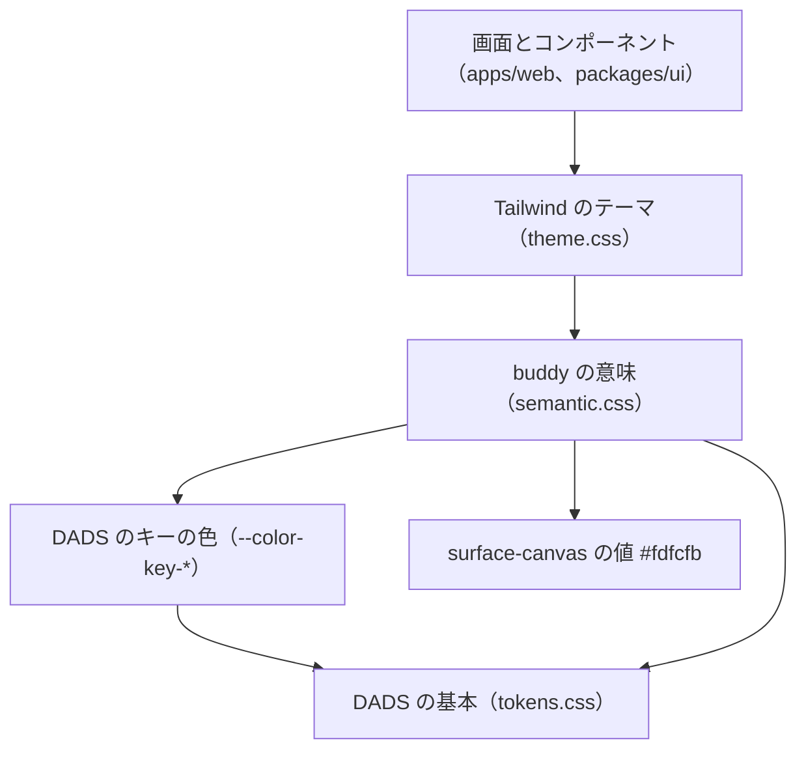

# ADR-0012: デザインシステムのトークンを DADS の基本、buddy の意味、Tailwind のテーマの 3 段にする

## Status

ADR-0013 に置換

## Context

画面の見た目をそろえる基準を決める必要がある。

- receipt-front からコピーしたもとの画面のテーマには、白の上で 4.5:1 に届かない文字の色と、文字でないものの基準の 3:1 に届かない入力欄の枠があった。フォーカスの表示はコンポーネントごとに違い、色相を人数で等分した職員の色は、色相によって白の文字が読めなかった。

- デジタル庁デザインシステム（DADS）は、トークンを npm の `@digital-go-jp/design-tokens` で配っている。2.1.0 は MIT で、`dist/tokens.css` に CSS の変数として色、文字、角丸、影を持つ。余白とフォーカスのトークンは持たない。
  - 出典: [@digital-go-jp/design-tokens](https://www.npmjs.com/package/@digital-go-jp/design-tokens)
- DADS の Tailwind の plugin `@digital-go-jp/tailwind-theme-plugin` 1.0.1 は、v4 の `@theme` を持つ。原色の全ての段を `--color-blue-900` のような名前で Tailwind のテーマに入れる。
  - 出典: [@digital-go-jp/tailwind-theme-plugin](https://www.npmjs.com/package/@digital-go-jp/tailwind-theme-plugin)
- DADS は、キーの色をサービスごとに選ぶ前提で `--color-key-*` を置き、何も選ばなければ blue の階調を当てている。
  - 出典: [DADS のカラー](https://design.digital.go.jp/dads/foundations/color/)
- buddy のもともとのデザイン案は、くすんだ青（`#4d89c0`）を主の色にし、画面の背景をわずかに温かい白（`#fdfcfb`）にしている。
  - この青は、白の文字を載せると 4.5:1 に届かない。DADS の light-blue-800 は色相がほぼ同じで、白の文字で 4.5:1 以上になる。
  - DADS の基本のトークンには、温かい白の値が無い。白の次に明るい灰色の solid-gray-50 は、白との差が `#fdfcfb` より大きい。

## Decision

### トークンは DADS の基本、buddy の意味、Tailwind のテーマの 3 段にする

コンポーネントと画面は意味のトークンだけを使い、DADS の段の名前を直に書かない。  
DADS の値を替えても、意味のトークンの参照先を 1 か所直せば画面が追従する。

| 段 | 配置先 | 名前の例 | 書くもの |
| --- | --- | --- | --- |
| DADS の基本 | `@digital-go-jp/design-tokens` の `dist/tokens.css` | `--color-primitive-blue-800`、`--font-size-16`、`--border-radius-8`、`--elevation-3` | 色の階調、文字の大きさと行高、角丸、影の値 |
| buddy の意味 | `packages/ui/src/tokens/semantic.css` | `--buddy-color-primary`、`--buddy-color-border-field` | 用途ごとの名前と、DADS の基本への参照。値は `surface-canvas` のほかは書かない |
| Tailwind のテーマ | `packages/ui/src/tokens/theme.css` | `bg-primary`、`text-caption`、`rounded-8`、`desktop:` | `@theme inline` で意味のトークンをユーティリティにする。Tailwind のデフォルトの色、文字の大きさ、角丸、影、ブレークポイントは消す |

トークンは、次の向きにだけ参照する。

- 値は CSS の変数で持ち、JSON から生成しない。DADS が生成済みの CSS を配っており、buddy が足すのは参照だけなので、生成の手順を持つ理由がない。
- DADS の `@digital-go-jp/design-tokens` は依存にし、バージョンを `2.1.0` に固定する。値をコピーすると、DADS の修正を手で追い、MIT の表示を自分で持つ必要がある。バージョンを上げるときは、`tokens.css` の差分と、意味のトークンのコントラストを確認する。
- `@digital-go-jp/tailwind-theme-plugin` は使わない。原色の段がそのまま Tailwind のユーティリティになり、画面が意味のトークンを経ずに `bg-blue-800` と書ける。
- DADS が持たないトークンは、次のように扱う。
  - 余白は、Tailwind のデフォルトの 4px の段を使い、トークンを足さない。DADS は余白を 8px を基準に組む例を示し、トークンにするかは任意としている。
    - 出典: [DADS の余白](https://design.digital.go.jp/dads/foundations/spacing/)
  - フォーカスは、DADS の実装例の値で `focus-ring` のユーティリティを `theme.css` に置く。
  - 文字は、DADS のテキストスタイルのうち 6 つを、`text-caption` のような用途の名前で `theme.css` に置く。
- 意味のトークンの一覧と使い分けは [packages/ui の DESIGN.md](../design/packages/ui.md#トークン) にある。

キーの色と画面の背景は、もともとのデザイン案の印象に寄せる。

- `semantic.css` で、DADS の `--color-key-50` から `--color-key-1200` を、同じ段の light-blue に当て直す。`primary` と `primary-surface` は、key の 800 と 50 を参照する。キーの色を参照するほかの箇所（ドキュメントサイトのアクセントの色）も、同じ色相にそろう。
- 画面の背景の `surface-canvas` だけ、DADS に無い `#fdfcfb` を直に書き、`body` の背景にする。カード、表、入力欄、ダイアログ、ヘッダーは `surface`（白）にする。
  - 白との差は小さく、文字と線のコントラストは白の上とほぼ変わらない。canvas の上の文字と線の組は、`pnpm check:contrast` で確認する。
  - 値を直に持つトークンは `surface-canvas` だけにする。

### 画面の見た目は、意味のトークンで次のとおりにする

色、文字の大きさ、角丸、影、ブレークポイントの使い道ごとの意味のトークンは、[今の画面のテーマとトークンの対応表](https://github.com/Fukuemon/buddy/blob/develop/packages/ui/src/tokens/current-theme-map.md) に決めた。

- 主のボタン、ロゴ、選ばれている選択肢は、主の色（key の 800、light-blue）にする。
- 入力欄、副のボタン、選択肢の枠は、solid-gray-600 `#666666` にする。
- フォーカスの表示は、DADS の黄と黒の 2 重の枠にする。
- 角丸は、ボタン、入力欄、幅の広い画面のダイアログで 8px にする。
- 14px 未満の文字は使わない。日の格子の予定は、高さ 20px の枠に文字が収まらなくなることがある。
- 書体は Noto Sans JP にする。
- 職員の色は、白の文字で 4.5:1 以上の 10 色の繰り返しにする。11 人目から色が重なる。

照合の結果の区分と印は、新しい色のトークンを作らず、状態の色に当てる。対応は DESIGN.md に書く。  
照合のドメインの名前を packages/ui に持ち込まないためである。

## Considered Options

### トークンの値の配置先

| 選択肢 | 強み | 弱み |
| --- | --- | --- |
| **採用:** `@digital-go-jp/design-tokens` を依存にし、意味のトークンを CSS の変数で参照する | DADS の修正をバージョンの更新で取り込める。MIT の表示はパッケージが持つ | DADS が名前を変えると、意味のトークンの参照を直す必要がある |
| `@digital-go-jp/tailwind-theme-plugin` の v4 の `@theme` を読み込む | Tailwind のテーマを書かずに済む | 原色の全ての段がユーティリティになり、意味のトークンを経ない書き方を止められない。1.0.1 が対応する Figma のバージョンは 2.14.0 までで、tokens の 2.1.0 の 2.18.1 より古い |
| DADS の値を `semantic.css` にコピーする | 依存が増えない | DADS の修正を手で追う。MIT の表示を自分で持つ |
| トークンを JSON に書き、Style Dictionary で CSS を生成する | CSS 以外の形式にも出せる | CSS 以外で使う場所がない。生成の手順と、生成物のずれの確認が増える |

### キーの色と背景

| 選択肢 | 強み | 弱み |
| --- | --- | --- |
| **採用:** キーの色を light-blue に当て直し、canvas だけ値を持つ | もともとのデザイン案の色相と背景に近い。キーの色を参照する箇所がそろって変わる | 意味のトークンに値を持つ例外が 1 つできる |
| `primary` だけ light-blue の原色を参照し、キーの色は blue のまま | 変更が `primary` の 2 行で済む | キーの色を参照するドキュメントサイトのアクセントが blue のまま残り、ホバーで色相が変わる |
| もともとのデザイン案の `#4d89c0` をそのまま使う | もともとのデザイン案と同じ色になる | 白の文字で 4.5:1 に届かず、ボタンの文字に使えない |
| 背景を白か solid-gray-50 にする | DADS の値だけで済む | 白はもともとのデザイン案の背景と違う。solid-gray-50 は灰色が強く、カードとの差が大きすぎる |

## Consequences

### Positive

- 画面は Tailwind のユーティリティで意味のトークンしか書けなくなり、色の値を直に書くと見つけられる。
- 主のボタン、リンク、選択、ドキュメントサイトのアクセントが、もともとのデザイン案と同じ色相にそろう。
- トークンの CSS の生成を、パッケージの手順で更新できる。

### Negative

- DADS のバージョンを上げるたびに、`tokens.css` の名前と値の差分を確認する必要がある。`surface-canvas` は DADS の値に追従しないので、canvas の上のコントラストも確認する。
- 背景を指定しない要素は canvas の色になる。白にする要素には `bg-surface` を付ける。
