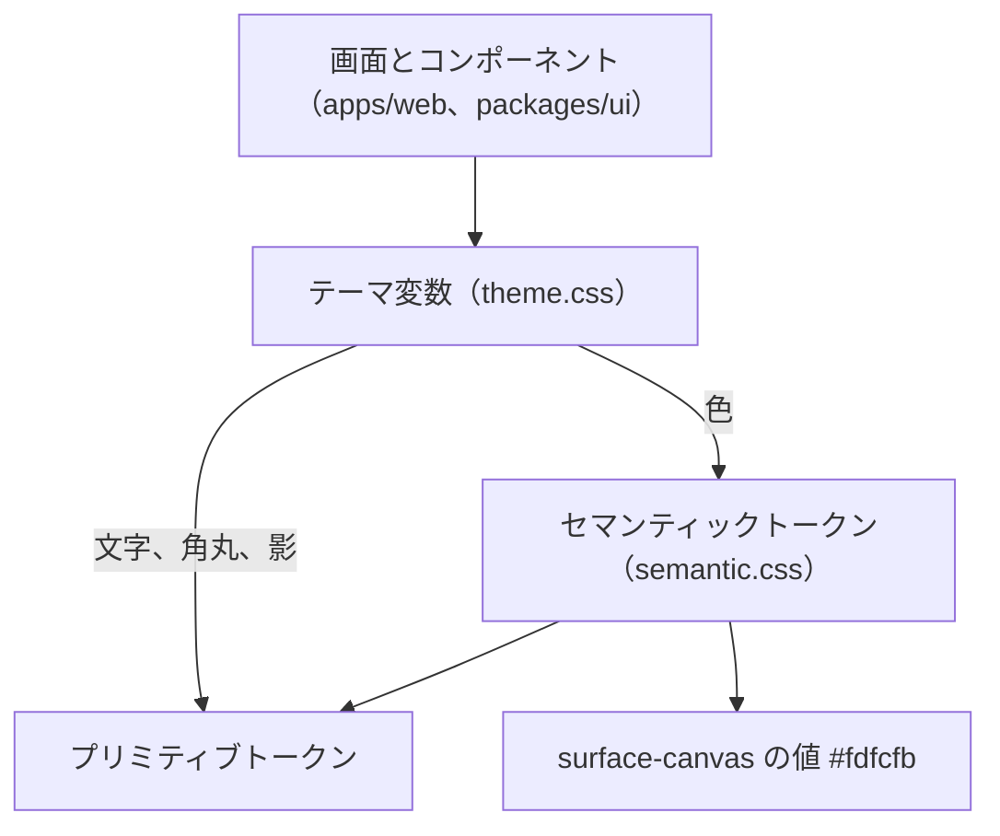

# ADR-0013: デザインシステムのトークンを、buddy に持つプリミティブトークン、セマンティックトークン、テーマ変数の 3 つの層にする

## Status

承認

## Context

デザインシステムのトークンの層と、プリミティブトークンの値をどこに置くかを決める必要がある。

- buddy には、もとはデザインシステムが無かった。初めて作るときに、デジタル庁デザインシステム（DADS）の値と指針を元にした。
- receipt-front からコピーしたもとの画面のテーマには、白の上で 4.5:1 に届かない文字の色と、文字でないものの基準の 3:1 に届かない入力欄の枠があった。
- DADS は、トークンを npm の `@digital-go-jp/design-tokens` で配っている。2.1.0 は MIT で、`dist/tokens.css` に CSS の変数として色、文字、角丸、影を持つ。余白とフォーカスのトークンは持たない。
  - 出典: [@digital-go-jp/design-tokens](https://www.npmjs.com/package/@digital-go-jp/design-tokens)
- これまでは、このパッケージを依存にし、`node_modules` の中の `dist/tokens.css` を読んでいた。`pnpm install` をしていない場所では、値を読めない。
- buddy の画面は、DADS のキーカラーを当て直し、DADS に無い背景の色を持ち、DADS の指針から 5 点で外れている。buddy 独自の UI になりつつある。
- セマンティックトークンとテーマ変数が参照する DADS の値は、色が 43 個と、文字の大きさ、行高、太さ、書体、角丸、影の一部である。
- buddy のもともとのデザイン案は、くすんだ青（`#4d89c0`）を主の色にし、画面の背景をわずかに温かい白（`#fdfcfb`）にしている。
  - この青は、白の文字を載せると 4.5:1 に届かない。DADS の light-blue-800 は色相がほぼ同じで、白の文字で 4.5:1 以上になる。
  - DADS のプリミティブトークンには、温かい白の値が無い。白の次に明るい灰色の solid-gray-50 は、白との差が `#fdfcfb` より大きい。

## Decision

### トークンは 3 つの層にする

コンポーネントと画面は、テーマ変数のユーティリティだけを使い、プリミティブトークンの名前を直に書かない。  
プリミティブトークンの値を替えても、セマンティックトークンの参照先を 1 か所直せば画面が追従する。

| 層 | 配置先 | 書くもの |
| --- | --- | --- |
| プリミティブトークン | `packages/ui/src/tokens/` のプリミティブトークンのファイル | 色の階調、文字の大きさと行高、角丸、影の値 |
| セマンティックトークン | `packages/ui/src/tokens/semantic.css` | 用途ごとの名前（`--buddy-color-primary` など）と、プリミティブトークンへの参照。値は `surface-canvas` のほかは書かない |
| テーマ変数 | `packages/ui/src/tokens/theme.css` | `@theme inline` で、色はセマンティックトークンを、文字、角丸、影はプリミティブトークンを、用途の名前のユーティリティ（`bg-primary`、`text-caption`、`rounded-8`）にする。Tailwind のデフォルトの色、文字の大きさ、角丸、影、ブレークポイントは消す |

トークンは、次の向きにだけ参照する。

- 層の呼び名は、DADS の変数の名前（`--color-primitive-*`、`--color-semantic-*`）と、Tailwind CSS の theme variables に合わせる。
  - 出典: [DADS のカラー](https://design.digital.go.jp/dads/foundations/color/)
  - 出典: [Tailwind CSS の Theme variables](https://tailwindcss.com/docs/theme)
- 値は CSS の変数で持ち、JSON から生成しない。CSS のほかに値を使う場所がない。
- `@digital-go-jp/tailwind-theme-plugin` は使わない。原色の段がそのまま Tailwind のユーティリティになり、画面がセマンティックトークンを経ずに `bg-blue-800` と書ける。
- DADS が持たないトークンは、次のように扱う。
  - 余白は、Tailwind のデフォルトの 4px の段を使い、トークンを足さない。DADS は余白を 8px を基準に組む例を示し、トークンにするかは任意としている。
    - 出典: [DADS の余白](https://design.digital.go.jp/dads/foundations/spacing/)
  - フォーカスは、DADS の実装例の値で `focus-ring` のユーティリティを `theme.css` に置く。
  - 文字は、DADS のテキストスタイルのうち 6 つを、`text-caption` のような用途の名前で `theme.css` に置く。

### プリミティブトークンの値は、DADS から使う値だけを buddy のファイルにコピーする

- セマンティックトークンとテーマ変数が参照する値だけを、DADS の 2.1.0 からコピーする。新しい値が要るときは、DADS から足す。
- 変数の名前は、buddy の接頭辞にする。セマンティックトークンの接頭辞（`--buddy-color-`）とも、テーマ変数の名前とも重ならないようにする。DADS の名前を残すと、DADS の変数を読んでいるように見え、値の元がどちらかが分からなくなる。
- プリミティブトークンのファイルの冒頭に、コピーした元のパッケージとバージョン、出典、MIT の表示を書く。
- `@digital-go-jp/design-tokens` を依存から外す。

### キーカラーと画面の背景は、もともとのデザイン案の印象に寄せる

- キーカラーは light-blue の階調にする。`primary` と `primary-surface` は light-blue の 800 と 50 を参照する。キーカラーを参照するほかの箇所（ドキュメントサイトのアクセントの色）も、同じ色相にそろえる。
- 画面の背景の `surface-canvas` だけ、DADS に無い `#fdfcfb` を直に書き、`body` の背景にする。カード、表、入力欄、ダイアログ、ヘッダーは `surface`（白）にする。
  - 白との差は小さく、文字と線のコントラストは白の上とほぼ変わらない。canvas の上の文字と線の組は、`pnpm check:contrast` で確認する。
  - 値を直に持つセマンティックトークンは `surface-canvas` だけにする。

### 画面の見た目は、セマンティックトークンで次のとおりにする

色、文字の大きさ、角丸、影、ブレークポイントの使い道ごとのトークンは、[今の画面のテーマとトークンの対応表](https://github.com/Fukuemon/buddy/blob/develop/packages/ui/src/tokens/current-theme-map.md) に決めた。

- 主のボタン、ロゴ、選ばれている選択肢は、主の色（light-blue の 800）にする。
- 入力欄、副のボタン、選択肢の枠は、solid-gray-600 `#666666` にする。
- フォーカスの表示は、DADS の黄と黒の 2 重の枠にする。
- 角丸は、ボタン、入力欄、幅の広い画面のダイアログで 8px にする。
- 14px 未満の文字は使わない。日の格子の予定は、高さ 20px の枠に文字が収まらなくなることがある。
- 書体は Noto Sans JP にする。
- 職員の色は、白の文字で 4.5:1 以上の 10 色の繰り返しにする。11 人目から色が重なる。

照合の結果の区分と印は、新しい色のトークンを作らず、状態の色に当てる。対応は DESIGN.md に書く。  
照合のドメインの名前を packages/ui に持ち込まないためである。

## Considered Options

### プリミティブトークンの値の配置先

| 選択肢 | 強み | 弱み |
| --- | --- | --- |
| **採用:** 使う値だけを buddy のファイルにコピーし、buddy の接頭辞の名前にする | 値の予定の管理先が buddy の中にそろい、`pnpm install` をしなくても読める。使わない値を保守しない | DADS の値の修正を、自分で読んで取り込む。名前を替えるので、セマンティックトークン、テーマ変数、チェックのスクリプトを同じ変更で直す |
| `@digital-go-jp/design-tokens` を依存にし、`dist/tokens.css` を読む | DADS の修正をバージョンの更新で取り込める。MIT の表示はパッケージが持つ | 値が `node_modules` の中にあり、`pnpm install` をしていない場所では読めない |
| DADS の `tokens.css` を全部コピーする | 新しい値を足すときに DADS を見ずに済む | 使わない値が大半になる |
| DADS の名前のままコピーする | 差分が小さく、DADS と見比べやすい | buddy のファイルに DADS の名前が残り、値の元がどちらかが分からない |
| `@digital-go-jp/tailwind-theme-plugin` の v4 の `@theme` を読み込む | テーマ変数を書かずに済む | 原色の全ての段がユーティリティになり、セマンティックトークンを経ない書き方を止められない |
| トークンを JSON に書き、Style Dictionary で CSS を生成する | CSS 以外の形式にも出せる | CSS 以外で使う場所がない。生成の手順と、生成物のずれの確認が増える |

### キーカラーと背景

| 選択肢 | 強み | 弱み |
| --- | --- | --- |
| **採用:** キーカラーを light-blue にし、canvas だけ値を持つ | もともとのデザイン案の色相と背景に近い。キーカラーを参照する箇所がそろって変わる | セマンティックトークンに値を持つ例外が 1 つできる |
| もともとのデザイン案の `#4d89c0` をそのまま使う | もともとのデザイン案と同じ色になる | 白の文字で 4.5:1 に届かず、ボタンの文字に使えない |
| 背景を白か solid-gray-50 にする | DADS の値だけで済む | 白はもともとのデザイン案の背景と違う。solid-gray-50 は灰色が強く、カードとの差が大きすぎる |

## Consequences

### Positive

- デザインシステムの値を、buddy のファイルだけで読める。
- 画面は Tailwind のユーティリティでセマンティックトークンしか書けなくなり、色の値を直に書くと見つけられる。
- 主のボタン、リンク、選択、ドキュメントサイトのアクセントが、もともとのデザイン案と同じ色相にそろう。

### Negative

- DADS の値の修正を、自分で読んで取り込む必要がある。
- `surface-canvas` はプリミティブトークンに追従しないので、canvas の上のコントラストを確認し続ける。
- 背景を指定しない要素は canvas の色になる。白にする要素には `bg-surface` を付ける。
