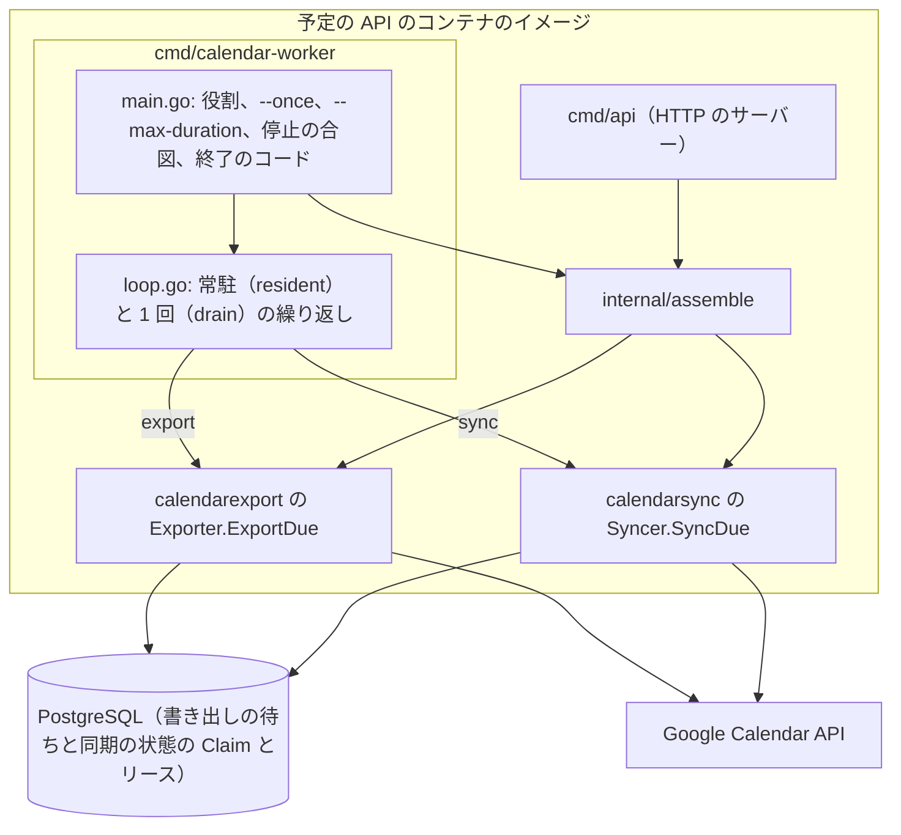

# ADR-0017: Google カレンダーの書き出しと同期を、予定の API と同じイメージの Worker のコマンドで役割ごとに動かし、繰り返しを Worker のコマンドに集める

## Status

承認

## Context

Google カレンダーの書き出し（`Exporter`）と同期（`Syncer`）を、予定の API の HTTP のサーバーと同じプロセスで常駐させるとする。  
すると、API のレプリカを増やしたときに書き出しと同期の処理も増え、API の負荷、デプロイ、停止がカレンダーの連携に影響する。  
Cloud Run のようなリクエストで動く環境では、スケールゼロと CPU の割り当てにより、常駐の処理が動き続けることを前提にできない。

決定に関わる事実は次のとおり。

- 組み立ては `internal/assemble` にあり、`cmd/api` とほかの実行単位が共有する。設定は `config.LoadAPI` と `config.LoadWorker` に分かれ、`LoadWorker` は OIDC とブローカーの値を読まない。
  - ADR-0005: [予定の API を機能ごとのパッケージに分け、Go の API の操作を使う依存だけを持つ型にし、ファイルの名前の末尾の語で役割を表す](0005-schedule-api-packages.md)
- 書き出しの待ちと同期の状態は、`FOR UPDATE SKIP LOCKED` とリースで取る（Claim）。取った処理が終わらずにリースが切れると、別の処理が取り直す。書き出しは 1 回に 5 件、リース 2 分、同期は 1 回に 5 件、リース 6 分である。
- 書き出しは、buddy の予定の ID から Google の予定の ID を決め（`EventIDOf`）、作り直しの 409 を同じ予定とみなす。外部への書き込みが成功した後に DB の更新が失敗し、書き出しの待ちを取り直しても、同じ予定を 2 つ作らない。
- 書き出しと同期の向きは、事業所の正本のモードで決まる。`google_primary` の事業所は同期だけ、`buddy_primary` の事業所は書き出しだけを行う。同期は 2〜5 分ごとのポーリングで行う。
  - ADR-0008: [Google カレンダーとの連携を事業所ごとの正本のモードで分け、職員のカレンダーを事業所ごとのサービスアカウントへの共有で読み書きする](0008-google-calendar-sync.md)
- 機能のパッケージは、常駐の処理（`Exporter`、`Syncer`）を型の名前のファイルに置く（ADR-0005）。次のバッチをいつ呼ぶかを機能のパッケージと Worker のコマンドに分けて持つと、常駐と 1 回の形の振る舞いがそろわない。
- ログは JSON で書き、集める先と通知の条件はインフラのリポジトリが決める。予定の API に、メトリクスのライブラリは無い。

## Decision

書き出しと同期を、予定の API と同じコンテナのイメージの新しいコマンド `cmd/calendar-worker` で動かす。`cmd/api` は、書き出しと同期の常駐の処理を起動しない。

Worker のプロセスは、次のように組む。

### 実行の形

- `calendar-worker` は、役割を引数で受ける。`calendar-worker export` は書き出し、`calendar-worker sync` は同期を行う。1 つのプロセスは 1 つの役割だけを持つ。
  - 役割ごとに、起動の数、間隔、リソースを変えられるようにするためである。
- 実行の形は 2 つにする。
  - 常駐: 引数を付けずに起動すると、取れるものが無くなるまで呼んでから、間隔を待つことを繰り返す。停止の合図（SIGTERM、SIGINT）を受けると、新しく取るのをやめ、取ったものの結果を書いてから終わる。
  - 1 回: `--once` を付けると、取れるものが無くなるまで取って処理し、終わる。`--max-duration` で長さの上限を決め、上限に達したら新しく取るのをやめ、取ったものの結果を書いてから終わる。
- 終了のコードは、処理を最後まで回せたら 0 にする。1 つの予定やカレンダーの失敗は、待ちと同期の状態に結果として書き、終了のコードには出さない。次のときだけ 0 以外にする。
  - 引数の誤りは 2 にする。
  - 設定の誤り、DB に繋がらないとき、`--once` で待ちとカレンダーを取れなかったときは 1 にする。設定の誤りには、環境変数の誤りのほか、サービスアカウントの設定のファイルを読めないときと、Google カレンダーの認証の情報を作れないときが入る。
  - 常駐で待ちとカレンダーを取れなかったときは、ログに書いて取り直し、終わらない。
- Worker は HTTP のポートを持たない。常駐は VM か、常に起動しておく実行環境で動かす。リクエストで動く環境では、1 回の形を定期的な起動（Cloud Run Jobs と Cloud Scheduler など）で動かす。どちらを使うかは、インフラのリポジトリが決める。

### 繰り返しの配置先

常駐と 1 回の繰り返しを、`cmd/calendar-worker` の `loop.go` に集める。

- 常駐（`resident`）は、1 回の形（`drain`）と同じく、取れるものが無くなるまで呼んでから、間隔を待つ。
  - 待ちとカレンダーを取れなかったときは、ログに書き、間隔を待ってから取り直す。
  - 停止の合図を受けたら、新しく取らない。呼んだ処理は、取ったものの結果を書いてから戻る。
- 常駐の書き出しの間隔は `GOOGLE_CALENDAR_EXPORT_INTERVAL` である。
- 常駐の同期の確認の間隔は、`GOOGLE_CALENDAR_SYNC_INTERVAL` と 5 秒の短い方である。確認の間隔（`syncPollTick`）は `cmd/calendar-worker` が持つ。
- 機能のパッケージは、1 回の取得と処理（`ExportDue`、`SyncDue`）、Claim、リース、Finish、1 回に取る数の上限を持ち、繰り返し（`Run`）を持たない。
  - `Syncer` の `interval` は、読み終えたカレンダーを次に読む時刻を決める業務の値なので、`Syncer` に置く。
- 新しいパッケージ（`internal/calendarworker`）は作らない。使う側が `cmd/calendar-worker` の 1 つのうちは、パッケージを作っても、依存の規則と文書が増えるだけである。2 つ目の Worker のコマンドを足すときに分ける。

### 多重起動と異常終了

- 同じ役割の Worker を 2 つ以上動かしても、Claim（`FOR UPDATE SKIP LOCKED` とリース）で、同じ待ちとカレンダーを同時に取らない。Worker の数を 1 つに限る仕組みは足さない。
- 異常終了で結果を書けなかった待ちとカレンダーは、リースが切れた後に、ほかの Worker か次の起動が取り直す。書き出しは、外部への書き込みの後に DB の更新が失敗しても、取り直したときに同じ予定を 2 つ作らない。

### 正本と逆の向きに書かない守り方

- 設定のフラグ（`GOOGLE_CALENDAR_EXPORT_ENABLED`、`GOOGLE_CALENDAR_SYNC_ENABLED`）は残す。フラグが無効の役割で起動した Worker は、処理をせずに終了のコード 0 で終わり、そのことをログに書く。
- フラグを誤って有効にしても、正本のモードが向きを守る（ADR-0008）。
  - `Outbox` は、`buddy_primary` でない事業所の予定の変更を積まない。`Exporter` は、取った待ちの事業所が `buddy_primary` でなければ書かずに保留にする。
  - `Syncer` は、`google_primary` でない事業所のカレンダーを読まない。

### ログとメトリクス

- ログには、どの実行単位が書いたかを示す項目 `component` を付ける。値は `api`、`calendar-export`、`calendar-sync` にする。
- Worker は、1 回の取得と処理（1 つのバッチ）ごとに、要約のログを 1 行書く。項目は、取った件数、成功、失敗、保留、取り直しに戻した件数、処理の時間である。
  - 常駐で待ちとカレンダーを取れなかったときのログの `msg` は `calendar worker batch` にし、役割は `component` で見分ける。
- Worker は、1 つのバッチの後に滞留を数えてログに書く。
  - 書き出しは、書いていない待ちの件数と、最も古い待ちを積んでからの時間を書く。
  - 同期は、次の同期の時刻を過ぎたカレンダーの数と、最も古い最後の成功からの時間を書く。
- メトリクスは、このログからインフラの側で作る。予定の API にメトリクスのライブラリを足さない。クラウドに依存しない形にするためである。
- 予定のタイトル、利用者名、カレンダーの ID のメールは、ログに書かない。

### Worker の設定

- Worker は `config.LoadWorker` で、DB、ログの水準、Google カレンダーの値（サービスアカウント、フラグ、間隔）だけを読む。OIDC とブローカーの値を求めない。
- DB の接続の数の上限を、環境変数 `DB_MAX_CONNS` で決められるようにする。Worker は 1 つのバッチを順に処理するので、少ない数でよい。
- 間隔のデフォルトは、書き出し 30 秒、同期 2 分にする。
  - 1 回の形を定期的な起動で動かすときは、起動の間隔が反映の遅れになる。Cloud Scheduler の最短の 1 分で起動すると、書き出しの遅れは最大でおよそ 1 分になる。
  - 同期は ADR-0008 の 2〜5 分の範囲に収まる。
- 停止と復旧の手順、どの形で動かしているかの確認の仕方は、`context/operations.md` に書く。

## Considered Options

### 実行の単位

| 選択肢 | 強み | 弱み |
| --- | --- | --- |
| **採用:** 同じイメージの `cmd/calendar-worker` で、役割ごとのプロセスにし、常駐と 1 回の形を引数で選ぶ | API のレプリカと書き出しと同期の数が分かれる。VM の常駐とリクエストで動く環境の定期的な起動の両方に使える。Claim をそのまま使える | コマンドとデプロイの単位が増える |
| 1 つの `calendar-worker` が書き出しと同期の両方を動かす | 動かすプロセスが 1 つで済む | 役割ごとに間隔、数、リソースを変えられない。片方の障害がもう片方に影響する |
| `cmd/api` のサブコマンドで Worker を動かす | コマンドが 1 つで済む | API の設定と Worker の設定の境目が引数でしか分からない。組み立ての共有は採用の案と同じく要る |
| Cloud Tasks や Pub/Sub のような新しいキューの基盤を使う | 再試行と滞留の監視を基盤に任せられる | クラウドに依存する。DB の Outbox と同じトランザクションで積む形を変える |
| Worker の数を 1 つに限るリーダーの選出を足す | 同時に動く処理が必ず 1 つになる | Claim で重複は起きないので要らない。選出の仕組みの障害が増える |

### 繰り返しの配置先

| 選択肢 | 強み | 弱み |
| --- | --- | --- |
| **採用:** 常駐と 1 回の繰り返しを `cmd/calendar-worker` の 1 つのファイルに集め、機能のパッケージは 1 回の処理だけを持つ | 次のバッチを呼ぶ方針が 1 か所になり、常駐と 1 回の形の振る舞いがそろう。機能のパッケージは時刻の待ち方を持たない | 1 回に取る数の上限を `cmd` が知らないので、常駐は、取れるものが無くなったことを、何も取らなかった呼び出しで知る |
| 機能のパッケージに `Exporter.Run` と `Syncer.Run` を置き、振る舞いだけをそろえる | 変更が小さい | 方針が 3 か所（2 つの `Run` と `drain`）に分かれ、片方だけを直すと、またずれる |
| `internal/calendarworker` を作り、繰り返しをそこに置く | Worker のコマンドが増えたときに、そのまま共有できる | 使う側が 1 つのうちは、依存の規則と文書が増えるだけである |

## Consequences

### Positive

- API のレプリカを増やしても、書き出しと同期の処理は増えない。
- 書き出しと同期を、API と別に止め、起動の数と間隔を変えられる。
- リクエストで動く環境でも、1 回の形で書き出しと同期を動かせる。
- 常駐と 1 回の形が、同じ `drain` で取れるものを処理する。書き出しと同期の振る舞いがそろう。
- 繰り返しのテストを、DB と外部のカレンダーを使わずに、`cmd/calendar-worker` で書ける。

### Negative

- Worker のデプロイの単位が 2 つ（書き出しと同期）増え、インフラのリポジトリに設定を足す。
- 1 回の形を定期的な起動で動かすと、書き出しの遅れが起動の間隔だけ増える。
- メトリクスはログから作るので、インフラの側にログを集計する設定が要る。
- 常駐は、取った数が上限に届かなかった後も、何も取らなくなるまでもう 1 回呼ぶ。間隔ごとの Claim の問い合わせが、取るものがあった間隔だけ 1 回増える。

## 統合した ADR

- ADR-0021: Google カレンダーの書き出しと同期を、予定の API と同じイメージの Worker のコマンドで動かす（[統合の前](https://github.com/Fukuemon/buddy/blob/b77ee63b57eec4ee3c78f40b350b5acc0851da6d/docs/adr/0021-calendar-worker.md)）
- ADR-0022: Worker の常駐と 1 回の繰り返しを cmd/calendar-worker に集め、機能のパッケージは 1 回の処理だけを持つ（[統合の前](https://github.com/Fukuemon/buddy/blob/b77ee63b57eec4ee3c78f40b350b5acc0851da6d/docs/adr/0022-calendar-worker-loop.md)）
