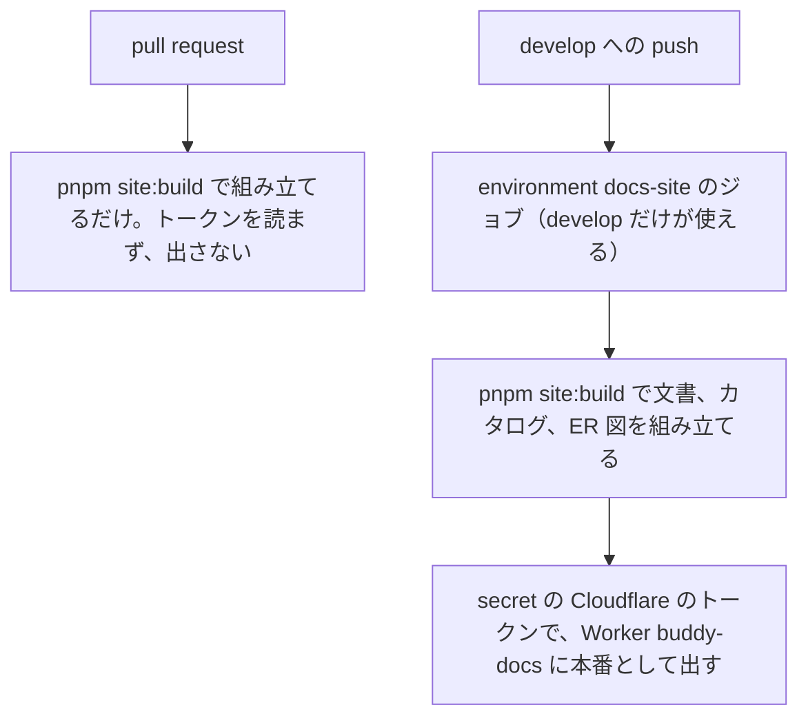

# ADR-0017: カタログをドキュメントサイトと同じ Worker で、develop に入ったときだけ出す

## Status

承認

## Context

カタログとドキュメントサイトの公開の仕方を決める必要がある。

- ドキュメントサイト（Worker `buddy-docs`）は、文書、Storybook のカタログ、表の ER 図を 1 つの URL で出す。サイトに並べるものは、どれもリポジトリの文書とコードから組み立てる。
- 同じリポジトリの pull request には GitHub が secret を渡すので、書き込みの権限を持つ人は、ワークフローを書き換えてリポジトリの単位の secret を読める。
- カタログは、apps/web の Storybook で組む。
  - ADR-0016: [apps/web の Storybook を 1 つのカタログにする](0016-storybook-catalog.md)

## Decision

カタログは、ドキュメントサイトと 1 つの Cloudflare Worker の静的なファイルとして出す（`/storybook/`）。デプロイの構成は `apps/docs-site/README.md` にある。

develop に入った変更は、次の流れで本番に出る。

- pull request ごとのプレビューは出さない。Cloudflare のトークンを、pull request のコードから読めないようにするためである。
- Cloudflare のトークンは、GitHub の environment `docs-site` の secret に置き、environment にデプロイできるブランチを develop だけにする。
  - ワークフローの条件だけで develop に絞ると、条件を外したワークフローを別のブランチへ push してトークンを読める。environment のブランチの制限は、ワークフローを書き換えても外せない。
  - トークンは、Worker の中身を書き換えられるためである。
  - トークンの範囲はこの Worker に絞り、漏れたときに書き換えられるものを、このサイトの中身と設定に限る。
- ワークフローは、パッケージ docs-site のテンプレートを元にする。

## Considered Options

| 選択肢 | 強み | 弱み |
| --- | --- | --- |
| **採用:** ドキュメントサイトと 1 つの Worker にまとめ、develop に入ったときだけ出す | トークンを develop の実行だけが読める | 文書の見た目は、マージする前にローカルの `pnpm site:build` か `zensical serve` で確認する |
| ドキュメントサイトとカタログを、別々の Worker に出す | 変えた方だけを出せる | Worker の作成、URL、設定が 2 つずつになる。文書からカタログへ相対のリンクで行き来できない |
| pull request ごとのプレビューを残し、トークンをリポジトリの単位の secret に置く | マージする前に、公開した形で確認できる | 書き込みの権限を持つ人が、ワークフローを書き換えてトークンを読める |
| サイトをやめ、リポジトリの Markdown だけを読ませる | Cloudflare のアカウントとトークンが要らない | カタログと ER 図は組み立てた成果物で、リポジトリでは読めない。文書の検索と目次がなくなる |

## Consequences

### Positive

- Cloudflare のトークンを読めるのは、develop の実行だけになる。
- サイトの組み立てを、パッケージの手順で更新できる。

### Negative

- pull request の段階で、公開した形のサイトを確認できない。
