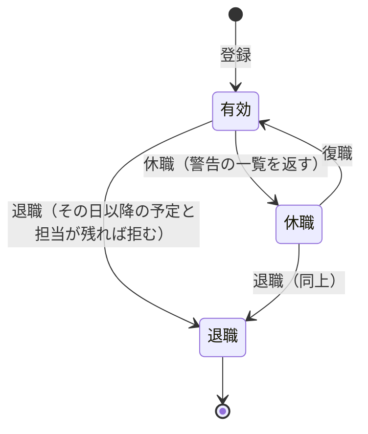

# ADR-0018: 職員の停止を、戻せる休職と、戻せない退職に分ける

## Status

承認

## Context

職員を止める操作と、止めた後の扱いを決める必要がある。

- 事業所には、育休や病気の休職のように戻る職員と、退職して戻らない職員がいる。
- 止めた職員に割り振り済みの予定、繰り返しの予定、利用者の担当は、止めた後も残る。予定のカレンダーは止めた職員の列と予定を出さないので、誰も行かない訪問に気付けない。
- 職員の身元（メールと上流のアカウント）と有効か停止かはブローカーが持ち、ブローカーは Hydra の admin API でログインのセッションを扱う。
  - ADR-0001: [認証を OIDC のブローカーと BFF のサーバー側のセッションにし、職員の身元をブローカーが、権限と業務のデータを予定の API が持つ](0001-auth.md)
- ブローカーは、職員のメールを全ての事業所で一意に持ち、上流のアカウント（`iss` と `sub`）を 1 人の職員にだけ結び付ける。
- 職員の登録、役職の変更、権限を足し外す操作は、職員の管理の権限（`staff.manage`）を持つ職員だけに許す。
  - ADR-0002: [権限を役職のデフォルトと職員ごとの上書きで持ち、職員の管理と照合も権限で許す](0002-pbac.md)
- 過去の予定と照合の結果は、主訪問者の名前で読む。予定と訪問の情報は利用者の ID で利用者を参照し、予定の一覧と Google カレンダーへの書き出しは、そのときの利用者の名前を読む。

## Decision

職員の状態は、次のとおり移る。

| 状態 | ログイン | 戻す操作 | 職員の一覧 | 予定のカレンダーと予定の候補 |
| --- | --- | --- | --- | --- |
| 有効 | できる | なし | 出る | 出る |
| 休職 | できない | 復職で有効に戻す | 休職の印を付けて出る | 出ない |
| 退職 | できない | なし | 退職の印を付けて出る | 出ない |

- 休職は、職員の管理の権限を持つ職員が手で始め、手で戻す。戻る予定の日をメモとして持てるが、その日に自動では戻さない。
  - 理由: 育休や休職は延びることがあり、日付で切り替えると延びるたびに直す必要がある。日付で切り替える定期の処理も要らない。
- 休職でも退職でも、ブローカーは Hydra の admin API で、その職員のログインのセッション、同意、refresh token を取り消す。復職では、ブローカーの職員を有効に戻し、上流のアカウントの結び付けはそのまま使う。
- 退職では、予定の API は職員の名前、所属、役職を残し、電話番号を消す。ブローカーは職員の身元（メールと上流のアカウント）を消す。
  - 理由: 過去の予定と照合の結果で、誰が訪問したかを読めるようにする。退職した人の連絡先とログインの手段は残さない。
  - 同じ人を再び雇うときは、新しい職員として登録する。ブローカーの身元を消すので、同じメールと同じ上流のアカウントで登録し直せる。
- 休職か退職にするときに、その日以降の予定、繰り返しの予定、担当の利用者を一覧で示す。
  - 退職は、一覧が空になるまで拒む。管理者は、別の職員に割り振り直してから退職にする。担当の利用者の範囲は、ADR-0019 にある。
    - ADR-0019: [利用者を、戻せる利用の終了にでき、終了の利用者を予定の候補と職員の退職の確認から外す](0019-patient-service-end.md)
  - 休職は拒まず、一覧を警告として返す。休職が短ければ、割り振り直さずに戻ることがあるためである。
- 予定の API は、休職と退職の職員への新しい割り振り（予定の作成、職員の変更、利用者の担当の変更）を拒む。既にその職員に割り振った予定は、職員を変えずに保存できる。
- 職員は自分を休職と退職にできない。事業所で職員の管理の権限を持つ最後の有効な職員も、休職と退職にできない。
  - 理由: 戻す操作をする職員がいなくなると、DB を直すほかに戻せない（ADR-0002 の Negative）。

## Considered Options

| 選択肢 | 強み | 弱み |
| --- | --- | --- |
| **採用:** 休職と退職の 2 種類 | 業務の言葉と合い、戻す操作を休職だけに限れる | 状態と API が 1 つ増える |
| 停止の 1 種類に、有効に戻す操作だけを足す | 変更が最も小さい | 休職と退職を見分けられず、退職した職員も戻せる |
| 休職、退職、削除の 3 種類 | 個人情報を残さない | 過去の予定と照合の主訪問者が誰かを読めなくなる |
| 退職で名前も匿名にする | 個人情報が残らない | 過去の予定と照合の結果で、誰が訪問したかを読めない |
| 休職を開始日と終了日で自動で切り替える | 戻し忘れが無い | 日付で切り替える定期の処理が要り、延長のたびに直す |
| 休職と退職で、その日以降の予定を自動でキャンセルする | 管理者の操作が要らない | 訪問が消え、別の職員に割り振り直す作業が漏れる |

## Consequences

### Positive

- 休職から戻る職員は、上流のアカウントの結び付けを保ったまま、同じ職員としてログインできる。
- 退職の前に、誰も行かない訪問が残らない。

### Negative

- 退職にするには、管理者が先に予定と担当を割り振り直す必要がある。割り振り直す画面が無い間は、予定の編集で 1 件ずつ直す。
- 休職のまま戻し忘れると、その職員はログインできない。職員の一覧の休職の印と、戻る予定の日のメモで気付く必要がある。
- 再び雇った職員は新しい職員になるので、退職の前と後の予定は別の職員として読む。
