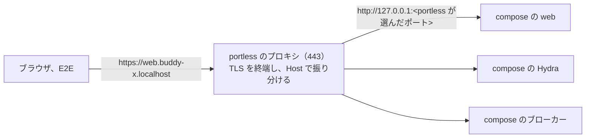

# ADR-0034: worktree ごとのローカル環境を、portless で worktree ごとのホスト名の HTTPS の URL で出す

## Status

承認

## Context

worktrunk で作った worktree ごとに compose の環境を並べて起動できる。ポートの組は、worktree を作るときにフックが `.env` に書く。ブラウザが開く URL は `http://localhost:<ポート>` である。

- cookie はポートを区別しない。並べた環境の cookie は全て `localhost` に置かれ、web の `buddy_session`、Hydra の `ory_hydra_session_dev`、ブローカーの `broker_login` は、環境の間で同じ名前になる。
  - 並べた 2 つの環境に 1 つのブラウザで順にログインすると、後の環境のセッションが先の環境のセッションを上書きし、先の環境はログインの画面に戻される。
- ローカル環境は https でないので、web のセッションの cookie に `Secure` を付けずに動かしている。本番と違う設定で確認していることになる。
- compose は、ブラウザが開く URL を、どれもポートから組み立てている。
  - Hydra の公開の URL と、ログイン、同意、ログアウトの画面
  - web のクライアントのリダイレクト先と、予定の API の CORS の許可
  - ブローカーの公開の URL と、上流の IdP のフェイクの認可の画面
- E2E のテストのコードは、Node.js から API とブローカーを呼ぶ。macOS の Node.js は、`/etc/hosts` に無い `*.localhost` の名前を引けない。ブラウザは `*.localhost` を自分で `127.0.0.1` に引く。
- web は、ログインとログアウトの戻り先の URL を、リクエストの URL から作る。TLS を終端するプロキシの後ろでは、リクエストの URL が `http` になる。

## Decision

worktrunk で作った worktree の環境は、[portless](https://github.com/vercel-labs/portless) の `portless compose up` で起動し、`https://<サービス>.<プロジェクト>.localhost` の名前で出す。メインの checkout と CI は、今の `http://localhost:<ポート>` のまま動かす。

- ホスト名のプロジェクトの部分は、compose のプロジェクトの名前である。portless は、名前の `_` を `-` に変えて使う。worktree ごとに名前が違うので、cookie はホスト名ごとに分かれる。
- ブラウザが開く URL は、compose が `WEB_ORIGIN`、`HYDRA_PUBLIC_ORIGIN`、`BROKER_ORIGIN`、`IDP_ORIGIN` から組み立てる。未設定なら `http://localhost:<ポート>` にする。worktree を作るときのフックが、`.env` に portless のホスト名の URL を書く。
  - portless は、compose の HTTP のサービスのポートを選び直す。worktree では、ポートで URL を組み立てられない。
- web は、`PUBLIC_URL` があれば、ログインとログアウトの戻り先の URL のオリジンをそれにする。portless は TLS を終端して web へ http で渡すためである。本番で TLS を終端するロードバランサーの後ろに置くときも、同じ値を渡せる。
- worktree の環境では、web のセッションの cookie に `Secure` を付ける。
- 管理者の権限を使わない。開発者の端末とコーディングエージェントの環境では、`sudo` を使えないことがあるためである。
  - プロキシは、最初に 1 回だけ `portless proxy start --unprivileged --https` で起動する。macOS では、443 番を管理者の権限なしで待ち受け、loopback からの接続だけを受ける。portless はこのモードを覚え、次からは `portless compose up` が同じモードでプロキシを起動する。
  - portless の CA はシステムに信頼させない。ブラウザで開くと証明書の警告が出るので、開発者は警告を受け入れて開く。
  - ホスト名は `/etc/hosts` に書かない。ブラウザは `*.localhost` を自分で loopback に引く。E2E のテストのコード（Node.js）は、Playwright の設定で `*.localhost` を loopback に引くように名前の解決を差し替え、https の URL では証明書のエラーを無視する。
- portless のバージョンは、`mise.toml` で固定する。1.0 より前で、バージョンの間で状態のファイルの形が変わることがあるためである（[portless の README](https://github.com/vercel-labs/portless#install)）。
- CI は portless を使わない。CI はブラウザで並べて開かないので、ホスト名で分ける利点が無い。

## Verification

2026-11-07 に、portless 0.16.0 の `--unprivileged --https` のプロキシで、ローカルで次を確認した。CA は信頼させず、ブラウザは証明書のエラーを無視した。

| 確認したこと | 結果 |
| --- | --- |
| `portless compose up` のホスト名 | `buddy-feature_817_v29` のプロジェクトの web は `https://web.buddy-feature-817-v29.localhost` になった |
| ログイン | web から Hydra、ブローカー、上流の IdP のフェイクを通って、web の `/schedule` に戻った |
| cookie | `buddy_session` に `Secure` が付き、ドメインは web のホスト名だけだった |
| 2 つの環境を並べたログイン | 1 つのブラウザで A、B の順にログインした後、A を開き直してもログインしたままだった |
| worktree を消したとき | portless に登録したホスト名、コンテナ、ボリューム、イメージが全て消えた |
| Node.js の名前の解決 | 差し替えないと、`/etc/hosts` に書かない unprivileged モードでは、`ENOTFOUND` で引けなかった |

## Considered Options

| 選択肢 | 強み | 弱み |
| --- | --- | --- |
| **採用:** portless の `portless compose up` | 設定が少ない。ポートの入らない URL になる。HTTPS で本番と同じ cookie の設定にできる。後から dev server にも同じ名前を付けられる | 1.0 より前である。管理者の権限を使わないので、ブラウザに証明書の警告が出る。同時に起動したアプリに同じポートが割り当たる不具合（[vercel-labs/portless#533](https://github.com/vercel-labs/portless/issues/533)）が未解決である |
| `.env` に `http://<ラベル>.localhost:<ポート>` を書く | ツールを足さない。管理者の権限が要らない | URL にポートが残る。HTTPS にならない |
| Traefik と mkcert | 実績が多い。Docker のラベルで振り分ける | プロキシの compose、証明書、サービスごとのラベルが要り、設定が多い |
| OrbStack のコンテナのドメイン | コンテナに名前と HTTPS が自動で付く | 今の Docker の実行環境（colima）から乗り換えが要る。ホストで動かす dev server には名前が付かない |

## Consequences

### Positive

- 同じブラウザで複数の worktree の環境にログインしても、セッションが上書きし合わない。
- URL に worktree の名前が入り、どの環境を開いているかが分かる。
- web のセッションの cookie に `Secure` を付けて、本番と同じ設定で確認できる。

### Negative

- ブラウザで worktree の環境を開くと、証明書の警告が出る。
- E2E は、`*.localhost` の名前の解決の差し替えと、証明書のエラーの無視に頼る。portless の証明書の誤りは、E2E では見つからない。
- Linux では、443 番を管理者の権限なしで待ち受けるのに `sysctl` の設定が要る。今の開発者の端末は macOS なので、扱っていない。
- worktree では `docker compose up` で起動できない。ブラウザが開く URL が portless のホスト名を指すので、`portless compose up` で起動する。
- CI とメインの checkout は `http://localhost:<ポート>` で動くので、HTTPS と `Secure` の cookie は worktree の環境でだけ確認できる。
