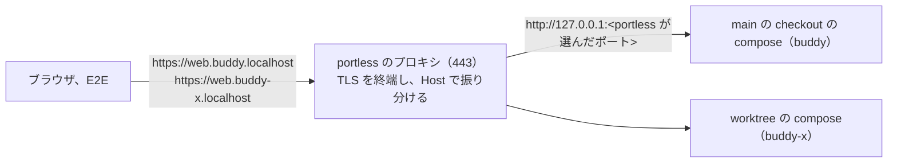

# ADR-0036: main の checkout と worktree のローカル環境を、portless でプロジェクトごとのホスト名の HTTPS の URL で出す

## Status

承認

## Context

ADR-0035 で、worktrunk で作った worktree の環境を、portless の `https://<サービス>.<プロジェクト>.localhost` で出すようにした。main の checkout と CI は、`http://localhost:<ポート>` のまま残した。

- main の checkout の環境は http で動き、web のセッションの cookie に `Secure` が付かない。worktree の環境と違う設定で確認していることになる。
- main の checkout の環境は `localhost` のホスト名で、ほかの localhost のアプリと cookie を共有する。
- 起動の手順と、コーディングエージェントへの指示が、main の checkout と worktree で 2 つに分かれる。
- main の checkout の compose のプロジェクトの名前は `buddy` である。volume とビルドしたイメージの名前は、プロジェクトの名前から付く。
- ADR-0035 の次の事実は変わらない。
  - cookie はポートを区別しない。
  - portless は、compose の HTTP のサービスのポートを選び直す。
  - macOS の Node.js は、`/etc/hosts` に無い `*.localhost` の名前を引けない。
  - web は、TLS を終端するプロキシの後ろでは、リクエストの URL から戻り先の URL を作れない。

この ADR は、ADR-0035 を置き換える。ADR-0035 の判断のうち変えないものも、この ADR に書く。

- ADR-0035: [worktree ごとのローカル環境を、portless で worktree ごとのホスト名の HTTPS の URL で出す](0035-local-hostnames-with-portless.md)

## Decision

ローカル環境は、main の checkout も worktree も、[portless](https://github.com/vercel-labs/portless) の `portless compose up` で起動し、`https://<サービス>.<プロジェクト>.localhost` の名前で出す。CI は `http://localhost:<ポート>` のまま動かす。

- ホスト名のプロジェクトの部分は、compose のプロジェクトの名前である。portless は、名前の `_` を `-` に変えて使う。
  - main の checkout は、プロジェクトの名前を `buddy` のままにする。ホスト名は `https://web.buddy.localhost` になる。volume とイメージの名前が変わらないので、今の DB をそのまま使える。
  - worktree は、worktrunk のフック（`.config/wt.toml`）が付けるブランチごとの名前になる。
  - プロジェクトごとに名前が違うので、cookie はホスト名ごとに分かれる。`buddy-x.localhost` は `buddy.localhost` の下の名前ではないので、main の checkout と worktree の cookie も分かれる。
- ブラウザが開く URL は、compose が `WEB_ORIGIN`、`HYDRA_PUBLIC_ORIGIN`、`BROKER_ORIGIN`、`IDP_ORIGIN` から組み立てる。
  - 未設定なら `https://<サービス>.${COMPOSE_PROJECT_NAME}.localhost` にする。main の checkout は `.env` を持たずに起動できる。
  - worktree のプロジェクトの名前には `_` が入り、compose の変数の展開では `-` に変えられない。worktree を作るときのフックが、`.env` にホスト名の URL を書く。
  - portless はポートを選び直すので、ポートで URL を組み立てない。ポートが変わらない postgres と valkey だけ、ポートで分ける。
- web は、`PUBLIC_URL` があれば、ログインとログアウトの戻り先の URL のオリジンをそれにする。portless は TLS を終端して web へ http で渡すためである。
- web のセッションの cookie に `Secure` を付ける。compose の `SESSION_COOKIE_SECURE` のデフォルトを `true` にする。
- 管理者の権限を使わない。開発者の端末とコーディングエージェントの環境では、`sudo` を使えないことがあるためである。
  - プロキシは、最初に 1 回だけ `portless proxy start --unprivileged --https` で起動する。macOS では、443 番を管理者の権限なしで待ち受け、loopback からの接続だけを受ける。portless はこのモードを覚え、次からは `portless compose up` が同じモードでプロキシを起動する。
  - portless の CA はシステムに信頼させない。ブラウザで開くと証明書の警告が出るので、開発者は警告を受け入れて開く。
  - ホスト名は `/etc/hosts` に書かない。ブラウザは `*.localhost` を自分で loopback に引く。E2E のテストのコード（Node.js）は、Playwright の設定で `*.localhost` を loopback に引くように名前の解決を差し替える。
  - Node.js と curl は、portless の CA（`~/.portless/ca.pem`）で証明書を検証する。Node.js には、`mise.toml` が `NODE_EXTRA_CA_CERTS` を渡す。ブラウザの E2E は、https の URL では証明書のエラーを無視する。
- API の仕様の `servers` と、E2E と `compose/dev-token.sh` の URL のデフォルトは、main の checkout の環境を指す。
- portless のバージョンは、`mise.toml` で固定する。1.0 より前で、バージョンの間で状態のファイルの形が変わることがあるためである（[portless の README](https://github.com/vercel-labs/portless#install)）。
- CI は portless を使わず、`docker compose up` で起動する。CI はブラウザで並べて開かないので、ホスト名で分ける利点が無い。CI は、`*_ORIGIN` に `http://localhost:<ポート>` を、`SESSION_COOKIE_SECURE` に `false` を渡す。

## Verification

2026-11-07 に、portless 0.16.0 の `--unprivileged --https` のプロキシで、ローカルで次を確認した。CA は信頼させず、ブラウザは証明書のエラーを無視した。

| 確認したこと | 結果 |
| --- | --- |
| main の checkout の起動 | `.env` なしの `portless compose up` で、web が `https://web.buddy.localhost` になった。今の `buddy_postgres` の volume をそのまま使い、DB のデータが残った |
| 2 つの環境を並べたログイン | 1 つのブラウザで main の checkout、worktree の順にログインした後、main の checkout を開き直してもログインしたままだった |
| cookie | `buddy_session` は 2 つの環境のホスト名ごとに分かれ、どちらにも `Secure` が付いた |
| E2E | URL の環境変数を渡さずに流すと、main の checkout の環境に向いてログインした。worktree の環境では、ログイン、画面の枠、職員の登録、照合の spec が通った |
| `compose/dev-token.sh` と curl | portless の CA で検証して、main の checkout の予定の API とブローカーの内部の API を呼べた |

## Considered Options

| 選択肢 | 強み | 弱み |
| --- | --- | --- |
| **採用:** compose の `*_ORIGIN` のデフォルトを portless のホスト名にし、main の checkout の名前を `buddy` のままにする | main の checkout に `.env` が要らない。今の volume と DB をそのまま使える。起動の手順が worktree と同じになる | `docker compose up` で起動すると、ブラウザが開くホスト名が portless に登録されず、ログインが失敗する。CI は `*_ORIGIN` を渡す必要がある |
| デフォルトを `http://localhost` のままにし、main の checkout にも `.env` を書くスクリプトを足す | compose のデフォルトと CI の設定を変えない | main の checkout に、`.env` を書く手順が 1 つ増える。手順を忘れると http で動く |
| main の checkout の名前を `buddy-main` などに変える | worktree と同じ形の名前になる | volume の名前が変わり、今の DB を使うには volume を移す手順が要る。同じ名前のブランチの worktree とぶつかる |
| main の checkout は `http://localhost` のまま残す（ADR-0035） | 変更が要らない | cookie の `Secure` と localhost の cookie の共有が残る。手順が 2 つに分かれる |
| Traefik と mkcert、OrbStack のコンテナのドメイン | 実績が多い。コンテナに名前と HTTPS が付く | ADR-0035 で採らなかった理由（設定の多さ、Docker の実行環境の乗り換え）が変わらない |

## Consequences

### Positive

- main の checkout と worktree の環境を、同じ手順で起動し、同じ形の URL で開ける。
- 同じブラウザで main の checkout と複数の worktree の環境にログインしても、セッションが上書きし合わない。
- web のセッションの cookie に `Secure` を付けて、本番と同じ設定で確認できる。

### Negative

- ブラウザで開くと、証明書の警告が出る。ドキュメントサイトの API の参照のページからリクエストを送る前にも、API の URL を開いて警告を受け入れる必要がある。
- E2E は、`*.localhost` の名前の解決の差し替えと、証明書のエラーの無視に頼る。portless の証明書の誤りは、E2E では見つからない。
- Linux では、443 番を管理者の権限なしで待ち受けるのに `sysctl` の設定が要る。今の開発者の端末は macOS なので、扱っていない。
- ローカル環境は、`docker compose up` で起動できない。
- CI は `http://localhost:<ポート>` で動くので、HTTPS と `Secure` の cookie はローカル環境でだけ確認できる。
