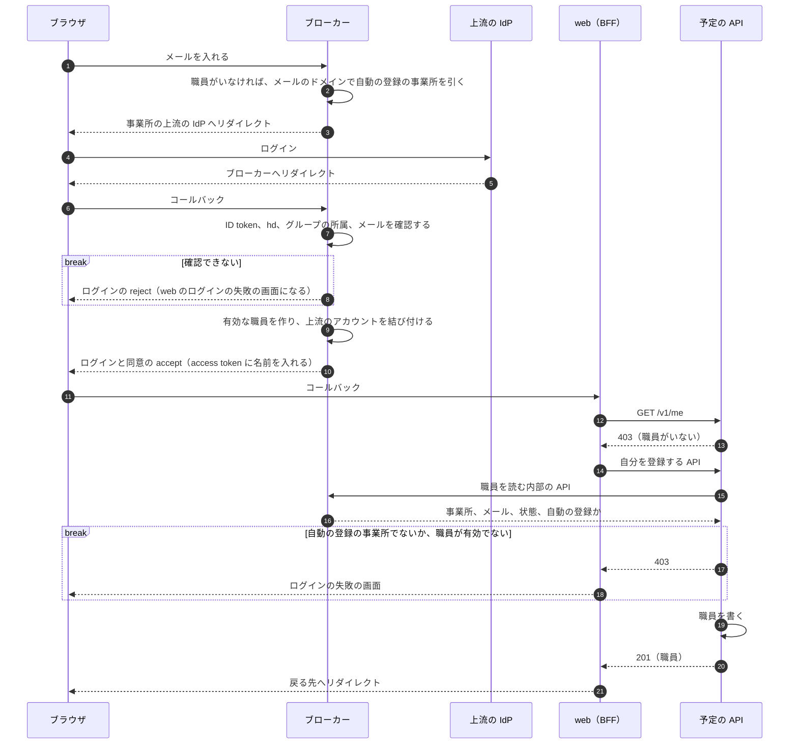

# ADR-0049: 自動の登録の事業所では、初回のログインで職員を一般の職員として登録し、ブローカーが職員を作って予定の API が業務の職員を作る

## Status

承認

## Context

Google カレンダーで予定を管理する事業所に、少ない手間で使い始められる常設の軽いプランを用意する。  
このプランの事業所では、buddy のマネージャーが職員を 1 人ずつ登録しない。  
初めてログインした職員を、一般の職員として自動で登録する。  
部署、チーム、マネージャーの役割は、buddy のマネージャーが後で決める。

- 使える人は、事業所の Workspace のグループで決める。ブローカーが上流のログインのたびに所属を読む。
  - ADR-0048: [自動の登録の事業所で buddy を使える人を、Workspace のグループに直接入れた職員にし、ブローカーが上流のログインのたびに Cloud Identity Groups API で所属を読む](0048-workspace-group-access.md)
- 職員の身元（ID、メール、事業所、状態、上流のアカウント）はブローカーが持ち、名前、役職、権限は予定の API が持つ。予定の API は、トークンの `sub` で職員を引く。
  - ADR-0001: [認証を OIDC のブローカーと BFF のサーバー側のセッションにし、職員の身元をブローカーが、権限と業務のデータを予定の API が持つ](0001-auth.md)
- 今の職員の登録は、職員の管理の権限を持つ職員が予定の API で行う。予定の API がブローカーの内部の API で登録の途中の職員を作り、予定の API に書いてから有効にする。依存の向きは、予定の API がブローカーを呼ぶ 1 方向だけである。
  - ADR-0043: [事業所と最初のマネージャーを予定の API の運営用の CLI で登録し、ブローカーは運営用のクライアントに職員の登録だけを許す](0043-facility-onboarding-cli.md)
- ブローカーは、ログインの画面で入れたメールから職員を引き、その事業所の上流の IdP へリダイレクトする。登録されていないメールには、事業所を示さずに、ログインの失敗と同じ文言を返す。
- 予定の API の職員は、名前、メール、部署、チーム、役職を必ず持つ。
- ブローカーは、上流の IdP に `openid` と `email` のスコープだけを求める。Google の ID token の `name` は、スコープに `profile` を含めると入ることがあるが、必ず入るとは限らない。
  - 出典: [OpenID Connect（Google Identity）](https://developers.google.com/identity/openid-connect/openid-connect)
- Hydra のログインの accept に付けた `context` は、同意の要求を読むときに渡る。
  - 出典: [Implementing the login endpoint（Ory Hydra）](https://www.ory.com/docs/hydra/guides/login)
- 運営用の CLI の登録でコミットだけが失敗すると、ブローカーの職員が有効のまま、予定の API に職員が無い状態が残る。web は、予定の API で職員を引けないログインを、事業所に登録されていないログインの失敗にする。
- 退職は、ブローカーの職員のメールと上流のアカウントを消す。休職はどちらも残す。
  - ADR-0004: [職員の停止を、戻せる休職と、戻せない退職に分ける](0004-staff-leave-and-retirement.md)

## Decision

### 自動の登録の事業所

自動の登録の事業所を、ブローカーの上流の IdP の設定の `auto_register` で表す。  
予定の API は、自動の登録の事業所かを、ブローカーに新しく足す職員を読む内部の API で知る。  
理由: 設定を 1 か所に置き、上流の IdP の設定のファイルと同じくデプロイし直して変えるためである（ADR-0002）。

- `auto_register` の事業所では、許すドメインと ADR-0048 のグループを必須にし、無ければブローカーは起動しない。
  - 許すドメインが無いと、個人の Gmail やほかの組織の Google のアカウントでも職員として登録されるためである。
- 1 つのドメインは、自動の登録の事業所の 1 つにだけ許せる。重なれば、ブローカーは起動しない。
- 予定の API は、「ブローカーで有効なのに予定の API に職員が無い」ことだけで自動の登録とみなさない。運営用の CLI の失敗でも同じ状態が残るためである。

### 初回のログインの振り分け

ブローカーは、入れたメールに当たる職員がいなければ、メールのドメインを、自動の登録の事業所の許すドメインと比べる。  
合う事業所があれば、その事業所の上流の IdP へリダイレクトする。  
合わなければ、今のとおり、登録されていないメールとして拒む。

- この規則は、登録されていないメールに事業所を示さない規則を、自動の登録の事業所のドメインに限って変える。明かすのは、ドメインが buddy の事業所かであり、人が職員かではない。
- 許すドメインは、Workspace の組織のプライマリドメインである。メールのドメインが別名のドメインの職員は振り分けられないので、マネージャーが先に登録する。

### 職員を作る流れ

次の図は、初回のログインで、ブローカーと予定の API が職員を作る順を示す。

- ブローカーは、上流の ID token の確認（`hd`、ADR-0048 のグループ、確認済みで入れたメールと同じメール）を通ったときだけ、有効な職員を作り、上流のアカウントを結び付ける。作る職員と結び付けは、1 つのトランザクションで書く。
  - 同じ上流のアカウントが既に職員に結び付いていれば、作らずに今の職員でログインする。
- ブローカーは、上流の IdP に `profile` のスコープも求め、ID token の `name` をログインの accept の `context` に入れ、同意の accept で access token のクレームに入れる。ブローカーは名前を DB に持たない。
- web は、`GET /v1/me` が職員を引けない 403 を返したときだけ、予定の API の自分を登録する API を呼び、もう一度 `GET /v1/me` を呼ぶ。
- 予定の API は、自分を登録する API で、ブローカーの職員を読んでから、次の値で職員を書く。
  - 役職は、標準の 4 つの役職のメンバーにし、役職のデフォルトの権限をコピーする。
  - 部署とチームは、「未所属」の部署とチームにする。同じ名前があれば使い、無ければ作る。
  - 名前は、access token の名前を使い、無ければメールの `@` の前を使う。
  - 訪問するかは、「訪問する」にする。
  - 登録の記録を、権限の変更の監査の記録に、登録した職員自身を操作した職員として書く（ADR-0051）。
- 予定の API に同じ `sub` の職員がいれば、書かずにその職員を返す。予定の API に書けなかったときは、ブローカーの職員を有効のまま残し、web はログインの失敗の画面を出す。次のログインで書き直す。
- Google カレンダーの結び付けは作らない。マネージャーが後で結び付ける。

### 自動の登録で作らないもの

- 最初のマネージャーは、自動の登録の事業所でも、運営用の CLI で登録する。自動の登録は、メンバーの職員だけを作る。
- 部署、チーム、役職をグループから決めない。マネージャーの役割を Workspace の管理者に配らせないためである。

### 退職と休職

- 退職した職員がグループに残っていると、次のログインで新しい職員として登録される。退職はメールと上流のアカウントを消すので、buddy の側では同じ人と分からない。事業所の管理者は、退職の前にグループから外す。
- 休職の職員は、グループに残っていても、メールと結び付けが残るので、今のとおりログインできない。

## Considered Options

| 論点 | 選択肢 | 強み | 弱み |
| --- | --- | --- | --- |
| 作る流れ | **採用:** ブローカーが職員を作り、web が予定の API の自分を登録する API を呼ぶ | 依存の向きを変えない。書き込みを明示の操作に分けられる | 予定の API に書けないと、ブローカーにだけ職員が残る。次のログインで書き直す |
| 作る流れ | ブローカーがコールバックで予定の API の内部の API を呼ぶ | 初回のログインのコールバックの中で両方がそろう | ブローカーから予定の API への依存が増え、循環する |
| 作る流れ | 予定の API が `GET /v1/me` の中で職員を作る | web の変更が少ない | 読む操作が書き込みを持つ |
| 振り分け | **採用:** メールのドメインを、自動の登録の事業所の許すドメインと比べる | 職員の手間が今と同じ | ドメインが buddy の事業所かが分かる。1 つのドメインに事業所を 1 つしか置けない |
| 振り分け | 事業所ごとのログインの URL から始める | 事業所を示さない規則を変えない | 事業所ごとに URL を配る手間がある |
| 振り分け | メールを聞かずに Google でログインさせ、`hd` で事業所を決める | 入力が減る | 事業所の間で 1 つの Google のクライアントを共有する前提になる |
| 見分け方 | **採用:** ブローカーの上流の IdP の設定に持ち、予定の API はブローカーから読む | 設定が 1 か所 | 予定の API は、自分を登録する API でブローカーを呼ぶ |
| 見分け方 | ブローカーの設定と、予定の API の事業所の両方に持つ | 予定の API が自分で拒める | 2 か所の値が食い違う |
| 部署とチーム | **採用:** 「未所属」の部署とチームに入れる | 職員の必須の値を変えない | マネージャーが後で移す |
| 部署とチーム | 部署とチームを空にできるようにする | 「未所属」を作らない | カレンダー、絞り込み、権限の対象に広く手が入る |

## Consequences

### Positive

- マネージャーが職員を 1 人ずつ登録しなくても、グループに入った職員が初回のログインで使い始められる。
- 予定の API がブローカーを呼ぶ向きだけを保つ。
- 自動の登録の事業所でも、最上位の権限を持つマネージャーは運営用の CLI でしか作られない。

### Negative

- 職員とログインの規則（登録されていないメールに事業所を示さない、職員は事前に登録した場合だけ使える）を、自動の登録の事業所について変える。context と PRD を同じく直す。
- 自動の登録の職員は「未所属」の部署とチームのメンバーとして始まり、訪問する職員としてカレンダーに出る。事務の職員は、マネージャーが訪問しない職員に変えるまでカレンダーに出る。
- 退職の前にグループから外さないと、退職した人が新しい職員として戻る。
- ブローカーに、職員を読む内部の API と、名前を受け取るスコープを足す。
