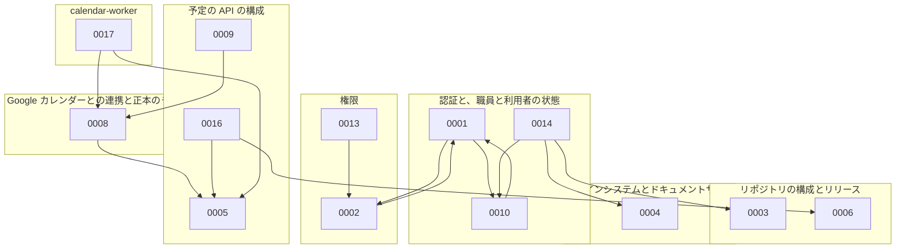

# ADR の索引

話題ごとに、今有効な ADR を並べる。

## 話題ごとの ADR

### 認証と、職員と利用者の状態

| ADR | 題 | Status |
| --- | --- | --- |
| [ADR-0001](0001-auth.md) | 認証を OIDC のブローカーと BFF のサーバー側のセッションにし、職員の身元と停止をブローカーが、権限と業務のデータを予定の API が持つ | 承認 |
| [ADR-0010](0010-id-broker-hydra.md) | OIDC のブローカーを、Ory Hydra と、自作の login and consent app で作る | 承認 |
| [ADR-0014](0014-broker-login-pages-source.md) | ID ブローカーのログインの画面のソースを apps/broker に置き、@buddy/ui から生成したテンプレートを ID ブローカーが埋め込んで配信する | 承認 |

### 権限

| ADR | 題 | Status |
| --- | --- | --- |
| [ADR-0002](0002-pbac.md) | 権限を役職のデフォルトと職員ごとの上書きで持ち、職員の管理と照合も権限で許し、訪問するかを職員に持つ | 承認 |
| [ADR-0013](0013-web-permission-checks.md) | web の画面の権限の確認を、route の beforeLoad と PermissionGuard で宣言し、1 つの関数で評価する | 承認 |

### リポジトリの構成とリリース

| ADR | 題 | Status |
| --- | --- | --- |
| [ADR-0003](0003-branch-and-release.md) | モノレポを git flow でマージし、画面を apps/ に、API を services/ に置き、ディレクトリの名前でタグとサービスの名前をそろえる | 承認 |
| [ADR-0006](0006-go-shared-module.md) | 2 つの Go の API が共有するコードを、別の module にまとめる | 承認 |

### デザインシステムとドキュメントサイト

| ADR | 題 | Status |
| --- | --- | --- |
| [ADR-0004](0004-design-system.md) | デザインシステムのトークンを DADS の基本、buddy の意味、Tailwind のテーマの 3 段にし、カタログをドキュメントサイトと同じ Worker で出す | 承認 |

### 予定の API の構成

| ADR | 題 | Status |
| --- | --- | --- |
| [ADR-0005](0005-schedule-api-packages.md) | 予定の API を機能ごとのパッケージに分け、Go の API の操作を使う依存だけを持つ型にし、ファイルの名前の末尾の語で役割を表す | 承認 |
| [ADR-0009](0009-schedule-api-postgresql.md) | 予定の API の DB を PostgreSQL にし、見直したテーブルでマイグレーションを作り直す | 承認 |
| [ADR-0016](0016-service-code-rules.md) | サービスの規則を packages/go/servicecode に置き、予定の API のサービスコードを visit から servicecode の機能に分ける | 承認 |

### web の画面の構成

| ADR | 題 | Status |
| --- | --- | --- |
| [ADR-0007](0007-web-view-types.md) | web の画面の型を API の型と分けて持ち、ダミーデータを API の形で 1 か所に置く | 承認 |
| [ADR-0015](0015-web-site-frame-in-root-route.md) | web の画面の枠を root の route の component で包み、左の欄を持つ画面だけを staticData で外す | 承認 |

### Google カレンダーとの連携と正本のモード

| ADR | 題 | Status |
| --- | --- | --- |
| [ADR-0008](0008-google-calendar-sync.md) | Google カレンダーとの連携を事業所ごとの正本のモードで分け、職員のカレンダーを事業所ごとのサービスアカウントへの共有で読み書きする | 承認 |

### calendar-worker

| ADR | 題 | Status |
| --- | --- | --- |
| [ADR-0017](0017-calendar-worker.md) | Google カレンダーの書き出しと同期を、予定の API と同じイメージの Worker のコマンドで役割ごとに動かし、繰り返しを Worker のコマンドに集める | 承認 |

### 日をまたぐ予定

| ADR | 題 | Status |
| --- | --- | --- |
| [ADR-0011](0011-overnight-schedule.md) | 日をまたぐ予定を、開始の日の予定に「終了が翌日か」の印を付けて持ち、取り込み、カレンダー、照合で扱う | 提案 |

### E2E のテスト

| ADR | 題 | Status |
| --- | --- | --- |
| [ADR-0012](0012-e2e-functions-without-page-object.md) | E2E のテストのコードを、Page Object を使わず page を受け取る関数で書き、描画の完了の信号をアプリに足さない | 承認 |

## ADR の間の依存

次の図は、ADR が、Context で前提にした ADR を指す向きを示す。統合の ADR は、まとめた ADR の前提を引き継ぐので、2 本が互いを指すことがある。

- ADR-0007、ADR-0011、ADR-0012、ADR-0015 は、ほかの ADR を前提にせず、前提にもされないので、図に描かない。

## 旧番号と新番号

統合と番号の詰め直しで、ADR の番号を変えた。コミット、issue、pull request に書いた旧番号は、この表で今の ADR を探す。

| 旧番号（変えた issue の時点） | 新番号 | 変えた issue |
| --- | --- | --- |
| ADR-0010 | ADR-0005 に統合 | #731 |
| ADR-0011 | ADR-0010 | #731 |
| ADR-0012 | ADR-0011 | #731 |
| ADR-0013 | ADR-0012 | #731 |
| ADR-0014 | ADR-0013 | #731 |
| ADR-0015 | ADR-0014 | #731 |
| ADR-0016 | ADR-0015 | #731 |
| ADR-0017 | ADR-0016 | #731 |
| ADR-0018 | ADR-0017 | #731 |
| ADR-0019 | ADR-0018 | #731 |
| ADR-0020 | ADR-0019 | #731 |
| ADR-0021 | ADR-0020 | #731 |
| ADR-0022 | ADR-0021 | #731 |
| ADR-0023 | ADR-0022 | #731 |
| ADR-0024 | ADR-0023 | #731 |
| ADR-0025 | ADR-0024 | #731 |
| ADR-0026 | ADR-0005 に統合 | #731 |
| ADR-0027 | ADR-0025 | #731 |
| ADR-0028 | ADR-0026 | #731 |
| ADR-0029 | ADR-0005 に統合 | #731 |
| ADR-0030 | ADR-0005 に統合 | #731 |
| ADR-0031 | ADR-0005 に統合 | #731 |
| ADR-0032 | ADR-0005 に統合 | #731 |
| ADR-0033 | ADR-0027 | #731 |
| ADR-0034 | ADR-0028 | #731 |
| ADR-0035 | ADR-0029 | #731 |
| ADR-0036 | ADR-0030 | #731 |
| ADR-0037 | ADR-0031 | #731 |
| ADR-0038 | ADR-0032 | #731 |
| ADR-0014 | ADR-0004 に統合 | #732 |
| ADR-0015 | ADR-0014 | #732 |
| ADR-0016 | ADR-0015 | #732 |
| ADR-0017 | ADR-0016 | #732 |
| ADR-0018 | ADR-0004 に統合 | #732 |
| ADR-0019 | ADR-0004 に統合 | #732 |
| ADR-0020 | ADR-0017 | #732 |
| ADR-0021 | ADR-0018 | #732 |
| ADR-0022 | ADR-0019 | #732 |
| ADR-0023 | ADR-0020 | #732 |
| ADR-0024 | ADR-0021 | #732 |
| ADR-0025 | ADR-0022 | #732 |
| ADR-0026 | ADR-0023 | #732 |
| ADR-0027 | ADR-0024 | #732 |
| ADR-0028 | ADR-0025 | #732 |
| ADR-0029 | ADR-0026 | #732 |
| ADR-0030 | ADR-0027 | #732 |
| ADR-0031 | ADR-0028 | #732 |
| ADR-0032 | ADR-0029 | #732 |
| ADR-0015 | ADR-0001 に統合 | #733 |
| ADR-0016 | ADR-0001 に統合 | #733 |
| ADR-0017 | ADR-0001 に統合 | #733 |
| ADR-0018 | ADR-0015 | #733 |
| ADR-0019 | ADR-0016 | #733 |
| ADR-0020 | ADR-0017 | #733 |
| ADR-0021 | ADR-0018 | #733 |
| ADR-0022 | ADR-0019 | #733 |
| ADR-0023 | ADR-0020 | #733 |
| ADR-0024 | ADR-0021 | #733 |
| ADR-0025 | ADR-0022 | #733 |
| ADR-0026 | ADR-0023 | #733 |
| ADR-0027 | ADR-0024 | #733 |
| ADR-0028 | ADR-0025 | #733 |
| ADR-0029 | ADR-0026 | #733 |
| ADR-0011 | ADR-0009 に統合 | #734 |
| ADR-0012 | ADR-0011 | #734 |
| ADR-0013 | ADR-0012 | #734 |
| ADR-0014 | ADR-0013 | #734 |
| ADR-0015 | ADR-0014 | #734 |
| ADR-0016 | ADR-0015 | #734 |
| ADR-0017 | ADR-0016 | #734 |
| ADR-0018 | ADR-0017 | #734 |
| ADR-0019 | ADR-0018 | #734 |
| ADR-0020 | ADR-0019 | #734 |
| ADR-0021 | ADR-0009 に統合 | #734 |
| ADR-0022 | ADR-0020 | #734 |
| ADR-0023 | ADR-0009 に統合 | #734 |
| ADR-0024 | ADR-0021 | #734 |
| ADR-0025 | ADR-0022 | #734 |
| ADR-0026 | ADR-0009 に統合 | #734 |
| ADR-0022 | ADR-0021 に統合 | #735 |
| ADR-0006 | ADR-0002 に統合 | #748 |
| ADR-0007 | ADR-0006 | #748 |
| ADR-0008 | ADR-0007 | #748 |
| ADR-0009 | ADR-0008 | #748 |
| ADR-0010 | ADR-0009 | #748 |
| ADR-0011 | ADR-0010 | #748 |
| ADR-0012 | ADR-0011 | #748 |
| ADR-0013 | ADR-0012 | #748 |
| ADR-0014 | ADR-0002 に統合 | #748 |
| ADR-0015 | ADR-0013 | #748 |
| ADR-0016 | ADR-0014 | #748 |
| ADR-0017 | ADR-0015 | #748 |
| ADR-0018 | ADR-0016 | #748 |
| ADR-0019 | ADR-0017 | #748 |
| ADR-0020 | ADR-0018 | #748 |
| ADR-0021 | ADR-0019 | #748 |
| ADR-0010 | ADR-0003 に統合 | #749 |
| ADR-0011 | ADR-0003 に統合 | #749 |
| ADR-0012 | ADR-0010 | #749 |
| ADR-0013 | ADR-0011 | #749 |
| ADR-0014 | ADR-0012 | #749 |
| ADR-0015 | ADR-0013 | #749 |
| ADR-0016 | ADR-0014 | #749 |
| ADR-0017 | ADR-0015 | #749 |
| ADR-0018 | ADR-0016 | #749 |
| ADR-0019 | ADR-0017 | #749 |
