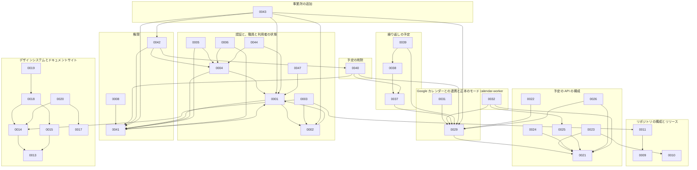

# ADR の索引

話題ごとに、今有効な ADR を並べる。

## 話題ごとの ADR

### 認証と、職員と利用者の状態

| ADR | 題 | Status |
| --- | --- | --- |
| [ADR-0001](0001-auth.md) | 認証を OIDC のブローカーと BFF のサーバー側のセッションにし、職員の身元をブローカーが、権限と業務のデータを予定の API が持つ | 承認 |
| [ADR-0002](0002-id-broker-hydra.md) | OIDC のブローカーを、Ory Hydra と、自作の login and consent app で作る | 承認 |
| [ADR-0003](0003-broker-login-pages-source.md) | ID ブローカーのログインの画面のソースを apps/broker に置き、@buddy/ui から生成したテンプレートを ID ブローカーが埋め込んで配信する | 承認 |
| [ADR-0004](0004-staff-leave-and-retirement.md) | 職員の停止を、戻せる休職と、戻せない退職に分ける | 承認 |
| [ADR-0005](0005-patient-service-end.md) | 利用者を、戻せる利用の終了にでき、終了の利用者を予定の候補と職員の退職の確認から外す | 承認 |
| [ADR-0006](0006-non-visiting-staff.md) | 訪問するかを職員に持ち、訪問しない職員を予定と担当から外す | 承認 |
| [ADR-0044](0044-token-hook-fail-closed.md) | token_hook が答えないときはトークンを発行せず、待ちを短くし、冗長化と監視で止まる時間を減らす | 承認 |
| [ADR-0047](0047-web-session-postgres.md) | web のセッションを、web 用の PostgreSQL のデータベースに暗号化して置けるようにし、期限の切れた行を web が消す | 承認 |

### 権限

| ADR | 題 | Status |
| --- | --- | --- |
| [ADR-0041](0041-pbac-grants.md) | 権限を役職のデフォルトと職員ごとの上書きで持ち、役職を変えても職員ごとに足した権限を残し、職員の管理と照合も権限で許す | 承認 |
| [ADR-0042](0042-permission-audit.md) | 権限の変更を、操作した職員か運営者と変更の前後の権限の全量で、予定の API の DB の監査の記録に残す | 承認 |
| [ADR-0008](0008-web-permission-checks.md) | web の画面の権限の確認を、route の beforeLoad と PermissionGuard で宣言し、1 つの関数で評価する | 承認 |

- ADR-0007（[権限を役職のデフォルトと職員ごとの上書きで持ち、職員の管理と照合も権限で許す](0007-pbac.md)）は、ADR-0041 に置換した。

### リポジトリの構成とリリース

| ADR | 題 | Status |
| --- | --- | --- |
| [ADR-0009](0009-branch-and-release.md) | モノレポを git flow でマージし、アプリごとのバージョンでリリースする | 承認 |
| [ADR-0010](0010-go-shared-module.md) | 2 つの Go の API が共有するコードを、別の module にまとめる | 承認 |
| [ADR-0011](0011-directories-and-service-names.md) | 画面を apps/ に、API を services/ に置き、ディレクトリの名前でサービスの名前をそろえる | 承認 |

### デザインシステムとドキュメントサイト

画面を作るときに使う側の規則は [DESIGN.md](https://github.com/Fukuemon/buddy/blob/develop/packages/ui/DESIGN.md) と、そこから指す 3 つの文書にあり、見本は [カタログ（Storybook）](https://buddy-docs.emon-apps.workers.dev/storybook/) にある。このセクションの ADR は、その規則を決めた理由と、却下した案を持つ。

| ADR | 題 | Status |
| --- | --- | --- |
| [ADR-0013](0013-design-system-primitive-tokens.md) | デザインシステムのトークンを、buddy に持つプリミティブトークン、セマンティックトークン、テーマ変数の 3 つの層にする | 承認 |
| [ADR-0014](0014-ui-components.md) | packages/ui に、ドメインを持たない Base と Case のコンポーネントを置き、DADS の指針から外れる 3 点は理由を DESIGN.md に書く | 承認 |
| [ADR-0015](0015-accessibility.md) | アクセシビリティは WCAG 2.2 の AA を基準にし、自動で確認する | 承認 |
| [ADR-0017](0017-design-system-guidelines.md) | アクセシビリティと UI/UX の規則は、DADS の指針を元にし、DESIGN.md に buddy の規則として書く | 承認 |
| [ADR-0018](0018-storybook-catalog.md) | apps/web の Storybook を 1 つのカタログにする | 承認 |
| [ADR-0019](0019-docs-site-publish.md) | カタログをドキュメントサイトと同じ Worker で、develop に入ったときだけ出す | 承認 |
| [ADR-0020](0020-design-system-topic-documents.md) | デザインシステムの文書を、原則と手順を持つ DESIGN.md と、トークン、コンポーネント、カタログの文書に分ける | 承認 |

- ADR-0012（[デザインシステムのトークンを DADS の基本、buddy の意味、Tailwind のテーマの 3 段にする](0012-design-system.md)）は、ADR-0013 に置換した。
- ADR-0016（[デザインシステムの文書を、使う側の DESIGN.md と、保守の判断の ADR に分ける](0016-design-system-documents.md)）は、ADR-0020 に置換した。
- ADR-0015 の Decision の基準と確認の方法の表は、決めたときの記録である。今の基準と確認の方法は、[DESIGN.md の「アクセシビリティ」](https://github.com/Fukuemon/buddy/blob/develop/packages/ui/DESIGN.md#アクセシビリティ)にある。

### 予定の API の構成

| ADR | 題 | Status |
| --- | --- | --- |
| [ADR-0021](0021-schedule-api-packages.md) | 予定の API を機能ごとのパッケージに分ける | 承認 |
| [ADR-0022](0022-schedule-api-postgresql.md) | 予定の API の DB を PostgreSQL にし、見直したテーブルでマイグレーションを作り直す | 承認 |
| [ADR-0023](0023-service-code-rules.md) | サービスの規則を packages/go/servicecode に置き、予定の API のサービスコードを visit から servicecode の機能に分ける | 承認 |
| [ADR-0024](0024-go-operation-types.md) | Go の API の操作を、使う依存だけを持つ操作ごとの型にする | 承認 |
| [ADR-0025](0025-go-file-names.md) | Go の API のパッケージをフラットに保ち、ファイルの名前の末尾の語で役割を表す | 承認 |
| [ADR-0026](0026-schedule-write-read-models.md) | 予定の書き込みのモデルを schedule に、読み取りのモデルを scheduleview に置く | 承認 |

### web の画面の構成

| ADR | 題 | Status |
| --- | --- | --- |
| [ADR-0027](0027-web-view-types.md) | web の画面の型を API の型と分けて持ち、ダミーデータを API の形で 1 か所に置く | 承認 |
| [ADR-0028](0028-web-site-frame-in-root-route.md) | web の画面の枠を root の route の component で包み、左の欄を持つ画面だけを staticData で外す | 承認 |

### Google カレンダーとの連携と正本のモード

| ADR | 題 | Status |
| --- | --- | --- |
| [ADR-0029](0029-google-calendar-sync.md) | Google カレンダーとの連携を、事業所ごとの正本のモードで分ける | 承認 |
| [ADR-0030](0030-google-calendar-service-accounts.md) | 職員のカレンダーを、事業所ごとのサービスアカウントへの共有で読み書きする | 承認 |
| [ADR-0031](0031-calendar-cutover.md) | 事業所の予定の正本を、期間のある切り替えの記録で Google カレンダーから buddy へ移す | 承認 |

### calendar-worker

| ADR | 題 | Status |
| --- | --- | --- |
| [ADR-0032](0032-calendar-worker.md) | Google カレンダーの書き出しと同期を、予定の API と同じイメージの Worker のコマンドで役割ごとに動かし、繰り返しを Worker のコマンドに集める | 承認 |

### 日をまたぐ予定

| ADR | 題 | Status |
| --- | --- | --- |
| [ADR-0033](0033-overnight-schedule.md) | 日をまたぐ予定を、開始の日の予定に「終了が翌日か」の印を付けて持ち、取り込み、カレンダー、照合で扱う | 提案 |

### E2E のテスト

| ADR | 題 | Status |
| --- | --- | --- |
| [ADR-0034](0034-e2e-functions-without-page-object.md) | E2E のテストのコードを、Page Object を使わず page を受け取る関数で書き、描画の完了の信号をアプリに足さない | 承認 |

### ローカルの開発環境

| ADR | 題 | Status |
| --- | --- | --- |
| [ADR-0036](0036-main-checkout-with-portless.md) | main の checkout と worktree のローカル環境を、portless でプロジェクトごとのホスト名の HTTPS の URL で出す | 承認 |

- ADR-0035（[worktree ごとのローカル環境を、portless で worktree ごとのホスト名の HTTPS の URL で出す](0035-local-hostnames-with-portless.md)）は、ADR-0036 に置換した。

### 繰り返しの予定

| ADR | 題 | Status |
| --- | --- | --- |
| [ADR-0037](0037-recurring-rule-change.md) | 繰り返しの予定の規則の変更を、適用の日以降の回にだけ当て、繰り返しの予定を適用の日で分ける | 承認 |
| [ADR-0038](0038-recurring-rule-scope.md) | 繰り返しの規則に、毎週の複数の曜日と間隔を足し、終わりは終了日だけで持つ | 承認 |
| [ADR-0039](0039-recurring-rrule-mapping.md) | Google カレンダーの RRULE のうち、buddy の繰り返しの規則と毎日の繰り返しを規則に写し、書き出す RRULE に週の始まりの日曜を書く | 承認 |

### 予定の削除

| ADR | 題 | Status |
| --- | --- | --- |
| [ADR-0040](0040-schedule-deletion.md) | 誤って入れた予定を、キャンセルと別の削除で消し、開始の日が今日以降の有効な予定に限り、監査の記録だけを残す | 承認 |

### 事業所の追加

| ADR | 題 | Status |
| --- | --- | --- |
| [ADR-0043](0043-facility-onboarding-cli.md) | 事業所と最初のマネージャーを予定の API の運営用の CLI で登録し、ブローカーは運営用のクライアントに職員の登録だけを許す | 承認 |

## ADR の間の依存

次の図は、ADR が、Context で前提にした ADR を指す向きを示す。統合の ADR は、まとめた ADR の前提を引き継ぐので、2 本が互いを指すことがある。置換した ADR を前提にした辺は、置換した先の ADR に付け替えて描く。

- ADR-0027、ADR-0028、ADR-0030、ADR-0033、ADR-0034、ADR-0036 は、ほかの ADR を前提にせず、前提にもされないので、図に描かない。

## 旧番号と新番号

統合、番号の詰め直し、分割、番号の振り直しで、ADR の番号を変えた。コミット、issue、pull request に書いた旧番号は、この表で今の ADR を探す。今の番号は、その判断を今持つ ADR を指す。統合した ADR の行は、統合した判断を今持つ ADR を指す。

| 旧番号（変えた issue の時点） | 今の番号 | 変えた issue |
| --- | --- | --- |
| ADR-0010 | ADR-0021（統合） | #731 |
| ADR-0011 | ADR-0022 | #731 |
| ADR-0012 | ADR-0030（統合） | #731 |
| ADR-0013 | ADR-0011（統合） | #731 |
| ADR-0014 | ADR-0011（統合） | #731 |
| ADR-0015 | ADR-0013（統合） | #731 |
| ADR-0016 | ADR-0002 | #731 |
| ADR-0017 | ADR-0001（統合） | #731 |
| ADR-0018 | ADR-0004（統合） | #731 |
| ADR-0019 | ADR-0015、ADR-0019（統合） | #731 |
| ADR-0020 | ADR-0019（統合。判断は #758 で消した） | #731 |
| ADR-0021 | ADR-0005（統合） | #731 |
| ADR-0022 | ADR-0007、ADR-0006（統合） | #731 |
| ADR-0023 | ADR-0033 | #731 |
| ADR-0024 | ADR-0034 | #731 |
| ADR-0025 | ADR-0008 | #731 |
| ADR-0026 | ADR-0021（統合） | #731 |
| ADR-0027 | ADR-0003 | #731 |
| ADR-0028 | ADR-0028 | #731 |
| ADR-0029 | ADR-0021、ADR-0025（統合） | #731 |
| ADR-0030 | ADR-0025（統合） | #731 |
| ADR-0031 | ADR-0024（統合） | #731 |
| ADR-0032 | ADR-0021（統合） | #731 |
| ADR-0033 | ADR-0026、ADR-0029（統合） | #731 |
| ADR-0034 | ADR-0023 | #731 |
| ADR-0035 | ADR-0029、ADR-0031（統合） | #731 |
| ADR-0036 | ADR-0032 | #731 |
| ADR-0037 | ADR-0032（統合） | #731 |
| ADR-0038 | ADR-0029（統合） | #731 |
| ADR-0014 | ADR-0013（統合） | #732 |
| ADR-0015 | ADR-0002 | #732 |
| ADR-0016 | ADR-0001（統合） | #732 |
| ADR-0017 | ADR-0004（統合） | #732 |
| ADR-0018 | ADR-0015、ADR-0019（統合） | #732 |
| ADR-0019 | ADR-0019（統合。判断は #758 で消した） | #732 |
| ADR-0020 | ADR-0005（統合） | #732 |
| ADR-0021 | ADR-0007、ADR-0006（統合） | #732 |
| ADR-0022 | ADR-0033 | #732 |
| ADR-0023 | ADR-0034 | #732 |
| ADR-0024 | ADR-0008 | #732 |
| ADR-0025 | ADR-0003 | #732 |
| ADR-0026 | ADR-0028 | #732 |
| ADR-0027 | ADR-0026、ADR-0029（統合） | #732 |
| ADR-0028 | ADR-0023 | #732 |
| ADR-0029 | ADR-0029、ADR-0031（統合） | #732 |
| ADR-0030 | ADR-0032 | #732 |
| ADR-0031 | ADR-0032（統合） | #732 |
| ADR-0032 | ADR-0029（統合） | #732 |
| ADR-0015 | ADR-0001（統合） | #733 |
| ADR-0016 | ADR-0004（統合） | #733 |
| ADR-0017 | ADR-0005（統合） | #733 |
| ADR-0018 | ADR-0007、ADR-0006（統合） | #733 |
| ADR-0019 | ADR-0033 | #733 |
| ADR-0020 | ADR-0034 | #733 |
| ADR-0021 | ADR-0008 | #733 |
| ADR-0022 | ADR-0003 | #733 |
| ADR-0023 | ADR-0028 | #733 |
| ADR-0024 | ADR-0026、ADR-0029（統合） | #733 |
| ADR-0025 | ADR-0023 | #733 |
| ADR-0026 | ADR-0029、ADR-0031（統合） | #733 |
| ADR-0027 | ADR-0032 | #733 |
| ADR-0028 | ADR-0032（統合） | #733 |
| ADR-0029 | ADR-0029（統合） | #733 |
| ADR-0011 | ADR-0030（統合） | #734 |
| ADR-0012 | ADR-0011（統合） | #734 |
| ADR-0013 | ADR-0011（統合） | #734 |
| ADR-0014 | ADR-0002 | #734 |
| ADR-0015 | ADR-0007、ADR-0006（統合） | #734 |
| ADR-0016 | ADR-0033 | #734 |
| ADR-0017 | ADR-0034 | #734 |
| ADR-0018 | ADR-0008 | #734 |
| ADR-0019 | ADR-0003 | #734 |
| ADR-0020 | ADR-0028 | #734 |
| ADR-0021 | ADR-0026、ADR-0029（統合） | #734 |
| ADR-0022 | ADR-0023 | #734 |
| ADR-0023 | ADR-0029、ADR-0031（統合） | #734 |
| ADR-0024 | ADR-0032 | #734 |
| ADR-0025 | ADR-0032（統合） | #734 |
| ADR-0026 | ADR-0029（統合） | #734 |
| ADR-0022 | ADR-0032（統合） | #735 |
| ADR-0006 | ADR-0007（統合） | #748 |
| ADR-0007 | ADR-0010 | #748 |
| ADR-0008 | ADR-0027 | #748 |
| ADR-0009 | ADR-0029 | #748 |
| ADR-0010 | ADR-0022 | #748 |
| ADR-0011 | ADR-0011（統合） | #748 |
| ADR-0012 | ADR-0011（統合） | #748 |
| ADR-0013 | ADR-0002 | #748 |
| ADR-0014 | ADR-0007、ADR-0006（統合） | #748 |
| ADR-0015 | ADR-0033 | #748 |
| ADR-0016 | ADR-0034 | #748 |
| ADR-0017 | ADR-0008 | #748 |
| ADR-0018 | ADR-0003 | #748 |
| ADR-0019 | ADR-0028 | #748 |
| ADR-0020 | ADR-0023 | #748 |
| ADR-0021 | ADR-0032 | #748 |
| ADR-0010 | ADR-0011（統合） | #749 |
| ADR-0011 | ADR-0011（統合） | #749 |
| ADR-0012 | ADR-0002 | #749 |
| ADR-0013 | ADR-0033 | #749 |
| ADR-0014 | ADR-0034 | #749 |
| ADR-0015 | ADR-0008 | #749 |
| ADR-0016 | ADR-0003 | #749 |
| ADR-0017 | ADR-0028 | #749 |
| ADR-0018 | ADR-0023 | #749 |
| ADR-0019 | ADR-0032 | #749 |
| ADR-0002 | ADR-0007 | #760 |
| ADR-0003 | ADR-0009 | #760 |
| ADR-0004 | ADR-0013 | #760 |
| ADR-0005 | ADR-0021 | #760 |
| ADR-0006 | ADR-0010 | #760 |
| ADR-0007 | ADR-0027 | #760 |
| ADR-0008 | ADR-0029 | #760 |
| ADR-0009 | ADR-0022 | #760 |
| ADR-0010 | ADR-0002 | #760 |
| ADR-0011 | ADR-0033 | #760 |
| ADR-0012 | ADR-0034 | #760 |
| ADR-0013 | ADR-0008 | #760 |
| ADR-0014 | ADR-0003 | #760 |
| ADR-0015 | ADR-0028 | #760 |
| ADR-0016 | ADR-0023 | #760 |
| ADR-0017 | ADR-0032 | #760 |
| ADR-0018 | ADR-0004 | #760 |
| ADR-0019 | ADR-0005 | #760 |
| ADR-0020 | ADR-0006 | #760 |
| ADR-0021 | ADR-0011 | #760 |
| ADR-0022 | ADR-0014 | #760 |
| ADR-0023 | ADR-0015 | #760 |
| ADR-0024 | ADR-0020 | #760 |
| ADR-0025 | ADR-0018 | #760 |
| ADR-0026 | ADR-0019 | #760 |
| ADR-0027 | ADR-0024 | #760 |
| ADR-0028 | ADR-0025 | #760 |
| ADR-0029 | ADR-0030 | #760 |
| ADR-0030 | ADR-0026 | #760 |
| ADR-0031 | ADR-0031 | #760 |
| ADR-0013 | ADR-0014 | #783 |
| ADR-0014 | ADR-0015 | #783 |
| ADR-0015 | ADR-0020 | #783 |
| ADR-0016 | ADR-0018 | #783 |
| ADR-0017 | ADR-0019 | #783 |
| ADR-0018 | ADR-0021 | #783 |
| ADR-0019 | ADR-0022 | #783 |
| ADR-0020 | ADR-0023 | #783 |
| ADR-0021 | ADR-0024 | #783 |
| ADR-0022 | ADR-0025 | #783 |
| ADR-0023 | ADR-0026 | #783 |
| ADR-0024 | ADR-0027 | #783 |
| ADR-0025 | ADR-0028 | #783 |
| ADR-0026 | ADR-0029 | #783 |
| ADR-0027 | ADR-0030 | #783 |
| ADR-0028 | ADR-0031 | #783 |
| ADR-0029 | ADR-0032 | #783 |
| ADR-0030 | ADR-0033 | #783 |
| ADR-0031 | ADR-0034 | #783 |
| ADR-0020 | ADR-0021 | #851 |
| ADR-0021 | ADR-0022 | #851 |
| ADR-0022 | ADR-0023 | #851 |
| ADR-0023 | ADR-0024 | #851 |
| ADR-0024 | ADR-0025 | #851 |
| ADR-0025 | ADR-0026 | #851 |
| ADR-0026 | ADR-0027 | #851 |
| ADR-0027 | ADR-0028 | #851 |
| ADR-0028 | ADR-0029 | #851 |
| ADR-0029 | ADR-0030 | #851 |
| ADR-0030 | ADR-0031 | #851 |
| ADR-0031 | ADR-0032 | #851 |
| ADR-0032 | ADR-0033 | #851 |
| ADR-0033 | ADR-0034 | #851 |
| ADR-0034 | ADR-0035 | #851 |
| ADR-0041（#986 の pull request の中の番号） | ADR-0043 | #986 |
