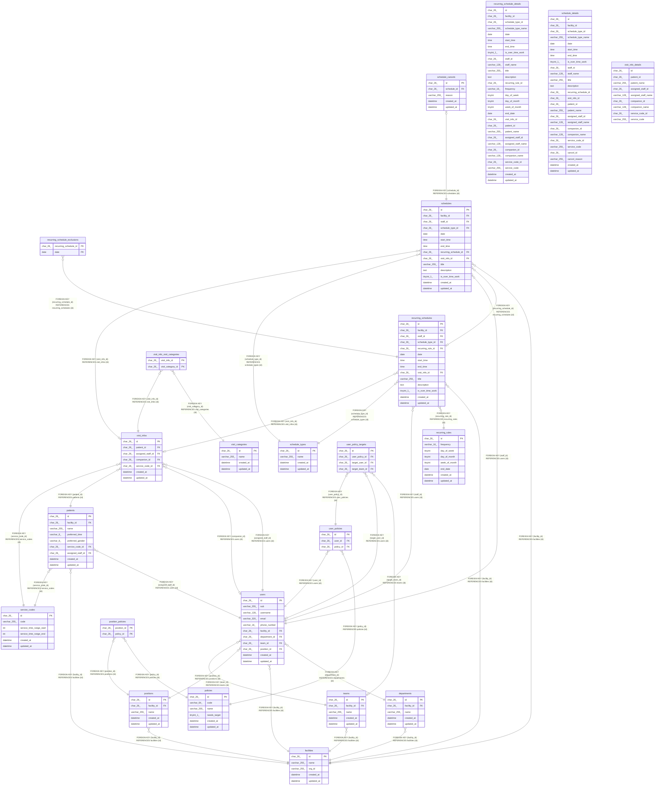

# schedule-api

## Tables

| Name                                                              | Columns | Comment                                                                | Type       |
| ----------------------------------------------------------------- | ------- | ---------------------------------------------------------------------- | ---------- |
| [departments](departments.md)                                     | 5       | 事業所の部署                                                           | BASE TABLE |
| [facilities](facilities.md)                                       | 5       | 訪問看護の事業所                                                       | BASE TABLE |
| [patients](patients.md)                                           | 9       | 利用者                                                                 | BASE TABLE |
| [policies](policies.md)                                           | 6       | 権限。マイグレーションで入れ、API では作らない                         | BASE TABLE |
| [position_policies](position_policies.md)                         | 2       | 役職の既定の権限                                                       | BASE TABLE |
| [positions](positions.md)                                         | 5       | 事業所の役職。職員を登録するときに写す既定の権限を持つ                 | BASE TABLE |
| [recurring_rules](recurring_rules.md)                             | 8       | 繰り返しの規則                                                         | BASE TABLE |
| [recurring_schedule_details](recurring_schedule_details.md)       | 29      | 一覧の読み出しに使う、繰り返しの予定と訪問の情報と名前を結合したビュー | VIEW       |
| [recurring_schedule_exclusions](recurring_schedule_exclusions.md) | 2       | 繰り返しの予定のうち、回にしない日                                     | BASE TABLE |
| [recurring_schedules](recurring_schedules.md)                     | 14      | 繰り返しの予定                                                         | BASE TABLE |
| [schedule_cancels](schedule_cancels.md)                           | 5       | 予定の取り消し                                                         | BASE TABLE |
| [schedule_details](schedule_details.md)                           | 26      | 一覧の読み出しに使う、予定と訪問の情報と名前を結合したビュー           | VIEW       |
| [schedule_types](schedule_types.md)                               | 4       | 予定の種類（通常、訪問）。マイグレーションで入れる                     | BASE TABLE |
| [schedules](schedules.md)                                         | 14      | 予定                                                                   | BASE TABLE |
| [service_codes](service_codes.md)                                 | 6       | サービスコード。マイグレーションで入れる                               | BASE TABLE |
| [teams](teams.md)                                                 | 5       | 事業所のチーム                                                         | BASE TABLE |
| [user_policies](user_policies.md)                                 | 3       | 職員が持つ権限。職員と権限の組で一意                                   | BASE TABLE |
| [user_policy_targets](user_policy_targets.md)                     | 4       | 職員の権限の対象                                                       | BASE TABLE |
| [users](users.md)                                                 | 11      | 職員                                                                   | BASE TABLE |
| [visit_categories](visit_categories.md)                           | 4       | 訪問の区分（夜勤、緊急、入院）。マイグレーションで入れる               | BASE TABLE |
| [visit_info_details](visit_info_details.md)                       | 9       | 訪問の情報と名前を結合したビュー                                       | VIEW       |
| [visit_info_visit_categories](visit_info_visit_categories.md)     | 2       | 訪問に付けた区分。1 件の訪問に複数を付けられる                         | BASE TABLE |
| [visit_infos](visit_infos.md)                                     | 7       | 訪問の情報                                                             | BASE TABLE |

## Relations

---

> Generated by [tbls](https://github.com/k1LoW/tbls)
