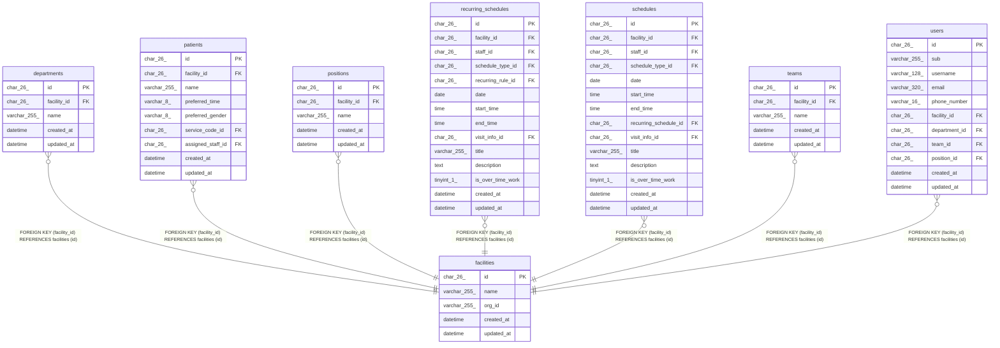

# facilities

## Description

訪問看護の事業所

<details>
<summary><strong>Table Definition</strong></summary>

```sql
CREATE TABLE `facilities` (
  `id` char(26) NOT NULL,
  `name` varchar(255) NOT NULL,
  `org_id` varchar(255) DEFAULT NULL,
  `created_at` datetime NOT NULL DEFAULT CURRENT_TIMESTAMP,
  `updated_at` datetime NOT NULL DEFAULT CURRENT_TIMESTAMP ON UPDATE CURRENT_TIMESTAMP,
  PRIMARY KEY (`id`),
  UNIQUE KEY `uq_facilities_org_id` (`org_id`)
) ENGINE=InnoDB DEFAULT CHARSET=utf8mb4 COLLATE=utf8mb4_0900_ai_ci
```

</details>

## Columns

| Name       | Type         | Default           | Nullable | Extra Definition                              | Children                                                                                                                                                                                    | Parents | Comment                                    |
| ---------- | ------------ | ----------------- | -------- | --------------------------------------------- | ------------------------------------------------------------------------------------------------------------------------------------------------------------------------------------------- | ------- | ------------------------------------------ |
| id         | char(26)     |                   | false    |                                               | [departments](departments.md) [patients](patients.md) [positions](positions.md) [recurring_schedules](recurring_schedules.md) [schedules](schedules.md) [teams](teams.md) [users](users.md) |         |                                            |
| name       | varchar(255) |                   | false    |                                               |                                                                                                                                                                                             |         | 事業所名                                   |
| org_id     | varchar(255) |                   | true     |                                               |                                                                                                                                                                                             |         | ブローカーの組織の ID。結び付けるまで NULL |
| created_at | datetime     | CURRENT_TIMESTAMP | false    | DEFAULT_GENERATED                             |                                                                                                                                                                                             |         |                                            |
| updated_at | datetime     | CURRENT_TIMESTAMP | false    | DEFAULT_GENERATED on update CURRENT_TIMESTAMP |                                                                                                                                                                                             |         |                                            |

## Viewpoints

| Name                                      | Definition                                                                             |
| ----------------------------------------- | -------------------------------------------------------------------------------------- |
| [事業所と組織](viewpoint-organization.md) | 事業所と、その中の部署、チーム、役職、職員                                             |
| [利用者](viewpoint-patients.md)           | 利用者と、受けているサービスと、主に担当する職員                                       |
| [予定と訪問](viewpoint-schedules.md)      | 予定と、訪問のときの訪問の情報と区分、予定の取り消し                                   |
| [繰り返しの予定](viewpoint-recurring.md)  | 繰り返しの規則と予定、回にしない日。繰り返しの 1 回を置き換えた予定は schedules に入る |

## Constraints

| Name                 | Type        | Definition                               |
| -------------------- | ----------- | ---------------------------------------- |
| PRIMARY              | PRIMARY KEY | PRIMARY KEY (id)                         |
| uq_facilities_org_id | UNIQUE      | UNIQUE KEY uq_facilities_org_id (org_id) |

## Indexes

| Name                 | Definition                                           |
| -------------------- | ---------------------------------------------------- |
| PRIMARY              | PRIMARY KEY (id) USING BTREE                         |
| uq_facilities_org_id | UNIQUE KEY uq_facilities_org_id (org_id) USING BTREE |

## Relations



---

> Generated by [tbls](https://github.com/k1LoW/tbls)
