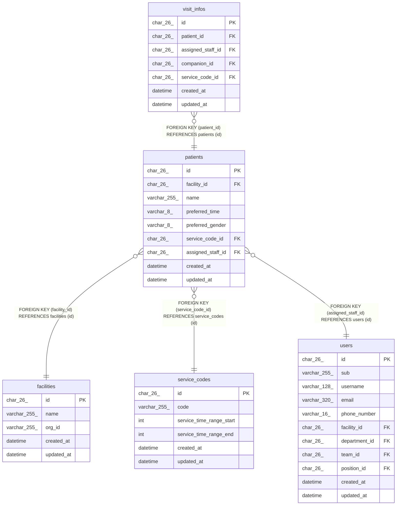

# patients

## Description

利用者

<details>
<summary><strong>Table Definition</strong></summary>

```sql
CREATE TABLE `patients` (
  `id` char(26) NOT NULL,
  `facility_id` char(26) NOT NULL,
  `name` varchar(255) NOT NULL,
  `preferred_time` varchar(8) NOT NULL,
  `preferred_gender` varchar(8) NOT NULL,
  `service_code_id` char(26) NOT NULL,
  `assigned_staff_id` char(26) NOT NULL,
  `created_at` datetime NOT NULL DEFAULT CURRENT_TIMESTAMP,
  `updated_at` datetime NOT NULL DEFAULT CURRENT_TIMESTAMP ON UPDATE CURRENT_TIMESTAMP,
  PRIMARY KEY (`id`),
  KEY `idx_patients_facility` (`facility_id`),
  KEY `fk_patients_service_code` (`service_code_id`),
  KEY `fk_patients_assigned_staff` (`assigned_staff_id`),
  CONSTRAINT `fk_patients_assigned_staff` FOREIGN KEY (`assigned_staff_id`) REFERENCES `users` (`id`),
  CONSTRAINT `fk_patients_facility` FOREIGN KEY (`facility_id`) REFERENCES `facilities` (`id`),
  CONSTRAINT `fk_patients_service_code` FOREIGN KEY (`service_code_id`) REFERENCES `service_codes` (`id`),
  CONSTRAINT `chk_patients_preferred_gender` CHECK ((`preferred_gender` in (_utf8mb4'男性',_utf8mb4'女性'))),
  CONSTRAINT `chk_patients_preferred_time` CHECK ((`preferred_time` in (_utf8mb4'午前',_utf8mb4'午後')))
) ENGINE=InnoDB DEFAULT CHARSET=utf8mb4 COLLATE=utf8mb4_0900_ai_ci
```

</details>

## Columns

| Name              | Type         | Default           | Nullable | Extra Definition                              | Children                      | Parents                           | Comment                          |
| ----------------- | ------------ | ----------------- | -------- | --------------------------------------------- | ----------------------------- | --------------------------------- | -------------------------------- |
| id                | char(26)     |                   | false    |                                               | [visit_infos](visit_infos.md) |                                   |                                  |
| facility_id       | char(26)     |                   | false    |                                               |                               | [facilities](facilities.md)       |                                  |
| name              | varchar(255) |                   | false    |                                               |                               |                                   |                                  |
| preferred_time    | varchar(8)   |                   | false    |                                               |                               |                                   | 希望の時間帯（午前、午後）       |
| preferred_gender  | varchar(8)   |                   | false    |                                               |                               |                                   | 希望の訪問者の性別（男性、女性） |
| service_code_id   | char(26)     |                   | false    |                                               |                               | [service_codes](service_codes.md) | 受けているサービス               |
| assigned_staff_id | char(26)     |                   | false    |                                               |                               | [users](users.md)                 | 主に担当する職員                 |
| created_at        | datetime     | CURRENT_TIMESTAMP | false    | DEFAULT_GENERATED                             |                               |                                   |                                  |
| updated_at        | datetime     | CURRENT_TIMESTAMP | false    | DEFAULT_GENERATED on update CURRENT_TIMESTAMP |                               |                                   |                                  |

## Viewpoints

| Name                                 | Definition                                           |
| ------------------------------------ | ---------------------------------------------------- |
| [利用者](viewpoint-patients.md)      | 利用者と、受けているサービスと、主に担当する職員     |
| [予定と訪問](viewpoint-schedules.md) | 予定と、訪問のときの訪問の情報と区分、予定の取り消し |

## Constraints

| Name                          | Type        | Definition                                                           |
| ----------------------------- | ----------- | -------------------------------------------------------------------- |
| fk_patients_assigned_staff    | FOREIGN KEY | FOREIGN KEY (assigned_staff_id) REFERENCES users (id)                |
| fk_patients_facility          | FOREIGN KEY | FOREIGN KEY (facility_id) REFERENCES facilities (id)                 |
| fk_patients_service_code      | FOREIGN KEY | FOREIGN KEY (service_code_id) REFERENCES service_codes (id)          |
| PRIMARY                       | PRIMARY KEY | PRIMARY KEY (id)                                                     |
| chk_patients_preferred_gender | CHECK       | CHECK ((`preferred_gender` in (_utf8mb4\'男性\',_utf8mb4\'女性\'))) |
| chk_patients_preferred_time   | CHECK       | CHECK ((`preferred_time` in (_utf8mb4\'午前\',_utf8mb4\'午後\')))       |

## Indexes

| Name                       | Definition                                                     |
| -------------------------- | -------------------------------------------------------------- |
| fk_patients_assigned_staff | KEY fk_patients_assigned_staff (assigned_staff_id) USING BTREE |
| fk_patients_service_code   | KEY fk_patients_service_code (service_code_id) USING BTREE     |
| idx_patients_facility      | KEY idx_patients_facility (facility_id) USING BTREE            |
| PRIMARY                    | PRIMARY KEY (id) USING BTREE                                   |

## Relations



---

> Generated by [tbls](https://github.com/k1LoW/tbls)
