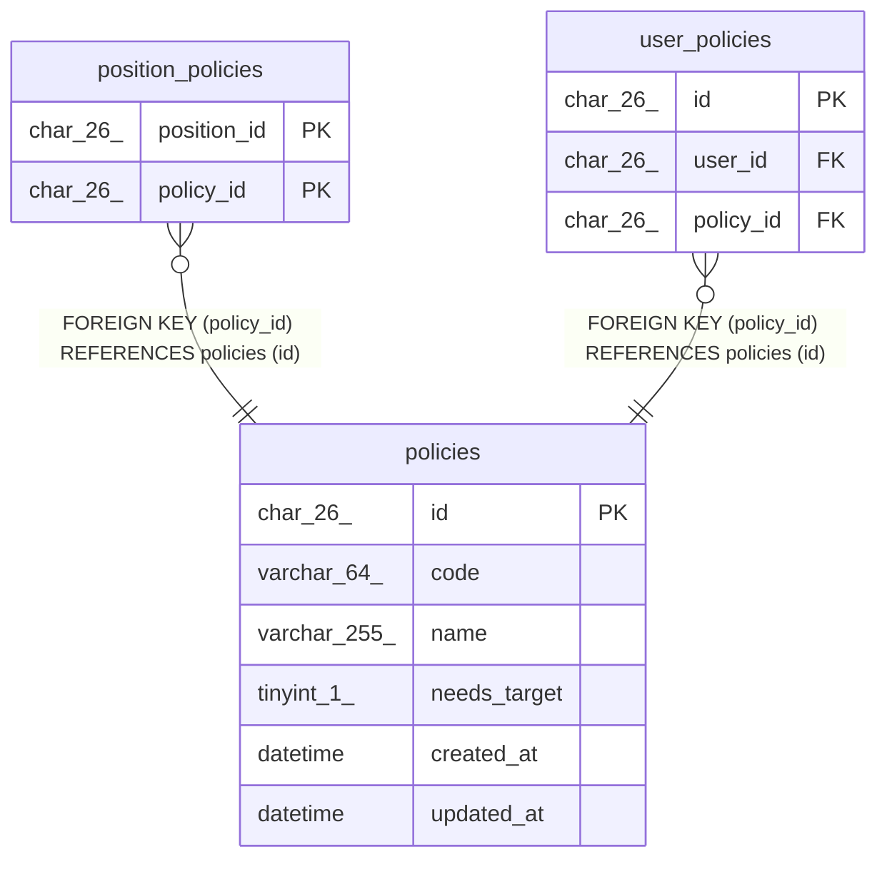

# policies

## Description

権限。マイグレーションで入れ、API では作らない

<details>
<summary><strong>Table Definition</strong></summary>

```sql
CREATE TABLE `policies` (
  `id` char(26) NOT NULL,
  `code` varchar(64) NOT NULL,
  `name` varchar(255) NOT NULL,
  `needs_target` tinyint(1) NOT NULL DEFAULT '0',
  `created_at` datetime NOT NULL DEFAULT CURRENT_TIMESTAMP,
  `updated_at` datetime NOT NULL DEFAULT CURRENT_TIMESTAMP ON UPDATE CURRENT_TIMESTAMP,
  PRIMARY KEY (`id`),
  UNIQUE KEY `uq_policies_name` (`name`),
  UNIQUE KEY `uq_policies_code` (`code`)
) ENGINE=InnoDB DEFAULT CHARSET=utf8mb4 COLLATE=utf8mb4_0900_ai_ci
```

</details>

## Columns

| Name         | Type         | Default           | Nullable | Extra Definition                              | Children                                                                    | Parents | Comment                        |
| ------------ | ------------ | ----------------- | -------- | --------------------------------------------- | --------------------------------------------------------------------------- | ------- | ------------------------------ |
| id           | char(26)     |                   | false    |                                               | [position_policies](position_policies.md) [user_policies](user_policies.md) |         |                                |
| code         | varchar(64)  |                   | false    |                                               |                                                                             |         | 認可が読む識別子               |
| name         | varchar(255) |                   | false    |                                               |                                                                             |         | 権限の名前                     |
| needs_target | tinyint(1)   | 0                 | false    |                                               |                                                                             |         | 対象の職員かチームを指定するか |
| created_at   | datetime     | CURRENT_TIMESTAMP | false    | DEFAULT_GENERATED                             |                                                                             |         |                                |
| updated_at   | datetime     | CURRENT_TIMESTAMP | false    | DEFAULT_GENERATED on update CURRENT_TIMESTAMP |                                                                             |         |                                |

## Viewpoints

| Name                                | Definition                                                             |
| ----------------------------------- | ---------------------------------------------------------------------- |
| [職員と権限](viewpoint-policies.md) | 職員が持つ権限と、その対象。職員を登録するとき、役職の既定の権限を写す |

## Constraints

| Name             | Type        | Definition                         |
| ---------------- | ----------- | ---------------------------------- |
| PRIMARY          | PRIMARY KEY | PRIMARY KEY (id)                   |
| uq_policies_code | UNIQUE      | UNIQUE KEY uq_policies_code (code) |
| uq_policies_name | UNIQUE      | UNIQUE KEY uq_policies_name (name) |

## Indexes

| Name             | Definition                                     |
| ---------------- | ---------------------------------------------- |
| PRIMARY          | PRIMARY KEY (id) USING BTREE                   |
| uq_policies_code | UNIQUE KEY uq_policies_code (code) USING BTREE |
| uq_policies_name | UNIQUE KEY uq_policies_name (name) USING BTREE |

## Relations



---

> Generated by [tbls](https://github.com/k1LoW/tbls)
