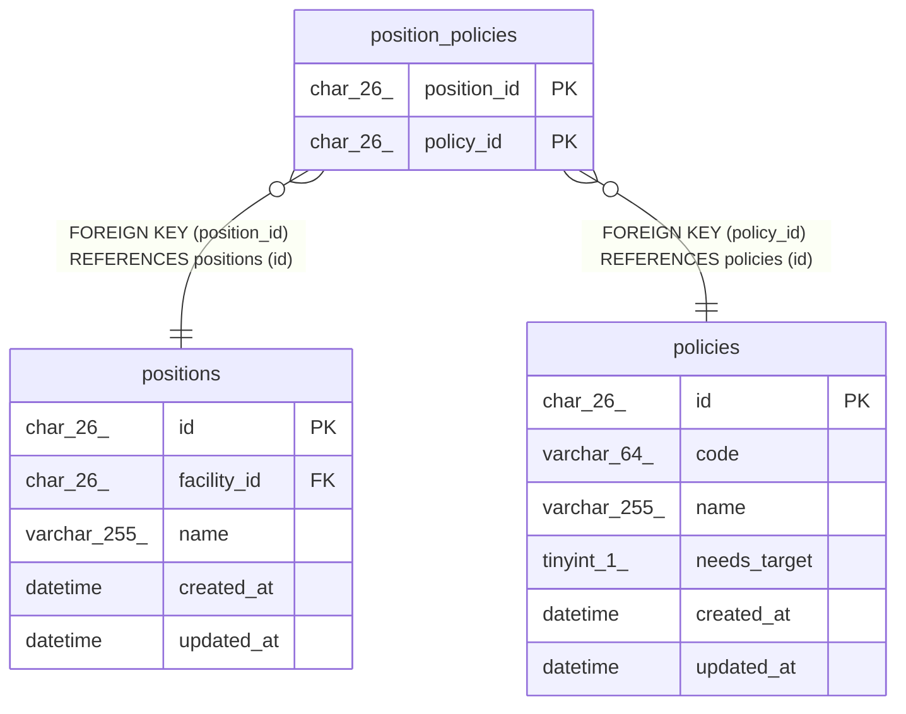

# position_policies

## Description

役職の既定の権限

<details>
<summary><strong>Table Definition</strong></summary>

```sql
CREATE TABLE `position_policies` (
  `position_id` char(26) NOT NULL,
  `policy_id` char(26) NOT NULL,
  PRIMARY KEY (`position_id`,`policy_id`),
  KEY `fk_position_policies_policy` (`policy_id`),
  CONSTRAINT `fk_position_policies_policy` FOREIGN KEY (`policy_id`) REFERENCES `policies` (`id`),
  CONSTRAINT `fk_position_policies_position` FOREIGN KEY (`position_id`) REFERENCES `positions` (`id`) ON DELETE CASCADE
) ENGINE=InnoDB DEFAULT CHARSET=utf8mb4 COLLATE=utf8mb4_0900_ai_ci
```

</details>

## Columns

| Name        | Type     | Default | Nullable | Children | Parents                   | Comment |
| ----------- | -------- | ------- | -------- | -------- | ------------------------- | ------- |
| position_id | char(26) |         | false    |          | [positions](positions.md) |         |
| policy_id   | char(26) |         | false    |          | [policies](policies.md)   |         |

## Constraints

| Name                          | Type        | Definition                                          |
| ----------------------------- | ----------- | --------------------------------------------------- |
| fk_position_policies_policy   | FOREIGN KEY | FOREIGN KEY (policy_id) REFERENCES policies (id)    |
| fk_position_policies_position | FOREIGN KEY | FOREIGN KEY (position_id) REFERENCES positions (id) |
| PRIMARY                       | PRIMARY KEY | PRIMARY KEY (position_id, policy_id)                |

## Indexes

| Name                        | Definition                                              |
| --------------------------- | ------------------------------------------------------- |
| fk_position_policies_policy | KEY fk_position_policies_policy (policy_id) USING BTREE |
| PRIMARY                     | PRIMARY KEY (position_id, policy_id) USING BTREE        |

## Relations



---

> Generated by [tbls](https://github.com/k1LoW/tbls)
