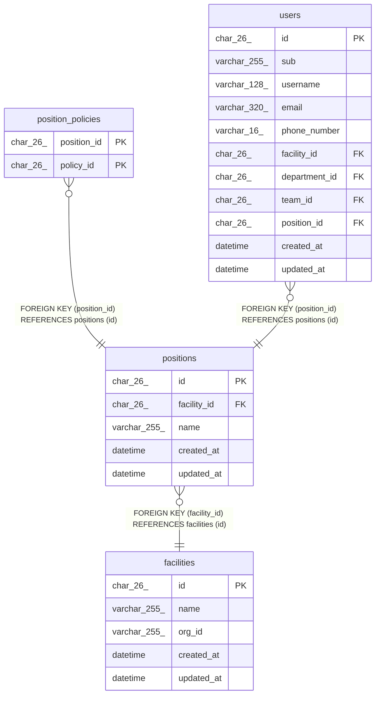

# positions

## Description

事業所の役職。職員を登録するときに写す既定の権限を持つ

<details>
<summary><strong>Table Definition</strong></summary>

```sql
CREATE TABLE `positions` (
  `id` char(26) NOT NULL,
  `facility_id` char(26) NOT NULL,
  `name` varchar(255) NOT NULL,
  `created_at` datetime NOT NULL DEFAULT CURRENT_TIMESTAMP,
  `updated_at` datetime NOT NULL DEFAULT CURRENT_TIMESTAMP ON UPDATE CURRENT_TIMESTAMP,
  PRIMARY KEY (`id`),
  UNIQUE KEY `uq_positions_facility_name` (`facility_id`,`name`),
  CONSTRAINT `fk_positions_facility` FOREIGN KEY (`facility_id`) REFERENCES `facilities` (`id`)
) ENGINE=InnoDB DEFAULT CHARSET=utf8mb4 COLLATE=utf8mb4_0900_ai_ci
```

</details>

## Columns

| Name        | Type         | Default           | Nullable | Extra Definition                              | Children                                                    | Parents                     | Comment          |
| ----------- | ------------ | ----------------- | -------- | --------------------------------------------- | ----------------------------------------------------------- | --------------------------- | ---------------- |
| id          | char(26)     |                   | false    |                                               | [position_policies](position_policies.md) [users](users.md) |                             |                  |
| facility_id | char(26)     |                   | false    |                                               |                                                             | [facilities](facilities.md) |                  |
| name        | varchar(255) |                   | false    |                                               |                                                             |                             | 事業所の中で一意 |
| created_at  | datetime     | CURRENT_TIMESTAMP | false    | DEFAULT_GENERATED                             |                                                             |                             |                  |
| updated_at  | datetime     | CURRENT_TIMESTAMP | false    | DEFAULT_GENERATED on update CURRENT_TIMESTAMP |                                                             |                             |                  |

## Viewpoints

| Name                                      | Definition                                                             |
| ----------------------------------------- | ---------------------------------------------------------------------- |
| [事業所と組織](viewpoint-organization.md) | 事業所と、その中の部署、チーム、役職、職員                             |
| [職員と権限](viewpoint-policies.md)       | 職員が持つ権限と、その対象。職員を登録するとき、役職の既定の権限を写す |

## Constraints

| Name                       | Type        | Definition                                                |
| -------------------------- | ----------- | --------------------------------------------------------- |
| fk_positions_facility      | FOREIGN KEY | FOREIGN KEY (facility_id) REFERENCES facilities (id)      |
| PRIMARY                    | PRIMARY KEY | PRIMARY KEY (id)                                          |
| uq_positions_facility_name | UNIQUE      | UNIQUE KEY uq_positions_facility_name (facility_id, name) |

## Indexes

| Name                       | Definition                                                            |
| -------------------------- | --------------------------------------------------------------------- |
| PRIMARY                    | PRIMARY KEY (id) USING BTREE                                          |
| uq_positions_facility_name | UNIQUE KEY uq_positions_facility_name (facility_id, name) USING BTREE |

## Relations



---

> Generated by [tbls](https://github.com/k1LoW/tbls)
