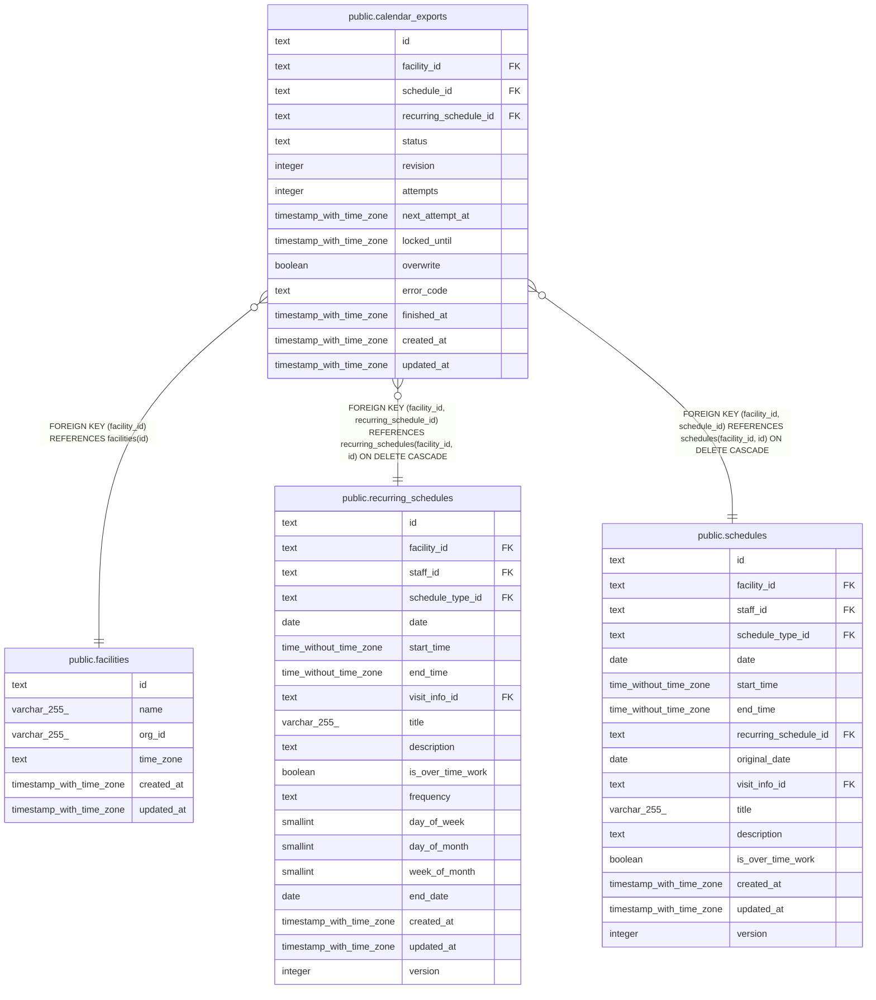

# public.calendar_exports

## Description

予定を外部のカレンダーに書き出す待ち。予定の変更と同じトランザクションで積む

## Columns

| Name                  | Type                     | Default         | Nullable | Children | Parents                                                                                                                                       | Comment                                                                                      |
| --------------------- | ------------------------ | --------------- | -------- | -------- | --------------------------------------------------------------------------------------------------------------------------------------------- | -------------------------------------------------------------------------------------------- |
| id                    | text                     |                 | false    |          |                                                                                                                                               |                                                                                              |
| facility_id           | text                     |                 | false    |          | [public.facilities](public.facilities.md) [public.recurring_schedules](public.recurring_schedules.md) [public.schedules](public.schedules.md) |                                                                                              |
| schedule_id           | text                     |                 | true     |          | [public.schedules](public.schedules.md)                                                                                                       |                                                                                              |
| recurring_schedule_id | text                     |                 | true     |          | [public.recurring_schedules](public.recurring_schedules.md)                                                                                   |                                                                                              |
| status                | text                     | 'pending'::text | false    |          |                                                                                                                                               | pending（書く）、succeeded（書いた）、conflict（外部で変わっていた）、failed（書けなかった） |
| revision              | integer                  | 1               | false    |          |                                                                                                                                               | 終わっていない行に積み直した回数に 1 を足した値。書いている間に積み直されたかを比べる        |
| attempts              | integer                  | 0               | false    |          |                                                                                                                                               | 書こうとした回数。再送の間隔と上限に使う                                                     |
| next_attempt_at       | timestamp with time zone | now()           | false    |          |                                                                                                                                               | この時刻より後に書く                                                                         |
| locked_until          | timestamp with time zone |                 | true     |          |                                                                                                                                               | 書いている処理が持つ期限。過ぎたら、ほかの処理が書いてよい                                   |
| overwrite             | boolean                  | false           | false    |          |                                                                                                                                               | 外部の予定の etag を比べずに、buddy の内容で書き直すか                                       |
| error_code            | text                     |                 | true     |          |                                                                                                                                               | 最後に書けなかった理由。外部の予定の題名とカレンダーの ID を含めない                         |
| finished_at           | timestamp with time zone |                 | true     |          |                                                                                                                                               |                                                                                              |
| created_at            | timestamp with time zone | now()           | false    |          |                                                                                                                                               |                                                                                              |
| updated_at            | timestamp with time zone | now()           | false    |          |                                                                                                                                               |                                                                                              |

## Viewpoints

| Name                                                               | Definition                                                                                 |
| ------------------------------------------------------------------ | ------------------------------------------------------------------------------------------ |
| [外部のカレンダーの取り込みと書き出し](viewpoint-calendar-sync.md) | 職員の外部のカレンダーと同期の状態、外部の予定と予定の対応、取り込みの記録、書き出しの待ち |

## Constraints

| Name                                      | Type        | Definition                                                                                                                                   |
| ----------------------------------------- | ----------- | -------------------------------------------------------------------------------------------------------------------------------------------- |
| calendar_exports_attempts_not_null        | n           | NOT NULL attempts                                                                                                                            |
| calendar_exports_count_check              | CHECK       | CHECK (((revision >= 1) AND (attempts >= 0)))                                                                                                |
| calendar_exports_created_at_not_null      | n           | NOT NULL created_at                                                                                                                          |
| calendar_exports_error_code_check         | CHECK       | CHECK ((error_code = ANY (ARRAY['precondition_failed'::text, 'not_found'::text, 'forbidden'::text, 'rejected'::text, 'unavailable'::text]))) |
| calendar_exports_facility_id_not_null     | n           | NOT NULL facility_id                                                                                                                         |
| calendar_exports_finished_check           | CHECK       | CHECK (((status = 'succeeded'::text) = (finished_at IS NOT NULL)))                                                                           |
| calendar_exports_id_check                 | CHECK       | CHECK ((id ~ '^[0-7][0-9A-HJKMNP-TV-Z]{25}$'::text))                                                                                         |
| calendar_exports_id_not_null              | n           | NOT NULL id                                                                                                                                  |
| calendar_exports_next_attempt_at_not_null | n           | NOT NULL next_attempt_at                                                                                                                     |
| calendar_exports_overwrite_not_null       | n           | NOT NULL overwrite                                                                                                                           |
| calendar_exports_revision_not_null        | n           | NOT NULL revision                                                                                                                            |
| calendar_exports_status_check             | CHECK       | CHECK ((status = ANY (ARRAY['pending'::text, 'succeeded'::text, 'conflict'::text, 'failed'::text])))                                         |
| calendar_exports_status_not_null          | n           | NOT NULL status                                                                                                                              |
| calendar_exports_target_check             | CHECK       | CHECK ((num_nonnulls(schedule_id, recurring_schedule_id) = 1))                                                                               |
| calendar_exports_updated_at_not_null      | n           | NOT NULL updated_at                                                                                                                          |
| calendar_exports_facility_fkey            | FOREIGN KEY | FOREIGN KEY (facility_id) REFERENCES facilities(id)                                                                                          |
| calendar_exports_recurring_schedule_fkey  | FOREIGN KEY | FOREIGN KEY (facility_id, recurring_schedule_id) REFERENCES recurring_schedules(facility_id, id) ON DELETE CASCADE                           |
| calendar_exports_schedule_fkey            | FOREIGN KEY | FOREIGN KEY (facility_id, schedule_id) REFERENCES schedules(facility_id, id) ON DELETE CASCADE                                               |
| calendar_exports_pkey                     | PRIMARY KEY | PRIMARY KEY (id)                                                                                                                             |
| calendar_exports_facility_id_key          | UNIQUE      | UNIQUE (facility_id, id)                                                                                                                     |

## Indexes

| Name                                             | Definition                                                                                                                                                                                                    |
| ------------------------------------------------ | ------------------------------------------------------------------------------------------------------------------------------------------------------------------------------------------------------------- |
| calendar_exports_pkey                            | CREATE UNIQUE INDEX calendar_exports_pkey ON public.calendar_exports USING btree (id)                                                                                                                         |
| calendar_exports_facility_id_key                 | CREATE UNIQUE INDEX calendar_exports_facility_id_key ON public.calendar_exports USING btree (facility_id, id)                                                                                                 |
| calendar_exports_open_schedule_key               | CREATE UNIQUE INDEX calendar_exports_open_schedule_key ON public.calendar_exports USING btree (schedule_id) WHERE ((status <> 'succeeded'::text) AND (schedule_id IS NOT NULL))                               |
| calendar_exports_open_recurring_schedule_key     | CREATE UNIQUE INDEX calendar_exports_open_recurring_schedule_key ON public.calendar_exports USING btree (recurring_schedule_id) WHERE ((status <> 'succeeded'::text) AND (recurring_schedule_id IS NOT NULL)) |
| calendar_exports_due_idx                         | CREATE INDEX calendar_exports_due_idx ON public.calendar_exports USING btree (next_attempt_at, id) WHERE (status = 'pending'::text)                                                                           |
| calendar_exports_facility_status_idx             | CREATE INDEX calendar_exports_facility_status_idx ON public.calendar_exports USING btree (facility_id, status)                                                                                                |
| calendar_exports_facility_schedule_idx           | CREATE INDEX calendar_exports_facility_schedule_idx ON public.calendar_exports USING btree (facility_id, schedule_id) WHERE (schedule_id IS NOT NULL)                                                         |
| calendar_exports_facility_recurring_schedule_idx | CREATE INDEX calendar_exports_facility_recurring_schedule_idx ON public.calendar_exports USING btree (facility_id, recurring_schedule_id) WHERE (recurring_schedule_id IS NOT NULL)                           |

## Triggers

| Name                            | Definition                                                                                                                             |
| ------------------------------- | -------------------------------------------------------------------------------------------------------------------------------------- |
| calendar_exports_set_updated_at | CREATE TRIGGER calendar_exports_set_updated_at BEFORE UPDATE ON public.calendar_exports FOR EACH ROW EXECUTE FUNCTION set_updated_at() |

## Relations

---

> Generated by [tbls](https://github.com/k1LoW/tbls)
