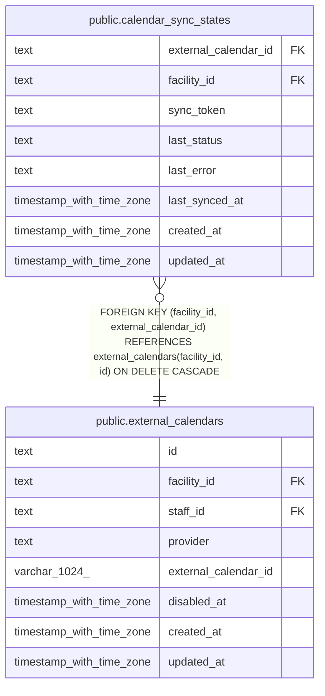

# public.calendar_sync_states

## Description

外部のカレンダーごとの同期の状態

## Columns

| Name                 | Type                     | Default | Nullable | Children | Parents                                                   | Comment                                                 |
| -------------------- | ------------------------ | ------- | -------- | -------- | --------------------------------------------------------- | ------------------------------------------------------- |
| external_calendar_id | text                     |         | false    |          | [public.external_calendars](public.external_calendars.md) |                                                         |
| facility_id          | text                     |         | false    |          | [public.external_calendars](public.external_calendars.md) |                                                         |
| sync_token           | text                     |         | true     |          |                                                           | 次の増分の取得に使うトークン。全件を取り直すときは NULL |
| last_status          | text                     |         | false    |          |                                                           | never、succeeded、failed                                |
| last_error           | text                     |         | true     |          |                                                           | 最後の失敗の理由。外部の予定の題名を含めない            |
| last_synced_at       | timestamp with time zone |         | true     |          |                                                           |                                                         |
| created_at           | timestamp with time zone | now()   | false    |          |                                                           |                                                         |
| updated_at           | timestamp with time zone | now()   | false    |          |                                                           |                                                         |

## Viewpoints

| Name                                                     | Definition                                                                 |
| -------------------------------------------------------- | -------------------------------------------------------------------------- |
| [外部のカレンダーの取り込み](viewpoint-calendar-sync.md) | 職員の外部のカレンダーと同期の状態、外部の予定と予定の対応、取り込みの記録 |

## Constraints

| Name                                               | Type        | Definition                                                                                                       |
| -------------------------------------------------- | ----------- | ---------------------------------------------------------------------------------------------------------------- |
| calendar_sync_states_created_at_not_null           | n           | NOT NULL created_at                                                                                              |
| calendar_sync_states_external_calendar_id_not_null | n           | NOT NULL external_calendar_id                                                                                    |
| calendar_sync_states_facility_id_not_null          | n           | NOT NULL facility_id                                                                                             |
| calendar_sync_states_last_status_check             | CHECK       | CHECK ((last_status = ANY (ARRAY['never'::text, 'succeeded'::text, 'failed'::text])))                            |
| calendar_sync_states_last_status_not_null          | n           | NOT NULL last_status                                                                                             |
| calendar_sync_states_updated_at_not_null           | n           | NOT NULL updated_at                                                                                              |
| calendar_sync_states_calendar_fkey                 | FOREIGN KEY | FOREIGN KEY (facility_id, external_calendar_id) REFERENCES external_calendars(facility_id, id) ON DELETE CASCADE |
| calendar_sync_states_pkey                          | PRIMARY KEY | PRIMARY KEY (external_calendar_id)                                                                               |

## Indexes

| Name                                       | Definition                                                                                                                             |
| ------------------------------------------ | -------------------------------------------------------------------------------------------------------------------------------------- |
| calendar_sync_states_pkey                  | CREATE UNIQUE INDEX calendar_sync_states_pkey ON public.calendar_sync_states USING btree (external_calendar_id)                        |
| calendar_sync_states_facility_calendar_idx | CREATE INDEX calendar_sync_states_facility_calendar_idx ON public.calendar_sync_states USING btree (facility_id, external_calendar_id) |

## Triggers

| Name                                | Definition                                                                                                                                     |
| ----------------------------------- | ---------------------------------------------------------------------------------------------------------------------------------------------- |
| calendar_sync_states_set_updated_at | CREATE TRIGGER calendar_sync_states_set_updated_at BEFORE UPDATE ON public.calendar_sync_states FOR EACH ROW EXECUTE FUNCTION set_updated_at() |

## Relations

---

> Generated by [tbls](https://github.com/k1LoW/tbls)
