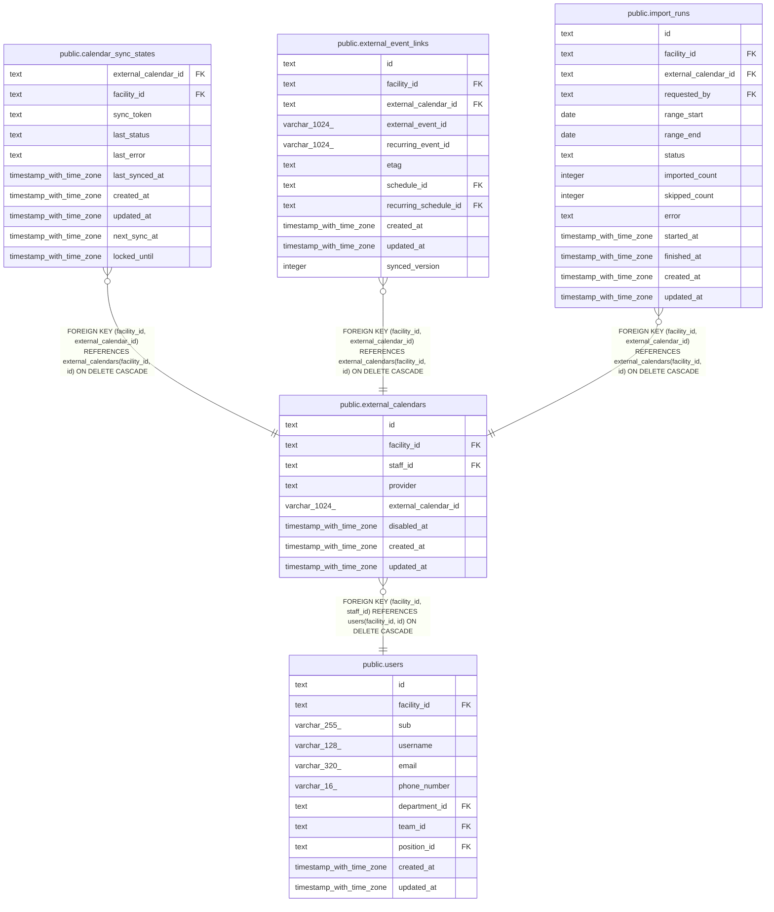

# public.external_calendars

## Description

取り込む外部のカレンダーと、その持ち主の職員。外していないものは職員ごとに 1 つ

## Columns

| Name                 | Type                     | Default | Nullable | Children                                                                                                                                                                | Parents                         | Comment                                                               |
| -------------------- | ------------------------ | ------- | -------- | ----------------------------------------------------------------------------------------------------------------------------------------------------------------------- | ------------------------------- | --------------------------------------------------------------------- |
| id                   | text                     |         | false    | [public.calendar_sync_states](public.calendar_sync_states.md) [public.external_event_links](public.external_event_links.md) [public.import_runs](public.import_runs.md) |                                 |                                                                       |
| facility_id          | text                     |         | false    | [public.calendar_sync_states](public.calendar_sync_states.md) [public.external_event_links](public.external_event_links.md) [public.import_runs](public.import_runs.md) | [public.users](public.users.md) |                                                                       |
| staff_id             | text                     |         | false    |                                                                                                                                                                         | [public.users](public.users.md) |                                                                       |
| provider             | text                     |         | false    |                                                                                                                                                                         |                                 | google                                                                |
| external_calendar_id | varchar(1024)            |         | false    |                                                                                                                                                                         |                                 | 外部のカレンダーの ID。サービスアカウントに共有されたもの             |
| disabled_at          | timestamp with time zone |         | true     |                                                                                                                                                                         |                                 | 外した時刻。外しても行と外部の予定との対応は残す。NULL なら使っている |
| created_at           | timestamp with time zone | now()   | false    |                                                                                                                                                                         |                                 |                                                                       |
| updated_at           | timestamp with time zone | now()   | false    |                                                                                                                                                                         |                                 |                                                                       |

## Viewpoints

| Name                                                               | Definition                                                                                 |
| ------------------------------------------------------------------ | ------------------------------------------------------------------------------------------ |
| [外部のカレンダーの取り込みと書き出し](viewpoint-calendar-sync.md) | 職員の外部のカレンダーと同期の状態、外部の予定と予定の対応、取り込みの記録、書き出しの待ち |

## Constraints

| Name                                             | Type        | Definition                                                                              |
| ------------------------------------------------ | ----------- | --------------------------------------------------------------------------------------- |
| external_calendars_created_at_not_null           | n           | NOT NULL created_at                                                                     |
| external_calendars_external_calendar_id_not_null | n           | NOT NULL external_calendar_id                                                           |
| external_calendars_facility_id_not_null          | n           | NOT NULL facility_id                                                                    |
| external_calendars_id_check                      | CHECK       | CHECK ((id ~ '^[0-7][0-9A-HJKMNP-TV-Z]{25}$'::text))                                    |
| external_calendars_id_not_null                   | n           | NOT NULL id                                                                             |
| external_calendars_provider_check                | CHECK       | CHECK ((provider = 'google'::text))                                                     |
| external_calendars_provider_not_null             | n           | NOT NULL provider                                                                       |
| external_calendars_staff_id_not_null             | n           | NOT NULL staff_id                                                                       |
| external_calendars_updated_at_not_null           | n           | NOT NULL updated_at                                                                     |
| external_calendars_staff_fkey                    | FOREIGN KEY | FOREIGN KEY (facility_id, staff_id) REFERENCES users(facility_id, id) ON DELETE CASCADE |
| external_calendars_pkey                          | PRIMARY KEY | PRIMARY KEY (id)                                                                        |
| external_calendars_external_key                  | UNIQUE      | UNIQUE (provider, external_calendar_id)                                                 |
| external_calendars_facility_id_key               | UNIQUE      | UNIQUE (facility_id, id)                                                                |

## Indexes

| Name                                  | Definition                                                                                                                                 |
| ------------------------------------- | ------------------------------------------------------------------------------------------------------------------------------------------ |
| external_calendars_pkey               | CREATE UNIQUE INDEX external_calendars_pkey ON public.external_calendars USING btree (id)                                                  |
| external_calendars_external_key       | CREATE UNIQUE INDEX external_calendars_external_key ON public.external_calendars USING btree (provider, external_calendar_id)              |
| external_calendars_facility_id_key    | CREATE UNIQUE INDEX external_calendars_facility_id_key ON public.external_calendars USING btree (facility_id, id)                          |
| external_calendars_staff_key          | CREATE UNIQUE INDEX external_calendars_staff_key ON public.external_calendars USING btree (staff_id, provider) WHERE (disabled_at IS NULL) |
| external_calendars_facility_staff_idx | CREATE INDEX external_calendars_facility_staff_idx ON public.external_calendars USING btree (facility_id, staff_id)                        |

## Triggers

| Name                              | Definition                                                                                                                                 |
| --------------------------------- | ------------------------------------------------------------------------------------------------------------------------------------------ |
| external_calendars_set_updated_at | CREATE TRIGGER external_calendars_set_updated_at BEFORE UPDATE ON public.external_calendars FOR EACH ROW EXECUTE FUNCTION set_updated_at() |

## Relations

---

> Generated by [tbls](https://github.com/k1LoW/tbls)
