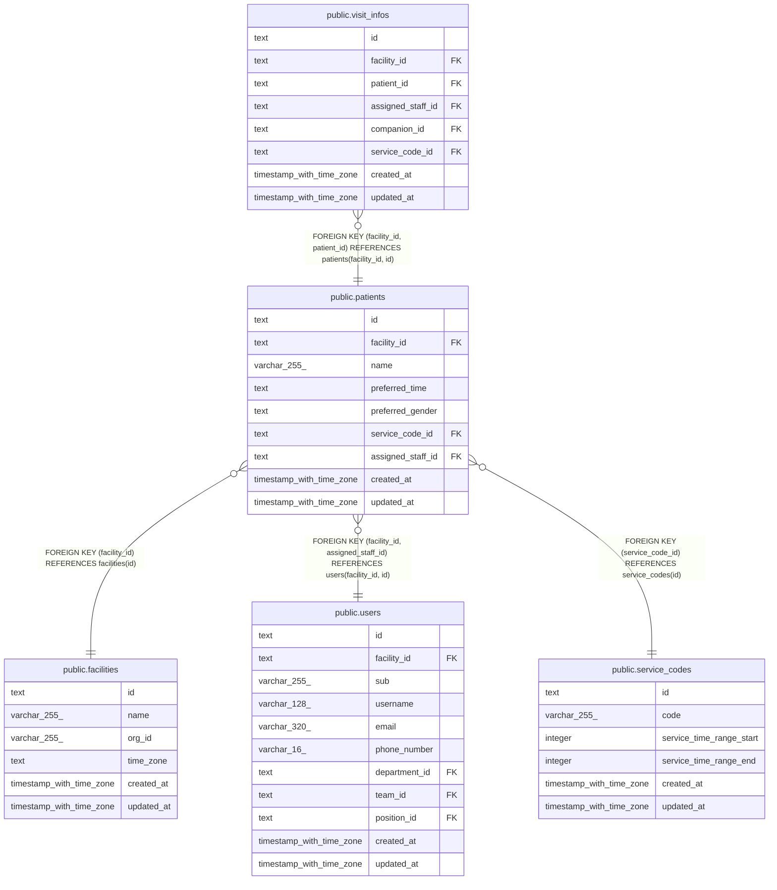

# public.patients

## Description

利用者

## Columns

| Name              | Type                     | Default | Nullable | Children                                    | Parents                                                                   | Comment                          |
| ----------------- | ------------------------ | ------- | -------- | ------------------------------------------- | ------------------------------------------------------------------------- | -------------------------------- |
| id                | text                     |         | false    | [public.visit_infos](public.visit_infos.md) |                                                                           |                                  |
| facility_id       | text                     |         | false    | [public.visit_infos](public.visit_infos.md) | [public.facilities](public.facilities.md) [public.users](public.users.md) |                                  |
| name              | varchar(255)             |         | false    |                                             |                                                                           |                                  |
| preferred_time    | text                     |         | false    |                                             |                                                                           | 希望の時間帯（午前、午後）       |
| preferred_gender  | text                     |         | false    |                                             |                                                                           | 希望の訪問者の性別（男性、女性） |
| service_code_id   | text                     |         | false    |                                             | [public.service_codes](public.service_codes.md)                           | 受けているサービス               |
| assigned_staff_id | text                     |         | false    |                                             | [public.users](public.users.md)                                           | 主に担当する職員                 |
| created_at        | timestamp with time zone | now()   | false    |                                             |                                                                           |                                  |
| updated_at        | timestamp with time zone | now()   | false    |                                             |                                                                           |                                  |

## Viewpoints

| Name                                 | Definition                                           |
| ------------------------------------ | ---------------------------------------------------- |
| [利用者](viewpoint-patients.md)      | 利用者と、受けているサービスと、主に担当する職員     |
| [予定と訪問](viewpoint-schedules.md) | 予定と、訪問のときの訪問の情報と区分、予定の取り消し |

## Constraints

| Name                                | Type        | Definition                                                                     |
| ----------------------------------- | ----------- | ------------------------------------------------------------------------------ |
| patients_assigned_staff_id_not_null | n           | NOT NULL assigned_staff_id                                                     |
| patients_created_at_not_null        | n           | NOT NULL created_at                                                            |
| patients_facility_id_not_null       | n           | NOT NULL facility_id                                                           |
| patients_id_check                   | CHECK       | CHECK ((id ~ '^[0-7][0-9A-HJKMNP-TV-Z]{25}$'::text))                           |
| patients_id_not_null                | n           | NOT NULL id                                                                    |
| patients_name_not_null              | n           | NOT NULL name                                                                  |
| patients_preferred_gender_check     | CHECK       | CHECK ((preferred_gender = ANY (ARRAY['男性'::text, '女性'::text])))           |
| patients_preferred_gender_not_null  | n           | NOT NULL preferred_gender                                                      |
| patients_preferred_time_check       | CHECK       | CHECK ((preferred_time = ANY (ARRAY['午前'::text, '午後'::text])))             |
| patients_preferred_time_not_null    | n           | NOT NULL preferred_time                                                        |
| patients_service_code_id_not_null   | n           | NOT NULL service_code_id                                                       |
| patients_updated_at_not_null        | n           | NOT NULL updated_at                                                            |
| patients_facility_fkey              | FOREIGN KEY | FOREIGN KEY (facility_id) REFERENCES facilities(id)                            |
| patients_assigned_staff_fkey        | FOREIGN KEY | FOREIGN KEY (facility_id, assigned_staff_id) REFERENCES users(facility_id, id) |
| patients_service_code_fkey          | FOREIGN KEY | FOREIGN KEY (service_code_id) REFERENCES service_codes(id)                     |
| patients_pkey                       | PRIMARY KEY | PRIMARY KEY (id)                                                               |
| patients_facility_id_key            | UNIQUE      | UNIQUE (facility_id, id)                                                       |

## Indexes

| Name                        | Definition                                                                                               |
| --------------------------- | -------------------------------------------------------------------------------------------------------- |
| patients_pkey               | CREATE UNIQUE INDEX patients_pkey ON public.patients USING btree (id)                                    |
| patients_facility_id_key    | CREATE UNIQUE INDEX patients_facility_id_key ON public.patients USING btree (facility_id, id)            |
| patients_facility_name_idx  | CREATE INDEX patients_facility_name_idx ON public.patients USING btree (facility_id, name)               |
| patients_assigned_staff_idx | CREATE INDEX patients_assigned_staff_idx ON public.patients USING btree (facility_id, assigned_staff_id) |

## Triggers

| Name                    | Definition                                                                                                             |
| ----------------------- | ---------------------------------------------------------------------------------------------------------------------- |
| patients_set_updated_at | CREATE TRIGGER patients_set_updated_at BEFORE UPDATE ON public.patients FOR EACH ROW EXECUTE FUNCTION set_updated_at() |

## Relations

---

> Generated by [tbls](https://github.com/k1LoW/tbls)
