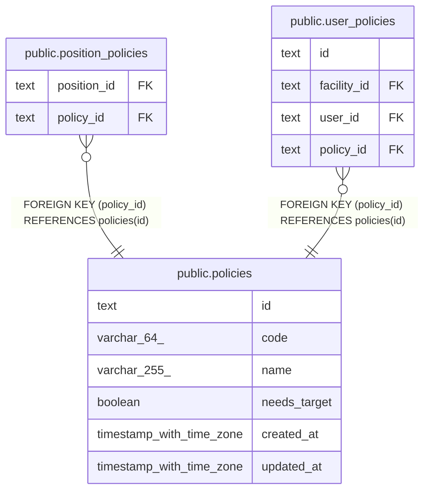

# public.policies

## Description

権限。マイグレーションで入れ、API では作らない

## Columns

| Name         | Type                     | Default | Nullable | Children                                                                                                | Parents | Comment                        |
| ------------ | ------------------------ | ------- | -------- | ------------------------------------------------------------------------------------------------------- | ------- | ------------------------------ |
| id           | text                     |         | false    | [public.position_policies](public.position_policies.md) [public.user_policies](public.user_policies.md) |         |                                |
| code         | varchar(64)              |         | false    |                                                                                                         |         | 認可が読む識別子               |
| name         | varchar(255)             |         | false    |                                                                                                         |         | 権限の名前                     |
| needs_target | boolean                  | false   | false    |                                                                                                         |         | 対象の職員かチームを指定するか |
| created_at   | timestamp with time zone | now()   | false    |                                                                                                         |         |                                |
| updated_at   | timestamp with time zone | now()   | false    |                                                                                                         |         |                                |

## Viewpoints

| Name                                | Definition                                                             |
| ----------------------------------- | ---------------------------------------------------------------------- |
| [職員と権限](viewpoint-policies.md) | 職員が持つ権限と、その対象。職員を登録するとき、役職の既定の権限を写す |

## Constraints

| Name                           | Type        | Definition                                           |
| ------------------------------ | ----------- | ---------------------------------------------------- |
| policies_code_not_null         | n           | NOT NULL code                                        |
| policies_created_at_not_null   | n           | NOT NULL created_at                                  |
| policies_id_check              | CHECK       | CHECK ((id ~ '^[0-7][0-9A-HJKMNP-TV-Z]{25}$'::text)) |
| policies_id_not_null           | n           | NOT NULL id                                          |
| policies_name_not_null         | n           | NOT NULL name                                        |
| policies_needs_target_not_null | n           | NOT NULL needs_target                                |
| policies_updated_at_not_null   | n           | NOT NULL updated_at                                  |
| policies_pkey                  | PRIMARY KEY | PRIMARY KEY (id)                                     |
| policies_code_key              | UNIQUE      | UNIQUE (code)                                        |
| policies_name_key              | UNIQUE      | UNIQUE (name)                                        |

## Indexes

| Name              | Definition                                                                  |
| ----------------- | --------------------------------------------------------------------------- |
| policies_pkey     | CREATE UNIQUE INDEX policies_pkey ON public.policies USING btree (id)       |
| policies_code_key | CREATE UNIQUE INDEX policies_code_key ON public.policies USING btree (code) |
| policies_name_key | CREATE UNIQUE INDEX policies_name_key ON public.policies USING btree (name) |

## Triggers

| Name                    | Definition                                                                                                             |
| ----------------------- | ---------------------------------------------------------------------------------------------------------------------- |
| policies_set_updated_at | CREATE TRIGGER policies_set_updated_at BEFORE UPDATE ON public.policies FOR EACH ROW EXECUTE FUNCTION set_updated_at() |

## Relations

---

> Generated by [tbls](https://github.com/k1LoW/tbls)
