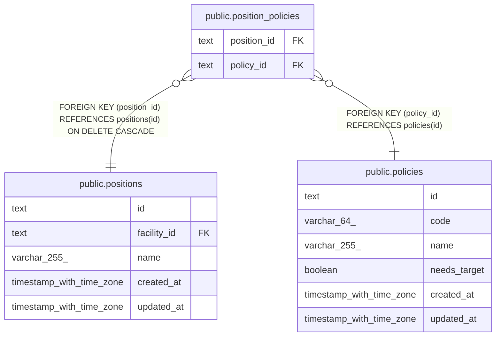

# public.position_policies

## Description

役職の既定の権限

## Columns

| Name        | Type | Default | Nullable | Children | Parents                                 | Comment |
| ----------- | ---- | ------- | -------- | -------- | --------------------------------------- | ------- |
| position_id | text |         | false    |          | [public.positions](public.positions.md) |         |
| policy_id   | text |         | false    |          | [public.policies](public.policies.md)   |         |

## Viewpoints

| Name                                | Definition                                                                         |
| ----------------------------------- | ---------------------------------------------------------------------------------- |
| [職員と権限](viewpoint-policies.md) | 職員が持つ権限と、その対象。職員を登録するとき、役職のデフォルトの権限をコピーする |

## Constraints

| Name                                   | Type        | Definition                                                           |
| -------------------------------------- | ----------- | -------------------------------------------------------------------- |
| position_policies_policy_id_not_null   | n           | NOT NULL policy_id                                                   |
| position_policies_position_id_not_null | n           | NOT NULL position_id                                                 |
| position_policies_position_fkey        | FOREIGN KEY | FOREIGN KEY (position_id) REFERENCES positions(id) ON DELETE CASCADE |
| position_policies_policy_fkey          | FOREIGN KEY | FOREIGN KEY (policy_id) REFERENCES policies(id)                      |
| position_policies_pkey                 | PRIMARY KEY | PRIMARY KEY (position_id, policy_id)                                 |

## Indexes

| Name                   | Definition                                                                                                  |
| ---------------------- | ----------------------------------------------------------------------------------------------------------- |
| position_policies_pkey | CREATE UNIQUE INDEX position_policies_pkey ON public.position_policies USING btree (position_id, policy_id) |

## Relations

---

> Generated by [tbls](https://github.com/k1LoW/tbls)
