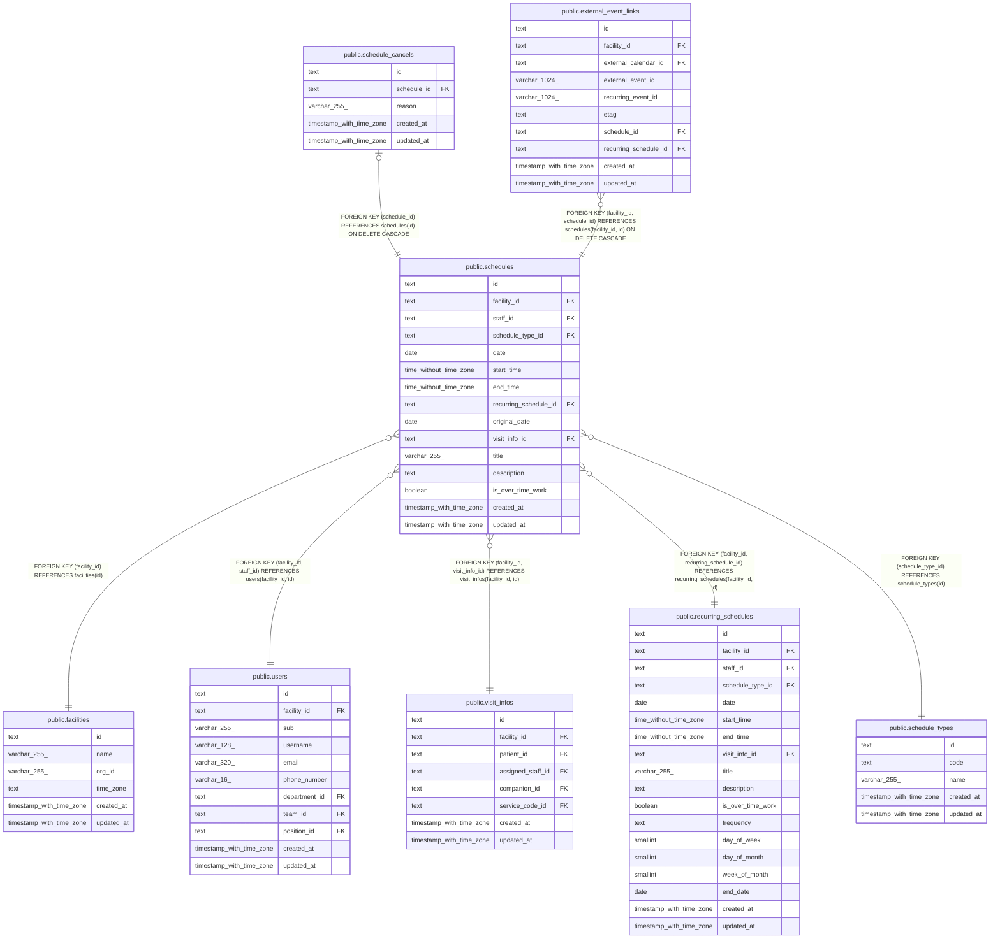

# public.schedules

## Description

予定

## Columns

| Name                  | Type                     | Default | Nullable | Extra Definition                                                               | Children                                                                                                            | Parents                                                                                                                                                                           | Comment                                                  |
| --------------------- | ------------------------ | ------- | -------- | ------------------------------------------------------------------------------ | ------------------------------------------------------------------------------------------------------------------- | --------------------------------------------------------------------------------------------------------------------------------------------------------------------------------- | -------------------------------------------------------- |
| id                    | text                     |         | false    |                                                                                | [public.schedule_cancels](public.schedule_cancels.md) [public.external_event_links](public.external_event_links.md) |                                                                                                                                                                                   |                                                          |
| facility_id           | text                     |         | false    |                                                                                | [public.external_event_links](public.external_event_links.md)                                                       | [public.facilities](public.facilities.md) [public.users](public.users.md) [public.visit_infos](public.visit_infos.md) [public.recurring_schedules](public.recurring_schedules.md) |                                                          |
| staff_id              | text                     |         | false    |                                                                                |                                                                                                                     | [public.users](public.users.md)                                                                                                                                                   |                                                          |
| schedule_type_id      | text                     |         | false    |                                                                                |                                                                                                                     | [public.schedule_types](public.schedule_types.md)                                                                                                                                 |                                                          |
| date                  | date                     |         | false    |                                                                                |                                                                                                                     |                                                                                                                                                                                   |                                                          |
| start_time            | time without time zone   |         | false    |                                                                                |                                                                                                                     |                                                                                                                                                                                   |                                                          |
| end_time              | time without time zone   |         | false    |                                                                                |                                                                                                                     |                                                                                                                                                                                   |                                                          |
| recurring_schedule_id | text                     |         | true     |                                                                                |                                                                                                                     | [public.recurring_schedules](public.recurring_schedules.md)                                                                                                                       | 繰り返しの 1 回を置き換えたときだけ                      |
| original_date         | date                     |         | true     |                                                                                |                                                                                                                     |                                                                                                                                                                                   | 置き換えた元の回の日付。recurring_schedule_id と組で持つ |
| visit_info_id         | text                     |         | true     |                                                                                |                                                                                                                     | [public.visit_infos](public.visit_infos.md)                                                                                                                                       | 訪問のときだけ。予定ごとに 1 つ                          |
| title                 | varchar(255)             |         | true     |                                                                                |                                                                                                                     |                                                                                                                                                                                   |                                                          |
| description           | text                     |         | true     |                                                                                |                                                                                                                     |                                                                                                                                                                                   |                                                          |
| is_over_time_work     | boolean                  |         | false    | GENERATED ALWAYS AS (start_time \>= '17:00:00'::time without time zone) STORED |                                                                                                                     |                                                                                                                                                                                   | 開始が 17 時以降。開始の時刻から生成する                 |
| created_at            | timestamp with time zone | now()   | false    |                                                                                |                                                                                                                     |                                                                                                                                                                                   |                                                          |
| updated_at            | timestamp with time zone | now()   | false    |                                                                                |                                                                                                                     |                                                                                                                                                                                   |                                                          |

## Viewpoints

| Name                                                     | Definition                                                                             |
| -------------------------------------------------------- | -------------------------------------------------------------------------------------- |
| [予定と訪問](viewpoint-schedules.md)                     | 予定と、訪問のときの訪問の情報と区分、予定の取り消し                                   |
| [繰り返しの予定](viewpoint-recurring.md)                 | 繰り返しの予定と規則、回にしない日。繰り返しの 1 回を置き換えた予定は schedules に入る |
| [外部のカレンダーの取り込み](viewpoint-calendar-sync.md) | 職員の外部のカレンダーと同期の状態、外部の予定と予定の対応、取り込みの記録             |

## Constraints

| Name                                 | Type        | Definition                                                                                       |
| ------------------------------------ | ----------- | ------------------------------------------------------------------------------------------------ |
| schedules_created_at_not_null        | n           | NOT NULL created_at                                                                              |
| schedules_date_not_null              | n           | NOT NULL date                                                                                    |
| schedules_end_time_not_null          | n           | NOT NULL end_time                                                                                |
| schedules_facility_id_not_null       | n           | NOT NULL facility_id                                                                             |
| schedules_id_check                   | CHECK       | CHECK ((id ~ '^[0-7][0-9A-HJKMNP-TV-Z]{25}$'::text))                                             |
| schedules_id_not_null                | n           | NOT NULL id                                                                                      |
| schedules_is_over_time_work_not_null | n           | NOT NULL is_over_time_work                                                                       |
| schedules_original_date_check        | CHECK       | CHECK (((recurring_schedule_id IS NULL) = (original_date IS NULL)))                              |
| schedules_schedule_type_id_not_null  | n           | NOT NULL schedule_type_id                                                                        |
| schedules_staff_id_not_null          | n           | NOT NULL staff_id                                                                                |
| schedules_start_time_not_null        | n           | NOT NULL start_time                                                                              |
| schedules_time_check                 | CHECK       | CHECK ((start_time < end_time))                                                                  |
| schedules_updated_at_not_null        | n           | NOT NULL updated_at                                                                              |
| schedules_facility_fkey              | FOREIGN KEY | FOREIGN KEY (facility_id) REFERENCES facilities(id)                                              |
| schedules_staff_fkey                 | FOREIGN KEY | FOREIGN KEY (facility_id, staff_id) REFERENCES users(facility_id, id)                            |
| schedules_visit_info_fkey            | FOREIGN KEY | FOREIGN KEY (facility_id, visit_info_id) REFERENCES visit_infos(facility_id, id)                 |
| schedules_type_fkey                  | FOREIGN KEY | FOREIGN KEY (schedule_type_id) REFERENCES schedule_types(id)                                     |
| schedules_recurring_schedule_fkey    | FOREIGN KEY | FOREIGN KEY (facility_id, recurring_schedule_id) REFERENCES recurring_schedules(facility_id, id) |
| schedules_pkey                       | PRIMARY KEY | PRIMARY KEY (id)                                                                                 |
| schedules_visit_info_key             | UNIQUE      | UNIQUE (visit_info_id)                                                                           |
| schedules_facility_id_key            | UNIQUE      | UNIQUE (facility_id, id)                                                                         |
| schedules_original_date_key          | UNIQUE      | UNIQUE (recurring_schedule_id, original_date)                                                    |

## Indexes

| Name                        | Definition                                                                                                             |
| --------------------------- | ---------------------------------------------------------------------------------------------------------------------- |
| schedules_pkey              | CREATE UNIQUE INDEX schedules_pkey ON public.schedules USING btree (id)                                                |
| schedules_visit_info_key    | CREATE UNIQUE INDEX schedules_visit_info_key ON public.schedules USING btree (visit_info_id)                           |
| schedules_facility_id_key   | CREATE UNIQUE INDEX schedules_facility_id_key ON public.schedules USING btree (facility_id, id)                        |
| schedules_original_date_key | CREATE UNIQUE INDEX schedules_original_date_key ON public.schedules USING btree (recurring_schedule_id, original_date) |
| schedules_facility_date_idx | CREATE INDEX schedules_facility_date_idx ON public.schedules USING btree (facility_id, date, start_time)               |
| schedules_staff_date_idx    | CREATE INDEX schedules_staff_date_idx ON public.schedules USING btree (facility_id, staff_id, date)                    |

## Triggers

| Name                     | Definition                                                                                                               |
| ------------------------ | ------------------------------------------------------------------------------------------------------------------------ |
| schedules_set_updated_at | CREATE TRIGGER schedules_set_updated_at BEFORE UPDATE ON public.schedules FOR EACH ROW EXECUTE FUNCTION set_updated_at() |

## Relations

---

> Generated by [tbls](https://github.com/k1LoW/tbls)
