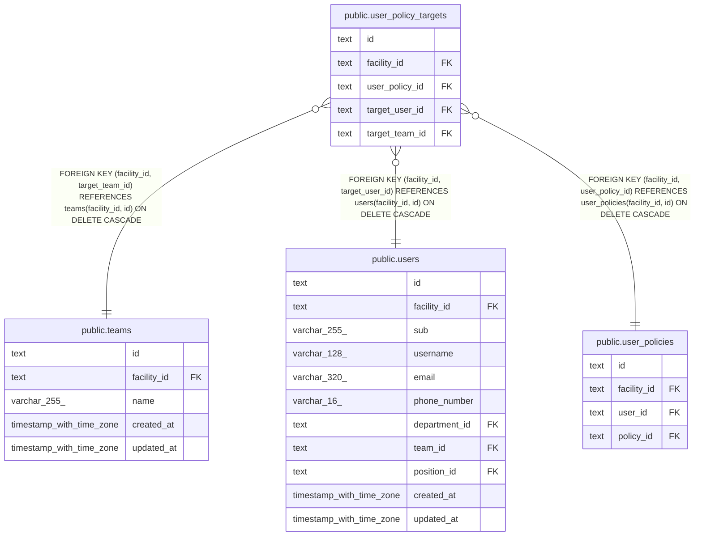

# public.user_policy_targets

## Description

職員の権限の対象

## Columns

| Name           | Type | Default | Nullable | Children | Parents                                                                                                         | Comment                  |
| -------------- | ---- | ------- | -------- | -------- | --------------------------------------------------------------------------------------------------------------- | ------------------------ |
| id             | text |         | false    |          |                                                                                                                 |                          |
| facility_id    | text |         | false    |          | [public.teams](public.teams.md) [public.users](public.users.md) [public.user_policies](public.user_policies.md) |                          |
| user_policy_id | text |         | false    |          | [public.user_policies](public.user_policies.md)                                                                 |                          |
| target_user_id | text |         | true     |          | [public.users](public.users.md)                                                                                 | 対象の職員。チームと排他 |
| target_team_id | text |         | true     |          | [public.teams](public.teams.md)                                                                                 | 対象のチーム。職員と排他 |

## Viewpoints

| Name                                | Definition                                                             |
| ----------------------------------- | ---------------------------------------------------------------------- |
| [職員と権限](viewpoint-policies.md) | 職員が持つ権限と、その対象。職員を登録するとき、役職の既定の権限を写す |

## Constraints

| Name                                        | Type        | Definition                                                                                            |
| ------------------------------------------- | ----------- | ----------------------------------------------------------------------------------------------------- |
| user_policy_targets_facility_id_not_null    | n           | NOT NULL facility_id                                                                                  |
| user_policy_targets_id_check                | CHECK       | CHECK ((id ~ '^[0-7][0-9A-HJKMNP-TV-Z]{25}$'::text))                                                  |
| user_policy_targets_id_not_null             | n           | NOT NULL id                                                                                           |
| user_policy_targets_one_check               | CHECK       | CHECK (((target_user_id IS NULL) <> (target_team_id IS NULL)))                                        |
| user_policy_targets_user_policy_id_not_null | n           | NOT NULL user_policy_id                                                                               |
| user_policy_targets_team_fkey               | FOREIGN KEY | FOREIGN KEY (facility_id, target_team_id) REFERENCES teams(facility_id, id) ON DELETE CASCADE         |
| user_policy_targets_user_fkey               | FOREIGN KEY | FOREIGN KEY (facility_id, target_user_id) REFERENCES users(facility_id, id) ON DELETE CASCADE         |
| user_policy_targets_user_policy_fkey        | FOREIGN KEY | FOREIGN KEY (facility_id, user_policy_id) REFERENCES user_policies(facility_id, id) ON DELETE CASCADE |
| user_policy_targets_pkey                    | PRIMARY KEY | PRIMARY KEY (id)                                                                                      |
| user_policy_targets_user_key                | UNIQUE      | UNIQUE (user_policy_id, target_user_id)                                                               |
| user_policy_targets_team_key                | UNIQUE      | UNIQUE (user_policy_id, target_team_id)                                                               |

## Indexes

| Name                                         | Definition                                                                                                                                                  |
| -------------------------------------------- | ----------------------------------------------------------------------------------------------------------------------------------------------------------- |
| user_policy_targets_pkey                     | CREATE UNIQUE INDEX user_policy_targets_pkey ON public.user_policy_targets USING btree (id)                                                                 |
| user_policy_targets_user_key                 | CREATE UNIQUE INDEX user_policy_targets_user_key ON public.user_policy_targets USING btree (user_policy_id, target_user_id)                                 |
| user_policy_targets_team_key                 | CREATE UNIQUE INDEX user_policy_targets_team_key ON public.user_policy_targets USING btree (user_policy_id, target_team_id)                                 |
| user_policy_targets_facility_user_policy_idx | CREATE INDEX user_policy_targets_facility_user_policy_idx ON public.user_policy_targets USING btree (facility_id, user_policy_id)                           |
| user_policy_targets_target_user_idx          | CREATE INDEX user_policy_targets_target_user_idx ON public.user_policy_targets USING btree (facility_id, target_user_id) WHERE (target_user_id IS NOT NULL) |
| user_policy_targets_target_team_idx          | CREATE INDEX user_policy_targets_target_team_idx ON public.user_policy_targets USING btree (facility_id, target_team_id) WHERE (target_team_id IS NOT NULL) |

## Relations

---

> Generated by [tbls](https://github.com/k1LoW/tbls)
