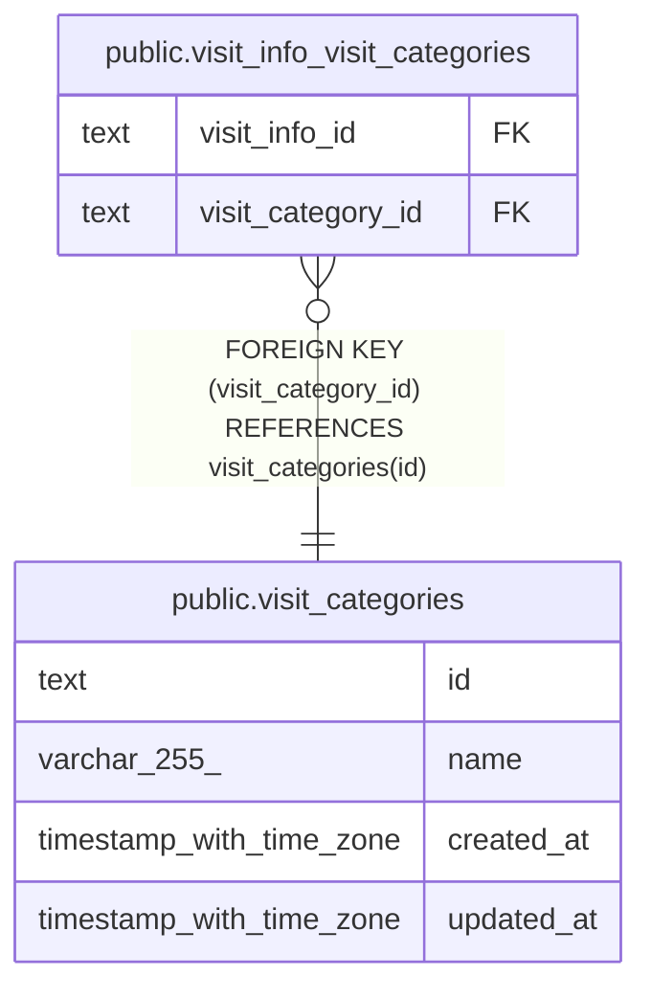

# public.visit_categories

## Description

訪問の区分（夜勤、緊急、入院）。マイグレーションで入れる

## Columns

| Name       | Type                     | Default | Nullable | Children                                                                    | Parents | Comment |
| ---------- | ------------------------ | ------- | -------- | --------------------------------------------------------------------------- | ------- | ------- |
| id         | text                     |         | false    | [public.visit_info_visit_categories](public.visit_info_visit_categories.md) |         |         |
| name       | varchar(255)             |         | false    |                                                                             |         |         |
| created_at | timestamp with time zone | now()   | false    |                                                                             |         |         |
| updated_at | timestamp with time zone | now()   | false    |                                                                             |         |         |

## Viewpoints

| Name                                 | Definition                                           |
| ------------------------------------ | ---------------------------------------------------- |
| [予定と訪問](viewpoint-schedules.md) | 予定と、訪問のときの訪問の情報と区分、予定の取り消し |

## Constraints

| Name                                 | Type        | Definition                                           |
| ------------------------------------ | ----------- | ---------------------------------------------------- |
| visit_categories_created_at_not_null | n           | NOT NULL created_at                                  |
| visit_categories_id_check            | CHECK       | CHECK ((id ~ '^[0-7][0-9A-HJKMNP-TV-Z]{25}$'::text)) |
| visit_categories_id_not_null         | n           | NOT NULL id                                          |
| visit_categories_name_not_null       | n           | NOT NULL name                                        |
| visit_categories_updated_at_not_null | n           | NOT NULL updated_at                                  |
| visit_categories_pkey                | PRIMARY KEY | PRIMARY KEY (id)                                     |
| visit_categories_name_key            | UNIQUE      | UNIQUE (name)                                        |

## Indexes

| Name                      | Definition                                                                                  |
| ------------------------- | ------------------------------------------------------------------------------------------- |
| visit_categories_pkey     | CREATE UNIQUE INDEX visit_categories_pkey ON public.visit_categories USING btree (id)       |
| visit_categories_name_key | CREATE UNIQUE INDEX visit_categories_name_key ON public.visit_categories USING btree (name) |

## Triggers

| Name                            | Definition                                                                                                                             |
| ------------------------------- | -------------------------------------------------------------------------------------------------------------------------------------- |
| visit_categories_set_updated_at | CREATE TRIGGER visit_categories_set_updated_at BEFORE UPDATE ON public.visit_categories FOR EACH ROW EXECUTE FUNCTION set_updated_at() |

## Relations

---

> Generated by [tbls](https://github.com/k1LoW/tbls)
