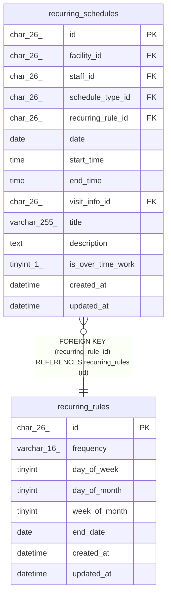

# recurring_rules

## Description

繰り返しの規則

<details>
<summary><strong>Table Definition</strong></summary>

```sql
CREATE TABLE `recurring_rules` (
  `id` char(26) NOT NULL,
  `frequency` varchar(16) NOT NULL,
  `day_of_week` tinyint DEFAULT NULL,
  `day_of_month` tinyint DEFAULT NULL,
  `week_of_month` tinyint DEFAULT NULL,
  `end_date` date DEFAULT NULL,
  `created_at` datetime NOT NULL DEFAULT CURRENT_TIMESTAMP,
  `updated_at` datetime NOT NULL DEFAULT CURRENT_TIMESTAMP ON UPDATE CURRENT_TIMESTAMP,
  PRIMARY KEY (`id`),
  CONSTRAINT `chk_recurring_rules_frequency` CHECK ((`frequency` in (_utf8mb4'weekly',_utf8mb4'monthly')))
) ENGINE=InnoDB DEFAULT CHARSET=utf8mb4 COLLATE=utf8mb4_0900_ai_ci
```

</details>

## Columns

| Name          | Type        | Default           | Nullable | Extra Definition                              | Children                                      | Parents | Comment             |
| ------------- | ----------- | ----------------- | -------- | --------------------------------------------- | --------------------------------------------- | ------- | ------------------- |
| id            | char(26)    |                   | false    |                                               | [recurring_schedules](recurring_schedules.md) |         |                     |
| frequency     | varchar(16) |                   | false    |                                               |                                               |         | weekly、monthly     |
| day_of_week   | tinyint     |                   | true     |                                               |                                               |         | 1（月曜）から 7     |
| day_of_month  | tinyint     |                   | true     |                                               |                                               |         | 1 から 31           |
| week_of_month | tinyint     |                   | true     |                                               |                                               |         | 1 から 5            |
| end_date      | date        |                   | true     |                                               |                                               |         | NULL なら終わりなし |
| created_at    | datetime    | CURRENT_TIMESTAMP | false    | DEFAULT_GENERATED                             |                                               |         |                     |
| updated_at    | datetime    | CURRENT_TIMESTAMP | false    | DEFAULT_GENERATED on update CURRENT_TIMESTAMP |                                               |         |                     |

## Viewpoints

| Name                                     | Definition                                                                             |
| ---------------------------------------- | -------------------------------------------------------------------------------------- |
| [繰り返しの予定](viewpoint-recurring.md) | 繰り返しの規則と予定、回にしない日。繰り返しの 1 回を置き換えた予定は schedules に入る |

## Constraints

| Name                          | Type        | Definition                                                        |
| ----------------------------- | ----------- | ----------------------------------------------------------------- |
| PRIMARY                       | PRIMARY KEY | PRIMARY KEY (id)                                                  |
| chk_recurring_rules_frequency | CHECK       | CHECK ((`frequency` in (_utf8mb4\'weekly\',_utf8mb4\'monthly\'))) |

## Indexes

| Name    | Definition                   |
| ------- | ---------------------------- |
| PRIMARY | PRIMARY KEY (id) USING BTREE |

## Relations



---

> Generated by [tbls](https://github.com/k1LoW/tbls)
