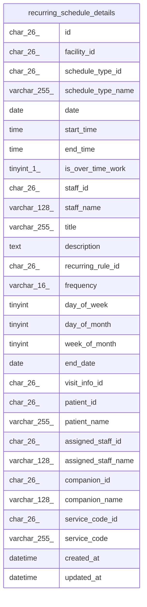

# recurring_schedule_details

## Description

一覧の読み出しに使う、繰り返しの予定と訪問の情報と名前を結合したビュー

<details>
<summary><strong>Table Definition</strong></summary>

```sql
CREATE VIEW recurring_schedule_details AS (select `rs`.`id` AS `id`,`rs`.`facility_id` AS `facility_id`,`rs`.`schedule_type_id` AS `schedule_type_id`,`st`.`name` AS `schedule_type_name`,`rs`.`date` AS `date`,`rs`.`start_time` AS `start_time`,`rs`.`end_time` AS `end_time`,`rs`.`is_over_time_work` AS `is_over_time_work`,`rs`.`staff_id` AS `staff_id`,`u`.`username` AS `staff_name`,`rs`.`title` AS `title`,`rs`.`description` AS `description`,`rs`.`recurring_rule_id` AS `recurring_rule_id`,`rr`.`frequency` AS `frequency`,`rr`.`day_of_week` AS `day_of_week`,`rr`.`day_of_month` AS `day_of_month`,`rr`.`week_of_month` AS `week_of_month`,`rr`.`end_date` AS `end_date`,`rs`.`visit_info_id` AS `visit_info_id`,`buddy`.`vid`.`patient_id` AS `patient_id`,`buddy`.`vid`.`patient_name` AS `patient_name`,`buddy`.`vid`.`assigned_staff_id` AS `assigned_staff_id`,`buddy`.`vid`.`assigned_staff_name` AS `assigned_staff_name`,`buddy`.`vid`.`companion_id` AS `companion_id`,`buddy`.`vid`.`companion_name` AS `companion_name`,`buddy`.`vid`.`service_code_id` AS `service_code_id`,`buddy`.`vid`.`service_code` AS `service_code`,`rs`.`created_at` AS `created_at`,`rs`.`updated_at` AS `updated_at` from ((((`buddy`.`recurring_schedules` `rs` join `buddy`.`schedule_types` `st` on((`st`.`id` = `rs`.`schedule_type_id`))) join `buddy`.`users` `u` on((`u`.`id` = `rs`.`staff_id`))) join `buddy`.`recurring_rules` `rr` on((`rr`.`id` = `rs`.`recurring_rule_id`))) left join `buddy`.`visit_info_details` `vid` on((`buddy`.`vid`.`id` = `rs`.`visit_info_id`))))
```

</details>

## Columns

| Name                | Type         | Default           | Nullable | Extra Definition                              | Children | Parents | Comment |
| ------------------- | ------------ | ----------------- | -------- | --------------------------------------------- | -------- | ------- | ------- |
| id                  | char(26)     |                   | false    |                                               |          |         |         |
| facility_id         | char(26)     |                   | false    |                                               |          |         |         |
| schedule_type_id    | char(26)     |                   | false    |                                               |          |         |         |
| schedule_type_name  | varchar(255) |                   | false    |                                               |          |         |         |
| date                | date         |                   | false    |                                               |          |         |         |
| start_time          | time         |                   | false    |                                               |          |         |         |
| end_time            | time         |                   | false    |                                               |          |         |         |
| is_over_time_work   | tinyint(1)   | 0                 | false    |                                               |          |         |         |
| staff_id            | char(26)     |                   | false    |                                               |          |         |         |
| staff_name          | varchar(128) |                   | false    |                                               |          |         |         |
| title               | varchar(255) |                   | true     |                                               |          |         |         |
| description         | text         |                   | true     |                                               |          |         |         |
| recurring_rule_id   | char(26)     |                   | false    |                                               |          |         |         |
| frequency           | varchar(16)  |                   | false    |                                               |          |         |         |
| day_of_week         | tinyint      |                   | true     |                                               |          |         |         |
| day_of_month        | tinyint      |                   | true     |                                               |          |         |         |
| week_of_month       | tinyint      |                   | true     |                                               |          |         |         |
| end_date            | date         |                   | true     |                                               |          |         |         |
| visit_info_id       | char(26)     |                   | true     |                                               |          |         |         |
| patient_id          | char(26)     |                   | true     |                                               |          |         |         |
| patient_name        | varchar(255) |                   | true     |                                               |          |         |         |
| assigned_staff_id   | char(26)     |                   | true     |                                               |          |         |         |
| assigned_staff_name | varchar(128) |                   | true     |                                               |          |         |         |
| companion_id        | char(26)     |                   | true     |                                               |          |         |         |
| companion_name      | varchar(128) |                   | true     |                                               |          |         |         |
| service_code_id     | char(26)     |                   | true     |                                               |          |         |         |
| service_code        | varchar(255) |                   | true     |                                               |          |         |         |
| created_at          | datetime     | CURRENT_TIMESTAMP | false    | DEFAULT_GENERATED                             |          |         |         |
| updated_at          | datetime     | CURRENT_TIMESTAMP | false    | DEFAULT_GENERATED on update CURRENT_TIMESTAMP |          |         |         |

## Referenced Tables

| Name                                          | Columns | Comment                                            | Type       |
| --------------------------------------------- | ------- | -------------------------------------------------- | ---------- |
| [recurring_schedules](recurring_schedules.md) | 14      | 繰り返しの予定                                     | BASE TABLE |
| [schedule_types](schedule_types.md)           | 4       | 予定の種類（通常、訪問）。マイグレーションで入れる | BASE TABLE |
| [users](users.md)                             | 11      | 職員                                               | BASE TABLE |
| [recurring_rules](recurring_rules.md)         | 8       | 繰り返しの規則                                     | BASE TABLE |
| [visit_info_details](visit_info_details.md)   | 9       | 訪問の情報と名前を結合したビュー                   | VIEW       |

## Relations



---

> Generated by [tbls](https://github.com/k1LoW/tbls)
