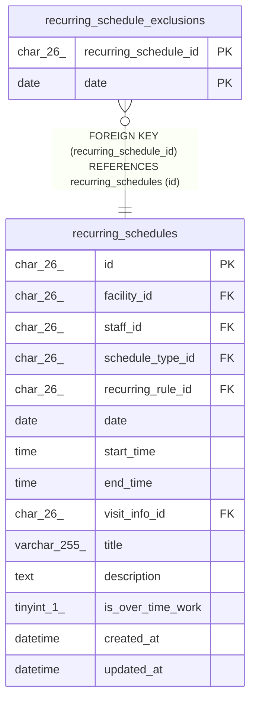

# recurring_schedule_exclusions

## Description

繰り返しの予定のうち、回にしない日

<details>
<summary><strong>Table Definition</strong></summary>

```sql
CREATE TABLE `recurring_schedule_exclusions` (
  `recurring_schedule_id` char(26) NOT NULL,
  `date` date NOT NULL,
  PRIMARY KEY (`recurring_schedule_id`,`date`),
  CONSTRAINT `fk_rse_recurring_schedule` FOREIGN KEY (`recurring_schedule_id`) REFERENCES `recurring_schedules` (`id`) ON DELETE CASCADE
) ENGINE=InnoDB DEFAULT CHARSET=utf8mb4 COLLATE=utf8mb4_0900_ai_ci
```

</details>

## Columns

| Name                  | Type     | Default | Nullable | Children | Parents                                       | Comment |
| --------------------- | -------- | ------- | -------- | -------- | --------------------------------------------- | ------- |
| recurring_schedule_id | char(26) |         | false    |          | [recurring_schedules](recurring_schedules.md) |         |
| date                  | date     |         | false    |          |                                               |         |

## Constraints

| Name                      | Type        | Definition                                                              |
| ------------------------- | ----------- | ----------------------------------------------------------------------- |
| fk_rse_recurring_schedule | FOREIGN KEY | FOREIGN KEY (recurring_schedule_id) REFERENCES recurring_schedules (id) |
| PRIMARY                   | PRIMARY KEY | PRIMARY KEY (recurring_schedule_id, date)                               |

## Indexes

| Name    | Definition                                            |
| ------- | ----------------------------------------------------- |
| PRIMARY | PRIMARY KEY (recurring_schedule_id, date) USING BTREE |

## Relations



---

> Generated by [tbls](https://github.com/k1LoW/tbls)
