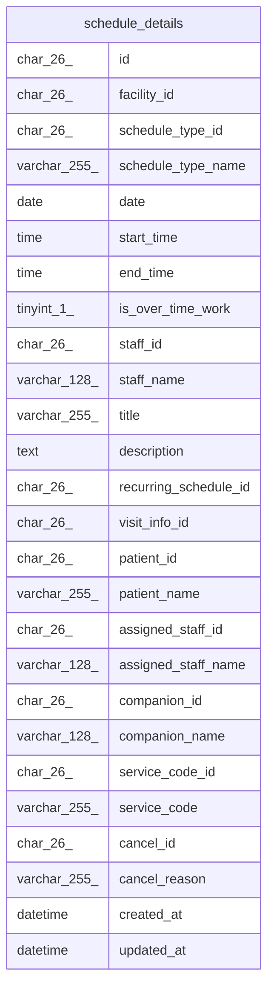

# schedule_details

## Description

一覧の読み出しに使う、予定と訪問の情報と名前を結合したビュー

<details>
<summary><strong>Table Definition</strong></summary>

```sql
CREATE VIEW schedule_details AS (select `s`.`id` AS `id`,`s`.`facility_id` AS `facility_id`,`s`.`schedule_type_id` AS `schedule_type_id`,`st`.`name` AS `schedule_type_name`,`s`.`date` AS `date`,`s`.`start_time` AS `start_time`,`s`.`end_time` AS `end_time`,`s`.`is_over_time_work` AS `is_over_time_work`,`s`.`staff_id` AS `staff_id`,`u`.`username` AS `staff_name`,`s`.`title` AS `title`,`s`.`description` AS `description`,`s`.`recurring_schedule_id` AS `recurring_schedule_id`,`s`.`visit_info_id` AS `visit_info_id`,`buddy`.`vid`.`patient_id` AS `patient_id`,`buddy`.`vid`.`patient_name` AS `patient_name`,`buddy`.`vid`.`assigned_staff_id` AS `assigned_staff_id`,`buddy`.`vid`.`assigned_staff_name` AS `assigned_staff_name`,`buddy`.`vid`.`companion_id` AS `companion_id`,`buddy`.`vid`.`companion_name` AS `companion_name`,`buddy`.`vid`.`service_code_id` AS `service_code_id`,`buddy`.`vid`.`service_code` AS `service_code`,`c`.`id` AS `cancel_id`,`c`.`reason` AS `cancel_reason`,`s`.`created_at` AS `created_at`,`s`.`updated_at` AS `updated_at` from ((((`buddy`.`schedules` `s` join `buddy`.`schedule_types` `st` on((`st`.`id` = `s`.`schedule_type_id`))) join `buddy`.`users` `u` on((`u`.`id` = `s`.`staff_id`))) left join `buddy`.`visit_info_details` `vid` on((`buddy`.`vid`.`id` = `s`.`visit_info_id`))) left join `buddy`.`schedule_cancels` `c` on((`c`.`schedule_id` = `s`.`id`))))
```

</details>

## Columns

| Name                  | Type         | Default           | Nullable | Extra Definition                              | Children | Parents | Comment |
| --------------------- | ------------ | ----------------- | -------- | --------------------------------------------- | -------- | ------- | ------- |
| id                    | char(26)     |                   | false    |                                               |          |         |         |
| facility_id           | char(26)     |                   | false    |                                               |          |         |         |
| schedule_type_id      | char(26)     |                   | false    |                                               |          |         |         |
| schedule_type_name    | varchar(255) |                   | false    |                                               |          |         |         |
| date                  | date         |                   | false    |                                               |          |         |         |
| start_time            | time         |                   | false    |                                               |          |         |         |
| end_time              | time         |                   | false    |                                               |          |         |         |
| is_over_time_work     | tinyint(1)   | 0                 | false    |                                               |          |         |         |
| staff_id              | char(26)     |                   | false    |                                               |          |         |         |
| staff_name            | varchar(128) |                   | false    |                                               |          |         |         |
| title                 | varchar(255) |                   | true     |                                               |          |         |         |
| description           | text         |                   | true     |                                               |          |         |         |
| recurring_schedule_id | char(26)     |                   | true     |                                               |          |         |         |
| visit_info_id         | char(26)     |                   | true     |                                               |          |         |         |
| patient_id            | char(26)     |                   | true     |                                               |          |         |         |
| patient_name          | varchar(255) |                   | true     |                                               |          |         |         |
| assigned_staff_id     | char(26)     |                   | true     |                                               |          |         |         |
| assigned_staff_name   | varchar(128) |                   | true     |                                               |          |         |         |
| companion_id          | char(26)     |                   | true     |                                               |          |         |         |
| companion_name        | varchar(128) |                   | true     |                                               |          |         |         |
| service_code_id       | char(26)     |                   | true     |                                               |          |         |         |
| service_code          | varchar(255) |                   | true     |                                               |          |         |         |
| cancel_id             | char(26)     |                   | true     |                                               |          |         |         |
| cancel_reason         | varchar(255) |                   | true     |                                               |          |         |         |
| created_at            | datetime     | CURRENT_TIMESTAMP | false    | DEFAULT_GENERATED                             |          |         |         |
| updated_at            | datetime     | CURRENT_TIMESTAMP | false    | DEFAULT_GENERATED on update CURRENT_TIMESTAMP |          |         |         |

## Referenced Tables

| Name                                        | Columns | Comment                                            | Type       |
| ------------------------------------------- | ------- | -------------------------------------------------- | ---------- |
| [schedules](schedules.md)                   | 14      | 予定                                               | BASE TABLE |
| [schedule_types](schedule_types.md)         | 4       | 予定の種類（通常、訪問）。マイグレーションで入れる | BASE TABLE |
| [users](users.md)                           | 11      | 職員                                               | BASE TABLE |
| [visit_info_details](visit_info_details.md) | 9       | 訪問の情報と名前を結合したビュー                   | VIEW       |
| [schedule_cancels](schedule_cancels.md)     | 5       | 予定の取り消し                                     | BASE TABLE |

## Viewpoints

| Name                                 | Definition                                           |
| ------------------------------------ | ---------------------------------------------------- |
| [予定と訪問](viewpoint-schedules.md) | 予定と、訪問のときの訪問の情報と区分、予定の取り消し |

## Relations



---

> Generated by [tbls](https://github.com/k1LoW/tbls)
