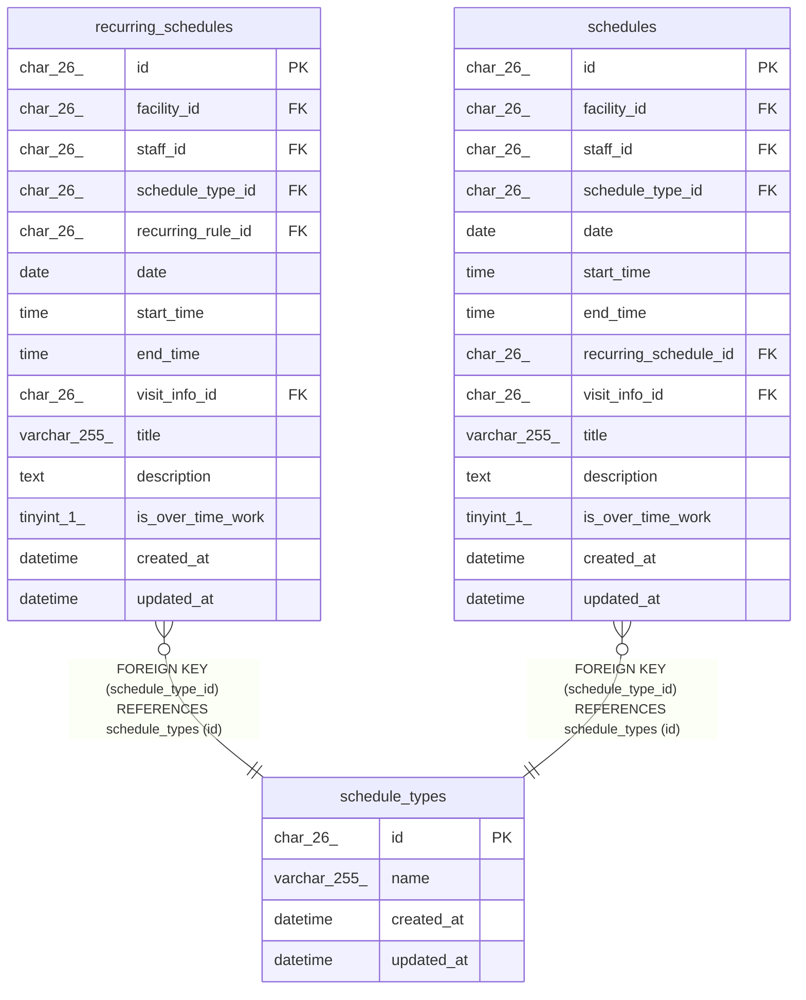

# schedule_types

## Description

予定の種類（通常、訪問）。マイグレーションで入れる

<details>
<summary><strong>Table Definition</strong></summary>

```sql
CREATE TABLE `schedule_types` (
  `id` char(26) NOT NULL,
  `name` varchar(255) NOT NULL,
  `created_at` datetime NOT NULL DEFAULT CURRENT_TIMESTAMP,
  `updated_at` datetime NOT NULL DEFAULT CURRENT_TIMESTAMP ON UPDATE CURRENT_TIMESTAMP,
  PRIMARY KEY (`id`),
  UNIQUE KEY `uq_schedule_types_name` (`name`)
) ENGINE=InnoDB DEFAULT CHARSET=utf8mb4 COLLATE=utf8mb4_0900_ai_ci
```

</details>

## Columns

| Name       | Type         | Default           | Nullable | Extra Definition                              | Children                                                                | Parents | Comment |
| ---------- | ------------ | ----------------- | -------- | --------------------------------------------- | ----------------------------------------------------------------------- | ------- | ------- |
| id         | char(26)     |                   | false    |                                               | [recurring_schedules](recurring_schedules.md) [schedules](schedules.md) |         |         |
| name       | varchar(255) |                   | false    |                                               |                                                                         |         |         |
| created_at | datetime     | CURRENT_TIMESTAMP | false    | DEFAULT_GENERATED                             |                                                                         |         |         |
| updated_at | datetime     | CURRENT_TIMESTAMP | false    | DEFAULT_GENERATED on update CURRENT_TIMESTAMP |                                                                         |         |         |

## Viewpoints

| Name                                     | Definition                                                                             |
| ---------------------------------------- | -------------------------------------------------------------------------------------- |
| [予定と訪問](viewpoint-schedules.md)     | 予定と、訪問のときの訪問の情報と区分、予定の取り消し                                   |
| [繰り返しの予定](viewpoint-recurring.md) | 繰り返しの規則と予定、回にしない日。繰り返しの 1 回を置き換えた予定は schedules に入る |

## Constraints

| Name                   | Type        | Definition                               |
| ---------------------- | ----------- | ---------------------------------------- |
| PRIMARY                | PRIMARY KEY | PRIMARY KEY (id)                         |
| uq_schedule_types_name | UNIQUE      | UNIQUE KEY uq_schedule_types_name (name) |

## Indexes

| Name                   | Definition                                           |
| ---------------------- | ---------------------------------------------------- |
| PRIMARY                | PRIMARY KEY (id) USING BTREE                         |
| uq_schedule_types_name | UNIQUE KEY uq_schedule_types_name (name) USING BTREE |

## Relations



---

> Generated by [tbls](https://github.com/k1LoW/tbls)
