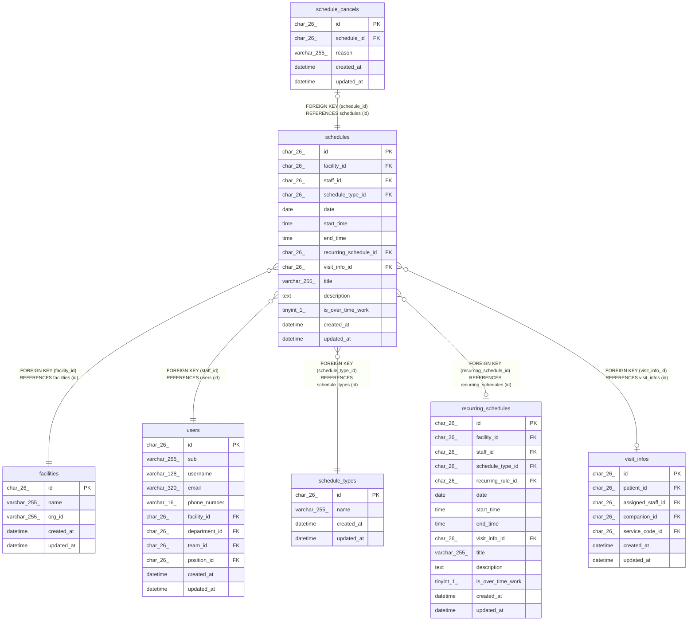

# schedules

## Description

予定

<details>
<summary><strong>Table Definition</strong></summary>

```sql
CREATE TABLE `schedules` (
  `id` char(26) NOT NULL,
  `facility_id` char(26) NOT NULL,
  `staff_id` char(26) NOT NULL,
  `schedule_type_id` char(26) NOT NULL,
  `date` date NOT NULL,
  `start_time` time NOT NULL,
  `end_time` time NOT NULL,
  `recurring_schedule_id` char(26) DEFAULT NULL,
  `visit_info_id` char(26) DEFAULT NULL,
  `title` varchar(255) DEFAULT NULL,
  `description` text,
  `is_over_time_work` tinyint(1) NOT NULL DEFAULT '0',
  `created_at` datetime NOT NULL DEFAULT CURRENT_TIMESTAMP,
  `updated_at` datetime NOT NULL DEFAULT CURRENT_TIMESTAMP ON UPDATE CURRENT_TIMESTAMP,
  PRIMARY KEY (`id`),
  KEY `idx_schedules_facility_date` (`facility_id`,`date`),
  KEY `fk_schedules_staff` (`staff_id`),
  KEY `fk_schedules_type` (`schedule_type_id`),
  KEY `fk_schedules_recurring_schedule` (`recurring_schedule_id`),
  KEY `fk_schedules_visit_info` (`visit_info_id`),
  CONSTRAINT `fk_schedules_facility` FOREIGN KEY (`facility_id`) REFERENCES `facilities` (`id`),
  CONSTRAINT `fk_schedules_recurring_schedule` FOREIGN KEY (`recurring_schedule_id`) REFERENCES `recurring_schedules` (`id`),
  CONSTRAINT `fk_schedules_staff` FOREIGN KEY (`staff_id`) REFERENCES `users` (`id`),
  CONSTRAINT `fk_schedules_type` FOREIGN KEY (`schedule_type_id`) REFERENCES `schedule_types` (`id`),
  CONSTRAINT `fk_schedules_visit_info` FOREIGN KEY (`visit_info_id`) REFERENCES `visit_infos` (`id`)
) ENGINE=InnoDB DEFAULT CHARSET=utf8mb4 COLLATE=utf8mb4_0900_ai_ci
```

</details>

## Columns

| Name                  | Type         | Default           | Nullable | Extra Definition                              | Children                                | Parents                                       | Comment                             |
| --------------------- | ------------ | ----------------- | -------- | --------------------------------------------- | --------------------------------------- | --------------------------------------------- | ----------------------------------- |
| id                    | char(26)     |                   | false    |                                               | [schedule_cancels](schedule_cancels.md) |                                               |                                     |
| facility_id           | char(26)     |                   | false    |                                               |                                         | [facilities](facilities.md)                   |                                     |
| staff_id              | char(26)     |                   | false    |                                               |                                         | [users](users.md)                             |                                     |
| schedule_type_id      | char(26)     |                   | false    |                                               |                                         | [schedule_types](schedule_types.md)           |                                     |
| date                  | date         |                   | false    |                                               |                                         |                                               |                                     |
| start_time            | time         |                   | false    |                                               |                                         |                                               |                                     |
| end_time              | time         |                   | false    |                                               |                                         |                                               |                                     |
| recurring_schedule_id | char(26)     |                   | true     |                                               |                                         | [recurring_schedules](recurring_schedules.md) | 繰り返しの 1 回を置き換えたときだけ |
| visit_info_id         | char(26)     |                   | true     |                                               |                                         | [visit_infos](visit_infos.md)                 | 訪問のときだけ                      |
| title                 | varchar(255) |                   | true     |                                               |                                         |                                               |                                     |
| description           | text         |                   | true     |                                               |                                         |                                               |                                     |
| is_over_time_work     | tinyint(1)   | 0                 | false    |                                               |                                         |                                               | 開始が 17 時以降                    |
| created_at            | datetime     | CURRENT_TIMESTAMP | false    | DEFAULT_GENERATED                             |                                         |                                               |                                     |
| updated_at            | datetime     | CURRENT_TIMESTAMP | false    | DEFAULT_GENERATED on update CURRENT_TIMESTAMP |                                         |                                               |                                     |

## Viewpoints

| Name                                     | Definition                                                                             |
| ---------------------------------------- | -------------------------------------------------------------------------------------- |
| [予定と訪問](viewpoint-schedules.md)     | 予定と、訪問のときの訪問の情報と区分、予定の取り消し                                   |
| [繰り返しの予定](viewpoint-recurring.md) | 繰り返しの規則と予定、回にしない日。繰り返しの 1 回を置き換えた予定は schedules に入る |

## Constraints

| Name                            | Type        | Definition                                                              |
| ------------------------------- | ----------- | ----------------------------------------------------------------------- |
| fk_schedules_facility           | FOREIGN KEY | FOREIGN KEY (facility_id) REFERENCES facilities (id)                    |
| fk_schedules_recurring_schedule | FOREIGN KEY | FOREIGN KEY (recurring_schedule_id) REFERENCES recurring_schedules (id) |
| fk_schedules_staff              | FOREIGN KEY | FOREIGN KEY (staff_id) REFERENCES users (id)                            |
| fk_schedules_type               | FOREIGN KEY | FOREIGN KEY (schedule_type_id) REFERENCES schedule_types (id)           |
| fk_schedules_visit_info         | FOREIGN KEY | FOREIGN KEY (visit_info_id) REFERENCES visit_infos (id)                 |
| PRIMARY                         | PRIMARY KEY | PRIMARY KEY (id)                                                        |

## Indexes

| Name                            | Definition                                                              |
| ------------------------------- | ----------------------------------------------------------------------- |
| fk_schedules_recurring_schedule | KEY fk_schedules_recurring_schedule (recurring_schedule_id) USING BTREE |
| fk_schedules_staff              | KEY fk_schedules_staff (staff_id) USING BTREE                           |
| fk_schedules_type               | KEY fk_schedules_type (schedule_type_id) USING BTREE                    |
| fk_schedules_visit_info         | KEY fk_schedules_visit_info (visit_info_id) USING BTREE                 |
| idx_schedules_facility_date     | KEY idx_schedules_facility_date (facility_id, date) USING BTREE         |
| PRIMARY                         | PRIMARY KEY (id) USING BTREE                                            |

## Relations



---

> Generated by [tbls](https://github.com/k1LoW/tbls)
