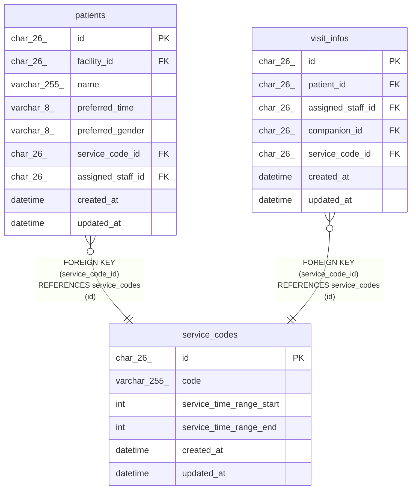

# service_codes

## Description

サービスコード。マイグレーションで入れる

<details>
<summary><strong>Table Definition</strong></summary>

```sql
CREATE TABLE `service_codes` (
  `id` char(26) NOT NULL,
  `code` varchar(255) NOT NULL,
  `service_time_range_start` int NOT NULL,
  `service_time_range_end` int NOT NULL,
  `created_at` datetime NOT NULL DEFAULT CURRENT_TIMESTAMP,
  `updated_at` datetime NOT NULL DEFAULT CURRENT_TIMESTAMP ON UPDATE CURRENT_TIMESTAMP,
  PRIMARY KEY (`id`),
  UNIQUE KEY `uq_service_codes_code` (`code`)
) ENGINE=InnoDB DEFAULT CHARSET=utf8mb4 COLLATE=utf8mb4_0900_ai_ci
```

</details>

## Columns

| Name                     | Type         | Default           | Nullable | Extra Definition                              | Children                                              | Parents | Comment                                            |
| ------------------------ | ------------ | ----------------- | -------- | --------------------------------------------- | ----------------------------------------------------- | ------- | -------------------------------------------------- |
| id                       | char(26)     |                   | false    |                                               | [patients](patients.md) [visit_infos](visit_infos.md) |         |                                                    |
| code                     | varchar(255) |                   | false    |                                               |                                                       |         | 例は 訪看I2、訪看I3                                |
| service_time_range_start | int          |                   | false    |                                               |                                                       |         | 提供時間の範囲の下限（分）。照合の許容範囲と同じ値 |
| service_time_range_end   | int          |                   | false    |                                               |                                                       |         | 提供時間の範囲の上限（分）。照合の許容範囲と同じ値 |
| created_at               | datetime     | CURRENT_TIMESTAMP | false    | DEFAULT_GENERATED                             |                                                       |         |                                                    |
| updated_at               | datetime     | CURRENT_TIMESTAMP | false    | DEFAULT_GENERATED on update CURRENT_TIMESTAMP |                                                       |         |                                                    |

## Viewpoints

| Name                            | Definition                                       |
| ------------------------------- | ------------------------------------------------ |
| [利用者](viewpoint-patients.md) | 利用者と、受けているサービスと、主に担当する職員 |

## Constraints

| Name                  | Type        | Definition                              |
| --------------------- | ----------- | --------------------------------------- |
| PRIMARY               | PRIMARY KEY | PRIMARY KEY (id)                        |
| uq_service_codes_code | UNIQUE      | UNIQUE KEY uq_service_codes_code (code) |

## Indexes

| Name                  | Definition                                          |
| --------------------- | --------------------------------------------------- |
| PRIMARY               | PRIMARY KEY (id) USING BTREE                        |
| uq_service_codes_code | UNIQUE KEY uq_service_codes_code (code) USING BTREE |

## Relations



---

> Generated by [tbls](https://github.com/k1LoW/tbls)
