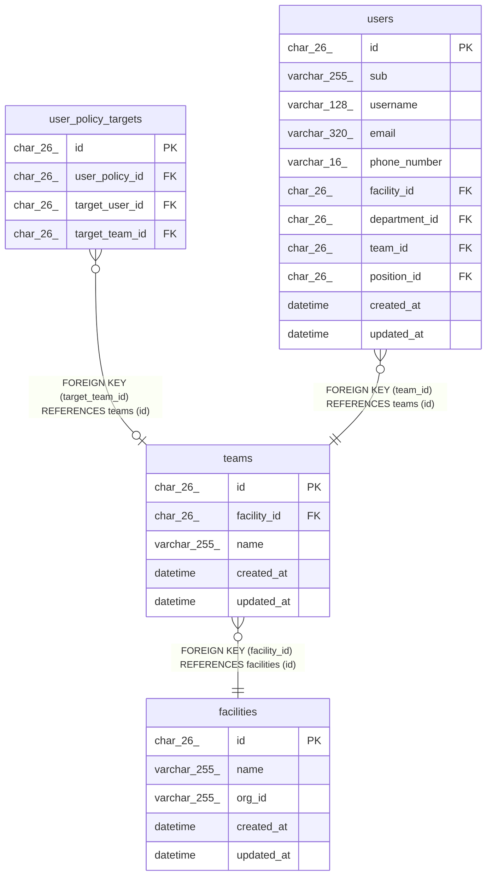

# teams

## Description

事業所のチーム

<details>
<summary><strong>Table Definition</strong></summary>

```sql
CREATE TABLE `teams` (
  `id` char(26) NOT NULL,
  `facility_id` char(26) NOT NULL,
  `name` varchar(255) NOT NULL,
  `created_at` datetime NOT NULL DEFAULT CURRENT_TIMESTAMP,
  `updated_at` datetime NOT NULL DEFAULT CURRENT_TIMESTAMP ON UPDATE CURRENT_TIMESTAMP,
  PRIMARY KEY (`id`),
  UNIQUE KEY `uq_teams_facility_name` (`facility_id`,`name`),
  CONSTRAINT `fk_teams_facility` FOREIGN KEY (`facility_id`) REFERENCES `facilities` (`id`)
) ENGINE=InnoDB DEFAULT CHARSET=utf8mb4 COLLATE=utf8mb4_0900_ai_ci
```

</details>

## Columns

| Name        | Type         | Default           | Nullable | Extra Definition                              | Children                                                        | Parents                     | Comment          |
| ----------- | ------------ | ----------------- | -------- | --------------------------------------------- | --------------------------------------------------------------- | --------------------------- | ---------------- |
| id          | char(26)     |                   | false    |                                               | [user_policy_targets](user_policy_targets.md) [users](users.md) |                             |                  |
| facility_id | char(26)     |                   | false    |                                               |                                                                 | [facilities](facilities.md) |                  |
| name        | varchar(255) |                   | false    |                                               |                                                                 |                             | 事業所の中で一意 |
| created_at  | datetime     | CURRENT_TIMESTAMP | false    | DEFAULT_GENERATED                             |                                                                 |                             |                  |
| updated_at  | datetime     | CURRENT_TIMESTAMP | false    | DEFAULT_GENERATED on update CURRENT_TIMESTAMP |                                                                 |                             |                  |

## Constraints

| Name                   | Type        | Definition                                            |
| ---------------------- | ----------- | ----------------------------------------------------- |
| fk_teams_facility      | FOREIGN KEY | FOREIGN KEY (facility_id) REFERENCES facilities (id)  |
| PRIMARY                | PRIMARY KEY | PRIMARY KEY (id)                                      |
| uq_teams_facility_name | UNIQUE      | UNIQUE KEY uq_teams_facility_name (facility_id, name) |

## Indexes

| Name                   | Definition                                                        |
| ---------------------- | ----------------------------------------------------------------- |
| PRIMARY                | PRIMARY KEY (id) USING BTREE                                      |
| uq_teams_facility_name | UNIQUE KEY uq_teams_facility_name (facility_id, name) USING BTREE |

## Relations



---

> Generated by [tbls](https://github.com/k1LoW/tbls)
